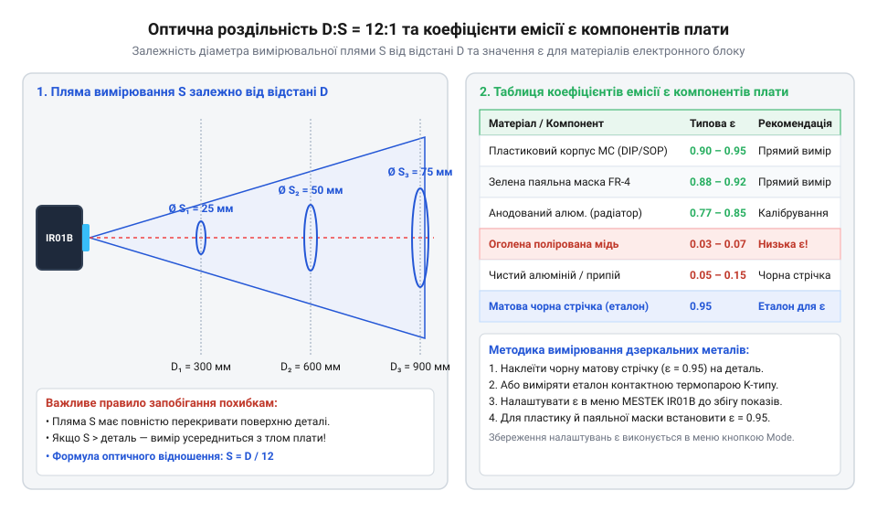
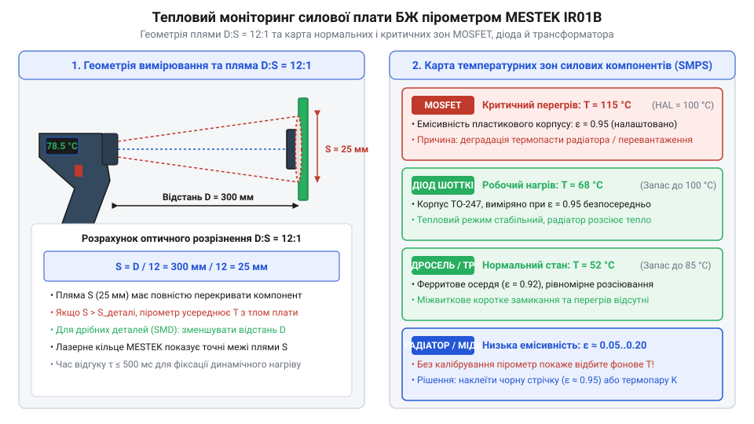

# Проєкт теплової діагностики силового блоку живлення та друкованої плати

<preknowlist>
- [Штангенциркуль](root:cat-hw-instruments/vernier-caliper) — Вимірювання геометричних розмірів компонентів та відстаней для точного розрахунку плями за співвідношенням D:S.
</preknowlist>

## Підготовка та безпечна робота під напругою

Безконтактний тепломпекційний моніторинг імпульсних блоків живлення — @@en|SMPS@@ (англ. @@en|SMPS@@, від *Switched-Mode Power Supply*) — уможливлює виявлення прихованих дефектів до настання аварійного пробою. Однак обстеження силової плати під навантаженням супроводжується ризиком ураження високою напругою та термічних опіків від розпечених радіаторів.

Головна небезпека первинного кола полягає у наявності високовольтного постійного потенціалу на первинному згладжувальному конденсаторі. Після мостового випрямляча амплітудна напруга `V_DC` розраховується через ефективну мережеву напругу `V_AC = 220.0 В`:

V_DC = V_AC × √2
= 220.0 × 1.4142          [множення ефективної напруги мережі на корінь з двох]
= 311.12                  [амплітудне значення напруги на конденсаторі у вольтах]

Накопичена у конденсаторі ємністю `C = 220 мкФ` енергія електричного поля `E` створює високий ризик дугового спалаху та термічного вибуху при випадковому короткому замиканні:

E = (C × V_DC²) ÷ 2
= (220 × 10⁻⁶ × 311.12²) ÷ 2   [підстановка ємності конденсатора та напруги]
= (0.00022 × 96795.65) ÷ 2     [обчислення квадрата напруги та добутку з ємністю]
= 10.65                        [запасена енергія розряду у джоулях]

Миттєвий розряд енергії у 10.65 Дж через випадковий контакт металевого інструмента спричиняє потужний дуговий спалах, розприскування розплавленого металу та вихід з ладу вимірювальних приладів.

Потенціал понад 310 В постійного струму є смертельно небезпечним, а відкриті струмоведучі шини та виводи силових ключів перебувають під високою частотною напругою. Для безпечного вимірювання дотримуються таких правил:
- **Гальванічна розв'язка та навантаження**: блок живлення підключають через роздільний трансформатор 220/220 В, а як навантаження застосовують регульований еквівалент навантаження, винесений за межі зони заміру.
- **Безпечний дистанційний доступ**: вимірювання виконують без фізичного контакту із силовою платою за допомогою пірометра MESTEK IR01B з відстані 15–30 см, унеможливлюючи випадкове торкання високовольтних вузлів.
- **Підготовка робочого місця**: плату розміщують на діелектричному килимку, а ввімкнення та зміну режимів навантаження здійснюють дистанційно або через захисні вимикачі.

Після вимкнення живлення високовольтний первинний конденсатор зберігає залишковий потенціал понад 310 В, якщо розрядний резистор несправний або відсутній у схемі. Пряме закорочування виводів конденсатора викруткою неприпустиме, оскільки іскровий розряд випалює мідні доріжки та руйнує обкладки. Для безпечного обслуговування накопичувач розряджають через потужний керамічний резистор опором 1–2.2 кОм (потужністю 5–10 Вт), приєднаний ізольованими щупами до клем на 5–10 секунд. Завершальним кроком безпеки є контрольний вимір напруги на виводах мультиметром, що гарантує спад потенціалу до безпечного значення нижче 10 В постійного струму перед будь-яким фізичним контактом з платою.

Особистий захист оператора під час безконтактного сканування відкритої плати БЖ під напругою вимагає обов'язкового застосування засобів індивідуального захисту. Для запобігання ураженню струмом при випадковому наближенні рук до струмоведучих шин використовують діелектричні рукавички (Клас 00, розраховані на напругу до 500 В). Очі захищають ударостійкими окулярами з бічним щитком, які перехоплюють бризки розплавленого припаю та уламки корпусів у разі дугового спалаху або вибуху електролітичного конденсатора. Використання пірометра MESTEK IR01B у поєднанні з діелектричними рукавичками та окулярами створює надійний багатобар'єрний захист інженера під час проведення теплових випробувань під навантаженням.

## Калібрування коефіцієнта випромінювання та плями

Інфрачервоний пірометр реєструє потоки теплового випромінювання, перераховуючи їх у температуру поверхні. Проте матеріали друкованої плати володіють різною оптичною здатністю випромінювати тепло. @@en|Емісивність@@ (англ. @@en|emissivity@@, від латинського *emissio* — випускання, позначення `ε`) показує, яку частку енергії випромінює поверхня порівняно з абсолютним чорним тілом. Крім оптичних властивостей матеріалу, на вимірювання суттєво впливає кут огляду: відхилення вимірювальної осі пірометра від нормалі до поверхні понаднормово підсилює дзеркальну складову відбиття. При кутах нахилу понад 30–45° коефіцієнт спрямованого випромінювання падає, а поверхня плати починає працювати як теплове дзеркало, спрямовуючи в об'єктив випромінювання сусідніх гарячих компонентів та довкілля. Тому для уникнення спотворень прилад MESTEK IR01B позиціонують строго перпендикулярно до площини об'єкта.

Некоректне значення `ε` спричиняє грубі помилки: оголена полірована мідь має надзвичайно низький коефіцієнт `ε ≈ 0.05` і діє як дзеркало, через що пірометр фіксує не температуру доріжки, а відбите фонове тепло. Для достовірних вимірювань параметр `ε` на приладі MESTEK IR01B налаштовують під відповідний тип поверхні:
- **Пластикові корпуси мікросхем та транзисторів (TO-220, SOIC)**: `ε = 0.95`.
- **Захисна паяльна маска плати (зелена, чорна, синя)**: `ε = 0.90–0.92`.
- **Анодований алюмінієвий радіатор**: `ε = 0.82–0.85`.
- **Оголені мідні шини та паяні контакти**: наклеюють шматок чорної матової стрічки або наносять матовий лак (`ε = 0.95`) для ліквідації відбиття.

Другим критичним фактором є геометрична оптична роздільність приладу `D:S = 12:1` (англ. @@en|Distance-to-Spot Ratio@@), де `D` — відстань до об'єкта, `S` — діаметр вимірювальної плями.

*Залежність розміру плями від відстані D:S 12:1 та коефіцієнти випромінювання ε визначають точність безконтактного заміру.*

Якщо вимірювальна пляма перевищує розмір компонента, пірометр усереднює температуру деталі з холодним тлом плати, занижуючи покази. Мінімальний діаметр плями `S_spot` для відстані `D = 240 мм` обчислюють так:

D = 240
S_spot = D ÷ 12
= 240 ÷ 12                [ділення відстані на оптичну роздільність D:S]
= 20.0                    [діаметр вимірювальної плями в міліметрах]

Для вимірювання дрібного корпусу (наприклад, SMD-транзистора розміром 5×5 мм) відстань скорочують до 60–80 мм (діаметр плями 5–6.6 мм). Попередній вимір геометричних відстаней зручно здійснювати цифровим [штангенциркулем](root:cat-hw-instruments/vernier-caliper). Круговий лазерний цілевказівник MESTEK IR01B з 12 точок чітко окреслює межі плями, гарантуючи, що всередину світлового кільця потрапляє лише досліджуваний корпус. Для перевірки оптичного профілю променів у лабораторіях іноді використовують спеціалізований [профілометр лазерного пучка](root:cat-hw-instruments/beam-profiler).

У тісно закритих зонах плати — між високими електролітичними конденсаторами, масивними дроселями та радіаторами — виникає ефект оптичного затінення вимірювального конуса. Лазерні діоди цілевказівника MESTEK IR01B та приймальна лінза ІЧ-сенсора просторово зміщені на передній панелі приладу. Через цей геометричний паралакс лазерне кільце може чітко підсвічувати досліджуваний корпус, тоді як ширший приймальний конус ІЧ-сенсора частково перекривається стінкою сусіднього гарячого конденсатора чи радіатора. У результаті пірометр інтегрує випромінювання від стороннього об'єкта, спотворюючи покази. Для запобігання паралаксному затіненню вимірювальну вісь приладу орієнтують так, щоб у кутовому полі зору приймальної оптики не опинялися високі суміжні елементи.

Окремим практичним завданням є вимірювання температури струмоведучих мідних доріжок під прозорим або напівпрозорим лаковим покриттям плати (конформним лаком чи паяльною маскою). Оскільки полімерна плівка лаку володіє високим коефіцієнтом випромінювання `ε ≈ 0.92–0.95`, але частково пропускає інфрачервоні промені, а блискуча мідна доріжка під нею має низьку емісивність `ε ≈ 0.05` і працює як теплове дзеркало, пірометр MESTEK IR01B фіксує спотворений комбінований потік випромінювання. Для компенсації цього оптичного ефекту на контрольне місце доріжки наносять матовий термостійкий маркер або наклеюють матовий пластир із фіксованим `ε = 0.95`, який повністю непрозорий для ІЧ-діапазону та ліквідує відбиття від міді. За відсутності можливості нанесення покриття виконують попереднє калібрування коефіцієнта `ε` на приладі за допомогою контактної термопари (від грец. @@el|therme@@ — тепло, лат. @@la|par@@ — пара): вимірявши дійсну температуру доріжки контактним методом під початковим навантаженням, коефіцієнт емісії пірометра підганяють до збігу показів обох приладів.

## Покроковий моніторинг силових компонентів

Після налаштування емісивності та геометричної відстані переходять до покрокового тепломпекційного сканування плати під навантаженням.

*Теплове сканування елементів плати дозволяє виявити критичні перегріви силових транзисторів і діодів до моменту їхнього розрушення.*

Послідовність температурної діагностики вузлів імпульсного блоку живлення містить такі кроки:
1. **Первинні силові MOSFET-ключі (@@en|MOSFET@@)**: при навантаженні 80–100% температура корпусу не повинна перевищувати 85–95 °C. Стрімке зростання температури понад 110 °C свідчить про високий опір відкритого каналу або затягнуті фронти перемикання драйвера.
2. **Вторинні випрямні діоди Шотткі (@@en|Шотткі@@)**: робоча температура перебуває в межах 90–105 °C. Перегрів понад 125 °C спричиняє тепловий розгін через зворотний струм витоку.
3. **Імпульсний трансформатор та силовий дросель**: допустима температура становить 75–85 °C. Перегрів обмоток вище 100 °C вказує на насичення феритового осердя або міжвиткове коротке замикання.
4. **Згладжувальні електролітичні конденсатори**: критична зона — не більше 60–70 °C. Радіаційне нагрівання від сусідніх радіаторів висушує рідкий електроліт, викликаючи зростання еквівалентного послідовного опору та пульсацій.

Для автоматизованої обробки температурних замірів, обчислення закону @@en|Стефана — Больцмана@@ (від імен фізиків Josef Stefan та Ludwig Boltzmann) та контролю гістерезисних тривог використовують програмні модулі обробки даних:

:::tabs
:::code proj-pcb-and-power-electronics-thermal-diagnostics/c/pyrometer.c 103-116
:::code proj-pcb-and-power-electronics-thermal-diagnostics/cpp/src/pyrometer.cpp 40-63
:::

Алгоритм обробки обчислює четвертий степінь температури об'єкта та компенсує відбиту фонову радіацію. Виявлення локальної @@en|гарячої точки@@ (англ. @@en|hotspot@@) дозволяє своєчасно скоригувати площу радіатора або замінити компонент до настання катастрофічної відмови обладнання.

Особливо уважно інтерпретують поверхневий монтаж силових SMD-компонентів, де основним шляхом скидання тепла виступають @@en|теплові перехідні отвори@@ (англ. @@en|thermal vias@@), що проводять тепло крізь текстоліт на зворотний бік плати. Під час тепломпекційного контролю пірометром заміри роблять не лише з лицьової сторони корпусу, а й безпосередньо з тильної мідної площадки навпроти компонента. При належному виконанні металізації отворів температурний градієнт між верхнім контактом та зворотним боком плати становить усього 5–15 °C. Якщо ж пірометр MESTEK IR01B фіксує перегрів корпусу понад 100 °C при холодній тильній зоні плати, це свідчить про високий опір теплового контакту — брак металізації всередині переходів або дефіцит їхньої кількості під паяльним падом.

Окрему увагу приділяють системній діагностиці силових ключів з примусовим повітряним охолодженням. Інтенсивний потік повітря від кулера ефективно здуває тепло з ребер радіатора, однак при висиханні термопасти або послабленні притискного ґвинта тепловий опір контакту між корпусом компонента (TO-220) та алюмінієвою основою стрімко зростає. У таких умовах пірометр MESTEK IR01B фіксує аномально великий температурний градієнт: радіатор залишається відносно холодним (45–55 °C), тоді як корпус транзистора перегрівається понад 90–100 °C. Перепади температури понаднормово підсилюються примусовою конвекцією, тому фіксація різниці понад 25–30 °C між корпусом і радіатором є прямою вказівкою на деградацію термоінтерфейсу або порушення механічного контакту.

Специфічним об'єктом теплової діагностики є мережевий згладжувальний дросель фільтра електромагнітних завад. У штатному режимі роботи обома симетричними обмотками дроселя протікає однаковий струм навантаження, тому їхній нагрів є помірним і рівномірним (`40–55 °C`) з температурним перепадом між секціями не більше `3–5 °C`. Виткове замикання у провіднику виникає внаслідок пробою емалевої ізоляції від високовольтних імпульсних перенапруг. Замикання створює замкнутий контур, у якому змінне магнітне поле індукує потужні вихрові струми, спричиняючи локальне джоулеве нагрівання обмотки. Під час теплоінспекційного сканування пірометром MESTEK IR01B замикання виявляють за різким асиметричним температурним градієнтом: пошкоджена секція дроселя стрімко нагрівається понад `85–100 °C` навіть при частковому навантаженні блоку живлення, тоді як справна обмотка та осердя залишаються відносно холодними, що слугує безапеляційним критерієм внутрішнього міжвиткового пробою.
