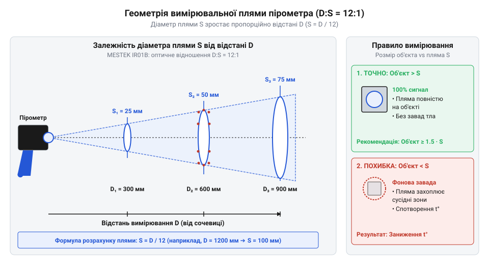
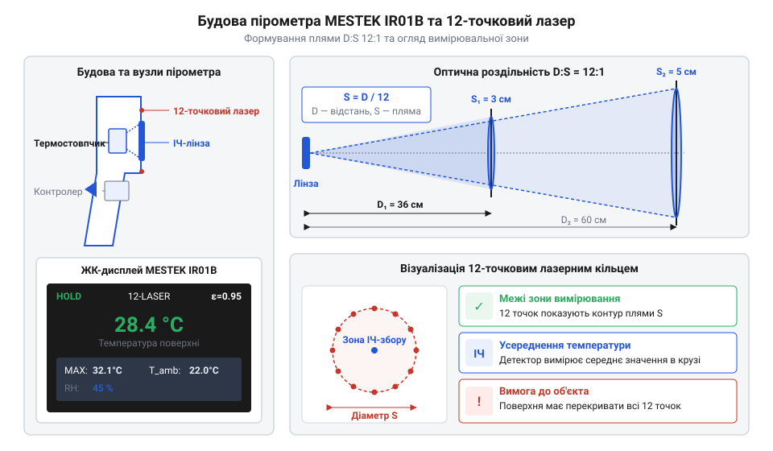
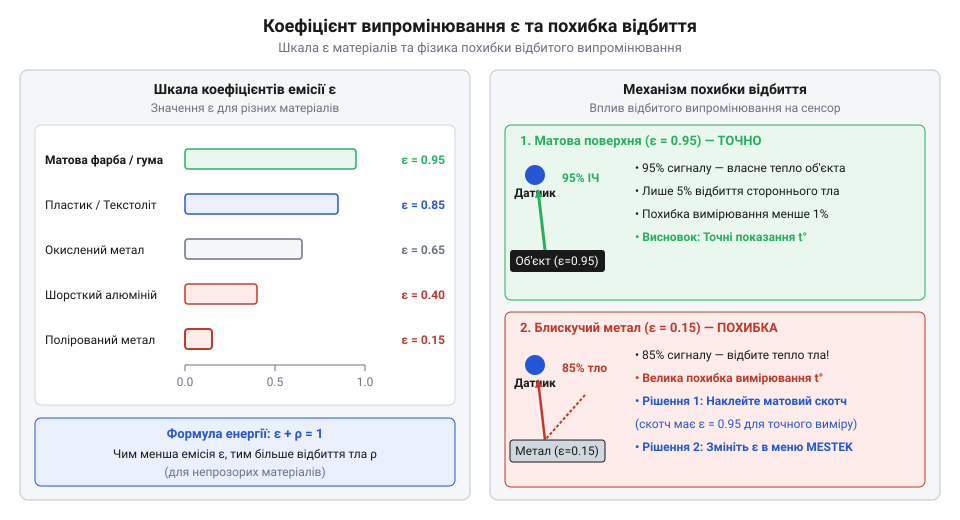

# Пірометр MESTEK IR01B (−50…+550 °C)

<preknowlist>
- [Штангенциркуль](root:cat-hw-instruments/vernier-caliper) — Прийоми точного вимірювання геометричних розмірів деталей для зіставлення з діаметром плями пірометра.
</preknowlist>

## Принцип інфрачервоної пірометрії та оптична пляма

Будь-яке фізичне тіло з температурою, вищою за абсолютний нуль, безперервно випромінює електромагнітні хвилі інфрачервоного діапазону. Фізичною основою безконтактного вимірювання температури є закон Стефана-Больцмана, згідно з яким повна енергетична світимість абсолютно чорного тіла пропорційна четвертому степеню його абсолютної температури. Для спектрального діапазону 8–14 мкм, у якому працюють портативні інфрачервоні пірометри (від англ. @@en|infrared pyrometer@@), випромінювану потужність сприймає оптична система приладу й фокусує її на внутрішньому приймачі. Співвідношення між спектральним розподілом та відстанню розраховується за законами випромінювання; детальні математичні розрахунки наведено в [математиці інфрачервоного випромінювання та геометрії оптичної плями](root:cat-hw-instruments/pyrometer-mestek-ir01b/math-pyrometry-radiation-and-distance-geometry.md). Від перших досліджень теплового спектра вченими минулого до створення портативних приладів пройдено великий шлях, про що можна прочитати в [історії розвитку інфрачервоної пірометрії](root:cat-hw-instruments/pyrometer-mestek-ir01b/hist-infrared-pyrometry-evolution.md).

Первинним перетворювачем у приладі виступає термостовпчиковий давач (від англ. @@en|thermopile sensor@@) — послідовно з'єднана матриця мікроскопічних термопар, виготовлених методом тонкоплівкового вакуумного напилення матеріалів із різним коефіцієнтом Термо-ЕРС на надтонку кремнієву мембрану. Конструктивно сенсор являє собою мікромеханічний чип із витравленою центральною нішею під підвішеною діелектричною мембраною завтовшки близько `1 μm`, на якій радіально розташовано десятки термопарних гілок із матеріалів із високою різницею термо-ЕРС. Вхідна лінза з германію або полімеру фокусує інфрачервоне випромінювання на гарячих спаях у центрі мембрани, тоді як холодні спаї виведені на масивний кремнієвий рамковий корпус чипа, що перебуває при основній температурі. Для ефективного уловлювання тепла поверхню гарячих спаїв покривають спеченим тонкоплівковим шаром нікель-хрому (NiCr). Власна діелектрична мембрана є частково прозорою для ІЧ-променів, але мікропориста структура та підібраний поверхневий опір нікель-хромового поглинача забезпечують спектральну неселективність — постійний високий коефіцієнт поглинання (`α(λ) ≈ 0.95–0.98`) у всьому діапазоні довжин хвиль від 8 до 14 мкм. Відсутність спектральної селективності запобігає викривленню вимірювань залежно від температури джерела, а надмала товщина поглинального шару не збільшує теплоємність мембрани. Виникнення різниці температур `ΔT = T_hot - T_cold` між центром мембрани та рамкою збуджує електрорушійну силу за ефектом Зеєбека. Вихідна напруга давача пропорційна кількості термопар `N`, диференціальному коефіцієнту Зеєбека `S_ab` та тепловому опору мембрани `R_th`, описуючись виразом `V = N × S_ab × ΔT = N × S_ab × R_th × Φ_ir`, де `Φ_ir` — поглинутий потік ІЧ-випромінювання. Мінімальна товщина й теплоємність підкладкової мембрани є вирішальними: зменшення її маси запобігає відведенню тепла в об'єм чипа й знижує часову інерційність вимірювання до сотень мілісекунд, тоді як товста підкладка спотворювала б динамічний відгук через теплопровідність. На відміну від приладів, які потребують безпосереднього механічного з'єднання з об'єктом, як-от [контактні термопари й термометри опору](root:cat-hw-instruments/contact-thermocouples-and-rtd-sensors), такий сенсор реагує на інфрачервоний потік дистанційно та майже безінерційно.

Вхідна лінза пірометра формує конусоподібне поле зору, яке визначає діаметр вимірювальної плями (від англ. @@en|measurement spot size@@) залежно від відстані до досліджуваного об'єкта. Ця характеристика описується оптичною роздільністю (від англ. @@en|distance-to-spot ratio@@ або @@en|D:S ratio@@), яка для приладу MESTEK IR01B становить `12:1`. Це означає, що при нормальному вимірюванні під прямим кутом на відстані `D = 120 см` до поверхні діаметр зони, з якої датчик збирає тепловий потік, становить `S = 10 см`. Якщо ж спрямувати прилад під кутом `θ` до нормалі поверхні, кругова пляма вироджується в еліпс, велика вісь якого збільшується пропорційно `S / cos(θ)`. Таке розтягнення геометричної плями суттєво збільшує її площу й підвищує ризик захоплення сторонніх джерел тепла із сусідніх ділянок.


*Залежність діаметра вимірювальної плями від відстані до поверхні за оптичного співвідношення D:S 12:1.*

Розрахунок мінімально допустимого розміру вимірюваної деталі є критичним для запобігання похибкам. Якщо об'єкт менший за діаметр плями `S` і займає лише частку площі `k = A_obj / A_spot`, у поле зору лінзи потрапляє навколишній фон з іншою температурою. Термостовпчик інтегрує радіаційний потік пропорційно площі `P_total = k · σ · T_obj⁴ + (1 - k) · σ · T_bg⁴`. У результаті гаряча деталь при `+100 °C`, яка перекриває лише 25% плями (`k = 0.25`) на тлі плати з температурою `+25 °C`, дасть покази всього `+49 °C`, викликаючи похибку вимірювання понад `51 °C`. Для вимірювання геометричних розмірів компонентів перед перевіркою застосовують [Штангенциркуль](root:cat-hw-instruments/vernier-caliper), а для складних поверхонь із розподіленим тепловим полем краще використовувати [тепловізори й матричні інфрачервоні камери](root:cat-hw-instruments/thermal-imaging-cameras-basics), які будують двовимірну карту температур.

## Конструкція та лазерний цілепокажчик MESTEK IR01B

Портативний пірометр MESTEK IR01B виконаний у міцному пістолетному корпусі з термостійкого АБС-пластику. Вівтарна частина приладу містить лінзу інфрачервоного об'єктива, кругову матрицю лазерних діодів та додатковий датчик температури й вологості довкілля. На задній панелі розташовано інверсний кольоровий рідкокристалічний дисплей (від англ. @@en|inverse color LCD@@) з високою контрастністю, який виводить значення температури об'єкта, налаштований коефіцієнт емісії та допоміжні параметри у діапазоні вимірювання від `-50 °C` до `+550 °C`.

Головною конструктивною особливістю MESTEK IR01B є 12-точковий лазерний цілепокажчик (від англ. @@en|12-point circular laser pointer@@). Апаратний механізм формування кільцевої картини базується на розщепленні когерентного випромінювання єдиного напівпровідникового лазерного діода спеціалізованим дифракційним оптичним елементом (від англ. @@en|diffractive optical element@@ або @@en|DOE@@). Мікроструктурний рельєф фазової дифракційної ґратки елемента моделює фронт світлової хвилі, створюючи інтерференційну картину з 12 симетричних дочірніх променів. Конус розбіжності цих променів чітко зіставлений із кутовим полем зору інфрачервоного об'єктива D:S 12:1. Однак через просторове рознесення осі приймального ІЧ-об'єктива та осі лазерного діода на передній панелі (базова відстань `b ≈ 1.5–2.0 см`) виникає @@en|parallax error@@ (похибка паралаксу, від грец. @@el|παράλλαξις@@ — зміщення). Фізична природа цього ефекту полягає в паралельному зсуві вимірювального конуса та конуса лазерної проєкції: на надмалих відстанях до `10–15 см`, коли діаметр приймальної плями `D = L / 12` становить лише близько `1 см`, геометричний зсув `b` є сумірним із розміром самої плями, тому лазерне кільце бачиться зміщеним від реального оптичного центра. Зі збільшенням відстані `L` понад `30–50 см` пляма розширюється, і фіксоване рознесення осей `b` стає нехтовно малим відносно радіуса плями, повністю нівелюючи похибку прицілювання. На відміну від бюджетних пірометрів із точковим лазером, які позначають лише умовний центр зони, така кругова лазерна система проєксує 12 червоних точок по периметру вимірювальної плями. Це дозволяє операторові наочно бачити реальні межі конуса охоплення при зміні відстані й гарантувати, що досліджувана деталь повністю перекриває пляму збору випромінювання. Детальний порядок увімкнення та вимкнення лазера викладено у [налаштуванні інтерфейсу приладу](root:cat-hw-instruments/pyrometer-mestek-ir01b/api-mestek-ir01b-hardware-interface.md).


*Конструкція приладу MESTEK IR01B та принцип формування 12-точкового лазерного кільця межі плями.*

Електроніка приладу аналізує сигнатурний потік із термостовпчика, обробляє сигнал внутрішнім мікроконтролером та здійснює компенсацію температури самого корпусу за допомогою вбудованого датчика. Оскільки Термо-ЕРС детектора виникає за різницею температур гарячих і холодних спаїв `V_th = k · (T_obj⁴ - T_ref⁴)`, внутрішній мікроконтролер безперервно зчитує абсолютну температуру корпусу `T_ref` через прецизійний @@en|NTC thermistor@@ (терморезистор з негативним температурним коефіцієнтом, від англ. @@en|Negative Temperature Coefficient@@). Алгоритм програмної компенсації додає обчислену теплову енергію холодного спаю `σ · T_ref⁴` до напруги термостовпчика перед коригуванням на `ε`, що запобігає дрейфу показань при нагріві пірометра від рук оператора чи довкілля. Для усунення високочастотних шумів та імпульсних завад АЦП використовує цифровий адаптивний фільтр низьких частот `y[n] = α · x[n] + (1 - α) · y[n-1]`. При стаціонарних вимірюваннях коефіцієнт згладжування має мале значення (`α ≈ 0.05–0.1`), гарантуючи високу стабільність показань. При різкому стрибку температури об'єкта `|x[n] - y[n-1]| > ΔT_thresh` алгоритм адаптивно збільшує коефіцієнт (`α ≈ 0.5–0.8`), відстежуючи швидкий динамічний перехід без часового запізнення. Обчислена компенсована напруга лінеаризується через кусочно-поліноміальну апроксимацію `T_obj = a_0 + a_1 · V_comp + a_2 · V_comp²` за калібрувальними коефіцієнтами пам'яті мікроконтролера. При випробуванні планарних випромінювачів оптичний профіль лазерного пучка можна оцінити за допомогою спеціалізованого приладу [Профілометр лазерного пучка](root:cat-hw-instruments/beam-profiler). Методику практичного пошуку локальних перегрівів електронних компонентів та клемників розкрито в [посібнику з діагностики плати](root:cat-hw-instruments/pyrometer-mestek-ir01b/proj-pcb-and-power-electronics-thermal-diagnostics.md).

## Коефіцієнт випромінювальної здатності та похибки

Якщо спрямувати пірометр на відполіровану мідну шину чи алюмінієвий радіатор із заводським налаштуванням коефіцієнта емісії, прилад покаже температуру, близьку до кімнатної, навіть якщо метал нагрітий до сотні градусів. Причина полягає у фізичній природі поверхні. Реальні тіла випромінюють інфрачервоне світло слабше за ідеальне @@en|black body@@ (абсолютно чорне тіло, від лат. *emissio* — випускання, випромінювання). Відношення енергії випромінювання реального матеріалу до випромінювання абсолютно чорного тіла за однакової температури визначає @@en|emissivity@@ (коефіцієнт випромінювальної здатності).

Згідно з законом збереження енергії, для непрозорого тіла сума випромінюваної та відбитої енергії дорівнює одиниці:

```
P_total = P_emitted + P_reflected
        = ε · σ · T_obj⁴ + (1 - ε) · σ · T_bg⁴      [рівняння теплового балансу поверхні]
```

Блискучі непроокислені метали мають вкрай низький коефіцієнт @@en|emissivity@@ (значення `ε` в межах `0.05–0.20`), а отже високий коефіцієнт @@en|infrared reflection@@ (інфрачервоного відбиття, `ρ = 1 - ε ≈ 0.80–0.95`). Фізичний механізм цього ефекту полягає у дзеркальній поведінці поверхні: полірований метал відбиває ІЧ-хвилі майже без власного поглинання, тому оптична лінза приймає не стільки власне тепло деталі, скільки паразитно відбитий потік від навколишніх гарячих предметів, стін кімнати чи тіла оператора. Приймач термостовпчика фіксує сумарну енергію `P_sum = ε_real · σ · T_obj⁴ + (1 - ε_real) · σ · T_bg⁴`, де `T_bg` — температура фонового середовища. Оскільки мікроконтролер обчислює показання за замовчуваним налаштуванням `ε_set = 0.95`, сумарний потік помилково інтерпретується як випромінювання високоемісійного тіла. Наприклад, якщо алюмінієвий радіатор нагрітий до `+150 °C` (`423 K`, `ε_real = 0.15`) в приміщенні з температурою `+20 °C` (`293 K`), слабкий власний потік металу та відбите випромінювання довкілля в сумі створюють щільність енергії, яку прилад при `ε_set = 0.95` обчислить як всього `+56 °C`. Це занижує реальний показник на `94 °C` і створює хибне уявлення про безпечний тепловий режим вузла. Натомість матові діелектрики — склотекстоліт FR-4, силіконові компаунди, кераміка, пластикові корпуси та чорна фарба — володіють високою випромінювальною здатністю (`ε ≈ 0.90–0.98`), тому відбита складова в їхньому спектрі є мінімальною. Детальніше фундаментальні залежності спектральної густини випромінювання розглянуто у [математичних розрахунках випромінювання](root:cat-hw-instruments/pyrometer-mestek-ir01b/math-pyrometry-radiation-and-distance-geometry.md).


*Залежність коефіцієнта емісії від матеріалу й обробки поверхні та виникнення похибки вимірювання через паразитно відбите теплове випромінювання.*

Цифровий пірометр MESTEK IR01B дозволяє регулювати параметр `ε` у діапазоні від `0.10` до `1.00` із кроком `0.01`. Для точної діагностики металевих поверхонь без оксидного шару застосовують два практичні прийоми. Перший спосіб — наклеювання на ділянку вимірювання матової термостійкої стрічки чи нанесення шару графітового аерозолю з відомим `ε ≈ 0.95`. Другий спосіб — попереднє калібрування, коли реальну температуру вузла тимчасово вимірюють через [контактні термопари й термометри](root:cat-hw-instruments/contact-thermocouples-and-rtd-sensors), після чого підганяють значення `ε` у меню пірометра до збігу показань. Окрім властивостей самої поверхні, слід ураховувати стан середовища: хоч прилад працює у спектральному «вікні прозорості» 8–14 мкм, водяна пара та пил у повітряному стовпці довжиною `L` розсіюють і поглинають ІЧ-потік за законом Бугера-Ламберта-Бера `τ_atm = exp(-γ_atm · L)`. Коефіцієнт ослаблення `γ_atm` залежить від відносної вологості `RH` та температури повітря `T_air`, які фіксує допоміжний вбудований датчик пірометра. Внаслідок цього детектор приймає ослаблений потік `P_det = τ_atm · ε · σ · T_obj⁴ + (1 - τ_atm) · σ · T_air⁴`, де другий доданок описує власне синє випромінювання товщі повітря. Для компенсації похибки заниження температури мікроконтролер обчислює коефіцієнт пропускання `τ_atm` і відновлює істинне значення об'єкта за виразом `T_obj⁴ = (P_det - (1 - τ_atm) · σ · T_air⁴) / (τ_atm · ε · σ)`.

## Практична теплова діагностика електроніки

Під час пошуку несправностей на друкованих платах інженер стикається з дрібними компонентами: силовими транзисторами у корпусах TO-220 чи D2PAK, поверхнево-монтованими дроселями та випрямними діодами. Якщо вимірювати їхню температуру зі значної відстані, світлова пляма пірометра охопить не лише сам компонент, а й навколишню ділянку текстоліту. Фізичний механізм цього обмеження пов'язаний зі просторовою інтеграцією потоку: термостовпчик уловлює сумарну теплову потужність з усієї площі плями `A_spot`. Якщо площа гарячого SMD-резистора `A_comp` займає лише малу частку `k = A_comp / A_spot` вимірювальної зони, а решту `1 - k` становить холодна плата з температурою `T_pcb`, обчислена приладом температура `T_meas` визначається ваговим середнім потоків `T_meas⁴ = k · T_comp⁴ + (1 - k) · T_pcb⁴`. Наприклад, SMD-компонент розміром `3 × 2 мм` нагрітий до `+120 °C`, але на відстані, де діаметр плями дорівнює `20 мм` (`A_spot ≈ 314 мм²`), частка компонента `k` становить лише `2%`. У результаті пірометр покаже всього близько `+27 °C`, і локальний @@en|thermal hot spot@@ (теплова гаряча точка) лишиться повністю непоміченим. Додаткова складність виникає при вимірюванні силових напівпровідників у полімерних корпусах: хоч епоксидний компаунд здається чорним у видимому світлі, його тонка товщина у спектральному діапазоні 8–14 мкм має часткове ІЧ-пропускання `τ_case > 0`. Термостовпчик приймає комбінований потік — поверхневе випромінювання корпусу `ε_case · T_case⁴` та транзитне ІЧ-випромінювання гарячого кремнієвого кристала `τ_case · T_junction⁴`. Оскільки температура p-n переходу `T_junction` значно вища за поверхню корпусу через внутрішній тепловий опір «кристало-корпус» `R_thJC`, прозорість компаунду завищує показання поверхневої температури, що вимагає нанесення непрозорого матового покриття або урахування теплового опору елемента.

Для точного вимірювання розмір об'єкта повинен перевищувати діаметр плями вимірювання. Оптична роздільність MESTEK IR01B становить `D:S = 12:1`. Це означає, що на відстані `D = 120 мм` діаметр світлової плями дорівнює `S = 10 мм`. Щоб визначити гранично припустиму відстань до компонента, зручно спочатку [виміряти геометричні розміри](root:cat-hw-instruments/vernier-caliper) корпусу деталей. Розрахунок максимальної відстані виконують за співвідношенням:

```
D_max = 12 · S_comp      [геометричне обмеження оптичної роздільності D:S]
```

Безконтактний метод надає ключову перевагу при діагностиці силових імпульсних блоків живлення, де компоненти первинного кола перебувають під високою напругою до 400 В. Використання металевих зондів мультиметра створює ризик короткого замикання та ураження струмом. Пірометр дозволяє безпечно контролювати нагрів силових ключів, трансформаторів та клемників на безпечній відстані.

Перед початком вимірювань необхідно правильно виставити коефіцієнт емісії залежно від зони плати: `ε = 0.95` для склотекстоліту та пластикових корпусів мікросхем, або `ε = 0.80–0.85` для анодованих алюмінієвих радіаторів. Окрему увагу приділяють імпульсним трансформаторам: темні феритові сердечники мають емісію `ε ≈ 0.90–0.92`, а лакований мідний дріт чи ізоляційна каптонова стрічка обмоток — `ε ≈ 0.95`. Оскільки гістерезисні втрати у фериті та вихрові струми у міді нагрівають їх нерівномірно, вимірювання слід проводити окремо для сердечника та витків обмотки. Детальний порядок перемикання режимів описано в [налаштуванні інтерфейсу приладу](root:cat-hw-instruments/pyrometer-mestek-ir01b/api-mestek-ir01b-hardware-interface.md). Покрокову алгоритмізацію пошуку перегрівів силових кіл викладено у [посібнику з діагностики плати](root:cat-hw-instruments/pyrometer-mestek-ir01b/proj-pcb-and-power-electronics-thermal-diagnostics.md). Якщо ж виникає потреба миттєво бачити розподіл температур по всій площі плати складного пристрою, замість одноточкового пірометра використовують [повнокадрові матричні тепловізори](root:cat-hw-instruments/thermal-imaging-cameras-basics).
