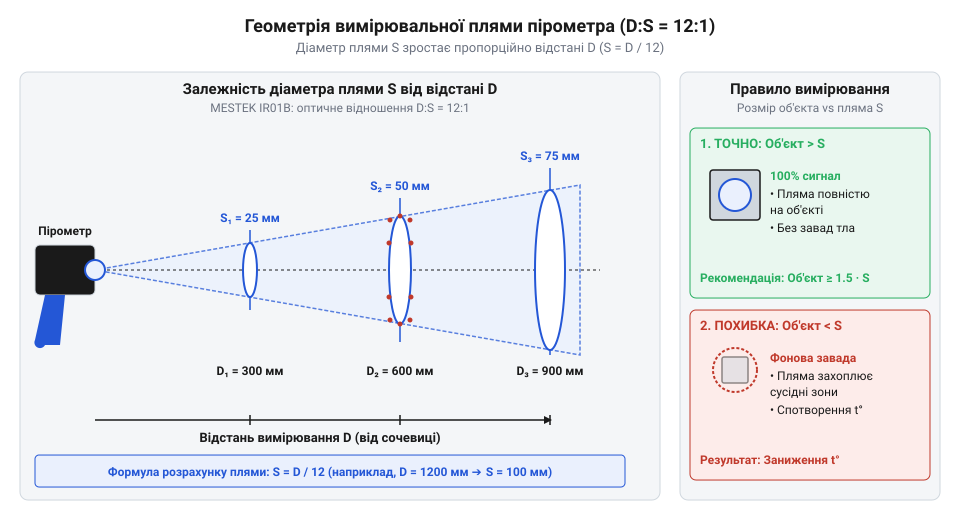
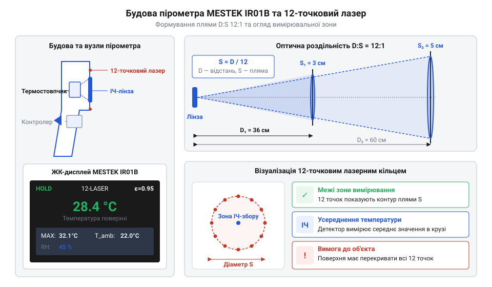
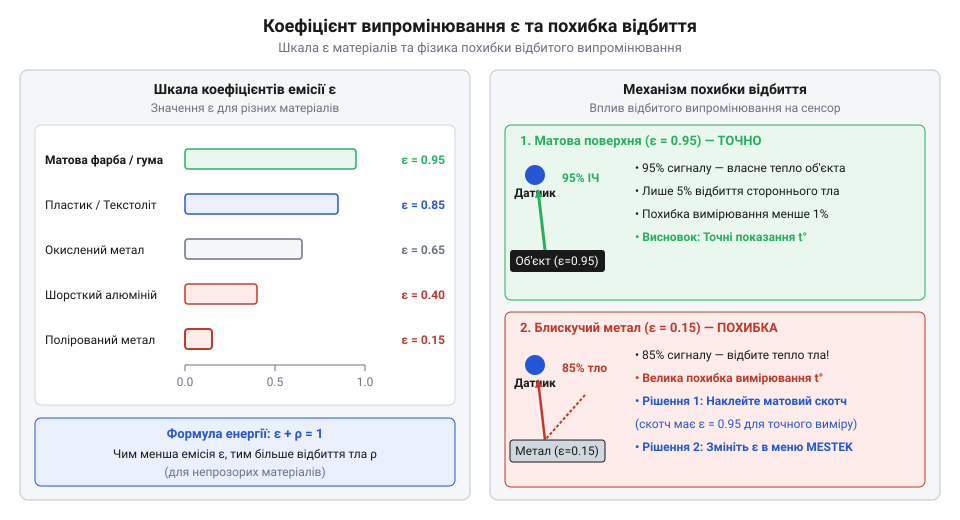

# Пірометр MESTEK IR01B (−50…+550 °C)

<preknowlist>
- [Штангенциркуль](root:cat-hw-instruments/vernier-caliper) — Прийоми точного вимірювання геометричних розмірів деталей для зіставлення з діаметром плями пірометра.
</preknowlist>

## Принцип вимірювання та оптична пляма

Безконтактне вимірювання температури пірометром (від грецького *pyr* — вогонь та *metron* — міра; @@en|pyrometer@@) ґрунтується на реєстрації власного інфрачервоного випромінювання поверхні. ІЧ-лінза фокусує випромінюваний тепловий потік на термостовпчиковому сенсорі (від грецького *therme* — тепло та українського *стовпчик*; @@en|thermopile@@), який перетворює теплову енергію на електричний сигнал, пропорційний температурі об'єкта від `−50 °C` до `+550 °C`.

Геометрія вимірювальної зони визначається оптичною роздільністю D:S (від англійського *distance to spot ratio* — «відношення відстані до плями»; @@en|D:S ratio@@), яка для моделі MESTEK IR01B становить `12:1`. Це означає, що на відстані `D = 120 мм` діаметр сенсорної плями `S` дорівнює `10 мм`. Якщо досліджувана деталь менша за розмір плями, сенсор усереднює випромінювання предмета з фоновою температурою плати, що створює значну вимірювальну похибку. Зіставити геометричні розміри деталі з діаметром плями можна за допомогою [штангенциркуля](root:cat-hw-instruments/vernier-caliper).

*Геометрія вимірювальної плями пірометра D:S 12:1: залежність діаметра зони збору випромінювання від відстані до об'єкта.*

## Будова та круговий лазерний цілепокажчик

Портативний пірометр MESTEK IR01B виконано у пістолетному корпусі з кульковим оптичним входом та вбудованим лазерним модулем. Для точного прицілювання прилад оснащено 12-точковим круговим лазерним цілепокажчиком, створеним за допомогою дифракційного елемента (від латинського *diffractio* — розлом; @@en|diffraction@@). Лазерне коло чітко окреслює зовнішню межу оптичної плями на поверхні. Профілювання світлового пучка розкрито у матеріалі про [профілометр лазерного пучка](root:cat-hw-instruments/beam-profiler).

На близькій відстані (`D < 200 мм`) виникає ефект паралаксу (від грецького *parallaxis* — зміна, ухилення; @@en|parallax@@) — просторовий зсув між віссю лазерного випромінювача та віссю оптичної лінзи ІЧ-сенсора. Через цей зсув центр лазерного кола відхиляється від фактичного центра вимірювальної плями, що вимагає врахування поправки при прицілюванні на дрібні елементи.

*Будова MESTEK IR01B: розташування ІЧ-сенсора, 12-точкового лазерного діода та виникнення паралаксу на малій відстані.*

## Коефіцієнт емісії та запобігання похибкам

Точність вимірювання залежить від коефіцієнта випромінювальної здатності (емісії) поверхні (від латинського *emissio* — випускання; @@en|emissivity@@), який показує частку випроміненої теплової енергії порівняно з абсолютним чорним тілом. Більшість матових діелектриків мають високу емісію `ε ≈ 0.95`, тоді як полив'яні металеві радіатори та паяні доріжки мають низький коефіцієнт `ε ≈ 0.10–0.30` і сильно відбивають навколишнє тепло.

При зчитуванні температури блискучого металу пірометр сприймає відбите інфрачервоне випромінювання сусідніх гарячих деталей, видаючи хибно завищені або занижені показання. Для усунення похибки в меню MESTEK IR01B коригують параметр `ε` під конкретний матеріал або наклеюють на металеву поверхню шматок матової ізоляційної стрічки з відомою емісією `ε = 0.95`.

*Вплив коефіцієнта емісії: спотворення вимірювань на дзеркальних металах та його нейтралізація матовим покриттям.*

## Практична теплова діагностика електроніки

Під час діагностики електронних схем під напругою пірометр дозволяє безпечно локалізувати перегріті силові транзистори, диодні мости та дроселі без контактного ризику короткого замикання. Для надійної перевірки SMD-компонентів (від англійського *surface-mount device* — пристрій поверхневого монтажу; @@en|SMD@@) прилад наближають на відстань `10–15 см`, щоб лазерне коло не виходило за межі корпусу елемента.

Спостереження за динамікою нагріву під час подачі живлення дає змогу виявити пробиті конденсатори й короткозамкнені мікросхеми до їхнього остаточного термічного руйнування.
