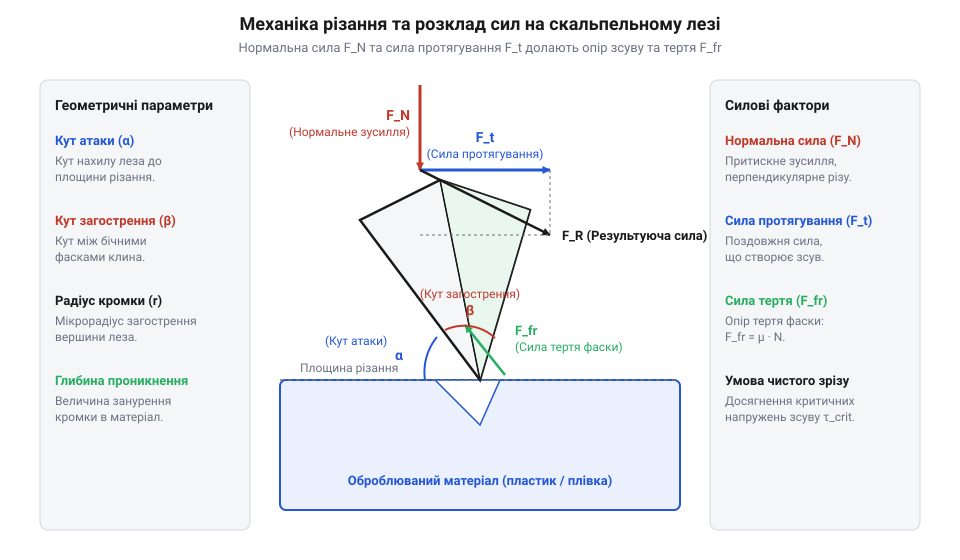

# Механіка різання, розрахунок кута загострення та розподіл напружень у змінних лезах

<preknowlist>
- [Свердла по металу HSS (2.0–8.0 мм)](root:cat-hw-instruments/hss-drill-set) — розуміння механіки стружкоутворення та різання металів
- [Надфілі (140 мм)](root:cat-hw-instruments/needle-files) — розуміння геометричного профілю та механічного знімання матеріалу
</preknowlist>

## Геометрія кромки та фізика проникнення

Під час зрізання тонких полімерних плівок, термоусадки чи захисного маскування недосконале загострення інструмента призводить до зминання та пластичного розтягування матеріалу замість розділення. Замість чистого розрізу кромка @@en|скальпеля@@ (від латинського *scalpellum* — маленький ніж) починає продавлювати деталь. У мікроскопічному масштабі різальна кромка являє собою клиноподібне сполучення двох бокових фасок із кутом загострення `β`, вершина якого розгладжена радіусом заокруглення `r_edge`. Для свіжого леза цей радіус становить `r_edge ≈ 0.1–0.5 мкм`. Локальне підсилення механічних напружень на вістрі описується коефіцієнтом концентрації напружень `K_t ≈ 1 + 2 · √(h_back ÷ (2 · r_edge · tan(β / 2)))`, де `h_back` — товщина обуха леза. Оскільки товщина обуха `h_back ≈ 0.4 мм` у сотні разів перевищує мікроскопічний радіус заокруглення `r_edge`, геометричне співвідношення `h_back ÷ r_edge` створює колосальну концентрацію напружень `K_t ≈ 50–100`, завдяки чому навіть незначне зусилля натиску розганяє локальне напруження у матеріалі до межі плинності.

При вертикальному натисканні нормальним зусиллям `F_N` на поверхню оброблюваної деталі відбувається @@en|індентування@@ (від латинського *indentare* — надрізати) — локальне втискання кромки. Пляма контакту вздовж довжини різання `L_edge` має ширину `w_contact = 2 · r_edge`. Контактний тиск `p_contact` у зоні дотику сягає високих значень:

```
p_contact = F_N ÷ (2 · r_edge · L_edge)      [контактний тиск під округлою кромкою]
τ_max = 0.5 · p_contact                      [максимальне напруження зсуву за умовою Треска]
F_N = 2 · τ_ult · r_edge · L_edge            [необхідне нормальне зусилля проникнення]
```

Для виникнення сдвигового руйнування матеріалу максимальне @@en|дотичне напруження@@ `τ_max` має досягти межі міцності матеріалу на зсув `τ_ult`. Наприклад, для фторопластової або поліамідної плівки з межею зсуву `τ_ult = 40 МПа`, довжиною контакту `L_edge = 10 мм` та гострим лезом `r_edge = 0.5 мкм` необхідне зусилля становить всього `F_N = 2 · (40 · 10⁶) · (0.5 · 10⁻⁶) · (10 · 10⁻³) = 0.4 Н`. Якщо ж кромка затупилася до `r_edge = 5 мкм`, зусилля зростає до `4.0 Н`, що перевищує поріг локальної стійкості тонкої плівки й викликає її зминання. На відміну від механічного знімання стружки, яке виконують [Надфілі (140 мм)](root:cat-hw-instruments/needle-files), розрізання скальпелем ґрунтується на чистій сдвиговій деформації без видалення об'єму матеріалу.

Після досягнення межі міцності `τ_ult` безпосередньо під вістрям відновлюється механічне розділення: у зоні контакту зароджується мікроскопічна тріщина, яка проростає вглиб матеріалу попереду фронту кромки. Подальше занурення фасок леза розсуває береги розрізу в бокові боки, переносячи пластичну деформацію у вузький локалізований шар шириною `w_contact`. Якщо прикладене зусилля `F_N` стабільно перевищує поріг проникнення, руйнування відбувається суто шляхом зсувного ковзання міжмолекулярних зв'язків без накопичення об'ємних напружень у сусідніх ділянках, що забезпечує ідеально гладку поверхню зрізу без задирок та відшарування захисних покриттів.

## Кут атаки та розрахунок тертя

При переході від чистого втискання кромки (гільйотинного різання) до похилого розрізу зі зміщенням вздовж леза виникає ефект протягування. Оператор нахиляє лезо під кутом атаки `α` та прикладає поздовжню силу тяги `F_t`. При цьому ефективний кут клина `β_eff` у напрямку руху зменшується за залежністю `tan(β_eff / 2) = tan(β / 2) · cos(α)`, що суттєво полегшує розклинювання матеріалу. Динаміка протягування визначається швидкістю ковзання `v_t`, похідна якої за часом дає @@en|kinematic acceleration@@ (від грецького *kinema* — рух; кінематичне прискорення, `a = dv_t / dt`). Поздовжній розгін леза з прискоренням `a` змінює режим тертя на бокових фасках: зі зростанням швидкості `v_t` значення @@en|dynamic friction coefficient@@ `μ(v_t)` (від латинського *frictio* — тертя) зменшується від статичного межі до динамічного мінімуму. Залежність коефіцієнта тертя від швидкості протягування обчислюють за формулою:

```
μ(v_t) = μ_d + (μ_s - μ_d) · exp(-v_t / v_c)    [коефіцієнт динамічного тертя залежно від швидкості]
```

де `μ_s` — коефіцієнт статичного тертя спокою, `μ_d` — асимптотичний динамічний коефіцієнт тертя при високих швидкостях, `exp` — експоненціальна функція, а `v_c` — характерна критична швидкість релаксації контактної зони. На початку руху при `v_t = 0` опір описується максимальним коефіцієнтом `μ_s`, але у міру досягнення та перевищення критичної швидкості `v_c` (коли прискорення `a > 0`) коефіцієнт тертя спадає до `μ_d`, зменшуючи силу тертя `F_fr` та необхідне поздовжнє зусилля `F_t`, що запобігає зминанню м'якого матеріалу.


*Схема розкладу сил на різальній кромці та бічних фасках скальпельного леза з позначенням кута загострення β, кута атаки α, нормальної сили F_N, сили протягування F_t та сил тертя F_fr.*

При зануренні леза у товщу матеріалу на бокові фаски діє нормальна реакція відтискання `N_facet`, яка викликає @@en|силу тертя@@ `F_fr` (від латинського *frictio* — тертя) з коефіцієнтом тертя `μ`. Рівновага сил та розрахунок зусилля протягування описуються системою:

```
N_facet = F_N ÷ (2 · sin(β / 2))             [нормальна реакція матеріалу на фаски леза]
F_fr = μ · F_N ÷ sin(β / 2)                  [сумарна сила тертя розклинювання об фаски]
F_t = F_fr · cos(α) + F_cut · sin(α)          [необхідна сила протягування під кутом атаки α]
```

Зменшення кута атаки до `α ≈ 15°–25°` дозволяє розподілити нормальне зусилля на більшу довжину кромки, що зменшує питоме тертя `F_fr` та запобігає заклинюванню леза у в'язких пластиках. Схожі принципи геометрії клина використовують [Свердла по металу HSS (2.0–8.0 мм)](root:cat-hw-instruments/hss-drill-set) під час формування переднього кута різальної кромки.

## Згинальний момент і міцність леза

Гострокутні змінні леза (зокрема популярний профіль №11) мають вузький шилоподібний кінчик. Під час виконання точкових надрізів або видалення заусенців у важкодоступних місцях на кінчик діє бічна сила `F_lat`, яка створює небезпечний згинальний момент `M_b = F_lat · L`. Якщо розріз виконують під кутом із розворотом леза (косий надріз), до згинання додається сила різання `F_cut`, прикладена з ексцентриситетом `e` відносно нейтральної осі перерізу, що генерує @@en|torsional moment@@ (від латинського *torsio* — кручення; крутний момент `M_t = F_cut · e`). Згинання викликає нормальні напруження `σ_b = M_b / W_z`, а кручення створює дотичні напруження зсуву `τ = M_t / W_k` (де `W_k ≈ b · h² / 3` — момент опору крученню тонкого прямокутного перерізу висотою `b` та товщиною `h`). Поєднання цих моментів формує складний напружений стан, у якому максимальне дотичне напруження `τ_max` та викликана ним @@en|shear strain@@ (від англійського *shear strain*; деформація зсуву `γ`) обчислюються за системою рівностей:

```
τ_max = √((σ_b / 2)² + τ²)                     [максимальне дотичне напруження зсуву]
γ = τ_max ÷ G                                   [деформація зсуву у кристалічній ґратці сталі]
```

де `G` — модуль зсуву сталі (для інструментальної сталі `G ≈ 79–81 ГПа`). Сумісна деформація зсуву `γ` зміщує нейтральну лінію напружень до кромок перерізу, через що критична межа міцності сталі досягається при значно менших бічних зусиллях `F_lat`, аніж при чистому згинанні, спричиняючи раптове сколювання або крихкий злам кінчика леза.

Розглядаючи кінчик леза як консольно закріплену балку вильотом `L`, товщиною `h` та висотою перерізу `b`, обчислюють момент опору `W_z` та максимальне @@en|нормальне напруження згину@@ `σ_b`:

```
M_b = F_lat · L                               [згинальний момент у небезпечному перерізі]
W_z = (b · h²) ÷ 6                            [момент опору прямокутного перерізу леза]
σ_b = (6 · F_lat · L) ÷ (b · h²)               [максимальне напруження згину на поверхні]
F_max = (σ_ult · b · h²) ÷ (6 · L)            [граничне бічне навантаження проти зламу]
```

Для леза з високовуглецевої загартованої сталі з межею міцності на розрив `σ_ult = 1800 МПа`, товщиною `h = 0.4 мм`, висотою основи кінчика `b = 2.0 мм` та плечем `L = 5.0 мм` граничне допустиме бічне зусилля становить `F_max = (1800 · 2.0 · 0.4²) ÷ (6 · 5.0) = 19.2 Н` (близько `1.95 кгс`). Зменшення товщини леза до `h = 0.25 мм` призводить до квадратичного падіння міцності: `F_max` зменшується до `7.5 Н`, підвищуючи ризик крихкого зламу кінчика при найменшому бічному перекосі.

## Оптимізація геометрії та ресурсу заточування

У процесі експлуатації кромка леза зношується під дією абразивного стирання об наповнювачі пластиків або мікрокристали скловолокна. Збільшення радіуса заокруглення від `r_edge,0` до `r_edge,t` викликає пропорційне зростання необхідного нормального зусилля `F_N(t) = F_N,0 · (r_edge,t ÷ r_edge,0)`. Під час різання склотекстоліту FR-4 високотверді мікрочастинки оксиду кремнію у скловолокні зрізають мікрооб'єми сталевої кромки, що описується @@en|Archard's wear law@@ (від прізвища британського інженера Джона Аршара; закон абразивного зношування Аршара). Об'єм зношеного металу `V_wear` та зростання радіуса кромки `r_edge,t` після проходження шляху різання `s` обчислюють за формулами:

```
V_wear = K · (F_N · s) ÷ H                     [загальний об'єм зношеного матеріалу]
r_edge,t = √(r_edge,0² + (2 · K · F_N · s) ÷ (H · sin(β / 2)))    [приріст радіуса кромки залежно від шляху s]
```

де `K` — безрозмірний @@en|wear coefficient@@ (від англійського *wear coefficient*; коефіцієнт абразивного зношування, який для пари сталь–скловолокно становить `K ≈ 10⁻⁴–10⁻³`), `H` — @@en|Vickers hardness@@ (від англійського *Vickers hardness*; твердість сталі леза за Віккерсом), а `β` — кут загострення леза. Оскільки твердість склотекстоліту FR-4 наближається до твердості загартованої вуглецевої сталі, значення `K` зростає в рази, спричиняючи швидке накопичення радіуса `r_edge,t` та вимагаючи застосування лез із підвищеним кутом `β` для збільшення об'єму металу в зоні зносу.

Критичний радіус тупіння `r_crit` визначається за умовою, при якій зусилля `F_N` перевищує поріг деформації оброблюваної деталі або викликає втрату контролю над інструментом:

```
r_crit = r_edge,0 · (F_limit ÷ F_N,0)         [гранично припустимий радіус заокруглення кромки]
```

Для вибору оптимального профілю змінного леза користуються критеріями:
- **Профіль №11** (`β ≈ 15°–20°`): придатний для точкового проколювання, підрізання дрібних друкованих доріжок та виганяння масок завдяки найгострішому кінчику.
- **Профіль №10** (`β ≈ 25°–30°`): вигнута дугоподібна кромка розподіляє навантаження при довгих прямолінійних розрізах, збільшуючи ресурс у 3–4 рази.
- **Профіль №15** (`β ≈ 20°`): малий радіус дуги поєднує точність маневру з високою стійкістю кромки при мікромакетуванні.

Застосування оптимального кута атаки `α ≈ 20°` у поєднанні з м'якими макетними килимками запобігає перевищенню `r_crit` і гарантує збереження прецизійної чистоти країв зрізу.
