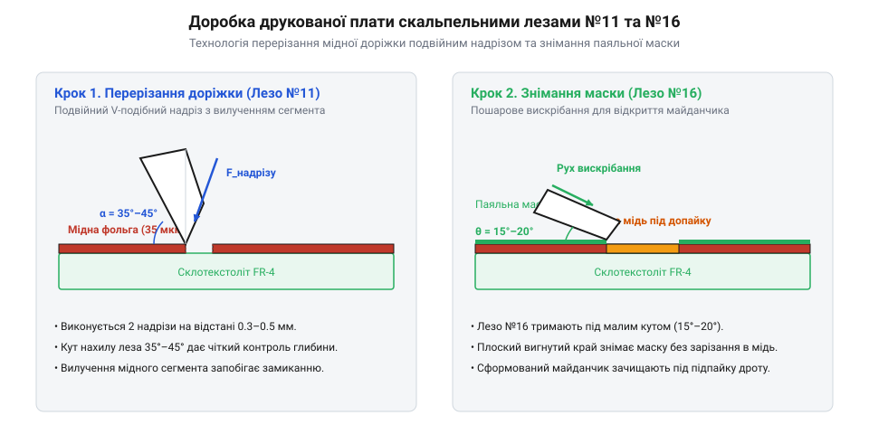

# Практичне вибирання доріжок друкованої плати, розкрій маскувальної плівки та доводка корпусних деталей

<preknowlist>
- [Надфілі (140 мм)](root:cat-hw-instruments/needle-files) — Прийоми фінішної обробки крайки та зняття заусенців дрібним надфілем після попереднього підрізання скальпелем.
</preknowlist>

## Підготовка інструмента та підкладки

Прецизійне макетування та підгонка друкованих вузлів вимагають суворого контролю робочої зони. Будь-яке совання деталі чи зісковзування різальної кромки скальпеля (від лат. *scalpellum*, «ножик») призводить до пошкодження тонких провідників або травмування оператора. Робоче місце оснащують спеціалізованим тримачем з замковим пазом або цанговим затискачем стандарту №3 для малих знімних полотен, який забезпечує відсутність люфту під дією бічних зусиль.

Перед початком маніпуляцій обов'язково перевіряють стан різальної кромки леза. Навіть мікроскопічні викришення чи заудирки на вістрях №10–16, непомітні неозброєним оком, призводять до рвання матеріалу замість чистого розклинювання. Гостроту випробовують контрольним надрізом на тестовому відрізку паперу або плівки — лезо має входити без відчутного опору та заминання крайки. Не менш важливим є вибір матеріалу та конструкції рукоятки: суцільнометалева державка надає максимальну жорсткість при дотичному підрізанні, тоді як легка пластикова рукоятка з гумовим потовщенням у зоні хвату рівномірно розподіляє тиск і запобігає втомі м'язів кисті під час тривалого розкрою плівок. Для захисту робочого столу та збереження мікрорадіуса заточування застосовують багатошаровий самовідновлюваний килимок @@en|Self-Healing Mat@@ (від англ. *self-healing mat*, «самовідновлюваний килимок») із полівінілхлориду @@en|PVC@@ (англ. *Polyvinyl Chloride*, «полівінілхлорид»). Його еластомерний поверхневий шар вловлює вістря під тиском і змикається після проходу полотна, запобігаючи тупінню кромки об тверду стільницю. Робочу поверхню очищають від пилу, стружки склотекстоліту @@en|FR-4@@ (англ. *Flame Retardant 4*, «термостійкий склотекстоліт») та металевих ошурків. Під час різання кисть фіксують триточковим хватом із обов'язковим опертям мізинця або безіменного пальця на килимок для точного дозування глибини занурення.

Завершивши серію робіт з обробки пластиків та монтажу, металеву державку піддають обов'язковому хімічному очищенню. Під час різання 3D-друкованих деталей та підготовки плати на поверхні ручки та всередині замкового паза накопичуються налиплі частки термопластичних смол, оксиди та каніфольні залишки паяльного флюсу. Для видалення залишків смол і флюсу металеву рукоятку промивають ізопропіловим спиртом (англ. @@en|isopropyl alcohol@@) або технічним ацетоном, використовуючи жорстку капронову щітку для повного вимивання бруду з затискних канавок. Після видалення органічних забруднень інструмент піддають дезінфекції — протирають 70-відсотковим розчином спирту та просушують стисненим повітрям. Це запобігає утворенню вогнищ корозії під знімним лезом, виключає заклинювання замкового механізму та гарантує гігієнічну чистоту й надійність хвату при наступних маніпуляціях.

## Модифікація доріжок та видалення маски

Перерізання мідних провідників на друкованих платах @@en|PCB@@ (англ. *Printed Circuit Board*, «друкована плата») виконують гострокутним трикутним лезом №11. Прямий волосінний надріз одинарним проходом є технологічною помилкою: мідна фольга товщиною 18–35 мкм під дією тиску деформується, а при подальшому термічному нагріванні або вібраціях краї зрізу можуть знову зімкнутися й відновити паразитний контакт.

Технологічно коректна методика передбачає вилучення суцільного сегмента міді шляхом виконання двох паралельних надрізів на відстані 0,5–1,0 мм один від одного. Лезо №11 орієнтують під кутом атаки `α = 45°` для першого направляючого проходу, після чого кут зменшують до `α = 30°` для повного прорізання фольги. Напрямок руху має бути строго прямолінійним — будь-які бічні розвертання леза №11 призводять до відламування його тендітного кінчика. Отриману смужку міді підважують вістрям і знімають із основи з склотекстоліту @@en|FR-4@@.

*Покрокова техніка виконання подвійного надрізу мідної доріжки лезом №11 та видалення паяльної маски лезом №16 без пошкодження склотекстоліту.*

Для відкриття нових контактних майданчиків під допайку провідників застосовують плоске закруглене лезо-долотце №16 або полотно №15. Захисну полімерну паяльну маску @@en|solder mask@@ (англ. *solder mask*, «паяльна маска») знімають методом плоского шабрування. Лезо розміщують під малим кутом `α ≈ 10°–15°` до площини плати й виконують легкі зсувні рухи уздовж провідника. Заккруглена кромка леза №16 зрізає крихкий шар маски, не врізаючись у м'якшу мідну підкладку та не утворюючи глибоких канавок на склотекстоліті.

Одразу після механічного оголення міді на контактному майданчику лишаються мікроскопічні оксидні плівки та ошурки полімеру, які блокують якісне змочування рідким припоєм. Для підготовки поверхні виконану зону вилучення маски ретельно промивають ізопропіловим спиртом (англ. @@en|isopropyl alcohol@@) за допомогою безворсової серветки чи пензлика, повністю видаляючи жирові й механічні забруднення. Безпосередньо перед допайкою тонкого відновлювального провідника на знежирену мідь наносять шар рідкого або гелеподібного флюсу, який розчиняє залишки оксидів під час нагрівання та забезпечує миттєве формування надійного інтерметалевого з'єднання без ризику перегріву й відшарування доріжки.

## Розкрій каптонової плівки та трафаретів

Термостійка поліімідна каптонова плівка @@en|Kapton@@ (від торгової марки *Kapton*) широко застосовується для локального захисту радіокомпонентів від термодеструкції при пайці гарячим повітрям корпусів @@en|BGA@@ (англ. *Ball Grid Array*, «масив кулькових виводів»). Розкрій тонких еластичних плівок супроводжується ризиком їх заминання та витягування крайки, якщо різальне зусилля перевищує межу плинності полімерного матеріалу.

Для розкрою каптону @@en|Kapton@@ застосовують лезо №11 і сталеву лінійку з гумовим протиковзним шаром, яку при довгомірних розрізах додатково фіксують міні-струбцинами на робочому столі для запобігання бічному зсуву під дією зусилля протягування. Застосовувати пластикові або дерев'яні лінійки заборонено, оскільки гостре вістря врізається в їхню направляючу крайку й зрізає стружку в тіло детальної маски. Лезо ведуть під кутом `α = 45°–60°` з помірним нормальним притиском. Високий кут атаки зменшує довжину дуги контакту й забезпечує чисте зрізання еластомеру без його зсуву, а глибина прорізання плівки прямо залежить від твердості підкладки: використання м'якої самовідновлюваної основи дозволяє вістрю вільно занурюватися нижче нижньої площини полімеру для повного розділення країв, тоді як занадто тверда підкладка спричиняє передчасне затуплення кромки та зминання плівки. При виготовленні захисних трафаретів зі складними прямокутними вікнами спочатку виконують вертикальні проколи вістрям леза №11 у кутах контуру, після чого з'єднують точки проколу прямолінійними різами вздовж закріпленої металевої направляючої.

## Зачищення та фінішна доводка деталей

Фінішна обробка 3D-друкованих корпусів із пластиків @@en|PLA@@ (англ. *Polylactic Acid*, «полімолочна кислота»), @@en|ABS@@ (англ. *Acrylonitrile Butadiene Styrene*, «акрилонітрилбутадієнстирол») та @@en|PETG@@ (англ. *Polyethylene Terephthalate Glycol*, «поліетилентерефталатгліколь») вимагає видалення технологічних підтримок і знімання напливів облою @@de|Abgrat@@ (від нім. *Abgrat*, «грат, заудирка»). Зрізання пластику виконують вигнутим лезом №10, що має довгу опуклу кромку.

Велика площа контакту леза №10 при малих кутах `α = 15°–30°` дозволяє плавно зрізати пластиковий облой @@de|Abgrat@@ тонкими шарами за дотичною траєкторією. Спроба виламувати або зрізати товстий шар пластику за один силовий прохід призводить до виникнення білих зон напруження та тріщин у виробі.

Після видалення основного облою @@de|Abgrat@@ скальпелем для точної підгонки стикувальних пазів і сопряження деталей застосовують [дрібні надфілі](root:cat-hw-instruments/needle-files), які остаточно вирівнюють мікронерівності та знімають фаски. Якщо ж у корпусі потрібно підігнати до потрібного діаметра монтажні отвори під гвинти, після первинної зенковки скальпелем використовують [свердла по металу](root:cat-hw-instruments/hss-drill-set) відповідного калібру.

Під час механічного доопрацювання деталей слід дотримуватися техніки безпеки при роботі з терморозм'якшеними та крихкими матеріалами. При зачищенні термоеластопластів, підігрітих для полегшення різання, виникає ефект теплового розм'якшення (від англійського *thermal softening*; @@en|thermal softening@@), через що в'язкий пластик може налипати на різальну кромку і спричиняти раптовий зіскок затиснутого леза. Натомість при обробці виробів із фотополімерних смол (від англійського *photopolymer resin*; @@en|photopolymer resin@@) висока твердість матеріалу супроводжується підвищеною крихкістю, що загрожує неконтрольованим сколюванням (від англійського *chipping*; @@en|chipping@@) та розлітанням гострих мікроуламків при силовому розклинюванні. Для запобігання травмам та пошкодженню фотополімерних деталей силу зрізання замінюють легким покроковим шабруванням під малим кутом атаки `α ≤ 15°`, а всі операції виконують у захисних окулярах.
