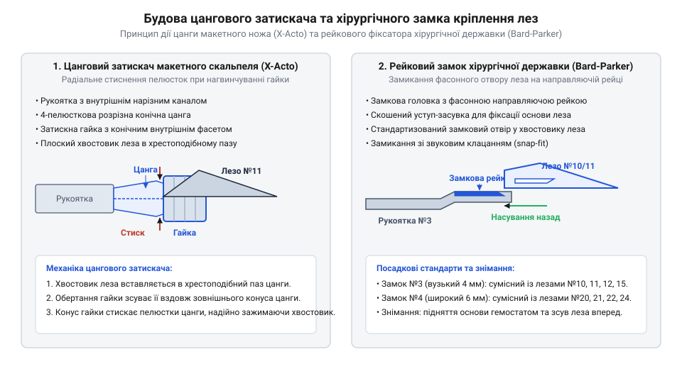
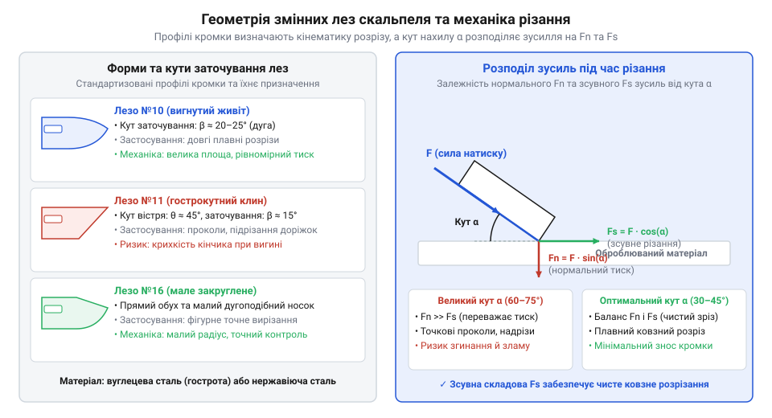
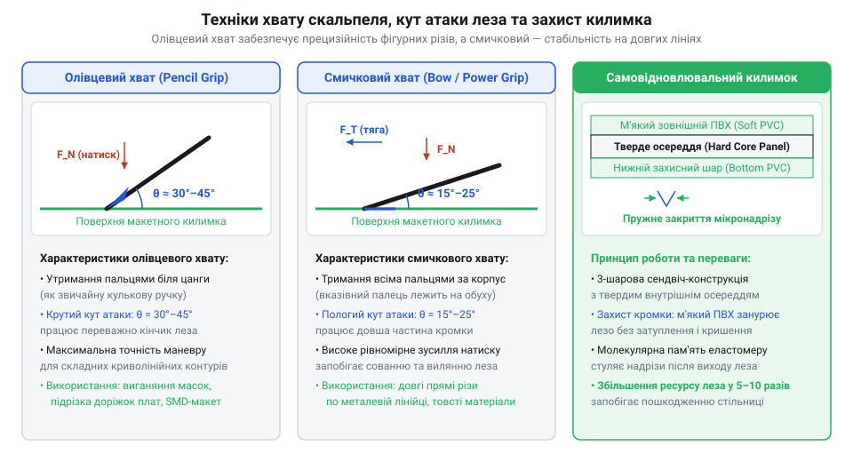

# Скальпелі й змінні леза

## Проблема чистого зрізу та типи скальпелів

Спроба виконати прецизійне вибіркове видалення захисної маски з друкованої плати чи точний розкрій товстої маскувальної плівки звичайним висувним канцелярським ножем зазвичай завершується заминанням країв, зміщенням лінії різу та пошкодженням мідних провідників. Причина полягає не лише у бічному люфті сегментованого леза всередині металевої направляючої, а й у фізиці клинового розклинювання. Стандартний канцелярський ніж має товщину обуха близько `0.4–0.5 мм` та сумарний кут загострення фаски `25°–35°`. Під час занурення такий широкий клин створює значне поперечне напруження розклинювання (`@@en|transverse stress@@`), яке розштовхує матеріал убік, спричиняючи підрив паяльної маски та розтягування плівок. Натомість монтерський або хірургічний @@la|скальпель@@ (від лат. *scalpellum* — ніж, різачок, зменшувальне від *scalprum*) виготовляють із товщиною обуха всього `0.20–0.25 мм` та гострим клиновим кутом `12°–15°`. Завдяки цьому кромка розрізає матеріал чистим зсувом без бічного деформування країв та з нульовим люфтом кромки в затискачі.

Історія розвитку прецизійного різального інструменту сягає давніх медичних @@la|ланцетів@@ (від лат. *lancea* — спис), які виготовлялися монолітними й потребували постійного ручного перезаточення. Справжній технологічний прорив відбувся у 1915 році, коли Морган Паркер патентував двокомпонентну систему знімного леза із замочним кріпленням на плоскій металевій державці, що створило світовий стандарт @@en|Bard-Parker@@. У середині XX століття для потреб технічного креслення, картографії та графічного дизайну з'явилися макетно-монтажні скальпелі типу @@en|X-Acto@@ з круглими ручками та затискачами цангового типу. Вимоги до постійної первинної гостроти, стерильності та суворої стандартизації профілів лез сформували сучасний асортимент інструментів, без яких неможливо уявити точне прототипування та радіомонтаж.

Сучасні скальпелі поділяються на два основні конструктивні класи: макетно-монтажні (технічні) та хірургічні (державочні). Макетні скальпелі мають циліндричну рукоятку зі спеціальною протиковзною насічкою та металевим затискачем, що забезпечує олівець-подібний хват для різання у будь-яких напрямках. Хірургічні скальпелі складаються з плоскої ергономічної рукоятки зі стандартизованим замковим виступом, на який надягається одноразове лезо. Для зняття заусенців із пластикових корпусів після різання часто застосовують спеціальні [інструменти для зняття заусенців](root:cat-hw-instruments/deburring-tools-and-scrapers).

Конструктивна відмінність між цими класами безпосередньо визначає кінематику роботи та характер тактильного зворотного зв'язку. Циліндричний корпус макетної ручки дає змогу плавно обертати інструмент навколо власної осі пальцями під час виколювання складних криволінійних контурів чи радіусних прорізів. Натомість сплюснутий профіль хірургічної державки жорстко орієнтує площину леза в долоні, запобігаючи неконтрольованому прокручуванню при виконанні глибоких поздовжніх розрізів. Для доведення отворів після висікання чи розкрою часто застосовують прецизійні [надфілі](root:cat-hw-instruments/needle-files), а можливість миттєвої заміни тупого леза в обох типах затискачів гарантує стабільну чистоту зрізу без деформації країв.

У сучасній мікроелектроніці прецизійний скальпель використовують для вибіркового зняття паяльної маски (`@@en|solder mask@@`) під час ревізії друкованих плат, підрізання закорочених доріжок та підготовки контактних майданчиків під SMD-компоненти. Завдяки нульовому люфту та тонкій кромці інструмент дозволяє зрізати мікронні шари лаку без пошкодження сусідніх мідних провідників чи текстолітової основи. У технічному моделюванні та прототипуванні скальпель є незамінним для розкрою самоклейних трафаретних плівок, обрізання литників пластикових деталей і підгонки фототравлених металевих елементів, де будь-який відхил кромки зіпсував би геометрію збірки. Для підготовки посадкових отворів під кріплення чи елементи конструкції після первинного розкрою матеріалу скальпелем застосовують спіральні [свердла по металу HSS](root:cat-hw-instruments/hss-drill-set).

## Конструкція рукояток та механізми фіксації

Якщо під час тонкого вискоблювання мікроскопічної доріжки лезо скальпеля хоча б на частку міліметра зміститься у гнізді, це призведе до зрізання сусіднього провідника. Надійність передачі зусилля від руки майстра до різальної кромки повністю залежить від конструкції механізму фіксації рукоятки. Бюджетні затискачі з двопелюстковою цангою обжимають плоский хвостовик лише у двох точках, залишаючи бічний кутовий люфт при бічному натиску. Професійні чотирипелюсткові цанги з хрестоподібним розпилом рівномірно розподіляють радіальне зусилля з усіх чотирьох боків, повністю блокуючи будь-які зсуви. Величезну роль відіграє й матеріал пелюсток: м'які латунні цанги з часом зазнають пластичної деформації та стираються об конус гайки, втрачаючи точність центрування, тоді як цанги із загартованої інструментальної сталі зберігають високу пружність та забезпечують нульовий бічний люфт (`@@en|zero backlash@@`) упродовж усього терміну служби інструмента.

У макетних скальпелях найчастіше використовується @@de|цанговий затискач@@ (від нім. *Zange* — кліщі, затискач). @@de|Цанга@@ являє собою пружинисту розрізну втулку з внутрішнім пазом під хвостовик леза. При закручуванні рифленої затискної гайки конусна @@fr|фаска@@ (від фр. *facette* — грань) насувається на пелюстки @@de|цанги@@, рівномірно стискаючи їх навколо леза. Для легких робіт застосовують алюмінієві рукоятки з латунними цангами, а для силового розкрою пластику — суцільносталеві затискачі збільшеного діаметра.

*Будова механізмів фіксації: цанговий патрон макетного ножа стискає пелюстки конусною гайкою, тоді як хірургічний замок фіксує лезо на замковому виступі за рахунок пружної деформації сталі.*

У хірургічних скальпелях застосовують рейковий замок стандарту @@en|Bard-Parker@@. Рукоятка має плоский профіль із похилим прямокутним пазом і замковим виступом на кінці. Хвостовик леза має відповідний фігурний виріз: його надягають на замок під кутом і з зусиллям зсувають назад до характерного клацання пружної фіксації. Хірургічні державки маркуються номерами: рукоятка №3 призначена для малих лез (з №10 по №15), а рукоятка №4 — для великих лез (з №20 по №25). На відміну від @@de|цанги@@, рейковий замок повністю унеможливлює випадання леза при осьовому витягуванні інструмента з щільного матеріалу.

Окрім стандартних жорстких державок, у макетуванні застосовують шарнірні ручки з поворотною цангою (`@@en|swivel knife@@`), голівка яких вільно обертається на `360°` на мініатюрних підшипниках. Це дає змогу висікати складні лекала й криволінійні маски без перехоплювання інструмента в руці. Для безпечного транспортування та виїзних робіт використовують складні макетні скальпелі із шарнірним прихованим лезом або ручки із захисними ковпачками й пружинними висувними кожухами. Вони надійно закривають мікроскопічний кінчик леза від випадкових ударів та захищають робочу поверхню столу, на якій розташовані [самовідновлювані килимки](root:cat-hw-instruments/cutting-mats-and-prototyping-surfaces).

## Форми лез, сталі та механіка різання

Спроба прорізати прямолінійний паз за допомогою леза з вигнутим черевцем призводить до відхилення лінії різу, а використання прямого загостреного клинка для вискоблювання радіусних ділянок спричиняє викришування кінчика. Ефективність різання визначається правильною відповідністю форми леза, матеріалу та геометрії заточення конкретній технологічній операції. Особливо важкою задачею для різальної кромки є обробка склотекстоліту марки `FR-4`, оскільки абразивні хаотично орієнтовані скловолокна (`@@en|glass fibers@@`) миттєво зношують звичайну сталеву фаску при прорізанні мідних доріжок. Для вирішення цієї проблеми на високовуглецеві або нержавіючі леза методом вакуумно-дугового напилення наносять твердосплавне покриття з нітриду титану (від англійського *titanium nitride coating*; `@@en|TiN coating@@`, `TiN`). Завдяки надвисокій мікротвердості близько `2500 HV` золотаве покриття `TiN` утворює зносостійкий бар'єр, який зменшує коефіцієнт тертя та запобігає абразивному зношуванню фаски, продовжуючи термін служби леза при роботі з жорсткими композитами у 5–10 разів.

Серед різноманіття профілів наибольше поширення в електроніці здобули три типи лез. Лезо №11 з гострим трикутним кінчиком та прямою різальною кромкою є основним інструментом для точкового проколювання, підрізання друкованих доріжок та розкрою плівок. Лезо №10 має вигнуту радіусну кромку («черевце») і служить для плавності соскоблювання окислів та вирівнювання поверхонь. Лезо №16 поєднує короткий зрізаний кінчик із підвищеною жорсткістю для силового підрізання пластикових конструктивів. Практичне застосування цих профілів розкрито у матеріалі про [вибирання доріжок друкованої плати](root:cat-hw-instruments/scalpel-set/proj-pcb-trace-mod-and-stencil-cutting.md).

*Геометрія та механіка лез: прямолінійне лезо №11 створює концентроване зсувне зусилля на кінчику, тоді як вигнуте лезо №10 розподіляє нормальний натиск уздовж радіусної кромки.*

Стійкість різальної кромки до тупління та викришування залежить від матеріалу леза. Леза з високовуглецевої сталі (@@en|high-carbon steel@@) мають найгострішу первинну кромку із радіусом заокруглення менше ніж `0.1` мкм, але схильні до корозії та швидкого тупління при контакті зі скловолокном. Леза з нержавіючої сталі (@@en|stainless steel@@) більш стійкі до агресивних флюсів та вологи. Керамічні леза з діоксиду цирконію (`ZrO₂`) не проводять струм, не магнітяться та мають колосальну зносостійкість, але є крихкими при бічних навантаженнях. Фізичну модель розклинювання матеріалу та розрахунок зусиль детально описано у праці про [механіку різання та розподіл напружень](root:cat-hw-instruments/scalpel-set/math-scalpel-blade-cutting-mechanics.md).

Окрім стандартних профілів, у монтажній та макетній практиці використовують спеціалізовані леза з особливою геометрією кромки. Серпоподібне лезо №12 із внутрішнім увігнутим вигострим радіусом призначене для підрізання термоусадочних трубок, знімання ізоляції та вихоплювання ниток чи провідників у важкодоступних місцях без ризику зачепити сусідні елементи. Мале радіусне лезо №15 є зменшеною аналогією №10 і застосовується для прецизійного мікровискоблювання та обробки мініатюрних контурів. Для доведення поверхонь складного профілю після первинного розкрою такими лезами широко застосовують спеціалізовані [шабери та гратознімачі](root:cat-hw-instruments/deburring-tools-and-scrapers).

## Техніка хвату, натиску та захист поверхні

Точність і чистота лінії розрізу під час роботи прецизійним скальпелем визначаються способом утримання рукоятки та контролем зусилля, що прикладається до різальної кромки. У монтажній та макетній практиці використовують два основних способи утримання інструмента. Для прецизійних робіт — прорізання доріжок на друкованих платах, обрізання тонких маскувальних плівок та виколювання дрібних елементів — застосовують олівцевий хват (від англійського *pencil grip*; `@@en|pencil grip@@`). У цьому разі державку утримують трьома пальцями ближче до затискача під кутом `30°–45°` до робочої площини. Таке положення забезпечує максимальну чутливість кисті та дозволяє точно регулювати глибину проникнення кінчика леза. Коли ж потрібно виконати довгий прямий розріз макетного пластику чи листового матеріалу вздовж металевої лінійки, інструмент переводять у смичковий хват (від англійського *violin grip*; `@@en|violin grip@@`), при якому вказівний палець спирається на верхнє ребро державки під зменшеним кутом нахилу `15°–25°`. Це дає змогу рівномірно розподіляти поздовжній сув та вертикальний натиск уздовж усієї довжини кромки. Дозоване регулювання натиску при будь-якому хваті критичне під час проходження кромки вглиб [самовідновлюваного килимка](root:cat-hw-instruments/cutting-mats-and-prototyping-surfaces): тонке вістрі не розриває міжмолекулярні зв'язки еластомеру безповоротно, а лише розсуває макромолекулярні ланцюги полімеру. Завдяки високим пружним відновлювальним силам та міжланцюговій взаємодії одразу після виходу кромки зі зрізу зміщені молекулярні ланцюги повертаються у початковий просторовий стан, повністю змикаючи канавку та зберігаючи гладку поверхню.

Глибина та рівномірність різу залежать від орієнтації леза й нормального зусилля натиску. При занадто великому куті нахилу вся сила концентрується на вістрі леза №11, що збільшує ризик його сколювання або заглиблення в основу, тоді як зменшення кута залучає більшу довжину кромки, знижуючи питомий тиск. Детальний математичний розрахунок [розподілу напружень у змінних лезах](root:cat-hw-instruments/scalpel-set/math-scalpel-blade-cutting-mechanics.md) пояснює залежність сили проникнення від радіуса заокруглення кромки та кута її заточування. На практиці надмірний тиск призводить до зсуву матеріалу та утворення заусенців на краях розрізу, тому для фінішного вирівнювання країв застосовують додаткові [шабери та гратознімачі](root:cat-hw-instruments/deburring-tools-and-scrapers). Дрібні похибки геометрії зрізу або нерівності на металевих чи пластикових деталях усувають, використовуючи дрібні [надфілі](root:cat-hw-instruments/needle-files).

*Схема техніки хвату скальпеля, орієнтація вектора натиску та взаємодія різальної кромки із самовідновлювальним килимком.*

Для збереження початкової гостроти леза та захисту стільниці різання виконують виключно на спеціалізованих поверхнях. Різання на твердих підкладках із загартованого скла чи сталі миттєво зминає мікроскопічну фаску кромки, а м'які дерев'яні чи фанерні дошки затискають кінчик і провокують його злам. Щоб запобігти зносу, під деталь підкладають [самовідновлювані килимки для різання](root:cat-hw-instruments/cutting-mats-and-prototyping-surfaces) (від англійського *self-healing cutting mat*; `@@en|self-healing cutting mat@@`), виготовлені з багатошарового еластичного полімеру. При прорізанні матеріал килимка локально розступається під лезом, не чинячи абразивного опору кромці, а після виходу леза еластичні молекулярні зв'язки змикають проріз. Конкретні прийоми підготовки інструмента та [вибирання доріжок друкованої плати](root:cat-hw-instruments/scalpel-set/proj-pcb-trace-mod-and-stencil-cutting.md) демонструють практичне поєднання правильного хвату й захисної підкладки при макетуванні.

Для довговічності захисного покриття та збереження прецизійної кромки слід уникати багатьох повторних прорізів по одній лінії, регулярно змінюючи орієнтацію деталей на [самовідновлюваних килимках](root:cat-hw-instruments/cutting-mats-and-prototyping-surfaces). Полімерна підкладка втрачає пружність при потраплянні агресивних розчинників чи тривалому локальному перегріві, а налипання залишків клейового шару або паяльної маски на бічні фаски леза збільшує тертя й вимагає обережного очищення спиртом без торкання самої різальної кромки.

Під час проведення скальпеля вздовж сталевої чи алюмінієвої лінійки нормальне зусилля натиску `Fₙ` мусить оптимізуватися так, щоб бічна сила притиску кромки до направляючої не перевищувала поріг зсуву металу. При нахилі леза вбік лінійки навіть на кут `α = 5°` з'являється поперечна складова зусилля `F_біч`, яка змушує тверде вістрі зрізати мікроскопічну стружку з м'якшої направляючої:

    Fₙ = F_верт + F_біч × tan(α)
    = 3.0 + 0.2 × 0.087            [розрахунок для вертикального натиску 3 H та кута нахилу 5°]
    = 3.02 H                       [сумарне векторне зусилля на різальну кромку]

Щоб уникнути пошкодження напрямних та сколювання фаски, інструмент тримають суворо паралельно бічній грані лінійки з мінімальним бічним контактом `F_біч ≈ 0.1–0.2 H`, а поздовжнє переміщення здійснюють за кілька легких проходів замість одного силового натисну. Похибки прямолінійності, що виникли при обробці пластику, усувають за допомогою прецизійних [надфілів](root:cat-hw-instruments/needle-files).

## Заходи безпеки та утилізація лез

Висока початкова гострота та мала товщина змінних лез роблять скальпель джерелом підвищеного травматизму при недотриманні техніки безпеки. Основною причиною поранень є зсув інструмента під час прикладання надмірного зусилля або зламування крихкого кінчика високовуглецевого леза при бічних навантаженнях. Якщо ж хвостовик леза зламався врівень із цанговим затискачем чи заклинив у пелюстках, спроба витягти його пальцями чи піддіти незахищеним інструментом веде до порізів. У такому разі застосовують безпечний покроковий алгоритм: спочатку повністю відкручують рифлену гайку, послаблюючи тиск на конус, після чого за допомогою прецизійного гострогубця чи медичного затискача (гемостата; `@@en|hemostat@@`) надійно захоплюють виступаючий край заклиненого уламка і витягують його вздовж осі прорізу. Лише після повного видалення уламка та очищення пазу цанги від дрібної сталевої стружки встановлюють нове лезо. Для запобігання травмам під час різання траєкторію інструмента завжди спрямовують у напрямку «від себе», а вільна рука, що фіксує деталь чи лінійку, мусить перебувати позаду лінії руху кромки.

Операції заміни лез вимагають суворого дотримання інструментального регламенту. Знімання чи встановлення замінних лез на хірургічні державки №3 та №4 голими руками або пасатижами категорично заборонено: ковзання пальців чи неконтрольований стиск губок пасатижів призводить до раптового зламу леза й глибоких порізів. Для безпечної зміни лез використовують спеціальний екстрактор (від англійського *blade extractor*; `@@en|blade extractor@@`) або медичний затискач (гемостат). Екстрактор насувають на обух леза до фіксації замка, після чого задню частину леза піднімають над фіксуючим виступом державки й безпечно зсувають лезо вперед уздовж направляючих пазів. У цангових макетних ручках перед заміною повністю послаблюють рифлену гайку, а лезо виймають за допомогою пінцета, утримуючи його за необроблену спинку.

Відпрацьовані та пошкоджені леза становлять тривалу небезпеку і підлягають обов'язковій ізоляції. Заборонено викидати зняті леза безпосередньо у загальні сміттєві пакети, оскільки тонкі сталеві уламки легко пробивають поліетилен та травмують персонал. Використані леза накопичують у жорсткому непробивному контейнері для гострих відходів (від англійського *sharps container*; `@@en|sharps container@@`), виготовленому з товстостінного пластику. За відсутності промислового контейнера відпрацьовані леза перед утилізацією надійно обгортають кількома шарами цупкого картону або фіксують утилізаційною клейкою стрічкою, унеможливлюючи випадковий контакт із гострою кромкою.

У промислових та лабораторних умовах контейнери для гострих відходів (`@@en|sharps container@@`) підлягають суворому санітарному нормуванню та стандартизованому кольоровому маркуванню. Промислові ємності виготовляють із товстостінного поліпропілену в яскраво-жовтому або червоному виконанні з нанесенням міжнародного знака біологічної та механічної небезпеки. Конструкція кришки має односторонній завантажувальний клапан із поворотною шторкою, що дозволяє скидати леза одним рухом, але унеможливлює їх випадання при перевертанні або спроби витягти вміст руками. Після заповнення контейнера на `3/4` об'єму поворотний замок затискають до незворотного блокування, передаючи запечатану ємність на утилізацію поруч із зношеними [самовідновлюваними килимками](root:cat-hw-instruments/cutting-mats-and-prototyping-surfaces).
