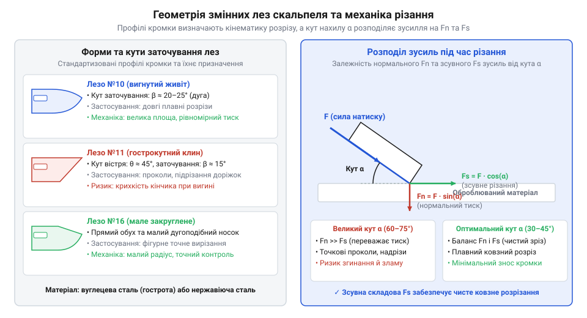

# Скальпелі й змінні леза

<preknowlist>
- [Надфілі (140 мм)](root:cat-hw-instruments/needle-files) — прийоми ручної обробки та доведення країв металевих і пластикових деталей
</preknowlist>

## Переваги скальпеля та класи інструмента

Спроба виконати точне зняття паяльної маски чи розкрій маскувальної плівки канцелярським ножем призводить до деформації країв та підриву доріжок. Причина полягає у фізиці клинового розклинювання: ніж із товщиною обуха `t_spine = 0.50 мм` та кутом загострення `α = 30°` створює високе поперечне напруження розклинювання (англ. @@en|transverse stress@@), що розштовхує матеріал убік. Поперечне зсувне деформування `d_split` прямо пропорційне товщині обуха `t_spine` та половині кута загострення `α / 2`. Нормальне розклинювальне зусилля `F_norm` при вертикальному тиску `F_cut` та коефіцієнті тертя `μ` обчислюють за формулою:

```
F_norm = F_cut ÷ (2 · sin(α ÷ 2) + 2 · μ · cos(α ÷ 2))      [розклинювальне зусилля клина]
```

Для канцелярського ножа (`t_spine = 0.50 мм`, `α = 30°`, `μ = 0.1`) та зусилля `F_cut = 10 Н` бічний зсув становить `d_split = 0.50 мм`. Натомість прецизійний скальпель (від латинського scalpellum — ніж; @@la|скальпель@@) з обухом `t_spine = 0.20 мм` та гострим кутом `α = 12°` дає такий бічний зсув:

```
d_split = t_spine                      [поперечне зміщення матеріалу]
= 0.20 мм                              [зменшення деформації на 60%]
```

Зменшення товщини обуха з `0.50 мм` до `0.20 мм` знижує поперечне розклинювання матеріалу у 2.5 раза. Завдяки цьому кромка скальпеля ріже шар маски чи плівки чистим зсувом, не перевищуючи межу міцності зчеплення мідної фольги з текстолітом та запобігаючи підриву доріжок.

За конструкцією інструменти поділяють на два класи. Макетирувальний скальпель (від німецького Maquette — модель; @@de|макетний скальпель@@) має циліндричну ручку з протиковзною насічкою для зручного обертання пальцями під час висікання криволінійних контурів. Хірургічний скальпель (від грецького cheir — рука, ergon — робота; @@en|surgical scalpel@@) має плоску державку, яка жорстко орієнтує лезо в долоні при виконанні прямолінійних розкроїв. Якщо після підрізання потрібна додаткова зачистка отворів, використовують [дрібні ручні надфілі](root:cat-hw-instruments/needle-files).

## Механізми фіксації та геометрія лез

Надійність передачі зусилля залежить від патрона фіксації. У макетних ножах застосовують цанговий затискач (від німецького Zange — кліщі; @@de|цанговий затискач@@). При закручуванні гайки конусна фаска (від французького facette — грань; @@fr|фаска@@) насувається на пружинисту @@de|цангу@@, обжимаючи хвостовик. У хірургічних державках використовують рейковий замок стандарту @@en|Bard-Parker@@, на який лезо надягають під кутом до пружного клацання, що унеможливлює його випадання при осьовому витягуванні.


*Геометрія та механіка лез: прямолінійне лезо №11 створює концентроване зсувне зусилля на кінчику, тоді як вигнуте лезо №10 розподіляє нормальний натиск уздовж радіусної кромки.*

Форму леза обирають під конкретну операцію. Лезо №11 із гострим трикутним кінчиком призначене для проколювання та підрізання друкованих доріжок, а лезо №10 з вигнутим «черевцем» служить для плавності соскоблювання окислів. Для свердління підготовчих отворів у металі перед висіканням застосовують спіральні [свердла по металу HSS](root:cat-hw-instruments/hss-drill-set).

## Техніка роботи та безпечна утилізація

Точність різу залежить від утримання інструмента. Для точного підрізання доріжок застосовують олівцевий хват (англ. @@en|pencil grip@@) під кутом 30°–45°. Для довгих розкроїв уздовж лінійки вказівний палець спирають на ребро державки у смичковому хваті (англ. @@en|violin grip@@) під кутом 15°–25°. Щоб кромка не тупилася, різання виконують на самовідновлюваному килимку (англ. @@en|self-healing cutting mat@@): еластичний полімер розступається під ніж і змикається після його виходу.

Знімання зламаних лез виконують виключно за допомогою пінцета або затискача, щоб уникнути порізів. Відпрацьовані леза заборонено викидати у відкритий смітник: їх утилізують у жорсткому контейнері для гострих відходів (англ. @@en|sharps container@@) із товстостінного пластику.
