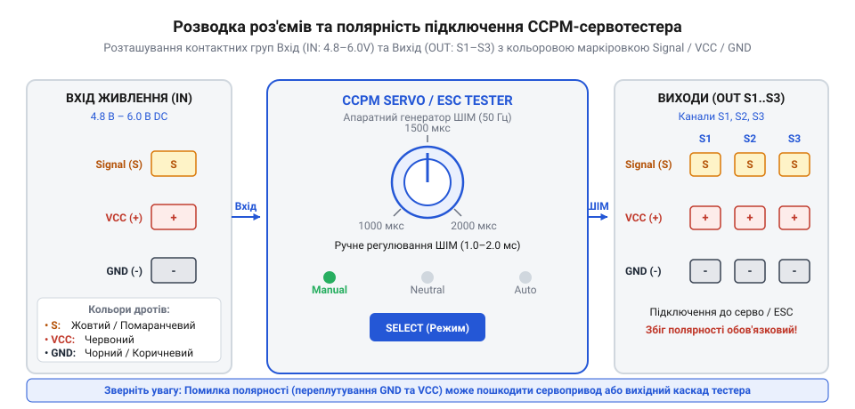
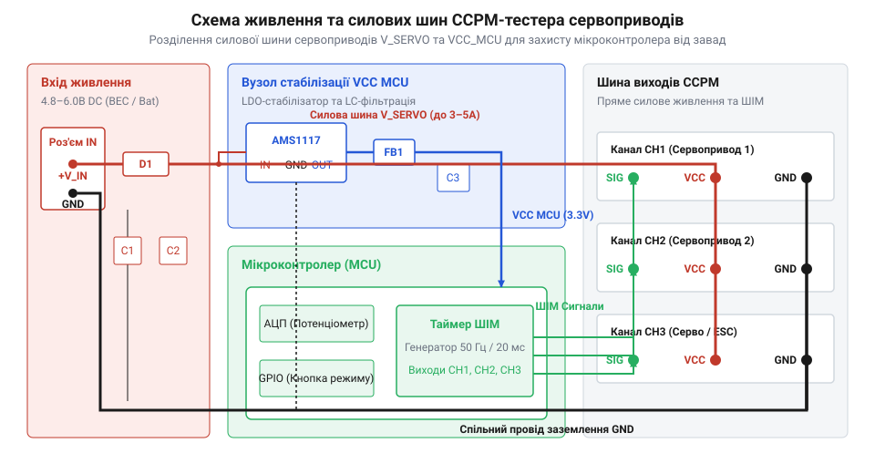
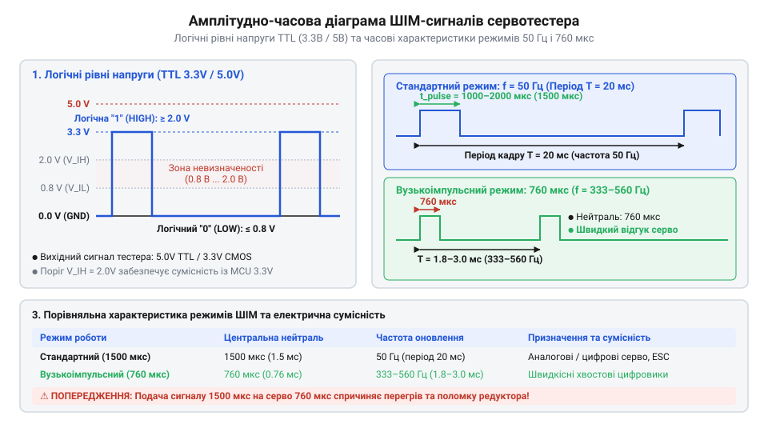
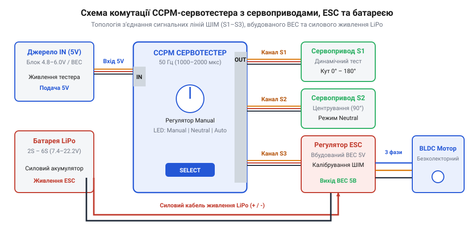

# Залізний інтерфейс тестера серво та ESC (CCPM): принципова схема, розводка роз'ємів та електричні параметри

## Проблема автономної діагностики та роз'єми

При стендовому налаштуванні кінематики радіокерованих моделей або перевірці кутів повороту важелів виникає гостра технічна проблема: розгортання повноцінного радіокомплексу з приймачем та передавачем є громіздким і незручним. Вмикання високочастотного передавача в умовах майстерні викликає ефірні завади, вимагає постійного сполучення (англ. @@en|binding@@, від *bind* — зв'язувати) каналів та створює ризик раптового ривка привода через випадкові перешкоди. Для швидкої перевірки та механічного виставляння нейтралі необхідний компактний автономний пристрій — @@en|сервотестер@@ (від латинського *servus* — слуга та англійського *tester* — випробувач). Він імітує вихідні ШІМ-команди польотного контролера або приймача, формуючи стандартні імпульси керування безпосередньо на робочому столі.

Фізичний інтерфейс тестера будується на базі стандартних трьохконтактних штирових роз'ємів серії @@en|DuPont@@ з кроком `2.54 мм`. Роз'єми розділені на дві функціональні групи: вхідну (англ. @@en|IN@@, від *in* — всередину) для подачі зовнішнього живлення та вихідну (англ. @@en|OUT@@, від *out* — назовні) для підключення виконавчих механізмів. При тривалій експлуатації в умовах стендових вібрацій та частих перепідключень пружинні латунні контакти роз'ємів зазнають механічного зношення та атмосферного окиснення, що призводить до зростання початкового перехідного опору `R_contact,0 = 10–20 мОм` до зношеного рівня `100–300 мОм`. При підвищенні температури контактної групи під дією струмового нагріву або температури довкілля від `T_0 = 25 °C` до `T = 85 °C` (температурне зростання `ΔT = 60 °C`) електричний опір латуні додатково зростає відповідно до температурного коефіцієнта `α ≈ 0.0015 °C⁻¹` за залежністю `R(T) = R_contact,0 · (1 + α · ΔT)`. Для зношеного контакту з початковим опором `0.20 Ом` це підвищує опір до `R(85 °C) = 0.20 · (1 + 0.0015 · 60) = 0.218 Ом` (218 мОм). На силових лініях живлення VCC при імпульсних струмах споживання потужних сервоприводів `I_peak = 1.5–2.0 А` це викликає додаткове падіння напруги `ΔU = I_peak · R(T)` до `0.3–0.6 В`, через що гранично припустимий перехідний опір до настання перезавантаження логіки тестера (при зниженні живлення нижче `4.8 В` від джерела `5.0 В`, `ΔU_max = 0.2 В`) становить лише `R_limit = ΔU_max ÷ I_peak = 0.2 В ÷ 1.5 А ≈ 133 мОм`.

Для кількісної оцінки електричного дефекту розраховують локальні теплові втрати та падіння напруги на зношеному контакті роз'єму. При імпульсному струмі споживання сервоприводу `I_peak = 2.0 А` та перехідному опорі окисненого контакту `R_contact = 0.25 Ом` падіння напруги становить `ΔU = I_peak · R_contact = 0.5 В`. Виділення теплової потужності `P_loss` на контакті обчислюють за формулою:

P_loss = I_peak² × R_contact
= 2.0² × 0.25          [підстановка імпульсного струму 2.0 А та опору 0.25 Ом]
= 4.0 × 0.25           [зведення струму до квадрата та множення на опір]
= 1.0                  [виділення теплової потужності на роз'ємі у ватах]

Локальне виділення `1.0 Вт` тепла у пластиковому корпусі роз'єму розм'якшує ізоляцію та прискорює окиснення латуні, створюючи замкнене коло деградації. Для мінімізації цих втрат у лабораторній практиці застосовують два методи: паралельне об'єднання шин VCC та GND кількох вихідних портів для зниження еквівалентного опору `R_eq = R ÷ n`, а також подачу силового живлення на потужні сервоприводи безпосередньо від зовнішнього джерела, підключаючи до тестера лише сигнальну лінію Signal та спільний провід заземлення GND.


*Конструкція та розводка контактів вхідного (IN) та трьох вихідних (OUT S1–S3) роз'ємів тестера.*

Кожен трьохконтактний канал містить три стандартні шини:
- **Signal (S / S1–S3)**: сигнальна лінія подачі прямокутних ШІМ-імпульсів керування тривалістю `1.0–2.0 мс`.
- **VCC (+ / Power)**: позитивна шина живлення постійного струму для забезпечення енергією електродвигунів та внутрішньої схеми.
- **GND (- / Ground)**: спільна шина заземлення (від англійського *ground* — земля) для замикання струмових кіл сигналів та живлення.

Недотримання полярності при підключенні сервокабелю є однією з найпоширеніших причин виходу з ладу приймачів та тестерів. У стандартних сервокабелях сигнальний провід завжди розташований з одного краю (білий або жовтий), провід живлення VCC — у центрі (червоний), а провід заземлення GND — з протилежного краю (чорний або коричневий). Завдяки симетричному розташуванню центрального контакту VCC випадковий переворот роз'єму на `180°` змінює місцями лінії Signal та GND, запобігаючи подачі зворотної полярності живлення на мікросхему пристрою, проте унеможливлює передачу сигналу до усунення помилки монтажу.

## Принципова схема та електричне живлення

Сервотестер розрахований на роботу в стандартному діапазоні напруг живлення від `4.8 В` до `6.0 В` постійного струму (DC). Цей інтерфейсний діапазон відповідає номінальній напрузі чотириелементних нікель-кадмієвих (NiCd) чи нікель-металогідридних (NiMH) акумуляторних батарей або стандартному виходу вбудованого схематичного стабілізатора — @@en|BEC@@ (англ. @@en|Battery Eliminator Circuit@@, від *battery* — батарея, *eliminate* — усувати та *circuit* — схема). Детальний аналіз конструктивних типів та навантажувальної здатності модулів розкрито у статті про [будову та типи схем BEC](root:cat-hw-drivers/battery-eliminator-circuit-bec-architecture).


*Принципова схема сервотестера з логічним генератором, часозадавальним потенціометром та вихідними буферними каналами.*

Електрична схема пристрою складається з трьох ключових вузлів:
1. **Вузол живлення та захисту**: включає випрямний діод для захисту від переполюсовки, фільтрувальні керамічні та електролітичні конденсатори ємністю `0.1 мкФ` та `100 мкФ` для згладжування імпульсних завад від моторів, а також малопотужний лінійний стабілізатор напруги `5 В` (типу 78L05) для живлення логічного ядра. При максимальній вхідній напрузі `U_in = 6.0 В` (падіння напруги на регуляторі `ΔU = U_in - U_out = 6.0 В - 5.0 В = 1.0 В`, а з урахуванням спаду `0.7 В` на захисному діоді — `ΔU = 0.3 В`) та струмі споживання логіки `I_load = 30 мА = 0.03 А` розсіювана теплова потужність становить `P_dis = ΔU · I_load = 0.3 В · 0.03 А = 0.009 Вт` (9 мВт). За теплового опору кристала щодо навколишнього середовища `R_thJA ≈ 200 °C/Вт` перегрів кристала дорівнює `ΔT = P_dis · R_thJA = 0.03 Вт · 200 °C/Вт = 6 °C`, що становить лише `6%` від гранично допустимого теплового розсіювання `P_max ≈ 0.5 Вт` (при `T_j_max = 125 °C`) і знаходиться значно нижче за межу спрацьовування внутрішнього теплового захисту (`T_shutdown ≈ 150 °C`).
2. **Генератор сигналів**: будується на базі аналогового таймера NE555 або виділеного мікроконтролера. Часові інтервали імпульсу визначаються опором часозадавального потенціометра (зазвичай `10 кОм`), який змінює час заряджання RC-ланцюга.
3. **Вихідні буферні каскади**: паралельно з'єднані лінії `S1`, `S2` та `S3` підключені до виходу генератора через струмообмежувальні резистори номіналом `220 Ом`–`470 Ом`.

Навантажувальна здатність сигнальних виходів розрахована на керування високоомними входами підсилювачів сервоприводів з вхідним опором не менше `10 кОм`. Статичний струм споживання сигнальної лінії в усталеному режимі не перевищує `0.5–1.0 мА`, що дозволяє формувачу одночасно без спотворень амплітуди керувати трьома паралельно підключеними приводами в режимі CCPM. Проте під час використання довгих з'єднувальних кабелів (понад `1.0–1.5 м`) паралельне підключення трьох приводів істотно збільшує @@en|parasitic capacitance@@ (від латинського *parasitus* — утриманець; паразитна ємність, `C_line ≈ 50–100 пФ/м` для кожного трижильного шлейфу). Сумарна ємність трьох ліній `C_total = C_1 + C_2 + C_3 ≈ 450 пФ` разом із внутрішнім струмообмежувальним резистором виходу `R_out = 220–470 Ом` створює інтегрувальний RC-ланцюг з часовою константою `τ_rc = R_out · C_total`. При переключенні логічного рівня ШІМ-сигналу від `0 В` до `V_logic = 5.0 В` рухомий фронт викликає короткий імпульсний струм перезаряджання паразитної ємності, пікове значення якого в момент `t = 0⁺` обчислюють як `I_peak,cap = V_logic ÷ R_out = 5.0 В ÷ 470 Ом ≈ 10.6 мА` (або `22.7 мА` для `R_out = 220 Ом`). Хоча цей динамічний кидок струму затухає за експоненціальним законом `i_cap(t) = I_peak,cap · e⁻ᵗ/τ_rc` протягом часу наростання фронту `t_rise ≈ 2.2 · τ_rc ≈ 465 нс`, наявність резистора `R_out` є критичною для обмеження пікового струму вихідного буфера мікроконтролера на безпечному рівні.

```
τ_rc = R_out · C_total                          [часова константа згладжування фронту]
t_rise = 2.2 · τ_rc                             [час наростання логічного фронту ШІМ]
```

Для сумарної ємності `C_total ≈ 450 пФ` та опору `R_out = 470 Ом` час наростання становить `t_rise ≈ 2.2 · (470 · 450 · 10⁻¹²) ≈ 465 нс`. Оскільки затягування фронту менше за `1 мкс`, воно не викликає збоїв у цифровій логіці приводу, але подальше подовження шлейфів без активних буферів завалює крутість прямокутного імпульсу, спричиняючи хибні спрацьовування компаратора серводвигуна.

При використанні тестера спільно з регулятором ходу (ESC) безколекторного мотора живлення на шину VCC тестера подається безпосередньо з виходу BEC регулятора. У цьому випадку підключення зовнішнього акумулятора до вхідної групи IN категорично заборонене, оскільки зустрічна подача напруг від двох незахищених джерел спричинить вигорання вихідних каскадів BEC або лінійного стабілізатора тестера.

## Логічні рівні та часові специфікації

Сигнальна шина `Signal` тестера формує послідовність прямокутних ШІМ-імпульсів із керованою тривалістю високого логічного рівня. Амплітуда вихідної напруги імпульсу визначається напругою живлення мікроконтролера чи генератора і становить `V_OH = 5.0 В` (для класичного стандарту @@en|TTL@@ — англ. @@en|Transistor-Transistor Logic@@, від *transistor* — транзистор та *logic* — логіка). Для сумісності з сучасними мікроконтролерами мінімальний поріг розпізнавання високого логічного рівня `V_IH,min` на вхідних каскадах цифрових сервоприводів становить `2.0 В`. Статичний запас завадостійкості сигнальної лінії `ΔV_margin` обчислюють як різницю між вихідною високою напругою та вхідним порогом спрацьовування:

```
ΔV_margin = V_OH - V_IH,min                     [формула статичного запасу завадостійкості]
= 5.0 - 2.0                                     [підстановка напруг для TTL 5 В]
= 3.0 В                                         [запас завадостійкості для рівнів 5 В]
```

Для сигнального виходу `3.3 В` запас становить `ΔV_margin = 3.3 В - 2.0 В = 1.3 В`. Наявність високого запасу завадостійкості `3.0 В` (що становить `60%` від амплітуди живлення) гарантує стійке розпізнавання імпульсів вхідним компаратором приводу навіть за наявності електромагнітних наводок від силових кабелів моторів чи імпульсних просідань заземлення амплітудою до `1.3–3.0 В`.


*Часові та амплітудні параметри прямокутних імпульсів тестера у стандартному (50 Гц) та високочастотному (760 мкс) режимах.*

Залежно від вибраного апаратного режиму тестер формує три основні типи ШІМ-сигналів:
- **Стандартний аналоговий режим (50 Гц)**: період повторення кадру `T_frame = 20 мс` (частота `50 Гц`). Тривалість імпульсу `t_pulse` змінюється від `1000 мкс` (`1.0 мс`, крайня ліва позиція) до `2000 мкс` (`2.0 мс`, крайня права позиція). Нейтральне положення відповідає імпульсу `1500 мкс` (`1.5 мс`).
- **Високочастотний режим цифрових серво (Narrow-Band Center 760 мкс)**: тривалість нейтрального імпульсу скорочена до `760 мкс`, а робочий діапазон становить `560–960 мкс` (з відхиленням `±200 мкс`). Частота оновлення підвищена до `333 Гц` (період кадру скорочено до `3.0 мс`).
- **Широкосмуговий цифровий режим (1520 мкс / 333 Гц)**: зберігає стандартну нейтраль `1520 мкс` (з тривалістю імпульсу `1020–2020 мкс`), але підвищує частоту кадру до `333 Гц` (`T_frame = 3.0 мс`), забезпечуючи високу швидкість передачі команд для універсальних цифрових приводів без зміни часового діапазону імпульсу.

Точна тривалість згенерованого імпульсу регулюється оцифруванням напруги з рухомого контакта потенціометра за допомогою вбудованого в мікроконтролер аналого-цифрового перетворювача — @@en|ADC@@ (англ. @@en|Analog-to-Digital Converter@@, від латинського *analogus* — відповідний та *digitus* — палець). Для 10-бітної шкали кількість дискретних відліків становить `N_adc = 2¹⁰ = 1024`. Для визначення мінімального дискрету зміни тривалості вихідного імпульсу `δt_pulse` при вимірюваному часовому діапазоні від `t_min = 1000 мкс` до `t_max = 2000 мкс` обчислюють відношення робочого інтервалу до кількості дискретних рівнів перетворення:

```
δt_pulse = (t_max - t_min) ÷ N_adc              [визначення кроку квантування ШІМ]
= (2000 - 1000) ÷ 1024                          [підстановка значень для 10-бітного АЦП]
≈ 0.977 мкс                                     [дискрет зміни тривалості на 1 молодший розряд]
```

Отриманий крок квантування означає, що зміна значення на один молодший значущий розряд — @@en|LSB@@ (англ. @@en|Least Significant Bit@@, від *least* — найменший, *significant* — вагомий та *bit* — біт) забезпечує дискретність встановлення тривалості імпульсу приблизно `0.98 мкс`. Оскільки поріг чутливості більшості цифрових та аналогових сервоприводів становить `1–2 мкс`, така роздільна здатність оцифрування гарантує плавне й прецизійне позиціонування вала без відчутних сходинок дискретизації.

Механізм роботи режиму `1520 мкс / 333 Гц` ґрунтується на тому, що мікроконтролер цифрового приводу здатний зчитувати позицію щокадру `T_frame = 3.0 мс`, мінімізуючи часову затримку відгуку з `20 мс` до `3.0 мс` при збереженні повної сумісності зі стандартною шкалою `1000–2000 мкс`. Проте подача такого високочастотного сигналу на звичайні аналогові сервоприводи призводить до перевантаження їхньої внутрішньої силової схеми: ключі мотора не встигають розмикатися за короткий паузовий інтервал між імпульсами, через що внутрішній H-міст перегрівається і привод швидко виходить з ладу.

Використання вузькосмугового сигналу `760 мкс` дозволяє передавати нові команди на привод кожні `3.0 мс` замість `20 мс`, що є критичним для вертолітних хвостових гіроскопів та швидкісних систем стабілізації мультироторних платформ.

## Схема підключення та межі безпеки

Для практичної діагностики обладнання тестер інтегрується у вимірювальні та налагоджувальні схеми відповідно до чітких правил комутації кіл живлення та керування.


*Топологія з'єднань при діагностиці сервоприводів та регуляторів ходу з дотриманням спільних шин заземлення.*

При збиранні вимірювальної схеми слід дотримуватися таких апаратних обмежень та правил безпеки:
1. **Перевірка сумісності частотного режиму**: перед підключенням аналогового сервоприводу обов'язково переконайтеся, що тестер переведено в режим `50 Гц`. Подача сигналу з частотою `333 Гц` або з вузьким центром `760 мкс` на аналоговий привод призводить до його негайного перегріву й згоряння електронного мотора та підсилювача.
2. **Єдина шина заземлення (GND)**: при живленні сервоприводів від окремого силового акумулятора (наприклад, LiPo `2S` через потужний виносний BEC), заземлення тестера обов'язково має бути об'єднане з мінусовим контактом силової батареї. Відсутність спільної точки GND викликає плавання сигнального потенціалу та самовільні дрижання (англ. @@en|jitter@@, від *jitter* — тремтіти) вала привода.
3. **Захист від підключення тягового ESC без навантаження**: при підключенні тестера до регулятора ходу (ESC) безколекторного двигуна слід спершу перевести потенціометр тестера у крайнє мінімальне положення (`1000 мкс`), що відповідає нульовій тязі, і лише після цього подавати силову напругу на ESC. Це запобігає випадковому запуску мотора та травмуванню оператора.
4. **Процедура калібрування діапазону газу (@@en|ESC calibration@@)**: для узгодження межевих точок керування безколекторним мотором тестер використовують для виконання процедури калібрування. Перед подачею живлення на ESC потенціометр тестера встановлюють у максимальне положення (`2000 мкс`). Під час подачі живлення прошивка мікроконтролера ESC вимірює тривалість вхідного імпульсу: якщо вона перевищує поріг верхньої межі (близько `1900–2000 мкс`), регулятор видає підтверджувальний звуковий сигнал і зчитує цей рівень як точний максимум. Якщо після цього оператор протягом `2–3` секунд плавно переведе потенціометр у мінімальне положення (`1000 мкс`), мікроконтролер фіксує нижню межу та обчислює коефіцієнт лінійної інтерполяції `(t_pulse - 1000) / 1000` для розрахунку коефіцієнта заповнення ШІМ-сигналу мотора, зберігши діапазон в енергонезалежній пам'яті (`EEPROM`). Якщо ж затримати ручку в максимальному положення довше `3–5` секунд, регулятор замість калібрування перейде в режим внутрішнього програмування параметрів (зміна таймінгу, гальмування чи напруги відсічки), що спричинить збій налаштувань або неможливість запуску двигуна.
5. **Захист сигнальної лінії та шини живлення від зворотної ЕРС**: при різкій зміні напрямку обертання чи реверсі двигуна індуктивність обмоток генерує імпульси зворотної електрорушійної сили (ЕРС, `U_emf = L · (di ÷ dt)`). Через паразитний ємнісний зв'язок шлейфу ці сплески індукуються у вихідну лінію `Signal`, викликаючи стрибки напруги за межі живлення. Для апаратного захисту сигнального буфера в лінію послідовно вмикають резистор `220–470 Ом` з діодами фіксації рівня (англ. @@en|clamp diodes@@, від *clamp* — фіксувати та *diode* — діод), які обмежують струм імпульсу до `I_spike ≤ 10 мА`. Для придушення кидків зворотної ЕРС на силовій шині живлення VCC встановлюють вихідний електролітичний фільтрувальний конденсатор `C_filt`. Розрахунок мінімальної ємності конденсатора для поглинання струмового сплеску `I_surge = 0.5 А` тривалістю `Δt_spike = 100 мкс` при допустимому пульсаційному прирості напруги `ΔU_ripple = 0.5 В` виконують за формулою: Покроковий порядок налаштування крайніх точок ШІМ-сигналу описано в інструкції з [калібрування діапазону газу ESC](root:cat-hw-instruments/servo-esc-tester/proj-servo-neutral-setup-and-esc-calibration.md).

```
C_filt = (I_surge · Δt_spike) ÷ ΔU_ripple       [формула ємності згладжувального конденсатора]
= (0.5 · 100 · 10⁻⁶) ÷ 0.5                      [підстановка струму 0.5 А та тривалості 100 мкс]
= 100 · 10⁻⁶ Ф                                  [розрахована ємність у фарадах]
= 100 мкФ                                       [мінімальна номінальна ємність вихідного фільтра]
```

Встановлення конденсатора ємністю не менше `100 мкФ` паралельно з керамічним `0.1 мкФ` гарантує шунтування високочастотних завад та запобігає імпульсному перегрузу лінійного стабілізатора 78L05 і вигоранню схеми тестера.
