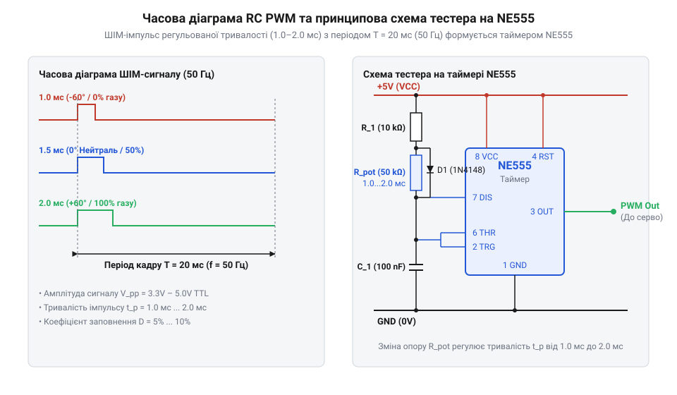
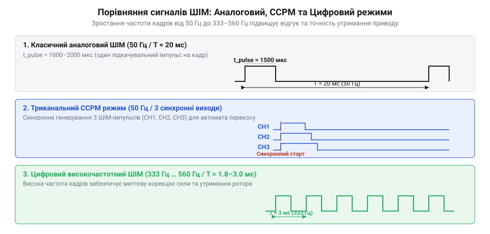

# Еволюція методів автономного тестування сервоприводів: від аналогових мультивібраторів до сервотестерів CCPM

## Проблема налагодження та народження протоколу

У 1960-х роках розвиток авіамоделізму зіштовхнувся з серйозним технічним бар'єром: для будь-якої перевірки, виставляння нейтрального положення або налаштування тяг сервоприводів моделістові доводилося вмикати громіздкий @@en|передавач@@ (від латинського *transmittere* — передавати). У лабораторних умовах це створювало чимало незручностей. Робота високочастотних радіомодулів у приміщенні викликала перешкоди на сусідніх каналах, швидко розряджала коштовні акумуляторні батареї, а випадкові наводки загрожували раптовим ривком привода й поломкою механіки. Виникла гостра потреба у компактному автономному пристрої, здатному імітувати вихідний сигнал радіоприймача без ефірного випромінювання.

Фундамент для такого інструмента заклала стандартизація пропорційного радіокерування. У середині 1960-х років американські інженери й піонери моделізму Даг Спренг (англ. @@en|Doug Spreng@@, який запатентував цифрову пропорційну систему у 1963 році) та Філ Крафт (англ. @@en|Phil Kraft@@, засновник компанії Kraft Systems) створили схеми з часовим розділенням каналів (англ. @@en|Time Division Multiplexing@@, TDM). Замість передачі різночастотних тонів передавач формував пачку імпульсів, де позиція кожного привода кодувалася тривалістю високого рівня від `1.0 мс` (крайнє ліве положення) до `2.0 мс` (крайнє праве), з нейтральною точкою `1.5 мс`.

Поширений міф стверджує, ніби діапазон `1.0–2.0 мс` був обраний через електромеханічні постійні часу моторів чи пропорційне аналогове кодування напруги. Насправді ця тривалість стала компромісом тогочасної дискретної транзисторної схемотехніки. У рамках стандартного кадру тривалістю `20 мс` (частота оновлення `50 Гц`), виділеного під механічний відгук тодішніх сервоприводів, послідовна пачка з 4–8 каналів тривалістю по `1–2 мс` та синхронізувальна пауза `4–10 мс` у протоколі PPM (англ. @@en|Pulse Position Modulation@@ — імпульсно-позиційна модуляція) ідеально вкладалися у часовий цикл без накладання сигналів. Механізм синхронізації спирався на тривалий спад рівня в кінці кадру (англ. @@en|Sync Gap@@): пасивний інтегрувальний @@en|RC-ланцюг@@ у демультиплексорі приймача накопичував заряд під час паузи, і коли її тривалість перевищувала поріг у `2.5–3.0 мс`, формувався імпульс скидання лічильника каналів у початковий стан. Якщо пауза ставала закороткою через максимальне відхилення всіх каналів або збій тривалості кадру, інтегратор не встигав спрацювати, що призводило до зсуву каналів і раптового зміщення сервоприводів. Для перевірки таких приводів на робочому столі інженери почали збирати перші лабораторні генератори прямокутних імпульсів.

Перші лабораторні генератори будувалися як стаціонарні вимірювальні стенди на дискретних радіолампах і перших германієвих транзисторах. Вони підключалися безпосередньо до кабелю привода й генерували еталонний ШІМ-сигнал з регульованою тривалістю `1.0–2.0 мс`, дозволяючи виставляти кути поворотних качалок, перевіряти плавність ходу редуктора й налаштовувати нейтраль без використання ефірного радіопередавача. Хоч такі стенди усунули залежність від радіоустаткування, вони залишалися надто громіздкими для польових умов, що спонукало до створення компактних портативних схем.

Головна схемотехнічна відмінність між цими рішеннями полягала в режимі комутації та узгодженні імпедансів. Лампові генератори працювали при високій анодній напрузі понад `100 В` і мали великий внутрішній опір триодів, через що крутизна фронтів прямокутних імпульсів виходила затягнутою (`t_rise > 10 мкс`), а схема вимагала громіздкого трансформаторного живлення й часу на прогрів. Перехід на германієві транзисторні ключі дозволив комутувати низьковольтний ланцюг `6–12 В` у режимі насичення з мінімальним залишковим опором. Це забезпечило формування крутих фронтів імпульсу (`t_rise < 1 мкс`), пряме узгодження з низькоомним входом підсилювача сервоприводу та можливість батарейного живлення.

## Епоха аналогових генераторів та NE555

Перше покоління автономних тестерів наприкінці 1960-х років будувалося на дискретних транзисторних чекаючих мультивібраторах (від латинського *multus* — численний та *vibro* — коливаюсь). Такі схеми вимагали ретельного добору парних транзисторів, високонадійних конденсаторів та подвійних змінних резисторів. Вони були громіздкими, чутливими до просідання напруги живлення та мали значну часову нестабільність.

Справжній прорив у схемотехніці відбувся у 1971 році, коли швейцарський інженер Ганс Камензінд (англ. @@en|Hans Camenzind@@), працюючи у компанії Signetics, винайшов легендарну мікросхему аналогового таймера NE555. Вона об'єднала на одному кремнієвому чипі два компаратори, прецизійний дільник напруги, тригер та розрядний транзистор.

*Часова діаграма сигналів сервоприводу та принципова схема генератора імпульсів 1.0–2.0 мс на аналоговому таймері NE555.*

На базі NE555 інженери створили класичний автономний @@en|сервотестер@@. Схема працювала у чекаючому або автоколивальному режимі, де @@en|потенціометр@@ (від латинського *potentia* — сила та грецького *metron* — міра) `R1` змінював опір у ланцюзі заряджання часозадавального конденсатора `C`. Це дозволяло плавно регулювати тривалість вихідного прямокутного імпульсу `t_pulse = 1.1 · R1 · C` в інтервалі від `1.0 мс` до `2.0 мс`. Період повторення кадру `T` обчислюють як суму тривалостей високого рівня `t_high` та розряду `t_low` через додатковий резистор `R2` та ємність `C`. Звідси частота повторення імпульсів `f` становить:

T = 0.693 · (R1 + 2 · R2) · C           [сума часу заряду й розряду ємності C]
f = 1 ÷ T = 1.44 ÷ ((R1 + 2 · R2) · C)  [обернена залежність кадрової частоти від R2]

Підбором опору розрядного резистора `R2` виставляли фіксовану паузу `t_low ≈ 18.5 мс`, що утримувало частоту проходження сигналів близько `50 Гц` при зміні тривалості імпульсу від `1.0 мс` до `2.0 мс`.

Попри простоту й доступність, аналогові тестери перших поколінь мали суттєві технічні обмеження:
- **Температурний дрейф**: при нагріві елементів або зміні температури довкілля ємність конденсаторів та опір резисторів плавали, викликаючи "дрейф нейтралі" (зсув центрального положення вала сервоприводу на `2–5%`).
- **Залежність від напруги**: просідання акумуляторного живлення змінювало пороги спрацьовування компараторів NE555, що вимагало додавання окремих інтегральних стабілізаторів напруги (типу 78L05).
- **Нелінійність шкали**: при регулюванні скважності потенціометром залежність тривалості імпульсу від кута повороту ручки була нелінійною через одночасну зміну частоти й коефіцієнта заповнення у фазах заряду та розряду ємності. Це стискало робочу шкалу біля меж `1.0 мс` і `2.0 мс`, ускладнюючи прецизійне виставляння нейтралі.

## Стандарт CCPM та триканальні тестери

У 1990-х роках бурхливий розвиток радіокерованих вертольотів створив новий виклик для сервісного обладнання. Керування орієнтацією та підйомною силою несучого гвинта вимагало складного механізму — @@en|автомата перекосу@@ (від англійського *swashplate* — похилий диск). Для зміни загального та циклічного кроку лопатей застосовували схему електронного мікшування (англ. @@en|Cyclic/Collective Pitch Mixing@@, CCPM), у якій тарілку перекосу утримували три сервоприводи, розташовані під кутом `120°` один до одного.

Механічне налаштування такої системи одноканальним тестером було надзвичайно складною задачею. Для точного виставляння горизонталі тарілки всі три приводи мали одночасно перебувати у строгому нейтральному положенні `1.5 мс`. Найменша розбіжність у кутах важелів призводила до самовільного нахилу моделі при підйомі.

Розв'язанням цієї проблеми наприкінці 1990-х років стала поява спеціалізованих триканальних CCPM-сервотестерів. Пристрій об'єднував три незалежні виходи, на які синхронно подавалися ШІМ-імпульси від спільного часозадавального генератора.

Тестери стандарту CCPM отримали три апаратні режими роботи:
- **Neutral (Нейтраль)**: фіксована генерація імпульсу `1.5 мс` (`1500 мкс`) на всіх трьох каналах одночасно для механічного виставляння качалок у горизонтальне положення. Синхронність виходів є критичною: при асинхронній подачі сигналів один привод рухається раніше за інші, через що жорстко зв'язане кільце створює вигинальне зусилля, яке викликає деформацію балок тарілки перекосу, заклинювання центрального слайдера на основному валу та пошкодження редукторів нерухомих сервоприводів.
- **Manual (Ручний)**: синхронне керування трьома приводами від одного потенціометра для перевірки відсутності заклинювання тяг у крайніх точках.
- **Auto / Wiper (Автомат)**: автоматична циклова хитавиця в діапазоні `1.0–2.0 мс` з регульованою швидкістю для технологічної обкатки моторів та пошуку зношених секторів потенціометрів зворотного зв'язку.

Завдяки трьом синхронним виходам тестери стандарту CCPM швидко вийшли за межі суто вертолітної діагностики. Авіамоделісти та робототехніки почали застосовувати їх для одночасного калібрування пари приводів елеронів, синхронізації двомоторних безколекторних регуляторів ходу та швидкої обкатки сервомодулів робототехнічних маніпуляторів. Поява таких приладів остаточно закріпила триканальний формат як лабораторний стандарт, але подальше зростання швидкодії електроніки вимагало від автономних тестерів принципово нової частотної гнучкості.

## Цифрова революція та високочастотні тестери

На початку 2000-х років у моделізмі відбувся перехід від класичних аналогових сервоприводів до цифрових приводів та безколекторних регуляторів ходу (англ. @@en|Electronic Speed Controller@@, ESC). Усередині цифрового привода з'явився власний @@en|мікроконтролер@@ (від грецького *mikros* — малий та латинського *controller* — управитель), який керував мотором через мостовий підсилювач із частотою кілька кілогерц.

*Порівняння часових сигнатур аналогових 50 Гц сигналів, триканальних вертолітних CCPM режимів та високочастотних цифрових протоколів 333–560 Гц.*

Традиційній аналоговій системі для оновлення показань вистачало кадрової частоти `50 Гц` (період `20 мс`). Натомість цифрові сервоприводи вимагали значно вищої швидкості оновлення команд для системи стабілізації. Це спричинило появу нових стандартів ШІМ-сигналу:
- **Високочастотний режим (High-Frequency Mode)**: підвищення кадрової частоти до `333 Гц`, `560 Гц` і вище. Час між імпульсами скоротився з `20 мс` до `1.8–3.0 мс`. При подачі такої частоти на аналоговий сервопривод його колекторний мотор миттєво перегрівається: індуктивність обмоток ротора `L` при кожному вимкненні силових ключів створює високовольтний сплеск проти-ЕРС `V = -L · (di/dt)`. На частоті `333 Гц` кількість цих сплесків зростає майже в сім разів, захисні діоди та обмотки не встигають розсіювати індуктивне тепло, а інертний колекторний ротор перетворює високочастотну комутаційну потужність на руйнівний нагрів.
- **Вузькосмуговий центр (Narrow-Band Center)**: скорочення тривалості нейтрального імпульсу з `1500 мкс` до `760 мкс` (або `960 мкс`), що дозволило вмістити повне відхилення `±400 мкс` у надкороткий період оновлення.

Використання високочастотних режимів висунуло жорсткі вимоги до діагностичного обладнання. Подача сигналу з частотою `333 Гц` або вузьким центром `760 мкс` на старий аналоговий сервопривод призводить до його негайного перегріву й згоряння електронного підсилювача, оскільки аналогова схема сприймає часті імпульси як суцільну стовідсоткову напругу. Для запобігання фатальній помилці у приладах застосовують схему апаратного захисту: при виборі високочастотного режиму мікроконтролер блокує вихідний сигнал силовим ключем на @@en|MOSFET-транзисторі@@ та моніторить струм споживання через токовимірювальний шунт `0.1 Ом`. Якщо апаратний компаратор фіксує аномальний стрибок струму, характерний для перевантаженого аналогового підсилювача, електронний ключ миттєво знеструмлює лінію живлення й виводить застереження на екран. Сучасні мікропроцесорні тестери оснащуються рідкокристалічними дисплеями, високопрецизійним відліком мікросекунд (`1 мкс`) та перемикачем режимів (`50 Гц / 125 Гц / 250 Гц / 333 Гц / 760 мкс`), гарантуючи безпечне перевіряння приводів усіх технологічних епох.
