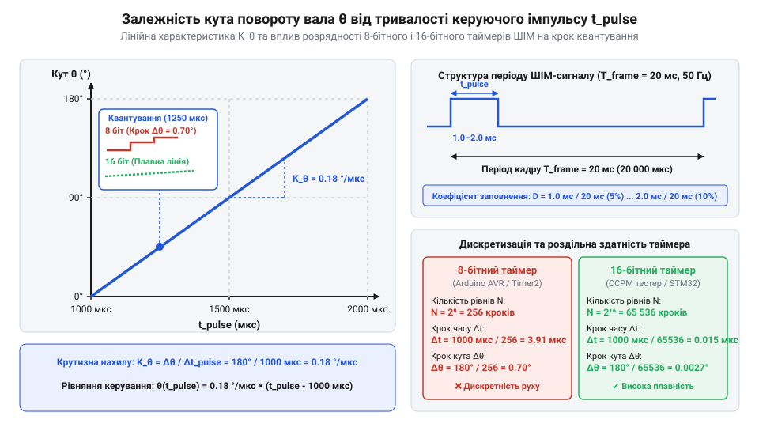

# Математичний розрахунок таймінгів ШІМ, кутового розрізнення та коефіцієнта заповнення

## Залежність кута повороту від тривалості імпульсу

Перетворення часових параметрів електричного сигналу на геометричне переміщення є базовою задачею безконтактного керування приводами. У протоколі керування аналоговими й цифровими серводвигунами інформаційним параметром є тривалість вимірювального прямокутного імпульсу `t_pulse`, який повторюється з кадровим періодом `T = 20 мс` (частота `f = 50 Гц`).

Стандартний діапазон зміни тривалості імпульсу становить від `1000 мкс` до `2000 мкс`. При цьому тривалості `t_min = 1000 мкс` відповідає крайній лівий кут повороту вала `θ = 0°` (або мінімальний газ регулятора ESC `0%`), нейтральному імпульсу `t_neutral = 1500 мкс` відповідає центральне положення `θ = 90°` (газ `50%`), а максимальному імпульсу `t_max = 2000 мкс` — кут `θ = 180°` (газ `100%`). Проте при нагріві тестера відносна нестабільність частоти опорного тактового генератора `Δf / f` (виражена в мільйонних частках, @@en|PPM@@ — англ. @@en|parts per million@@) викликає часовий зсув тривалості нейтралі `Δt_neutral = - t_neutral · (Δf / f)`. При температурному дрейфі кварцового генератора `Δf / f = 100 PPM` (тобто `100 · 10⁻⁶`) часовий зсув становить `Δt_neutral = 1500 мкс · 100 · 10⁻⁶ = 0.15 мкс`, що викликає лінійне кутове усунення центрального положення вала `Δθ_drift = Δt_neutral · K_θ = 0.15 мкс · 0.18 °/мкс = 0.027°` (а для дешевих бескварцевих RC-генераторів із дрейфом `2000 PPM` це призводить до значного виходу нейтралі на `Δt_neutral = 3 мкс` та кутового дрейфу `Δθ_drift = 0.54°`).

Зв'язок між кутом повороту `θ` та тривалістю імпульсу `t_pulse` у робочому діапазоні є суворо лінійним. Масштабний коефіцієнт крутизни `K_θ` визначає кутову чутливість приводу до зміни ширини імпульсу на одну мікросекунду:

```
K_θ = (180° - 0°) ÷ (2000 мкс - 1000 мкс)   [ділення кутового діапазону на часовий]
    = 180° ÷ 1000 мкс                       [обчислення різниці]
    = 0.18 °/мкс                            [коефіцієнт крутизни]
```

Для знаходження довільного кута повороту `θ` за відомою тривалістю керуючого імпульсу `t_pulse` застосовують пряме лінійне рівняння:

```
θ = (t_pulse - 1000) · K_θ                  [лінійне рівняння кута повороту]
```

Оскільки вимірювальний імпульс існує лише частину кадрового періоду `T = 20000 мкс`, відносне заповнення ШІМ (`@@en|duty cycle@@`, `D_pwm`) у відсотках розраховується як відношення тривалості імпульсу до повного періоду:

```
D_pwm = (t_pulse ÷ T) · 100%                [обчислення коефіцієнта заповнення]
```

Для мінімального імпульсу `t_pulse = 1000 мкс` заповнення дорівнює `D_pwm = 5%`, для нейтрального `1500 мкс` — `D_pwm = 7.5%`, а для максимального `2000 мкс` — `D_pwm = 10%`.

Для розв'язання зворотної задачі — обчислення необхідної тривалості імпульсу `t_pulse` за заданим кутом повороту вала `θ` — виконаємо алгебричне ізолювання змінної `t_pulse` із прямого лінійного рівняння:

```
θ ÷ K_θ = t_pulse - 1000                    [ділення обох частин на крутизну K_θ]
t_pulse = 1000 + θ ÷ K_θ                    [перенесення мінімальної межі 1000 мкс]
t_pulse = 1000 + (θ · 1000) ÷ 180           [підстановка значення K_θ = 0.18 °/мкс]
```

Отримане рівняння дозволяє мікроконтролеру або алгоритму тестера обчислювати точну тривалість прямокутного імпульсу `t_pulse` у мікросекундах для довільного цільового кута `θ` в межах від `0°` до `180°`.

Для розширених моделей сервоприводів із кутом робочого ходу `270°` або `360°` (з вимірювальним інтервалом імпульсу від `500 мкс` до `2500 мкс`) універсальна лінійна модель зберігає свою структуру, змінюючи лише значення межевих констант та крутизни `K_θ`. Завдяки цьому математичному виведенню мікроконтролер тестера здійснює пряме й зворотне перетворення кутових координат чи відсотків газу у регістри таймера ШІМ без виникнення накопичувальної похибки обчислень.

Проте реальна лінійність регулювання обмежується апаратною зоною нечутливості цифрової схеми приводу — @@en|deadband@@ (від англійського *deadband*; зона мертвої ходи, `t_db`), яка запобігає безперервному тремтінню (дребезгу) редуктора від мікрошумів сигналу. Схема не реагує на зміни тривалості імпульсу, якщо `|Δt_pulse| ≤ t_db / 2`. Це створює ділянку локальної нелінійності навколо кожного поточного положення вала, а мінімальний кут нечутливості `Δθ_deadband` обчислюється як:

```
Δθ_deadband = t_db · K_θ                        [кутова зона нечутливості приводу]
```

Для типового сервоприводу із зоною нечутливості `t_db = 4 мкс` та крутизною `K_θ = 0.18 °/мкс` кутова зона мертвої ходи становить `Δθ_deadband = 4 мкс · 0.18 °/мкс = 0.72°`. Отже, будь-які зміни вхідного ШІМ-сигналу, менші за `4 мкс`, не викличуть повороту вала, що формує фізичний поріг точності позиціонування незалежно від високої розрядності генератора тестера.

## Дискретність таймера та кутова роздільна здатність

Цифрові генератори тестерів та мікроконтролери формують імпульси ШІМ за допомогою аппаратних таймерів-лічильників. Внутрішній регістр таймера квантує час дискретними кроками `Δt_step`, залежно від тактової частоти й коефіцієнта дільника (`@@en|timer prescaler@@`). Крок квантування часу безпосередньо визначає мінімально можливу кутову роздільну здатність (`@@en|angular resolution@@`, `Δθ_min`).

При використанні 8-бітного таймера з базовою ємністю `2ⁿ = 256` відліків на повний кадр `20 мс` тривалість одного таймерного такту становить:

```
Δt_step = 20000 мкс ÷ 256 ≈ 78.125 мкс       [дискретність 8-бітного кадру]
```

Оскільки корисний вимірювальний інтервал від `1000` до `2000 мкс` займає лише `1000 мкс`, кількість дискретних градуйованих рівнів усередині цього діапазону складає `N = 1000 ÷ 78.125 = 12.8` кроків. У цьому разі найменша кутова дискретність приводу виявляється неприпустимо грубою:

```
Δθ_min = 180° ÷ 12.8 ≈ 14.06°               [кутова похибка 8-бітного таймера]
```

Для досягнення високої точності позиціонування застосовують 16-бітні таймери або оптимізоване тактування. При тактовій частоті таймера `f_timer = 2 МГц` тривалість одного дискретного відліку становить `Δt_step = 1 ÷ 2000000 = 0.5 мкс`.


*Залежність кута повороту від тривалості імпульсу: грубі 14-градусні сходинки 8-бітного таймера проти високоточної лінійної характеристики 16-бітного таймера з роздільністю 0.09°.*

За цієї дискретності вимірювальний інтервал `1000 мкс` розбивається на `N = 1000 ÷ 0.5 = 2000` градацій. Тоді кутова роздільна здатність покращується до:

```
Δθ_min = 180° ÷ 2000 = 0.09°                [кутова роздільність 16-бітного таймера]
```

Для регуляторів ESC така дискретність забезпечує похибку керування газом `100% ÷ 2000 = 0.05%`, що дозволяє дуже плавно змінювати оберти безколекторного мотора. Кількісно ця плавність описується квантуванням частоти обертів мотора @@en|rotational speed@@ (в обертах за хвилину, `RPM`), яка залежить від кількості полюсів ротора `P` (або пар полюсів `p = P / 2`). Якщо максимальна частота обертів становить `RPM_max`, мінімальний крок зміни обертів `ΔRPM` та відповідний крок електричної частоти комутації `Δf_el` обчислюються за формулами:

```
ΔRPM = RPM_max ÷ N                              [крок квантування механічної швидкості мотора]
Δf_el = (ΔRPM · (P ÷ 2)) ÷ 60                   [крок зміни електричної частоти комутації]
```

Наприклад, для безколекторного мотора з `P = 14` полюсами (`p = 7` пар полюсів) при максимальних обертах `RPM_max = 14000 RPM` та `N = 2000` кроках 16-бітного таймера мінімальна зміна швидкості становить всього `ΔRPM = 14000 ÷ 2000 = 7 RPM` (`Δf_el = (7 · 7) ÷ 60 ≈ 0.82 Гц`). Натомість при 8-бітному таймері з `N = 12.8` кроку `ΔRPM` досягає грубих `1093.75 RPM`, спричиняючи відчутні ривки та нестабільність утримання тяги. Понад те, дискретність таймера визначає крок квантування фазного струму мотора `ΔI` при комутації ключів регулятора ходу @@en|ESC@@. При напрузі силової шини `V_bus = 24 В` та активному опорі фази `R_m = 0.1 Ом` зміна коефіцієнта заповнення на один крок `ΔD = 1 ÷ N` призводить до стрибка струму `ΔI = (V_bus · ΔD) ÷ R_m`. Для 16-бітного таймера з `N = 2000` кроками (`ΔD = 0.0005`) крок струму становить всього `ΔI = (24 · 0.0005) ÷ 0.1 = 0.12 А`, забезпечуючи плавне наростання крутного моменту без сплесків. Натомість при 8-бітному таймері з `N = 12.8` кроку (`ΔD ≈ 0.078125`) мінімальний стрибок струму сягає катастрофічних `ΔI = (24 · 0.078125) ÷ 0.1 = 18.75 А`, що викликає ударні комутаційні перевантаження силових транзисторів, пульсації моменту та інтенсивний електромагнітний шум.

## Динаміка відгуку та розрахунок кутової швидкості

У реальних приводах вал не змінює положення миттєво при стрибкоподібній зміні тривалості вхідного імпульсу з `t_1` до `t_2`. Механічна швидкість обертання обмежується моментом електродвигуна й передаточним відношенням внутрішнього редуктора. Паспортна швидкість серводвигунів зазвичай вказується як час повороту на фіксований кут `60°` під номінальною напругою (наприклад, `S_60 = 0.15 с / 60°`).

Середня кутова швидкість обертання вала `ω` у градусах за секунду обчислюється як відношення еталонного кута до паспортного часу:

```
ω = 60° ÷ S_60                              [обчислення кутової швидкості]
```

Загальний час механічного переміщення `t_motion` на кут `Δθ` становить `t_motion = Δθ ÷ ω`. Проте повна затримка відгуку `t_total` складається з часу механічного повороту та часової затримки оновлення кадру ШІМ (до `T = 20 мс`), необхідної для зчитування нового значення внутрішньою схемою приводу:

**Умова: Розрахунок часу повороту вала сервоприводу зі швидкістю 0.15 с / 60° при стрибку імпульсу від 1200 мкс до 1800 мкс з урахуванням кадрової затримки 20 мс.**

```
Δt_pulse = 1800 мкс - 1200 мкс = 600 мкс    [різниця тривалості імпульсу]
Δθ = 600 мкс · 0.18 °/мкс = 108°            [обчислення кута переміщення]
ω = 60° ÷ 0.15 с = 400 °/с                  [обчислення кутової швидкості]
t_motion = 108° ÷ 400 °/с = 0.27 с          [час механічного переміщення]
t_total = 0.27 с + 0.02 с = 0.29 с           [повний час відгуку з урахуванням кадру]
```

Таким чином, для завершення повороту вала на `108°` приводу з швидкістю `0.15 с / 60°` потрібно сумарно `0.29 с`.

У системі автопілота чи сервотестера динаміка стає критичною під час гармонійного відпрацювання коливальних команд. Якщо вхідний траєкторний сигнал змінюється за синусоїдою з амплітудою `A` та частотою `f_in`, сумарна затримка відгуку `t_total` створює фазове запізнення вала. Для оцінки величини розсогласування застосовують математичний вираз @@en|dynamic positioning error@@ (від англійського *dynamic positioning error*; максимальна динамічна похибка позиціонування, `Δθ_dyn`): `Δθ_dyn = 2 · A · sin(π · f_in · t_total)`. Окрім кутового фазового зсуву, механічна інерція ротора та редуктора обмежує передачу високочастотних коливань, що визначається @@en|amplitude-frequency response@@ (від англійського *amplitude-frequency response*; амплітудно-частотна характеристика, `АЧХ`). Серводвигун поводиться як @@en|low-pass filter@@ (від англійського *low-pass filter*; фільтр нижніх частот першого порядку) з графіком амплітуди `A_out(f_in) = A ÷ √(1 + (f_in ÷ f_3dB)²)`, де @@en|cutoff frequency@@ (від англійського *cutoff frequency*; частота зрізу, `f_3dB ≈ 1 ÷ (2 · π · t_motion)`). При зростанні частоти вхідних команд за межу зрізу (`f_in > f_3dB`) розмах повороту вала згасає зі швидкістю `-20 дБ/декаду`: на частоті `f_3dB` амплітуда падає до `70.7%` від початкової (`-3 дБ`), а на вищих частотах привід втрачає здатність відпрацьовувати задану кутову амплітуду `A`, перетворюючи гармонійне керування на згладжену низькоамплітудну вібрацію.

```
Δθ_dyn = 2 · A · sin(π · f_in · t_total)         [максимальна динамічна похибка траєкторії]
```

де `A` — амплітуда коливань вала в градусах, `f_in` — частота синусоїдального сигналу в герцах, `t_total` — повна затримка відгуку приводу в секундах, а `sin` — тригонометрична функція синуса. При амплітуді `A = 30°`, частоті траєкторії `f_in = 1 Гц` та затримці `t_total = 0.05 с` похибка досягає `Δθ_dyn = 2 · 30° · sin(π · 1 · 0.05) ≈ 9.39°`, що спричиняє розгойдування та втрату точності позиціонування робочого органу.
