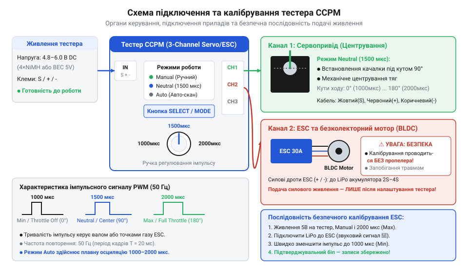

# Практичне виставляння нейтралі сервоприводів та калібрування діапазону газу ESC безколекторного мотора

## Підключення живлення та вибір режимів

Подача нестабільної напруги або спроба налаштування сервосистем без еталонного сигнального джерела призводить до хаотичного смикання вала, втрати точності позиціонування та збоїв внутрішнього контролера приводу. Без стабільного генератора керуючих імпульсів неможливо об'єктивно оцінити працездатність механіки та електроніки.

Для створення еталонного вимірювального стенда використовують триканальний @@en|CCPM-тестер@@ (англ. *@@en|CCPM@@*, від *Cyclic/Collective Pitch Mixing*). Пристрій вимагає постійної напруги живлення в діапазоні 4,8–6,0 В, яку подають на вхідні клеми від зовнішнього акумулятора або вбудованого модуля @@en|BEC@@ (англ. *@@en|Battery Eliminator Circuit@@*, від *battery eliminator*) регулятора ходу. Підключення органів керування здійснюється через стандартний триконтактний роз'єм: контакт заземлення GND (коричневий або чорний дріт), лінія живлення VCC (червоний дріт) та сигнальна лінія Signal (жовтий або помаранчевий дріт). Переполюсування роз'єму не виводить пристрій з ладу, проте блокує передачу @@en|PWM-сигналу@@ (англ. *@@en|PWM@@*, від *Pulse-Width Modulation*). Детальніше про принципи роботи та особливості вибору знижувальних модулів можна дізнатися в статті про [джерела живлення BEC та UBEC](root:cat-hw-power/bec-ubec).

Вибір режиму роботи тестера здійснюється послідовним натисканням кнопкового селектора, що циклічно перемикає три стани: ручний @@en|Manual@@ (потенціометр задає тривалість імпульсу від 1000 до 2000 мкс), фіксовану нейтраль @@en|Neutral@@ (строго 1500 мкс) та автоматичний свип @@en|Auto@@ (плавне коливання в усьому діапазоні).

Окрему увагу слід приділити електричним межам пристрою: подача напруги живлення понад 6.0 В безпосередньо на шину живлення та логічні входи тестера є суворо неприпустимою. Підключення високовольтних джерел без знижувального модуля @@en|BEC@@ (наприклад, багатоелементних акумуляторних батарей із напругою 7.4–11.1 В) спричиняє електричний пробій чутливих портів введення-виведення та незворотне термічне пошкодження напівпровідникової структури мікроконтролера. При одночасному підключенні трьох потужних сервоприводів пускові струми колекторних моторів та індуктивні сплески проти-ЕРС при вимкненні обмоток створюють високочастотні імпульсні наводки й кидки напруги на спільній шині. Для захисту логічного входу мікроконтролера від струмових перевантажень та імпульсних перенапруг у схемотехніці вимірювальних каналів застосовують послідовні струмообмежувальні резистори номіналом 100–330 Ом у поєднанні з захисними обмежувальними діодами (англ. @@en|TVS diodes@@, від *Transient Voltage Suppressor*) та шунтувальними фільтрувальними конденсаторами. Цей низькочастотний @@en|RC-фільтр@@ зрізає шкідливі піки індуктивних викидів, фіксує амплітуду сигналу в безпечних межах 0…VCC та запобігає збоям тактування й апаратному пробою логіки.

*Схема підключення тестера CCPM до джерела живлення, сервоприводу та регулятора ходу ESC безколекторного мотора з позначенням діапазону імпульсів 1000–2000 мкс.*

Зібравши таку схему, майстер отримує автономний інструмент, готовий до прецизійного налаштування механічної геометрії та програмування силових контролерів.

## Механічне центрування качалок у Neutral

Установка рульових качалок на очі без попереднього електричного встановлення вала в нульове положення призводить до асиметрії робочих кутів приводу та обмеження ходу тяг в один із боків. Програмна компенсація такого зсуву в передавачі звужує корисний динамічний діапазон і зменшує підсумкове зусилля на валу.

Фізичним змістом нульового положення будь-якого @@en|сервопривод@@а (англ. *@@en|servo@@*, від лат. *@@lat|servus@@*, слуга) є тривалість керуючого імпульсу, що становить строго 1500 мкс. При такій тривалості внутрішній мостовий підсилювач порівнює сигнал з аналоговим потенціометром зворотного зв'язку і фіксує мостову схему в стані рівноваги. Режим @@en|Neutral@@ тестера формує цей еталонний електричний нуль.

Методика механічного центрування полягає в наступній послідовності кроків:
1. Переключити тестер у режим @@en|Neutral@@ кнопковим селектором, переконавшись у подачі імпульсу 1500 мкс.
2. Надіти @@en|качалка@@у на шліцьовий вал приводу, прагнучи встановити її під кутом строго 90° до корпусу або напрямку рульової тяги.
3. Якщо кутовий крок @@de|шліц@@ів (нім. *@@de|Schlitz@@*, щілина) не дозволяє дістати ідеальний перпендикуляр, повернути качалку на 180° або використати інше плече хрестоподібної насадки.
4. Відрегулювати довжину рульової тяги обертанням різьбових наконечників до досягнення нульового відхилення робочого органу.

Коли сервопривід має вихідний вал із непарною кількістю шліців (наприклад, поширений стандарт 25T з кроком 360° ÷ 25 = 14.4°), протилежні плечі багатопроменевої качалки зміщені одне відносно одного на півкроку зубця (7.2°). Поворот насадки на 90° або 180° змінює взаємну орієнтацію зубців відносно вала, що дозволяє суттєво зменшити кутову похибку. Якщо ж дискретний крок шліців усе одно не дає змоги виставити ідеальний перпендикуляр, застосовують спеціальні розрізні або ексцентрикові регульовані качалки. Завдяки цанговому гвинтовому затискачу така качалка плавно повертається на валу на будь-який довільний кут перед остаточною фіксацією гвинтом, що повністю ліквідує дискретну кутову похибку шліцьового з'єднання.

Такий підхід повністю усуває потребу у програмному тримінгу та зберігає рівномірне зусилля й однакові кутові відхилення вала в обидва боки.

## Безпечне калібрування діапазону газу ESC

Спроба первинного запуску безколекторного мотора без калібрування меж газу регулятора @@en|ESC@@ (англ. *@@en|Electronic Speed Controller@@*, від *speed controller*) створює ризик раптового старту двигуна на максимальних обертах. Спроба коригування параметрів із встановленим пропелером становить пряму загрозу травмування. Тому першим і обов'язковим правилом є повний демонтаж повітряного гвинта або силового шківа з вала мотора перед подачею живлення.

Калібрування полягає у записі крайових точок газу @@en|Max Throttle@@ (2000 мкс) та @@en|Min Throttle@@ (1000 мкс) у пам'ять мікроконтролера @@en|ESC@@. Послідовність дій у режимі @@en|Manual@@ тестера наступна:
1. Зняти силове живлення з @@en|ESC@@.
2. Увімкнути тестер, перевести його в режим @@en|Manual@@ та повернути ручку потенціометра у крайнє праве положення (2000 мкс).
3. Подати силове живлення на @@en|ESC@@ від акумуляторної батареї.
4. Дочекатися звукового сигналу вбудованого @@en|біпер@@а (англ. *@@en|beeper@@*, від *beep*) — двох коротких тонів, що підтверджують зчитування максимальної межі газу @@en|Max Throttle@@.
5. Протягом двох секунд перевести потенціометр тестера у крайнє ліве положення (1000 мкс).
6. Вислухати підтверджувальну серію звукових сигналів (кількість звуків відповідає кількості банок акумулятора, після чого лунає довгий сигнал про успішне армування).

Нижче наведено програмну реалізацію керування ШІМ-імпульсами та автомата калібрування на мовах C та C++:

:::tabs
@tab C
:::code proj-servo-neutral-setup-and-esc-calibration/c/servo_tester.h
:::code proj-servo-neutral-setup-and-esc-calibration/c/servo_tester.c
@tab C++
:::code proj-servo-neutral-setup-and-esc-calibration/c/cpp/servo_tester.hpp
:::code proj-servo-neutral-setup-and-esc-calibration/c/cpp/servo_tester.cpp
:::

Після виконання цієї процедури регулятор ходу забезпечує суворо лінійне нарощування обертів двигуна у відповідь на зміну ширини імпульсу від 1000 до 2000 мкс.

## Перевірка синхронності в режимі Auto

При складанні багатоприводних систем (наприклад, елеронів крила літака або роторного паука гелікоптера) критично важливо гарантувати однакову швидкість та відсутність механічного заклинювання приводів. Приховані дефекти шестерень або міжвиткові замикання двигунів неможливо виявити при статичній перевірці нейтралі.

Для комплексної діагностики використовують режим автоматичного сканування @@en|Auto-sweep@@, який плавно змінює тривалість ШІМ-імпульсу від 1000 до 2000 мкс і назад із заданим часовим кроком. Три сервоприводи підключають паралельно до вихідних каналів тестера.

Під час циклічного руху виконують такі вимірювання та спостереження:
- **Оцінка синхронності:** візуально контролюють паралельність руху качалок усіх приводів. Відставання одного з приводів свідчить про знос мотора або високий тренувальний опір.
- **Пошук механічного @@de|люфт@@у:** (нім. *@@de|Luft@@*, зазор) при зміні напрямку руху стежать за затримкою рушійного плеча. Занадто великий мертвий хід вказує на спрацювання зубів @@lat|редуктор@@а (лат. *@@lat|reductio@@*, зменшення).
- **Виявлення заклинювання та перевантаження:** під час заклинювання зубчастої передачі струм споживання приводу різко зростає, спричиняючи просідання напруги живлення, підвищене нагрівання корпусу та характерне високочастотне гудіння.

Опанувавши режим автосканування, технічний фахівець отримує змогу забракувати дефектні компоненти ще до їх монтажу на реальний об'єкт.
