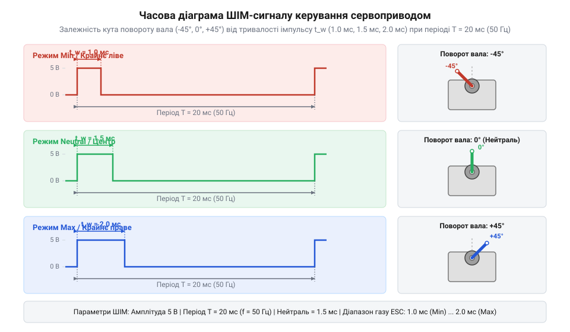
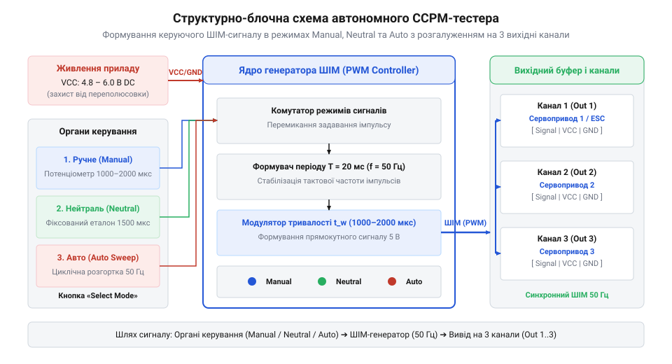
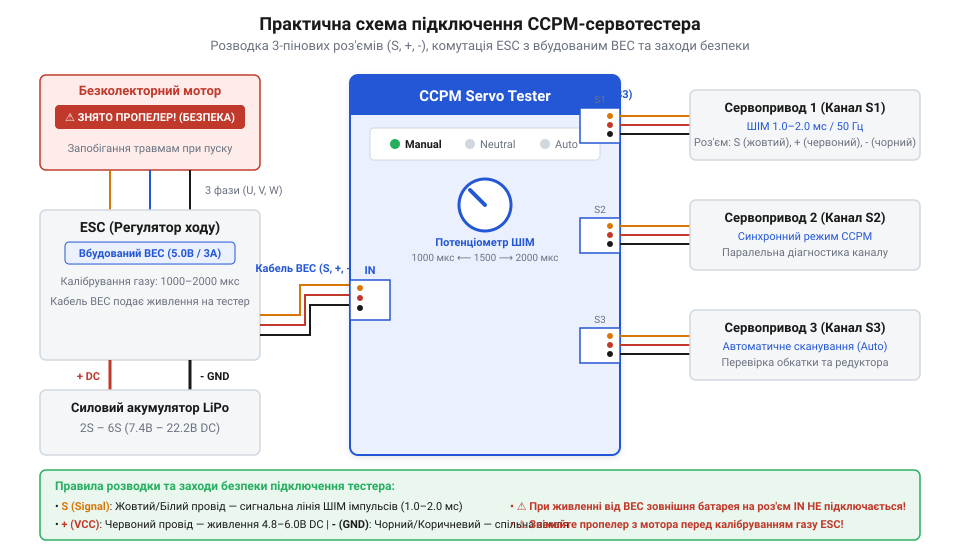

# Тестер серво та ESC (CCPM)

## Проблема налагодження приводів без апаратури

Під час складання роботизованих маніпуляторів, шасі безпілотних апаратів чи рульових поверхонь моделей інженер неминуче стикається з необхідністю механічного виставляння «нуля» вала приводу перед затягуванням кріпильної качалки. Якщо зафіксувати важіль на шліцах знеструмленого ротора, після подачі живлення внутрішня система зворотного зв'язку [сервоприводу радіокерованих моделей](root:cat-hw-actuators/rc-servo-mechanisms-and-control) миттєво поверне вал у нейтральне положення, що спричинить викривлення геометрії усієї тяги або навіть механічне заклинювання. Фізичний механізм такого викривлення розгортається внаслідок неузгодженості кута вала та положення качалки: під час подачі живлення мостова схема внутрішнього підсилювача фіксує відхилення потенціометра від нейтральної точки й подає повний струм на мотор для усунення помилки. Оскільки качалка вже жорстко з'єднана з нерухомим важелем чи шарніром, вихідний ротор намагається повернутися у вихідне положення під дією обертового моменту редуктора, що перетворює кутовий зсув у значне поздовжнє зусилля стиску чи розтягу вздовж осі тяги, викликаючи її пластичний вигин, зріз шліців пластикового адаптера або аварійне блокування двигуна.

Традиційний шлях подачі керуючого сигналу вимагає розгортання повного комплекту радіокерування: підключення приймача, з'єднання його з бортовим акумулятором та ввімкнення передавача. На стенді чи в польових умовах це створює зайву громіздкість. Альтернатива у вигляді прошивання лабораторного мікроконтролера для генерації потрібної частоти відбирає дорогоцінний час і вимагає наявності комп'ютера. Технічна складність використання мікроконтролера полягає в необхідності точного налаштування апаратних таймерів (наприклад, `Timer1` у режим порівняння) для стабільного формування періоду `20 мс` і тривалості активного стану `1000–2000 мкс`. Використання програмних затримок `delayMicroseconds()` замість апаратних таймерів викликає фазовий @@en|jitter@@ через переривання інших периферійних вузлів, що призводить до самовільного дрижання вала приводу. Крім того, розробник змушений монтувати зовнішній потенціометр, збирати окрему силову шину живлення з розв'язкою (оскільки виходи плат 3.3 В чи 5 В не розраховані на пускові струми двигунів до `1.5–2.0 А`) та захищати шину USB від індукованих сплесків зворотної ЕРС мотора. Подібні складнощі виникають і під час перевірки [безколекторних регуляторів ходу](root:cat-hw-drivers/bldc-electronic-speed-controllers), де перед першим запуском двигуна необхідно встановити й відкалібрувати межі високого та низького рівня газу.

Відсутність мобільного інструмента робить перевірку плавності ходу редуктора, виявлення мертвих зон чи пропущених зубців у польових умовах тривалою та незручною операцією. Спроба оцінити затримку реакції приводу або знайти зони нечутливості за допомогою лабораторного осцилографа вимагає розгортання громіздкого обладнання, підключення струмових вимірювальних шунтів та складного налаштування двоканальної синхронізації фронтів сигналу й пускових струмів двигуна. У польовому чи монтажному середовищі осцилограф показує лише електричну осцилограму, але не дає змоги плавно «руками» зсувати тривалість імпульсу та одночасно спостерігати за механічним відгуком качалки й шумом зубчастої передачі. Саме ця потреба зумовила появу компактного автономного генератора — тестера сервоприводів та регуляторів ходу (`@@en|CCPM servo tester@@`), який живиться безпосередньо від невеликої батареї й видає стандартний ШІМ-сигнал без залучення радіоефіру чи складної обчислювальної техніки. Детальніше про те, як розробники еволюціонували від простіших схематичних рішень до сучасних пристроїв, можна прочитати у викладі про [еволюцію методів автономного тестування](root:cat-hw-instruments/servo-esc-tester/hist-servo-tester-and-rc-pwm-evolution.md) сервоприводів.

Завдяки цьому інженер отримує можливість миттєво підключати приводи на складальному верстаті чи в польових умовах, виставляти кутову нейтраль поверхонь керування, подавати фіксовані або плавно регульовані ШІМ-імпульси та первинно налаштовувати безколекторні мотори. Автономний тестер усуває ризик непередбачуваного спрацьовування силових агрегатів від випадкових перешкод у радіоефірі та суттєво скорочує час діагностики й механічного монтажу обладнання.

## Принцип дії та параметри ШІМ

Автономний тестер формує сигнал широтно-імпульсної модуляції (`@@en|pulse-width modulation@@`, `ШІМ`), який є стандартом керування аналоговими й цифровими сервомоторами (від латинського *servus* — помічник; `@@en|servo motor@@`). Фізична суть такого керування полягає не у зміні амплітуди напруги живлення, а в точному дозуванні тривалості прямокутного імпульсу в межах кожного періоду повторення. При цьому амплітуда логічного сигналу ШІМ визначається вихідним каскадом тестера і зазвичай становить `5 В` (транзисторно-транзисторна логіка, від англ. @@en|transistor-transistor logic@@; `TTL`) або `3.3 В` (CMOS-логіка). Більшість сучасних сервоприводів та регуляторів ходу розраховані на сумісність із цими стандартами: їхні інформаційні входи сприймають високий логічний рівень починаючи від порогової напруги спрацьовування `V_IH ≈ 2.0 В`, що дозволяє приводам із живленням `5 В` або `6 В` надійно розпізнавати прямокутні імпульси як від 5-вольтних класичних тестерів, так і від 3.3-вольтних мікроконтролерів без застосування додаткових узгоджувачів рівнів.

Період повторення імпульсів у класичному протоколі становить `T = 20 мс`, що відповідає постійній частоті кадрів `f = 50 Гц`. Вибір цієї частоти в аналогових сервосистемах обумовлений вимогами багатоканальної радіоапаратури часового розділення каналів та термічними обмеженнями колекторних моторів: частота 50 Гц гарантує стабільне утримання позиції вала без ризику перегріву вихідних ключів і обмоток ротора при формуванні одного силового підкачувального імпульсу на кадр. Усередині кожного кадру тривалістю `20 мс` тестер генерує один позитивний вимірювальний імпульс `t_pulse`, тривалість якого варіюється в суворо визначеному інтервалі від `1000 мкс` до `2000 мкс`:

```
t_pulse = 1000 мкс  →  крайнє ліве положення вала (0°) / мінімальний газ ESC (0%)
t_pulse = 1500 мкс  →  нейтральне положення вала (90°) / середина газу ESC (50%)
t_pulse = 2000 мкс  →  крайнє праве положення вала (180°) / максимальний газ ESC (100%)
```


*Часова діаграма прямокутних імпульсів ШІМ із частотою 50 Гц: зміна тривалості імпульсу від 1.0 мс до 2.0 мс задає пропорційний кут повороту ротора.*

Внутрішній електронний підсилювач сервоприводу порівнює тривалість вхідного імпульсу `t_pulse` із тривалістю власного внутрішнього опорного імпульсу, який формується вбудованим потенціометром (від латинського *potentia* — сила та *metron* — вимір; `@@en|potentiometer@@`), зв'язаним із вихідним валом. Якщо виникає неузгодженість, схема подає струм на мостовий драйвер двигуна доти, доки кут повороту не зрівняє тривалості обох імпульсів. При цьому принципова відмінність між аналоговими та цифровими серводвигунами полягає в частоті внутрішнього силового керування мотором: аналогова схема подає один корегувальний сплеск струму на мостовий драйвер лише один раз за кадровий період (з частотою 50 Гц), що знижує точність утримання вала у паузах між імпульсами. Натомість цифровий сервопривод містить власний мікроконтролер, який оцифровує вхідний 50-герцовий імпульс і формує внутрішній високочастотний ШІМ-сигнал керування мотором з частотою 300 Гц і вище, забезпечуючи миттєвий відгук на найменше відхилення та високий моментовий опір. Більш детальні розрахунки кутового розрізнення та коефіцієнта заповнення наведено в матеріалі про [розрахунок таймінгів ШІМ](root:cat-hw-instruments/servo-esc-tester/math-servo-pwm-timing-and-resolution-calculations.md) та кутового розрізнення.

## Режими роботи та схемотехніка тестера

Схемотехніка класичного CCPM-тестера (від англійського `@@en|Cyclic/Collective Pitch Mixer@@` — змішувач циклічного та колективного кроку автомат-перекосу гелікоптера) будується на основі аналогового таймера `NE555` або компактного 8-бітного мікроконтролера, який керує триканальним вихідним буфером. Пристрій має два банки трьохконтактних роз'ємів стандарту `DuPont`: вхідний банк для подачі постійного живлення значенням `4.8–6.0 В` та вихідний банк для одночасного підключення до трьох приводів чи регуляторів. Внутрішня організація буферного підсилювача базується на паралельних логічних інверторах або роздавальних транзисторних ключах із низьким вихідним опором, що розгалужують один сигнал задавального генератора на три незалежні лінії без просідання напруги та викривлення фронтів імпульсів. Кожен вихідний вивід сигнальної лінії захищений послідовним резистором номіналом 100–330 Ом для захисту від короткого замикання, а силові шини живлення вихідного банку об'єднані паралельно й зашунтовані фільтрувальними керамічними конденсаторами для пригнічення індуктивних кидків струму від двигунів сервоприводів.


*Внутрішня блок-схема тестера: генератор таймера створює опорну частоту 50 Гц, перемикач режимів змінює джерело задавання ширини імпульсу, а буферний підсилювач транслює сигнал на три вихідні канали.*

Для зручності проведення діагностичних та монтажних робіт у тестері передбачено три перемикані режими роботи, які обираються кнопкою на передній панелі:

З точки зору схемотехніки селектор режимів реалізовано на основі цифрового автомата станів (`@@en|finite state machine@@`), який опитує тактову кнопку з апаратним або програмним пригніченням дребезгу контактів. При кожному натисканні контролер по черзі перемикає активний стан алгоритму, запалюючи відповідний світлодіод індикації та змінюючи джерело задавання ширини імпульсу: у ручному режимі мікроконтролер через АЦП зчитує напругу з середнього виводу потенціометра, у нейтральному — примусово завантажує в регістр порівняння таймера константу 1500 мкс, а в автоматичному — запускає інкрементно-декрементний лічильник для плавної генерованої осциляції.

1. **Ручний режим (`@@en|Manual mode@@`)**: Тривалість вихідного імпульсу плавно змінюється обертанням ручки вбудованого потенціометра. Це дозволяє перевіряти плавність ходу редуктора, оцінювати відгук на будь-якому куті та виявляти люфти й зношені зубці.
2. **Нейтральний режим (`@@en|Neutral mode@@`)**: Генератор примусово фіксує ширину вихідного імпульсу на позначці `1500 мкс`. Цей режим є базовим для монтажу качалок сервоприводів та механічного виставляння нейтрального положення поверхонь керування.
3. **Автоматичний режим (`@@en|Auto Sweep mode@@`)**: Пристрій автономно й безперервно змінює ширину імпульсу від `1000 мкс` до `2000 мкс` і назад із фіксованою швидкістю («режим двірників»). Це дозволяє проводити стрес-тестування приводів під навантаженням та виявляти перегрів чи нестабільність роботи.


*Схема практичного з'єднання: тестер отримує живлення від акумулятора або виходу BEC регулятора ESC та транслює рівнозначний сигнал керування на три сервоприводи.*

Для ознайомлення з повним описом схеми та призначенням контактів роз'ємів зверніться до документа про [інтерфейс тестера серво](root:cat-hw-instruments/servo-esc-tester/api-servo-esc-tester-hardware-interface.md) та його електричні параметри. Опис практичної процедури виставляння нейтралі та первинного налаштування регуляторів наведено у покроковому керівництві про [практичне виставляння нейтралі](root:cat-hw-instruments/servo-esc-tester/proj-servo-neutral-setup-and-esc-calibration.md) та калібрування газу.

## Методика перевірки сервоприводів та ESC

Діагностика сервоприводів починається з підключення їхніх трижильних кабелів до вихідних роз'ємів тестера з урахуванням колірного маркування дротів: коричневий або чорний дріт з'єднують із земляним контактом, червоний — із позитивною шиною живлення, а жовтий чи білий — із сигнальною лінією ШІМ. Розташування плюсового провідника живлення у центральному контакті роз'єму конструктивно захищає привід при повороті штекера на 180 градусів: у разі дзеркального підключення міняються місцями лише лінія заземлення та сигнальний вивід, що робить пристрій непрацездатним без ризику термічного пошкодження. Проте пряма переполюсовка силових шин (помилкове подання плюса на заземлення GND) призводить до зворотного зміщення паразитних діодів вихідних MOSFET-ключів H-моста та вхідних кіл підсилювача, викликаючи миттєвий пробій напівпровідникових структур струмом короткого замикання та незворотний вихід приводу з ладу. Під час випробування [сервоприводів радіокерованих моделей](root:cat-hw-actuators/rc-servo-mechanisms-and-control) пристроєм користуються послідовно у трьох режимах: спочатку примусово виставляють нейтраль (1500 мкс) для перпендикулярного монтажу качалки, після чого за допомогою потенціометра в ручному режимі перевіряють крайнощі ходу та відповідність кутів повороту вала.

Для виявлення прихованих механічних дефектів привід переводять у режим циклічного сканування, під час якого тестер безперервно змінює тривалість імпульсу від 1000 мкс до 2000 мкс і назад. Плавний рух вала дозволяє на слух і візуально локалізувати проскакування зубців редуктора, виявити знос графікової доріжки зворотного зв'язку та виміряти @@en|deadband@@ (від англійського *deadband*; зона нечутливості, `t_db`). Якщо вал реагує на поворот ручки з запізненням або сіпається при зміні напрямку, це свідчить про розширення зони нечутливості чи люфт у зубах шестерень. Точні [математичні співвідношення ШІМ](root:cat-hw-instruments/servo-esc-tester/math-servo-pwm-timing-and-resolution-calculations.md) пояснюють, що перевищення допустимої зони нечутливості зменшує реальну дискретність позиціонування виконавчого механізму. Коли кутовий люфт зношених шестерень редуктора перевищує ширину зони нечутливості `t_db`, внутрішній підсилювач приводу потрапляє у режим неперервних автоколивань (англ. @@en|hunting@@, від *hunting* — пошук рівноваги). Оскільки потенціометр зворотного зв'язку закріплений на вихідному валу, а мотор обертає первинну шестерню, люфт створює часове запізнення: підсилювач подає струм на двигун для виправлення помилки позиціонування, проте вихідний вал лишається нерухомим, поки редуктор не вибере вільний хід. Після вибору люфту ротор за інерцією проскокує цільову точку, що змушує підсилювач миттєво змінити полярність живлення мотора для зворотного маневру. Двигун знову починає обирати люфт у протилежному напрямку, викликаючи безперервне високочастотне дрижання вала навколо заданого положення, що супроводжується сплесками струму споживання, перегрівом силового H-моста та термічним пошкодженням ключів.

Калібрування крайніх точок газу для [безколекторних регуляторів ходу](root:cat-hw-drivers/bldc-electronic-speed-controllers) вимагає суворого дотримання часового алгоритму. До подачі силової напруги на контролер сигнал тестера встановлюють у максимальне значення 2000 мкс (Max Throttle). Після підключення акумуляторної батареї мікроконтролер регулятора зчитує максимальний імпульс, підтверджує його звуковим сигналом біпера мотора, після чого ручку тестера плавно переводять у мінімальне значення 1000 мкс (Min Throttle). Повний [практичний процес налаштування](root:cat-hw-instruments/servo-esc-tester/proj-servo-neutral-setup-and-esc-calibration.md) гарантує, що регулятор точно прив'яже весь діапазон обертів двигуна до лінійного відрізка керуючого сигналу.

Крім діагностики одиночних приводів, триканальний вихідний банк тестера дає змогу проводити одночасне синхронне випробування кількох сервомоторів або регуляторів ходу. Одночасна подача однакового ШІМ-сигналу на три виходи дозволяє миттєво виявити розкид швидкості відпрацювання, відмінності у зоні нечутливості та асиметрію кутів повороту між окремими екземплярами приводів, гарантуючи ідеальну узгодженість кінематичних пар у багатоосьових роботизованих системах.

## Захист живлення та безпека випробувань

Безперебійна робота автономного тестера залежить від якості підключеного джерела постійного струму напругою від `4.8 В` до `6.0 В`. При одночасному підключенні трьох потужних сервоприводів пускові струми під час пуску чи реверсу можуть сягати кількох ампер, спричиняючи короткочасні просідання напруги. Фізичною причиною просідання є омівський опір тонких мідних жил трижильного сервокабелю та перехідний опір пружинних контактів. Для трижильного шлейфу завдовжки `L = 0.3 м` із перерізом жили `AWG26` (`S ≈ 0.14 мм²`) та питомим опором міді `ρ = 0.0175 Ом·мм²/м` опір силової лінії VCC і шини GND разом із контактами `DuPont` (`R_contact ≈ 0.02 Ом`) обчислюють за формулами:

```
R_wire = (ρ · 2L) / S                          [опір двох провідників живлення VCC та GND]
R_total = R_wire + R_contact                   [сумарний опір силового кола]
ΔU = I_total · R_total                         [амплітуда просідання напруги на шині]
```

При одночасному пуску трьох сервоприводів із сумарним пусковим струмом `I_total = 6.0 А` та опором ліній `R_total ≈ 0.1 Ом` падіння напруги становить `ΔU = 6.0 А · 0.1 Ом = 0.6 В`. Якщо номінальна напруга джерела становить `4.8 В`, напруга живлення логічного ядра тестера падає до `4.2 В`, що перетинає апаратний поріг скидання (англ. @@en|brown-out reset@@, `BOR`) і спричиняє перезавантаження мікроконтролера та хаотичний скид ШІМ-імпульсів. Детальні розпіновки та [електричні специфікації тестера](root:cat-hw-instruments/servo-esc-tester/api-servo-esc-tester-hardware-interface.md) визначають гранично допустимі струмові навантаження вихідних контактних груп.

Захист схемотехніки тестера від помилок оператора забезпечується послідовним випрямним діодом або польовим транзистором у колі живлення, який блокує проходження струму при випадковій переполюсовці вхідного роз'єму. Фізичний механізм захисту полягає у переході напівпровідникового p-n переходу діода в закритий стан із викликом високого опору при зворотній полярності, що повністю відсікає струм від логічних мікросхем. Для придушення високочастотних імпульсних завад, що виникають від колекторних вузлів серводвигунів, паралельно шині VCC встановлюють керамічні й електролітичні розв'язувальні конденсатори: низькоіндуктивна кераміка ємністю 0.1 мкФ має мізерний реактивний опір на високих частотах і шунтує вузькі комутаційні піки струму на землю, а електролітичний конденсатор ємністю 47–100 мкФ виконує роль локального накопичувача енергії, згладжуючи низькочастотні просідання напруги під час пуску ротора. Вивчаючи [історію появи пристроїв](root:cat-hw-instruments/servo-esc-tester/hist-servo-tester-and-rc-pwm-evolution.md), можна простежити, як впровадження внутрішніх фільтрів живлення дозволило перейти від нестабільних аналогових мультивібраторів до стійких завадозахищених тестерів.

Головним правилом безпеки під час випробувань силових безколекторних моторів є обов'язковий демонтаж пропелерів та повітряних ґвинтів до подачі напруги. Оскільки калібрування регулятора ESC починається зі подачі максимального сигналу 2000 мкс, будь-яка збойна прошивка або помилка послідовності увімкнення може призвести до миттєвого розгону мотора на повну потужність. Дотримання цієї вимоги відвертає механічні травми оператора та пошкодження тестового обладнання при випадковому некерованому старті двигуна.
