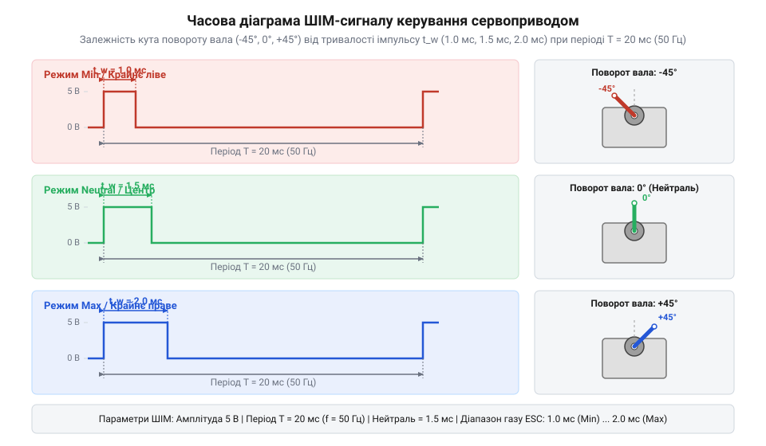
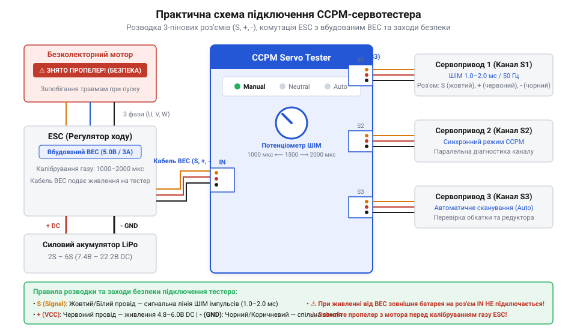

# Тестер серво та ESC (CCPM)

## Потреба в автономній перевірці приводів

Під час складання робототехнічних систем чи моделей радіокерування виникає задача первинного налаштування механічних тяг та нульового положення качалок сервоприводів (`@@en|servo motor@@`, від лат. *servus* — слуга). Якщо закріпити важелі на шліцах невідкаліброваного приводу, а потім увімкнути повну систему радіокерування або мікроконтролерний польотний контролер, привід може різко відпрацювати у крайнє положення. Це призводить до зрізу зубів редуктора, вигину тяг або пошкодження корпусу. Калібрування безпосередньо через польотний контролер чи приймач вимагає розгортання всього комплекту апаратури, прошивання тестових скетчів або налаштування приймача, що є незручним і небезпечним у польових чи майстерних умовах. Крім того, невідкалібрований безколекторний регулятор ходу (`@@en|Electronic Speed Controller@@`, ESC) при подачі живлення може не сприйняти сигнал газу або сприйняти його як команду на максимальні оберти, що загрожує неконтрольованим запуском силового мотора. Для безпечного механічного виставляння нейтралі та перевірки плавності ходу потрібне компактне автономне джерело керуючого сигналу — тестер сервоприводів (`@@en|CCPM servo tester@@`, від англ. *Cyclic/Collective Pitch Mixing*).

## Принцип ШІМ-керування та параметри сигналу

Управління кутом повороту вала сервоприводу та обертами регулятора ESC здійснюється за допомогою широтно-імпульсної модуляції (`@@en|Pulse-Width Modulation@@`, PWM). Сигнал являє собою повторювані прямокутні імпульси з фіксованою частотою 50 Гц, що відповідає періоду повторення `T = 20 мс`. Інформативним параметром є не коефіцієнт заповнення (`@@en|duty cycle@@`), а абсолютна тривалість високого рівня імпульсу `t_high`.

*Підпис: Опорні значення тривалості ШІМ-імпульсу та відповідне положення ротора.*

Стандартний часовий діапазон становить від 1000 мкс до 2000 мкс. Тривалість `1000 мкс` відповідає крайньому лівому положенню вала (кутова позиція `0°`) або нульовій потужності мотора в ESC. Тривалість `2000 мкс` відповідає крайньому правому положенню (`180°`) або 100% газу. Рівно посередині діапазону лежить значення `1500 мкс`, яке визначає абсолютну геометричну нейтраль приводу (`90°`). Зміна тривалості імпульсу у цих межах пропорційно зміщує позицію сервомеханізму.

## Режими роботи та правила підключення

Автономний CCPM-тестер створює потрібний ШІМ-сигнал без зовнішнього комп'ютера чи передавача і зазвичай підтримує три основні режими роботи. У ручному режимі (`Manual`) користувач обертає потенціометричну ручку для плавного зміщення тривалості імпульсу від 1000 до 2000 мкс, спостерігаючи за реакцією механіки. У режимі нейтралі (`Neutral`) тестер жорстко фіксує вихідний сигнал на позначці `1500 мкс`, що дозволяє точно встановити качалку під кутом `90°` до корпусу перед монтажем тяг. В автоматичному режимі (`Auto` або `@@en|wiper@@`) генератор плавно змінює тривалість імпульсу туди й назад між крайніми межами для виявлення пропусків зубів редуктора чи зносу потенціометра сервоприводу.

*Підпис: Розведення сигнальних і силових ліній при підключенні навантаження до тестера.*

Правильне підключення живлення є критичним для запобігання пошкодженню електронних компонентів. Тестер живиться постійною напругою `4.8…6.0 В` через вихідний кабель `@@en|BEC@@` (`@@en|Battery Eliminator Circuit@@`) регулятора ESC або від окремого акумуляторного блока. При підключенні сервоприводів важливо дотримуватись полярності: сигнальний провід (білий або жовтий) підключається до виходу `S`, позитивний силовий (червоний) — до `+`, а заземлення (чорне або коричневе) — до `-`. Калібрування діапазону газу ESC виконують у такій послідовності: спочатку на тестері подають максимальні 2000 мкс газу, підключають силове живлення до ESC, дочікуються звукового сигналу підтвердження від мотора і негайно переводять тестер у 1000 мкс. Це фіксує крайні межі газу в пам'яті регулятора й унеможливлює раптовий запуск двигуна.
