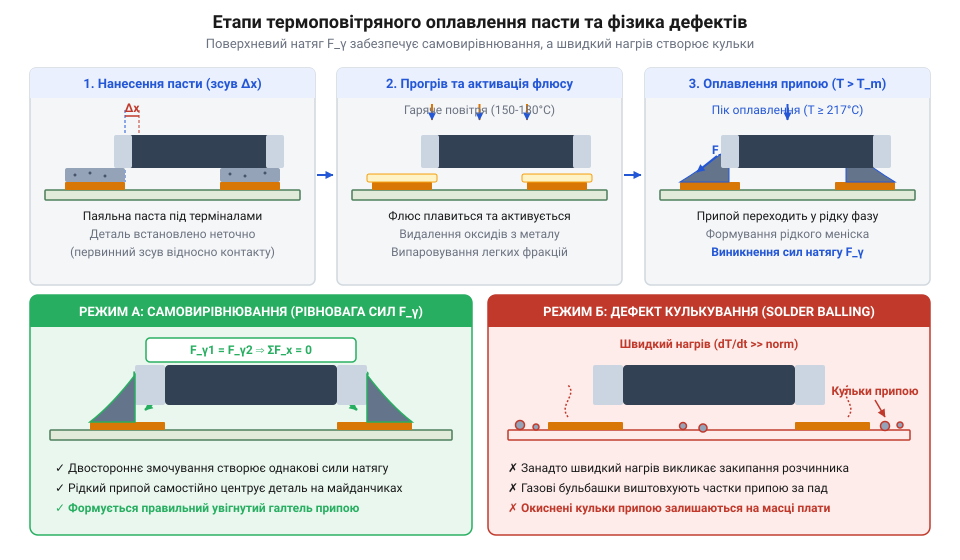
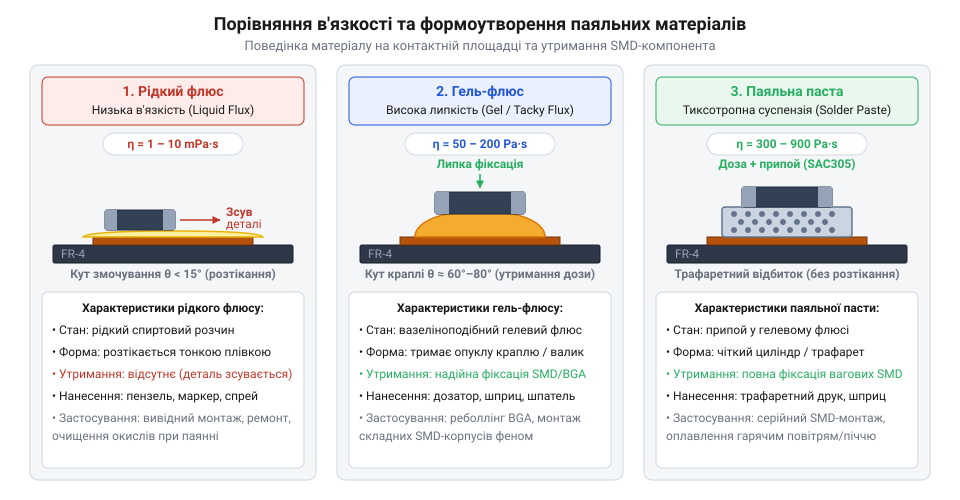

# Паяльні флюси та пасти для монтажу гарячим повітрям

<preknowlist>
- [Термоповітряні паяльні станції та фени BAKU](root:cat-hw-instruments/baku-hot-air-stations-family) — принцип формування гарячого повітряного потоку та налаштування температури паяльної станції
- [Хімічна класифікація та механізм дії безвідмивних флюсів (RO, OR, RE)](root:cat-hw-instruments/no-clean-fluxes-chemistry-and-classification) — хімічний склад флюсів, класифікація за розином/активністю та базові реакції зняття оксидів
- [Властивості та термопрофілі трубчастих припоїв і припайних паст](root:cat-hw-instruments/solder-paste-and-lead-free-alloys-properties) — фізичні властивості припайних сплавів, температури плавлення та загальна структура фаз термопрофілю
</preknowlist>

## Дефекти поверхневого монтажу без термічної хімії

Спроба припаяти дрібний чип-компонент або мікросхему гарячим повітрям без використання хімічного захисту майже завжди закінчується браком. Як тільки носик фена спрямовує повітряний потік з температурою `280–350 °C` на контактні майданчики, поверхня міді та виводи деталей миттєво змінюють колір на темний. Повітря містить близько 21% кисню, який за високих температур вступає у швидку хімічну реакцію з міддю, утворюючи щільну плівку оксидів `CuO` та `Cu₂O`. Розплавлений [рідкий припій](root:cat-hw-instruments/solder-tin) категорично відмовляється змочувати окиснену металеву поверхню: замість рівномірного розтікання він згортається у круглу краплю з високим контактним кутом `θ > 90°`. Без хімічного відновлення оксидного шару атомний контакт між металом плати та сплавом стає фізично неможливим, що призводить до сухого або холодного паяння.

Окрім хімічного блокування змочування, виникає механічна проблема утримання елементів. Гарячий струмінь повітря зі швидкостями робочих режимів [термоповітряної паяльної станції](root:cat-hw-instruments/baku-hot-air-stations-family) створює аеродинамічну силу зсуву `F_drag`. Для дрібних чип-компонентів типів 0402 або 0603 ця сила перевищує вагу самого елемента `m · g`. Оскільки незакріплена деталь лежить на сухих металевих доріжках з мінімальним коефіцієнтом тертя, повітряний потік легко здуває її з площадок або повертає під кутом. Спроба притиснути деталь пінцетом під час нагріву часто викликає перекіс або видавлювання припою на сусідній трек. Для запобігання цьому потрібен механічний демпфер і клейкий прошарок, який утримає деталь під час розігріву.

Термодинаміку взаємодії рідкого сплаву з металом описує поверхневий натяг. На межі розділу трьох фаз — твердого металу (S), рідкого припою (L) та газового середовища (A) — діють міжфазні енергії `γ_SA`, `γ_SL` та `γ_LA`. Рівноважний кут змочування `θ` визначається з рівняння балансу міжфазних сил натягу:

        γ_SA = γ_SL + γ_LA · cos(θ)
        = γ_SL + γ_LA · cos(θ)      [рівняння балансу Юнга-Дюпре]

З цього виразу видно, що при наявності оксидного шару поверхнева енергія чистої міді `γ_SA` різко падає. Для збереження рівності косинус кута `cos(θ)` стає від'ємним, а кут змочування `θ` перевищує `90°`, через що припій згортається у сферичні краплі замість розтікання. У випадку паяння двох контактних площадок без хімічного захисту різниця в швидкості плавлення викликає явище, відоме як @@en|tombstoning@@ (від англ. *tombstone* — надгробок: ефект надгробка, коли чип-компонент піднімається вертикально на одному з виводів). Високий поверхневий натяг чистого розплаву на одному з боків створює момент сили, який вивертає деталь догори.

*Під дією гарячого повітря чистий припій згортається в кульки через високий кут змочування, а флюс знижує поверхневий натяг і забезпечує самовирівнювання виводів.*

Застосування спеціальних хімічних речовин — флюсів і паяльних паст — кардинально змінює перебіг монтажу. Головне завдання @@en|флюс@@ (від лат. *fluxus* — течія: речовина для зняття оксидів та зниження поверхневого натягу) полягає у хімічному розчиненні оксидних плівок за підвищеної температури та закритті розплавленого металу від контакту з киснем повітря. Одночасно клейка основа носія забезпечує механічну фіксацію елемента до моменту розплавлення припою. Контролювати якість змочування та відсутність оксидних містків зручно за допомогою [оптичного мікроскопа для паяння](root:cat-hw-instruments/optical-microscope-soldering), який дозволяє візуально оцінити меніск утвореного з'єднання. Без паяльної хімії @@en|SMD-монтаж@@ (від англ. *surface-mount device* — пристрій поверхневого монтажу) гарячим повітрям перетворюється на хаотичний процес із високим відсотком непоправного браку.

## Фізико-хімічні форми флюсів та паяльних паст

Щоб ефективно вирішувати задачі поверхневого монтажу, хімічні матеріали випускаються у трьох принципово різних фізико-хімічних формах: рідкі розчини, гелеподібні речовини та паяльні пасти. Кожен стан розроблявся під власні умови подачі тепла та механічні вимоги. Головними параметрами, що визначають поведінку матеріалу під час термоповітряного паяння, є динамічна в'язкість `η`, термічна стабільність зв'язуючої основи та температура активації хімічних компонентів.

Рідкі розчини (спиртові або водно-гліколеві суміші з вмістом активних кислот чи каніфолі `2–15%`) мають в'язкість на рівні `1–50 mPa·s`. Вони чудово проникають у мікрощілини за допомогою капілярного ефекту, але абсолютно не придатні для паяння гарячим повітрям. Під час обдуву з термофена розчинник миттєво закипає при температурі `78–100 °C`. Швидке розширення пари викликає розбризкування флюсу, а залишковий активний шар висихає за лічені секунди. В результаті в момент плавлення припою (`183–217 °C`) зона паяння залишається повністю незахищеною. Щоб зрозуміти склад таких сполук, корисно вивчити [опис хімічної класифікації флюсів](root:cat-hw-instruments/no-clean-fluxes-chemistry-and-classification).

Густий @@en|гель-флюс@@ (від лат. *fluxus* — течія: термостабільний флюс-гель) створений спеціально для робіт гарячим повітрям та ремонту плат. Його початкова в'язкість перебуває в межах `50 000–200 000 mPa·s`. Основою таких гелів є модифікована каніфоль або синтетичні полімери з додаванням високотемпературних розчинників. Реологічний механізм гелю описується поняттям @@en|тиксотропія@@ (від грец. *thixis* — дотик та *trope* — зміна: здатність речовини зменшувати в'язкість під дією механічного навантаження і відновлювати її в спокої). Під час нанесення шприцом гель легко виходить крізь голку, але на платі тримає стабільну форму краплі. При нагріванні термофеном гель не закипає, а плавно розм'якшується, утворюючи захисну ванночку навколо виводів, яка утримує компонент за рахунок властивості @@en|tackiness@@ (від англ. *tackiness* — липкість: клейка здатність носія).

Поєднує в собі флюсуючий носій і металевий сплав @@en|паяльна паста@@ (від італ. *pasta* — тісто: суспензія мікросфер припою в гелеподібному флюсі). Паста містить від 85% до 92% за масою дрібних металевих кульок (шариків припою діаметром від 15 до 45 мкм) і 8–15% густого флюсового гелю. Динамічна в'язкість пасти сягає `300 000–800 000 mPa·s`. Завдяки цьому паста одночасно виконує роль тимчасового клею для @@en|SMD-компоненти@@ та джерела припою для доріжок. Оцінити термодинамічні характеристики сплавів у пастах допомагають [параметри класичних паяльних паст](root:cat-hw-instruments/solder-paste-and-lead-free-alloys-properties).

Перехід від вивідного монтажу до поверхневого та BGA вимагав кардинальної зміни фізико-хімічних властивостей витратних матеріалів. Детальніше про цей шлях і причини відмови від звичайних рідких спиртоканіфольних сумішей розповідає [історію еволюції паяльних сполук](root:cat-hw-instruments/smd-soldering-fluxes-and-pastes/hist-soldering-flux-paste-evolution.md).

Залежність напруги зсуву `τ` у тиксотропному гелі від швидкості деформації `dγ/dt` описує реологічний рівноважний вираз Оствальда-де-Віля. Тут `K` позначає коефіцієнт консистенції речовини, `dγ/dt` — градієнт швидкості зсуву, а `n` — безрозмірний індекс течії матеріалу.

        τ = K · (dγ / dt)ⁿ
        = K · (dγ / dt)ⁿ            [степеневий закон реології]

Показник `n < 1` демонструє псевдопластичну поведінку флюсу: під час дозування крізь тонку голку при високій швидкості зсуву в'язкість матеріалу падає, а після припинення тиску відновлюється до початкового стану. Для глибокого аналізу термодинаміки змочування та капілярних сил під час плавлення корисні [фізичні моделі реології паст](root:cat-hw-instruments/smd-soldering-fluxes-and-pastes/math-solder-paste-rheology-and-wetting-physics.md). Для масового нанесено пасти на плату застосовують [автоматичний трафаретний друк пасти](root:cat-hw-instruments/smd-stencil-printing-and-dispensing-equipment).

*Рідкий флюс розтікається по контактній площадці, гель формує термостабільний крапельний купол, а паста утримує металеві мікросфери у тиксотропній матриці.*

## Критерії вибору матеріалу під тип корпусу

Вибір між паяльною пастою, гелем чи рідким флюсом визначається геометрією виводів SMD-корпуса та технологічним завданням — первинним монтажем чи демонтажем/ремонтом. Для стандартних дискретних пасивних елементів (корпуси 0805, 1206) та мікросхем у корпусах SOIC оптимальним розв'язком є нанесення паяльної пасти. Проте при зменшенні кроку виводів до `0.5 мм` і нижче (корпуси TQFP, QFN) використання пасти з крупною фракцією зерна призводить до перемичок і коротких замикань між ніжками.

Дисперсійність металевого порошку в пасті класифікується за розміром мікросфер від Type 1 до Type 6. Для монтажу корпусів @@en|QFN@@ (від англ. *quad flat no-leads* — плоский корпус без виводів) та дрібнокрокових SMD необхідні пасти класифікації Type 4 (розмір гранул 20–38 мкм) або Type 5 (15–25 мкм). Крім того, наявність центрального майданчика @@en|exposed pad@@ (від англ. *exposed pad* — відкритий тепловодний майданчик) у корпусах QFN вимагає суворого дозування паста-гелю: надлишок матеріалу створює повітряну подушку, через яку мікросхема піднімається над платою і ніжки не дістають до периферійних майданчиків.

Найбільш вимогливими до хімічного носія є корпуси з масивом кулькових виводів — @@en|BGA@@ (від англ. *ball grid array* — масив кулькових виводів). Для паяння або демонтажу BGA-чипів паяльні пасти практично не використовують (окрім етапу відновлення кульок — реболінгу). Головним робочим матеріалом тут є безотмивочний гелеподібний флюс, наприклад [активний флюс FVS-7](root:cat-hw-instruments/flux-fvs7). Гель для BGA повинен мати підвищену термостійкість: під час прогріву масивної мікросхеми феном протягом 2–4 хвилин при температурі `220–250 °C` флюс не повинен обвуглюватися, закипати або виділяти рясний газ. Бульбашки газу під корпусом BGA призводять до утворення порожнин @@en|voiding@@ (від англ. *void* — порожнеча: утворення газових каверн усередині контактів) та випадкових мікрозамикань сусідніх кульок. Детальніше опрацювати фізику виходу газів та налаштування термопрофілю дозволяє [аналіз механізмів утворення порожнин при BGA-паянні](root:cat-hw-instruments/bga-voiding-mechanisms-and-control).

Покрокову технологію демонтажу, підготовки контактних майданчиків, трафаретного відновлення кульок та повторного встановлення чипа розглядає [практичне керівництво з реболінгу](root:cat-hw-instruments/smd-soldering-fluxes-and-pastes/proj-bga-reballing-and-smd-reflow-practice.md). Правильне дотримання фаз нагріву під час роботи термофеном критичне для запобігання деформації плати, про що свідчать [стандартні фази термопрофілювання](root:hw-pcb/reflow-soldering).

Після завершення оплавлення постає питання залишків флюсу. За хімічною активністю та методом очищення флюси поділяються на три групи: каніфольні (R/RMA), водорозчинні (OA/OR) та безвідмивні (NC/RO0). Водорозчинні флюси містять органічні кислоти і вимагають обов'язкової змивки, адже їхні залишки гігроскопічні та викликають корозію мідних доріжок. Безвідмивні гель-флюси залишають нейтральний залишок, проте під корпусами BGA та QFN через обмежений доступ кисню виникають продукти термодеструкції. Ці продукти можуть поглинати вологу з повітря і створювати витоки струму у високочастотних колах.

*Під корпусом BGA накопичуються продукти термодеструкції флюсу, які потребують вимивання розчинником через капілярний зазор.*

Для безпечного видалення залишків з-під низькопрофільних корпусів застосовують [методи очищення плати розчинниками](root:cat-hw-instruments/pcb-post-solder-cleaning-technologies-and-chemistry). При зніманні залишків припою з пада перед монтажем чипа незамінним інструментом є [мідне плетіння видалення припою](root:cat-hw-instruments/solder-wick). Дотримання [правила антистатичного захисту](root:cat-hw-instruments/esd-safe-soldering-practices) гарантує збереження чутливих SMD-компонентів від пробою під час усіх хімічних та термічних операцій.

## Техніка дозування та термоповітряного оплавлення

Точне внесення паяльних матеріалів на друковану плату є вирішальним етапом, який визначає якість майбутнього монтажу та відсутність коротких замикань. Помилка у дозуванні всього на кілька мікролітрів призводить до виникнення дефектів, які важко виправити після охолодження плати. У практиці термоповітряного паяння застосовують два основні методи внесення речовин: ручний або автоматизований @@en|диспенсинг@@ (від англ. *dispensing* — видавлювання/дозування: порційне нанесення матеріалу крізь дозувальну голку шприца) та @@en|трафаретний друк@@ (від італ. *traforetto* — проріз: нанесення пасти крізь профільовані отвори металевої маски).

Під час роботи зі шприцом головним інструментом є калібрована голка з конічним або циліндричним кінцем. Для дозування густого @@en|гель-флюс@@ або пасти обирають голки калібру від 20G (внутрішній діаметр `0.60 мм`) до 25G (`0.26 мм`). Видавлювання здійснюють за допомогою пневматичного шприца-дозатора або ручного поршня. Ключова вимога полягає у формуванні однакових мікрокрапель на кожному контактному майданчику. Якщо площадка покрита недостатньо, виникає дефіцит припою та сухе паяння. Якщо ж внесено надлишок, рідка @@en|паяльна паста@@ при нагріванні розпливається за межі площадки.

Для масового або дрібносерійного монтажу застосовують металеві трафарети з лазерною порізкою вікон. Пасту продавлюють крізь отвори трафарету ракелем, створюючи чіткі прямокутні дози однакової висоти. Оскільки паста містить близько 85–92% металу за масою, але лише біля 50% за об'ємом, після випаровування флюсового гелю під час нагріву об'єм металевого сплаву зменшується майже вдвічі. Підрахунок кінцевого об'єму висадки рідкого припою `V_solder` від початкового об'єму дозованої пасти `V_dose` описується співвідношенням масової `w_metal` та об'ємної `ϕ_vol` часток:

        V_solder = V_dose · ϕ_vol
                 = V_dose · (w_metal / ρ_metal) / (w_metal / ρ_metal + (1 - w_metal) / ρ_flux)      [об'єм рідкого сплаву після випаровування носія]

Тут `ρ_metal` позначає густину металевого сплаву (близько `8.4 г/см³` для Sn63Pb37), а `ρ_flux` — густину флюсової основи (близько `1.0 г/см³`). Ігнорування об'ємної усадки призводить до помилок при розрахунку товщини трафарету. Побачити роботу [обладнання для трафаретного друку](root:cat-hw-instruments/smd-stencil-printing-and-dispensing-equipment) можна під час організації технологічної лінії.

Після дозування та встановлення деталей починається процес оплавлення гарячим повітрям. Під час нагрівання соплом [термоповітряної паяльної станції](root:cat-hw-instruments/baku-hot-air-stations-family) температура матеріалу проходить кілька критичних фаз. На першому етапі (`100–150 °C`) розм'якшується флюсове зв'язуюче. Завдяки властивості @@en|тиксотропія@@ в'язкість матеріалу падає, флюс розтікається по мідному майданчику й починає активну нейтралізацію оксидних плівок. Якщо нагрів відбувається занадто швидко, розчинники в носії починають закипати. Швидке розширення пари вибиває мікрокраплі металевого порошку за межі контактів, створюючи дефект @@en|solder balling@@ (від англ. *solder balling* — утворення кульок: виникнення дрібних ізольованих сфероїдів припою поза контактними майданчиками). Ці дрібні кульки припою залишаються на масці плати і в подальшому загрожують коротким замиканням під дією вібрації. Методики точного коригування об'єму дозування пасти та термопрофілю детально висвітлює [посібник із запобігання кулькуванню припою](root:cat-hw-instruments/smd-solder-balling-prevention-and-defects).

З досягненням температури плавлення сплаву (`183 °C` для свинцевих та `217–227 °C` для безсвинцевих паст) мікросфери металу миттєво зливаються у єдиний рідкий об'єм. На цій фазі вирішальну роль відіграє @@en|самовирівнювання@@ (від англ. *self-alignment* — самостійне позиціонування елемента під дією поверхневого натягу рідкого припою). Якщо @@en|SMD-компоненти@@ були встановлені з незначним зсувом відносно центрів площадок, результуюча сила поверхневого натягу [рідкого припою](root:cat-hw-instruments/solder-tin) `F_restore` прагне мінімізувати вільну поверхню розплаву і затягує вивід елемента точно на центр металізації.

Відновлювальна сила `F_restore` залежить від поверхневого натягу припою `γ_LA`, ширини контакту `w` та величини зміщення `Δx` відносно висоти зазору `h`:

        F_restore = 2 · γ_LA · w · sin(θ)
                  = 2 · γ_LA · w · (Δx / h)      [відновлювальна сила поверхневого натягу припою]

Проте самовирівнювання працює лише за умови одинакового змочування обох боків деталі. За надмірного обдуву або нерівномірного дозування флюсу виникає ефект @@en|tombstoning@@, коли деталь піднімається вертикально. Крім того, надлишок внесеного матеріалу на дрібнокрокових виводах спричиняє @@en|bridging@@ (від англ. *bridge* — міст: виникнення небажаної припайної перемички між сусідніми виводами).

Щоб запобігти здуванню деталей та закипанню носія, повітряний потік [термофена BAKU BK-8033](root:cat-hw-instruments/hot-air-station-baku) налаштовують на мінімальну достатню швидкість, обираючи відповідні сопла з переліку [насадок для SMD-монтажу](root:cat-hw-instruments/hot-air-soldering-stations-and-nozzles). Додатковий попередній прогрів плати знижує градієнт температур і гарантує плавне випаровування розчинників без виникнення припайних кульок. Контролювати [фази термопрофілювання](root:hw-pcb/reflow-soldering) необхідно протягом усього циклу оплавлення.

## Оцінка залишків та технологія безпечного очищення

Після завершення оплавлення та природного охолодження друкованого вузла процес монтажу ще не вважається закінченим. На поверхні плати навколо та під корпусами елементів залишаються продукти хімічних реакцій та термічного розкладу витратних матеріалів. Оцінка стану цих залишків і прийняття рішення про їх видалення є критичним кроком для забезпечення довговічності та надійності електронного пристрою в умовах реальної експлуатації.

У процесі паяння гарячим повітрям флюсуючий носій зазнає глибокої зміни, яку викликає @@en|термодеструкція@@ (від грец. *therme* — тепло та лат. *destructio* — руйнування: розпад молекул розчинників і полімерів під впливом високої температури). Каніфольні або синтетичні смоли випаровуються лише частково, залишаючи тверду або в'язку плівку. Одночасно органічні кислоти-активатори, реагуючи з оксидами міді та олова, утворюють металеві солі. Фізико-хімічні властивості цих залишків залежать від початкового класу флюсу.

Матеріали категорії @@en|No-Clean@@ (від англ. *no-clean* — безвідмивний: склад флюсу, залишки якого утворюють захисну інертну матрицю) розроблені так, щоб після завершення термоциклу повністю зв'язувати залишки активних компонентів всередині твердої гідрофобної полімерної матриці. За кімнатної температури ця матриця є непористою і не вбирає вологу з повітря. На противагу їм, залишки водорозчинних (OA/OR) та активних каніфольних (RA) флюсів залишаються хімічно агресивними та гігроскопічними. Детальний хімічний механізм зв'язування активних іонів розглядають автори [безвідмивних флюсових сполук](root:cat-hw-instruments/no-clean-fluxes-chemistry-and-classification).

Залишення активних або зволожених залишків на платі викликає два головних види довготривалих відмов. Першим є виникнення паразитних провідних містків, що викликає @@en|витоки струму@@ (від англ. *leakage current* — проходження паразитних мікрострумів крізь забруднену поверхню діелектрика) між сусідніми треками. Другим, більш небезпечним дефектом є @@en|електрохімічна міграція@@ (від грец. *ēlektron* та лат. *migratio* — переміщення: розчинення й перенос іонів металу під дією електричного поля у вологому середовищі). Під впливом постійної напруги та плівки вологи розчинені іони міді `Cu²⁺` або олова `Sn²⁺` починають рухатися від анода до катода. На катоді металеві іони відновлюються, утворюючи мікроскопічні кристалічні нитки — @@en|дендрити@@ (від грец. *dendron* — дерево: кристалічні голчасті нитки металу, що ростуть між контактами), які викликають раптові короткі замикання.

Для кількісної оцінки чистоти плати використовують показник @@en|SIR@@ (від англ. *surface insulation resistance* — поверхневий опір ізоляції: величина опору ділянці плати між двома провідниками). Величину опору `R_insulation` між двома паралельними доріжками довжиною `L`, розташованими на відстані `d`, розраховують за виразом поверхневого питомого опору `ρ_surface`:

        R_insulation = ρ_surface · (d / L)
                     = (U / I_leak)      [поверхневий опір ізоляції між контактними майданчиками]

Якщо на платі залишаються іонні забруднення, `ρ_surface` різко падає з нормованого значення `10¹² Ом` до `10⁶ Ом` і нижче, що стає причиною збоїв у високоомних колах. Первинний контроль залишків здійснюють візуально з [оптичним мікроскопом для паяння](root:cat-hw-instruments/optical-microscope-soldering), перевіряючи наявність карамелізованих потьоків, білого нальоту або липких плям. Для проведения лабораторних вимірювань іонної чистоти та контролю активності залишків використовують [методики тестування поверхневого опору ізоляції SIR](root:cat-hw-instruments/j-std-004-flux-classification-and-testing-methods).

Для безпечного видалення залишків застосовують послідовний алгоритм очищення:
1. Фізико-хімічне розчинення: вимивання основи за допомогою ізопропілового спирту, модифікованих спирто-бензинових сумішей або спеціалізованих промивальних рідин. Оптимальний ефект дає @@en|азеотропний розчинник@@ (від грец. *a-* — не, *zeo* — киплю, *trope* — зміна: рідка суміш, яка випаровується без зміни концентрації компонентів). 2. Механічна активація та змивка під корпусами: для звичайних SMD застосовують антистатичні щітки, а для низькопрофільних корпусів @@en|QFN@@ та @@en|BGA@@ — із застосуванням [безвідмивного флюсу FVS-7](root:cat-hw-instruments/flux-fvs7) для розрідження залишків — застосовують вимивання струменем під тиском або рідинне очищення в [ультразвукових ваннах з розчинниками](root:cat-hw-instruments/pcb-post-solder-cleaning-technologies-and-chemistry). УЗ-кавітація легко проникає у вузький зазор `50–100 мкм` під чипом. 3. Фінальне ополіскування та сушка: обов'язкове видалення брудного розчинника чистою порцією рідини та сушка стисненим повітрям або в термошафі. Якщо не видалити брудний розчинник повністю, після його випаровування тонкий шар іонних солей знову рівномірно осяде по всій поверхні плати.

Під час демонтажу або ремонту перед очищенням майданчиків застосовують [мідне плетіння для видалення припаю](root:cat-hw-instruments/solder-wick), яке вбирає залишки надлишкового сплаву за допомогою капілярних сил. Дотримання цієї технології гарантує довговічну та стабільну роботу змонтованих модулів.