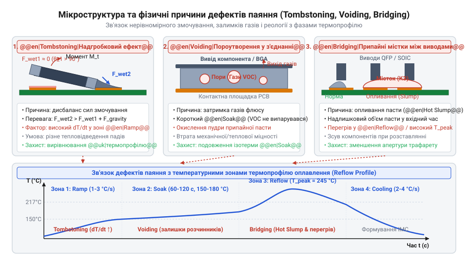
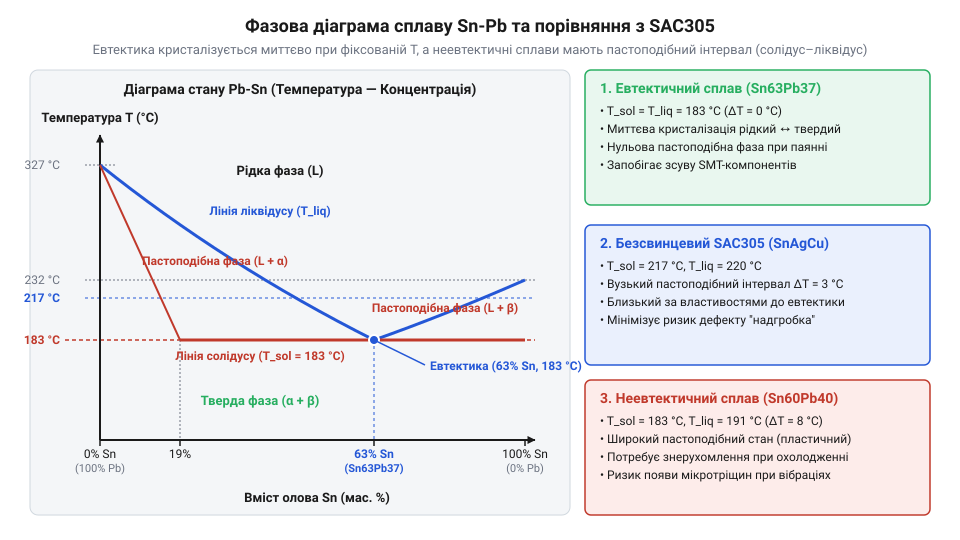
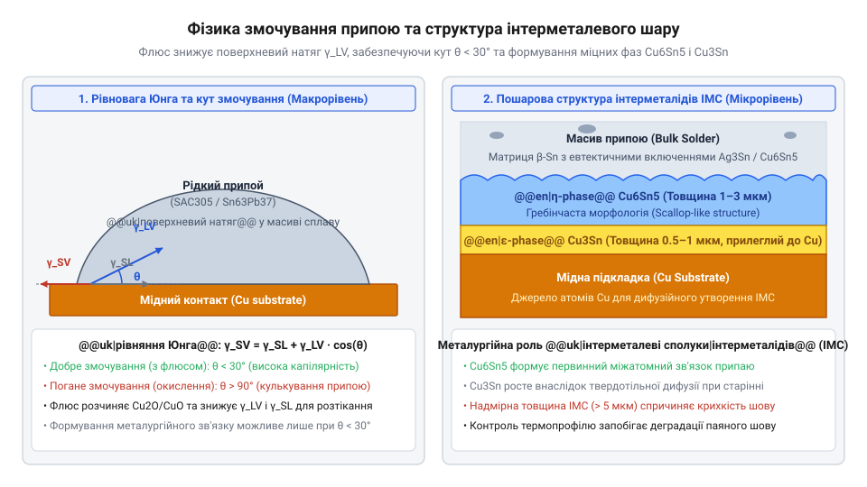
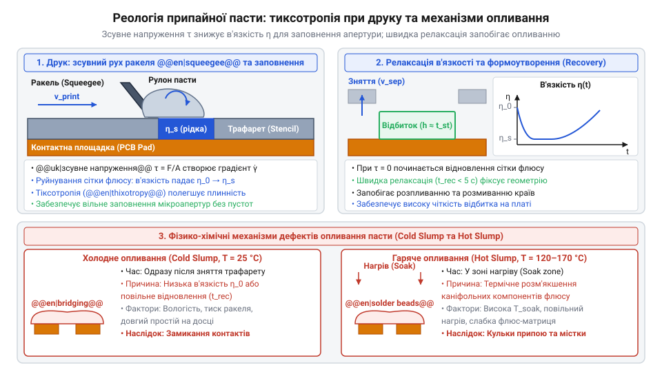
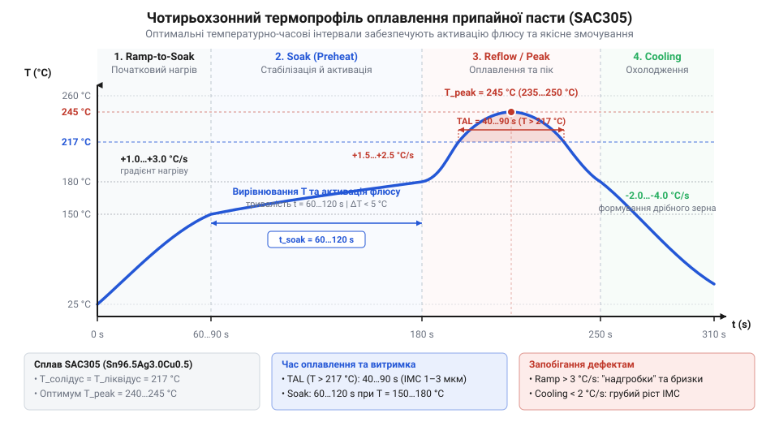

# Властивості та термопрофілі трубчастих припоїв і припайних паст

<preknowlist>
- [Припій / олово](root:cat-hw-instruments/solder-tin) — Базові уявлення про роль припою у створенні електричного та механічного контакту між провідниками.
- [Флюси та припої для монтажу електроніки](root:cat-hw-instruments/soldering-fluxes-and-solders) — Принципове призначення флюсу для видалення оксидних плівок з металевих поверхонь.
- [Хімічна класифікація та механізм дії безвідмивних флюсів (RO, OR, RE)](root:cat-hw-instruments/no-clean-fluxes-chemistry-and-classification) — Базова класифікація флюсів за хімічним складом та залишковою активністю після паяння.
- [Паяльні флюси та пасти для монтажу гарячим повітрям](root:cat-hw-instruments/smd-soldering-fluxes-and-pastes) — Основне призначення припайних паст та гарячого повітря для поверхневого монтажу.
</preknowlist>

## Небезпеки неправильного терморежиму та паяння

Спрощене сприйняття паяння як звичайного розігріву металевого виводу до плавлення припою неминуче призводить до прихованих катастрофічних дефектів у сучасній електронній апаратурі. Надрукована плата разом із поверхневими компонентами, трубчастим припоєм та припайною пастою становить складну термодинамічну систему, де температура й тривалість нагріву визначають фізико-механічну цілісність кожного з'єднання. Незалежно від того, чи виконується ручне паяння трубчастим припоєм із внутрішнім флюсовим сердечником, чи здійснюється автоматизоване паяння оплавленням припайної пасти в конвекційній печі, відхилення від оптимального температурно-часового бюджету всього на кілька градусів або секунд спричиняє незворотну деградацію матеріалів, яку неможливо виправити повторним прогрівом.

Першою критичною загрозою швидкого нагріву є @@en|термошок@@ (від грец. *therme* — тепло та англ. *shock* — удар). Більшість електронних компонентів, зокрема багатошарові керамічні конденсатори та кристали напівпровідникових мікросхем, мають низьку теплопровідність і різний коефіцієнт теплового розширення між металевими обкладинками й керамічною матрицею. При швидкості підйому температури понад 3–4 °C за секунду в товщі кераміки виникає критичний температурний градієнт: зовнішні шари розширюються значно швидше за внутрішнє ядро. Виникаючі механічні напруження перевищують межу міцності кераміки на розрив, утворюючи внутрішні мікротріщини. Згодом, під впливом робочої напруги та проникнення вологи, ці приховані тріщини призводять до електричного пробою, короткого замикання або нестабільних струмів витоку.

Для полімерної основи друкованих плат головну небезпеку становить @@en|деламінація@@ (від лат. *lamina* — пластина, шар) — розшарування склотекстоліту під дією внутрішнього тиску. Базовий матеріал плат (наприклад, FR-4) містить епоксидно-скловолоконну матрицю із залишками зв'язаної вологи та органічних летких сполук. Якщо плату піддати впливу температури, що перевищує @@en|температуру склування@@ `@@en|Tg@@` (для стандартного FR-4 це 130–150 °C), полімерний матрикс переходить із твердого склуватого стану у високоеластичний. При цьому коефіцієнт розширення матеріалу вздовж осі Z зростає майже вп'ятеро — з 50 ppm/°C до понад 250 ppm/°C. Накопичена волога миттєво перетворюється на пара з високим тиском, розриваючи зв'язки між шарами склотканини та смоли. Це призводить до утворення внутрішніх каверн, розшарування провідників та критичного розриву стінок металізованих отворів, що робить плату повністю непридатною для експлуатації.

Крім деструкції несучих матеріалів, порушення терморежиму руйнує хімічний механізм очищення металу флюсом. Флюс усередині трубчастого припою або пасти містить органічні кислоти, розчинники та речовини-активатори, які мають суворо визначене часове вікно хімічної реактивності. Якщо зона попереднього прогріву занадто коротка або швидкість нагріву надмірна, @@en|висококиплячі розчинники@@ флюсу не встигають випаруватися до моменту розплавлення металевого сплаву. Закипаючи всередині рідкого припою, ці розчинники формують @@en|порожнечі@@ (англ. *voids*) — газові каверни в об'ємі галтелі. @@en|Пороутворення@@ знижує електричну провідність, порушує тепловідведення від силових компонентів та утворює осередки концентрованих напружень, за якими відбувається розтріскування контакта. Якщо ж прогрів занадто тривалий, активатори флюсу повністю вигоряють ще до досягнення точки плавлення, залишаючи мідний контакт незахищеним від повторного окиснення.

При паянні гарячим повітрям або оплавленням пасти нерівномірний розподіл тепла створює асиметрію сил поверхневого натягу, що викликає @@en|надгробковий ефект@@ (англ. *tombstoning* або *Manhattan effect*). Якщо один контакт двовивідного SMD-компонента з'єднаний із масивним мідним полігоном живлення, а інший — із вузьким сигнальним провідником, сигнальний контакт розігрівається швидше. Припій під ним розплавляється першим і створює силу поверхневого натягу, яка тягне компонент донизу. Тверда паста на холодній стороні виконує роль опорної точки, і результуючий обертальний момент розвертає компонент вертикально, відриваючи другий вивід від плати.

Своєю чергою, зниження в'язкості пасти при підвищенні температури без належного висихання викликає її розтікання — @@en|холодне осідання@@ та @@en|гаряче осідання@@ (англ. *slump*). У поєднанні з недостатнім захистом флюсу це призводить до того, що розплавлений припій витікає за межі контактних майданчиків, утворюючи небажані @@en|припайні містки@@ (англ. *solder bridges*) між сусідніми виводами мікросхем із дрібним кроком. Для виявлення внутрішніх тріщин і порожнин після паяння недостатньо візуального огляду, тому в серійному виробництві застосовують спеціальні методології [контролю якісних параметрів](root:hw-pcb/pcb-defect-analysis-and-xray-inspection), а при ручній розробці використовують [використанні оптичних мікроскопів](root:cat-hw-instruments/optical-microscope-soldering). Для монтажу чутливих вузлів налаштовують параметри [термоповітряних паяльних станцій](root:cat-hw-instruments/baku-hot-air-stations-family) та обирають [класичні безвідмивні флюси](root:cat-hw-instruments/no-clean-fluxes-chemistry-and-classification), які мають стабільну кінетику активації.


*Мікроструктура та топологія типових дефектів монтажу (надгробковий ефект, мікропорожнечі в галтелі та змикання суміжних виводів), зумовлених дисбалансом температурного профілю.*

## Металургія сплавів і фазові перетворення

Розуміння небезпек термодеструкції змушує перейти від поверхневого спостереження дефектів до вивчення металургійної природи припоїв. Будь-який припій є багатокомпонентною металевою системою, фізичні властивості якої описуються фазовими діаграмами стану. Саме фазовий склад сплаву визначає інтервал його плавлення, плинність у рідкому стані, механічну міцність та кристалічну структуру після застигання.

Ключовими поняттями на фазових діаграмах є межі фазового стану: @@en|солідус@@ (від лат. *solidus* — щільний, міцний) та @@en|ліквідус@@ (від лат. *liquidus* — рідкий). Температура солідусу визначає найвищу точку, за якої сплав перебуває виключно у твердому стані. Температура ліквідусу є найнижчою точкою, вище якої сплав повністю стає рідким. У більшості багатокомпонентних сплавів між солідусом і ліквідусом існує двофазна зона — @@en|пастоподібний стан@@, у якому кристали твердої фази (@@en|дендрити@@, від грец. *δένδρον* — дерево) співіснують із розплавленим рідким металом. Співвідношення мас рідкої та твердої фаз у цій зоні визначається за термодинамічним @@en|правилом важеля@@. Проте існує суворо визначене співвідношення компонентів — @@en|евтектика@@ (від грец. *εὐτηκτός* — легкоплавкий), за якого солідус і ліквідус збігаються в одній температурній точці.

Прикладом класичного евтектичного сплаву є свинцево-олововий припій `Sn63Pb37` (63% олова, 37% свинцю), який переходить із твердого стану в рідкий строго при 183 °C без утворення пастоподібної фази. Завдяки кристалізації у вигляді чергованих дрібнодисперсних @@en|ламелей@@ олова й свинцю, відсутність кристалізаційного інтервалу запобігає зміщенню компонентів під час застигання галтелі. На противагу йому, безсвинцевий сплав `SAC305` (96.5% Sn, 3.0% Ag, 0.5% Cu) є близьким до евтектики, маючи солідус 217 °C та ліквідус 220 °C. Його мікроструктура складається з олов'яної матриці, зміцненої інтерметалевими дисперсіями `Ag3Sn` та `Cu6Sn5`, що суттєво підвищує стійкість з'єднання до @@en|повзучості@@ (англ. *creep*) при підвищених температурах. Невеликий 3-градусний пастоподібний інтервал вимагає підйому пікової температури оплавлення до 235–245 °C. Для специфічних завдань застосовують низькотемпературний евтектичний сплав `Sn42Bi58` із точкою плавлення всього 138 °C, який захищає термочутливі LED-діоди та пластикові роз'єми. Однак високий вміст вісмуту робить з'єднання крихким до ударних навантажень. Також використовують дешевий двокомпонентний евтектичний сплав `Sn99.3Cu0.7` із точкою плавлення 227 °C, поширений у масовому хвильовому паянні.


*Фазова діаграма бинарної системи з позначенням точок солідусу, ліквідусу та евтектичної концентрації, що ілюструє відсутність пастоподібного стану.*

На початку 2000-х років електронна індустрія зазнала фундаментальної перебудови через набрання чинності міжнародною екологічною директивою @@en|RoHS@@ (англ. *Restriction of Hazardous Substances*), яка заборонила використання токсичного свинцю у споживчій техніці. Головною рушійною силою відмови від Sn63Pb37 була не лише екологічна небезпека накопичення важких металів на звалищах, а й явище спонтанного зростання @@en|нитчастих кристалів олова@@ (англ. *tin whiskers*) — волокнистих монокристалів, що самочинно ростуть із поверхонь чистого олов'яного покриття під дією внутрішніх механічних напружень і викликають мікрокороткі замикання у високощільному монтажі. Перехід на безсвинцеві сплави (насамперед SAC305 та Sn-Bi) змусив виробників підняти робочі температури обладнання на 30–40 °C, переглянути формули флюсів для захисту від вигоряння при 245 °C та створити компоненти з високою термостійкістю корпусу.

Сформувати надійне паяне з'єднання неможливо без процесу змочування — розтікання рідкого припою по мідній підкладці під дією міжмолекулярних сил. Рівновага термодинамічних фаз описується рівнянням Юнга-Дюпре, а ступінь змочування характеризує @@en|кут змочування@@ (крайовий кут `θ`). Якщо кут `θ < 30°`, має місце відмінне змочування, за якого припій вільно затікає у вузькі зазори під дією @@en|капілярності@@ (від лат. *capillaris* — волосяний). Якщо кут `θ > 90°`, припій збивається в краплі (@@en|незмочування@@, англ. *non-wetting* або *dewetting*) через наявність невідновлених оксидів або зневоднення флюсу.

Найважливішим металургійним результатом паяння є утворення на межі розподілу між припоєм та міддю шару @@en|інтерметалідів@@ — @@en|інтерметалевих сполук@@ (від лат. *inter* — між та *metallum* — метал). При взаємодії розплавленого олова з мідною підкладкою утворюється первинна метастабільна фаза Cu₆Sn₅ (η-фаза). Під час подальшої експлуатації та термічного старіння внаслідок твердотільної дифузії між Cu₆Sn₅ та міддю виростає додаткова багата на мідь фаза Cu₃Sn (ε-фаза). Через різницю у швидкості дифузії атомів міді та олова виникає @@en|ефект Кіркендалла@@, який призводить до утворення мікропорожнеч усередині шару Cu₃Sn. Оптимальна загальна товщина шару інтерметалідів становить від 1 до 3 мкм: це забезпечує хімічний адгезійний зв'язок та високу механічну міцність контакту. Однак, якщо товщина інтерметалевого шару перевищує 4–5 мкм через надмірний термопрофіль або довготривалий перегрів, шар стає надзвичайно крихким, і під дією вібрації чи теплового розширення у з'єднанні виникають магістральні тріщини. Швидкість охолодження після плавлення також прямо впливає на дисперсність інтерметалічних фаз: оптимальне охолодження зі швидкістю 2–4 °C/s сприяє формуванню дрібнозернистої структури та підвищує опір втомі. Детальніше механізми дифузійного пороутворення в інтерметалевому шарі та їхній вплив на надійність BGA-вузлів описано у статті про [дефекти розшарування та ефект Кіркендалла в BGA-з'єднаннях](root:hw-components/kirkendall-voids-in-bga-joints).


*Геометрія змочування краплі припою на мідній підкладці з крайовим кутом та шаруватою мікроструктурою інтерметалевих сполук Cu6Sn5 і Cu3Sn.*

Під час добору сплавів орієнтуються на параметри [типових класичних припоїв](root:cat-hw-instruments/solder-tin) та враховують властивості [фінішних покриттів плат](root:hw-pcb/pcb-surface-finishes-compatibility), які вступають у взаємодію з оловом. Для активації змочування застосовують склади [спеціалізованого паяльного флюсу](root:cat-hw-instruments/soldering-fluxes-and-solders), а для поглибленого розрахунку швидкості дифузії в мікроелектроніці використовується [математична модель змочування](root:cat-hw-instruments/solder-paste-and-lead-free-alloys-properties/math-wetting-dynamics-and-intermetallic-growth.md), яка описує динаміку розтікання та формування дифракційних шарів.

## Змочування та хімічна активація флюсу

Нанесення рідкого припою на мідну контактну площадку без попередньої підготовки хімічного середовища завжди призводить до згортання розплаву в кулясті краплі. Причиною цього є плівка оксидів (CuO, Cu₂O), яка миттєво утворюється на поверхні міді під дією атмосферного кисню. Енергія міжатомних зв'язків оксидного шару занадто мала, щоб подолати значний поверхневий натяг (англ. surface tension) @@en|surface tension@@ рідкої фази олова, через що припій прагне мінімізувати площу контакту з підкладкою.

Формування міцного металевого зв'язку можливе лише за умов повного змочування (англ. wetting) @@en|wetting@@, коли рідкий сплав розтікається по твердому металу. Стан термодинамічної рівноваги на межі розподілу трьох фаз — твердої поверхні, рідкого припою та газового середовища — описує кут змочування (англ. contact angle) @@en|contact angle@@ `θ`, який виражають через співвідношення питомих поверхневих енергій.

```
γ_sv = γ_sl + γ_lv × cos(θ)
cos(θ) = (γ_sv - γ_sl) / γ_lv      [вираження косинуса кута змочування]
```

У цьому рівнянні `γ_sv` означає поверхневу енергію межі тверде тіло — газ, `γ_sl` — міжфазну енергію на межі тверде тіло — рідина, а `γ_lv` — поверхневий натяг рідкої фази припою на межі з газом. Якщо поверхня вкрита оксидом, значення `γ_sv` залишається низьким, величина `cos(θ)` прямує до нуля або стає від'ємною, що відповідає куту `θ > 90°` та повному відсутньому змочуванню. Щоб зменшити кут `θ` до значення менше `30°`, яке є стандартом якісного паяного з'єднання, необхідно радикально підвищити `γ_sv` шляхом видалення оксидного шару та знизити міжфазний натяг `γ_lv`.

Цю задачу виконує флюс (лат. fluxus — потік) @@la|fluxus@@, що знаходиться всередині каналів трубчастого припою або у складі рідкої фази припайної пасти. Хімічні компоненти флюсу проходять чітко розграничені температурні інтервали активації. Під час нагрівання в зоні попереднього прогріву (100–130 °C) спочатку випаровуються каніфольні розчинники, запобігаючи утворенню газових порожнин. Потім, при досягненні 130–180 °C, у роботу вступають активні добавки — активатори (лат. activus — діяльний) @@la|activus@@. Зазвичай це органічні дикарбонові кислоти, серед яких провідну роль відіграє адипінова кислота (англ. adipic acid) @@en|adipic acid@@ (`C₆H₁₀O₄`) та янтарна кислота.

Молекули адипінової кислоти розривають хімічні зв'язки оксидів міді, перетворюючи їх на розчинні металеві солі та воду:

```
CuO + 2 R-COOH → (R-COO)₂Cu + H₂O
Cu₂O + 4 R-COOH → 2 (R-COO)₂Cu + H₂O + 2 e⁻      [окисно-відновна реакція нейтралізації оксиду]
```

Утворені солі сольватуються матрицею каніфолі (англ. rosin) @@en|rosin@@ та витісняються на периферію паяної зони. Смоляна основа флюсу створює рідкий бар'єр, який ізолює чисто розкриту металеву мідь від кисню повітря аж до моменту досягнення температури ліквідусу (лат. liquidus — рідкий) @@la|liquidus@@. Якщо витримати надто тривалу паузу в температурному інтервалі активації, відбувається термічне вигорання флюсу. Його активні кислотні групи повністю нейтралізуються до оплавлення припою, що призводить до повторного окиснення міді та виникнення дефекту незмочування. Детальніше розібратися з хімічною активністю складів @@en|flux@@ можна під час вибору [хімічною активністю складів](root:cat-hw-instruments/no-clean-fluxes-chemistry-and-classification) та підбору [типових безвідмивних складів](root:cat-hw-instruments/flux-fvs7) для різних типів монтажу.

Видалення оксидів створює умови для капілярного затікання рідкого сплаву у вузькі зазори між виводами та стінками отворів друкованої плати. Фізику капілярного всмоктування описує капілярний тиск `P_c`, який виникає внаслідок викривлення меніска рідкого припою в каналі радіусом `r`:

```
P_c = (2 × γ_lv × cos(θ)) / r
```

Коли флюс забезпечує малий кут `θ < 90°`, величина `cos(θ)` є додатною, і капілярний тиск `P_c > 0` активно втягує розплав углиб металізованого отвору (THT) або під поверхневий вивід SMD-компонента. У разі недостатньої хімічної активності флюсу кут `θ` перевищує `90°`, `cos(θ)` стає від'ємним, і капілярні сили починають виштовхувати припій із зазору, блокуючи формування галтелі. При використанні [допоміжних паяльних матеріалів](root:cat-hw-instruments/soldering-fluxes-and-solders) значення `P_c` має бути достатнім для подолання сили тяжіння рідкого металлу.

Після забезпечення фізичного контакту між чистим рідким оловом та міддю розпочинається процес хімічної взаємодії з утворенням твердого шару інтерметалевих сполук (англ. intermetallic compounds, IMC) @@en|intermetallic compounds@@ на межі розподілу фаз. Атоми олова дифундують у кристаллу решітку міді, утворюючи крихку фазу `Cu₆Sn₅` (ета-фаза) безпосередньо під час оплавлення при 230–250 °C. Під час подальшої експлуатації або тривалого витримування при підвищеній температурі між шаром міді та `Cu₆Sn₅` повільно формується багатша на мідь фаза `Cu₃Sn` (епсилон-фаза).

Оптимальна товщина інтерметалевого шару становить від 0.5 до 2.0 мкм. Вона є безпосереднім підтвердженням надійного металургійного зв'язку. Якщо товщина IMC перевищує 4.0 мкм через надмірний термічний бюджет або занадто високу температуру оплавлення, паяне з'єднання втрачає пластичність. Модуль пружності інтерметалідів суттєво вищий за модуль розплавленого сплаву, що робить галтель вразливою до мікротріщин під дією вібрацій та термоциклювання. Повний математичний апарат для [розрахунку кінетики та динаміки](root:cat-hw-instruments/solder-paste-and-lead-free-alloys-properties/math-wetting-dynamics-and-intermetallic-growth.md) росту інтерметалевих шарів дозволяє точно прогнозувати довговічність контакту залежно від обраних [захисними покриттями контактних площадок](root:hw-pcb/pcb-surface-finishes-compatibility) друкованої плати.

## Реологія та деградація припайних паст

Припайна паста (англ. solder paste) @@en|solder paste@@ являє собою високонаповнену гетерогенну суспензію (лат. suspensio — підвішування) @@la|suspensio@@, яка складається з мікроскопічних сферичних зерен припайної пудри (англ. solder powder) @@en|solder powder@@, рівномірно розподілених у рідкому зв'язуючому середовищі флюсу. Масова частка металевого порошку в пастах для трафаретного друку становить 88–91 %, тоді як об'ємна частка складає близько 50 %. Решта об'єму припадає на флюс, носії, розчинники та тиксотропні модифікатори.

Розмір зерен металевої пудри класифікують за стандартом IPC J-STD-005 на типи (Type 3, Type 4, Type 5). Паста Type 3 містить частинки діаметром 25–45 мкм і застосовується для стандартного монтажу з кроком виводів від 0.65 мм. Паста Type 4 (20–38 мкм) призначена для дрібнокрокових компонентів (0.4–0.5 мм), а Type 5 (15–25 мкм) — для надщільного монтажу мікросхем у корпусах BGA з кроком менше 0.4 мм та пасивних елементів формату 01005. Головним обмеженням при виборі типу пудри є «правило 5 зерен»: найменший розмір апертури (лат. apertura — отвір) @@la|apertura@@ трафарету повинен уміщувати щонайменше п'ять сферичних частинок по своїй ширині. В іншому разі паста застрягає в апертурі під час відокремлення трафарету від плати.

Друк припайної пасти можливий завдяки її специфічній реології (грец. rheos — потік + logos — вчення) @@en|rheology@@. Паста належить до неньютонівських псевдопластичних рідин із вираженою тиксотропією (грец. thixis — дотик + trope — зміна) @@en|thixotropy@@. У стані спокою внутрішня просторова сітка, сформована тиксотропними агентами, утримує високу початкову в'язкість (англ. viscosity) @@en|viscosity@@ (порядку 800–1000 Па·с), що запобігає розшаруванню та осіданню важких металевих зерен.

Під дією зсувного напруження (англ. shear stress) @@en|shear stress@@ `τ`, яке створює рухомий ракель (нім. Rakel — зішкрібач) @@de|Rakel@@, тиксотропні зв'язки тимчасово руйнуються. В'язкість пасти падає в 8–10 разів (до 80–120 Па·с), забезпечуючи її псевдопластичне розрідження. Паста починає плавно котитися перед лезом ракеля у вигляді циліндричного валика та затікати в апертури трафарету (англ. stencil) @@en|stencil@@ під дією гідродинамічного тиску.

```
τ = η × γ̇
η = τ / γ̇                         [визначення динамічної в'язкості припайної пасти]
```

У цій формулі `η` означає динамічну в'язкість, `τ` — зсувне напруження, а `γ̇` — швидкість деформації зсуву. Після проходження ракеля зсувне напруження зникає (`γ̇ → 0`), і протягом кількох секунд тиксотропна структура пасти відновлюється. Паста знову набуває високої в'язкості, зберігаючи чітку геометрію відбитка після підняття трафарету та протистоячи розтіканню. Для точного вимірювання об'єму та висоти відбитків пасти після відокремлення трафарету застосовують [автоматичний 3D-контроль нанесення припайної пасти (SPI)](root:hw-pcb/solder-paste-inspection-spi).


*Реологічна поведінка припайної пасти: розрідження під навантаженням ракеля та швидка відновлюваність в'язкості в апертурі трафарету.*

Узгодження [технологічних параметрів друку](root:hw-pcb/smt-stencil-printing-and-paste-dispensing) із [математичним описом плинності](root:cat-hw-instruments/solder-paste-and-lead-free-alloys-properties/math-solder-paste-rheology-and-thermal-profiles.md) дозволяє розрахувати оптимальний тиск і швидкість руху ракеля для запобігання продавлюванню пасти під трафарет.

У процесі зберігання та використання припайна паста схильна до деградації через зміну фізико-хімічних властивостей її компонентів. Зберігати герметичні контейнери з пастою необхідно при температурі від 2 до 10 °C. Охолодження сповільнює хімічні реакції між органічними кислотами флюсу та поверхнею металевої пудри, запобігаючи передчасній втраті активності флюсу та підвищенню в'язкості.

Критично важливим етапом є температурне кондиціонування пасти перед відкриттям контейнера. Банку, вилучену з холодильника, витримують при кімнатній температурі (20–25 °C) протягом 4–6 годин не відкриваючи кришку. Якщо відкрити холодну банку, на поверхні пасти миттєво сконденсується атмосферна волога. Вода інтенсивно вскипає під час оплавлення, викликаючи розбризкування припою та утворення численних кульок припою (англ. solder balls) навколо паяного з'єднання.

Після кондиціонування пасту піддають механічному перемішуванню (ручному або в планетарному міксері) для відновлення однорідності суспензії та усунення відокремлення флюсу (англ. flux separation) @@en|flux separation@@, що виникає при тривалій статиці.

На трафареті припайна паста має обмежений термін придатності (живучість, англ. stencil life) @@en|stencil life@@, який зазвичай становить 4–8 годин. Тривалий контакт із повітрям призводить до випаровування легких розчинників флюсу. Внаслідок цього паста втрачає липкість (англ. tackiness) @@en|tackiness@@, необхідну для надійного утримання SMD-компонентів до оплавлення, а її в'язкість зростає, спричиняючи закупорювання апертур.

Іншим поширеним механізмом деградації є осідання пасти (англ. slump) @@en|slump@@, яке поділяють на холодне та гаряче:
1. Холодне осідання виникає одразу після друку через надмірне зниження в'язкості або пошкодження тиксотропної матриці. Відбитки пасти втрачають чіткі краї та змикаються між сусідніми контактними площадками. 2. Гаряче осідання відбувається під час нагрівання плати в зоні попереднього прогріву оплавлення (120–160 °C). Зростання температури знижує в'язкість рідкої фази флюсу раніше, ніж почне плавитися металевий сплав. Якщо поверхневий натяг флюсу є недостатнім, дози пасти опливають та перекривають міжострівцеві зазори.


*Стандартний чотирьохзонний температурний профіль оплавлення припайної пасти із розрахованими температурними градієнтами.*

Гаряче осідання є головною причиною виникнення припайних містків та надгробкового ефекту (англ. tombstoning). Для запобігання цим дефектам необхідне коригування градієнта нагрівання в зоні Soak та вибір паст із високою термореологічною стабільністю. Для побудови оптимальних режимів використовують алгоритми керування [промислового обладнання оплавлення](root:cat-hw-instruments/reflow-ovens-and-selective-soldering-equipment), керуючись [практичним налаштуванням термопрофілю](root:cat-hw-instruments/solder-paste-and-lead-free-alloys-properties/proj-reflow-profile-tuning-and-verification.md) і проведенням контрольних перевірок для [усунення дефектів монтажу](root:hw-pcb/pcb-defect-analysis-and-xray-inspection).

## Структура та коригування фазових термопрофілів

Нерівномірне прогрівання друкованої плати під час паяння викликає механічне жолоблення субстрату, розрив керамічних корпусів компонентів та утворення холодних спаїв. Формування якісного міжметалевого контакту вимагає суворого керування температурою в часі. Цю функцію виконує @@en|термопрофіль@@ (від @@grc|θερμός@@ — «теплий» та @@fr|profil@@ — «обрис») — графік залежності температури паяного з'єднання від часу, розділений на чотири послідовні технологічні зони, кожна з яких відповідає за окремий фізико-хімічний процес.


*Графік фазового термопрофілю RSS для безсвинцевого сплаву SAC305 із деталізацією швидкостей нагріву, витримування, часу TAL та охолодження.*

Перша зона — @@en|підйом температури@@ (від @@en|ramp-up@@ — «похила рампа»). На цьому етапі плата та компоненти прогріваються від кімнатної температури до початку активації флюсу. Швидкість нагріву `dT/dt` обмежена діапазоном від 1.0 °C/s до 3.0 °C/s. Перевищення швидкості 3.0 °C/s викликає @@en|термошок@@ (від @@grc|θερμός@@ — «теплий» та @@en|shock@@ — «поштовх») — катастрофічне розтріскування багатошарових керамічних конденсаторів через відмінності коефіцієнтів термічного розширення металевих обкладок і кераміки. Крім того, занадто швидке випаровування легкокиплячих розчинників флюсу викликає вибухоподібне закипання й розбризкування кульок припою по поверхні маски. Занадто повільний підйом (менше 1.0 °C/s) невиправдано продовжує технологічний цикл і призводить до передчасної деградації активних речовин флюсу.

Друга зона — @@en|соікінг@@ (від @@en|soak@@ — «просочування» або «витримування») або @@en|зону стабілізації@@. Для популярного безсвинцевого сплаву @@en|SAC305@@ цей інтервал лежить у межах від 150 °C до 200 °C із тривалістю 60–120 секунд. Головне призначення зони — вирівнювання температурного градієнта між компонентами з різною термічною масою (наприклад, масивними індуктивностями та дрібними чип-резисторами), повне випаровування летких органічних зв'язуючих речовин пасти та хімічна активація дикарбонових кислот. На цьому етапі @@en|активатори флюсу@@ розчиняють оксиди міді на контактних площадках та оксидну плівку на поверхні порошку припою. Занадто довге витримування (> 120 s) виснажує флюс до початку плавлення металу, а занадто коротке (< 60 s) залишає температурний перепад, що призводить до дефектів монтажу.

Третя зона — @@en|оплавлення@@ (від @@en|reflow@@ — «повторне протікання») або @@en|пікова зона@@. Температура перевищує точку @@en|ліквідус@@ (217 °C для SAC305). Параметр @@en|TAL@@ (від @@en|Time Above Liquidus@@ — «час вище ліквідусу») становить 45–90 секунд (оптимально 60 s). За цей час порошок припою повністю розплавляється, виникає @@en|змочування@@ та капілярне затікання рідкого металу в зазори між виводами. Пікова температура `T_peak` встановлюється на 18–25 °C вище точки ліквідус і для SAC305 становить 235–245 °C. Перевищення `T_peak` понад 250 °C запускає прискорений ріст крихких інтерметалевих сполук `Cu6Sn5` та `Cu3Sn`, деградує полімерну основу друкованої плати та руйнує чутливі напівпровідникові кристали. Недостатній `TAL` (< 45 s) залишає високий кут змочування й закупорює газові бульбашки у з'єднанні.

Четверта зона — @@en|охолодження@@. Швидкість зниження температури `-dT/dt` підтримується на рівні від 2.0 °C/s до 4.0 °C/s. Швидке охолодження формує дрібнокристалічну структуру сплаву з дрібними @@en|дендрити@@ (від @@grc|δένδρον@@ — «дерево»), що забезпечує високу механічну міцність і опір усталості. Повільне охолодження (< 2.0 °C/s) призводить до зростання великих зерен олова та виділення грубих інтерметалевих фаз, які роблять галтель крихкою. Однак перевищення швидкості 6.0 °C/s знову створює ризик термічного розтріскування корпусів компонентів.

Залежно від складності плат використовують два основні типи профілів: @@en|RSS@@ (від @@en|Ramp-Soak-Spike@@ — «підйом-витримування-пік») та @@en|RTS@@ (від @@en|Ramp-to-Spike@@ — «підйом-до-піку»). Профіль RSS має чітко виражену горизонтальну або слабопохилу полицю соікінгу і застосовується для плат із великим розкидом термічних мас та високою щільністю компонентів. Профіль RTS є безперервним лінійним підйомом температури зі швидкістю 0.75–1.5 °C/s від кімнатної до пікової без плато стабілізації. RTS зменшує загальне термічне навантаження на компоненти та запобігає окисненню флюсу, проте вимагає ідеального вирівнювання теплових потоків у конвекційній камері.

Під час ручного паяння або монтажу гарячим повітрям, де використовується @@en|трубчастий припій@@ з внутрішнім каналом флюсу, фізика термопрофілю кардинально змінюється через високий температурний градієнт. Оскільки тепло подається локально від жала інструмента, температура тиснучого елемента встановлюється суттєво вищою за точку плавлення сплаву (наприклад, 350 °C для безсвинцевих сплавів). При контакті жала з контактною площадкою виникає швидка передача тепла, а флюс всередині трубчастого припою за частки секунди проходить усі фази активації. Витримування жала понад 3–5 секунд викликає @@en|термічне вигорання флюсу@@, після чого рідкий припій швидко окиснюється на повітрі, втрачає плинність і формує тьмяні спаї з містками.

Для підрахунку параметрів термопрофілю використовують формули теплового балансу та швидкості зміни температури:

```
R_ramp = (T_soak - T_start) / t_ramp
= (150 - 25) / 60
= 2.08 °C/s
```

**Розрахунок швидкості підйому та часу TAL для безсвинцевої пасти SAC305.** Початкова температура плати `T_start = 25 °C`, температура початку соікінгу `T_soak = 150 °C`, час підйому `t_ramp = 60 s`. Температура ліквідус `T_liq = 217 °C`, пікова температура `T_peak = 242 °C`, час перебування вище ліквідусу `t_TAL = 60 s`.

```
R_ramp = (150 - 25) / 60 = 2.08 °C/s
R_reflow = (T_peak - T_liq) / (t_TAL / 2)
= (242 - 217) / 30
= 0.83 °C/s
```

Отримані значення швидкостей `R_ramp = 2.08 °C/s` та `R_reflow = 0.83 °C/s` перебувають у безпечному технологічному вікні матеріалу SAC305, запобігаючи термошоку та гарантуючи повне формування металургійної зв'язки.

Математичні рівняння гідродинаміки припайної пасти та розрахунку теплових градієнтів деталізовані у вставці [моделювання реології пасти та температурних градієнтів](root:cat-hw-instruments/solder-paste-and-lead-free-alloys-properties/math-solder-paste-rheology-and-thermal-profiles.md). Практичні методи вимірювання температурних кривих за допомогою багатоканальних термопар наведені в матеріалі про [налаштування та перевірку термопрофілю](root:cat-hw-instruments/solder-paste-and-lead-free-alloys-properties/proj-reflow-profile-tuning-and-verification.md). Апаратні принципи підключення термопар та знімання температурних кривих висвітлено у матеріалі про [багатоканальні реєстратори термопрофілів](root:cat-hw-instruments/smt-thermal-profilers-and-dataloggers).

Для автоматизованого сушильного та паяльного обладнання застосовують промислове [обладнання для паяння оплавленням](root:cat-hw-instruments/reflow-ovens-and-selective-soldering-equipment). При ручному монтажі та ремонті компоненти підігрівають, використовуючи [термоповітряні паяльні станції](root:cat-hw-instruments/baku-hot-air-stations-family) або портативні [паяльники з USB Power Delivery](root:cat-hw-instruments/usb-pd-soldering-irons) під керуванням [відкритої прошивки IronOS](root:cat-hw-instruments/ironos-open-firmware-soldering), які дозволяють точно програмувати час і рівень нагріву безпосередньо на сканері жала.

## Діагностика та ліквідація дефектів паяння

Відхилення параметрів термопрофілю або порушення умов зберігання матеріалів викликають появу дефектів, які знижують надійність приладу або призводять до повного електричного відмови. Систематичний аналіз морфології дефектів дозволяє встановити їхню фізико-хімічну природу та оперативно внести корективи в технологічний процес.


*Схематичне зображення чотирьох основних дефектів паяних з'єднань із зазначенням фізичних причин їх виникнення.*

Перший поширений дефект — @@en|пороутворення@@ або утворення @@en|порожнеч@@ (від @@en|voids@@ — «порожнечі»). Порожнечі являють собою заповнені газом порожнини всередині застиглого металевого об'єму галтелі або під контактними площаднами силових компонентів (QFN, BGA). Основний механізм виникнення — бурхливе виділення газів із недопарених органічних розчинників та компонентів флюсу в момент, коли сплав вже перебуває у рідкому стані вище точки ліквідус. Газові бульбашки піднімаються під дією сили Архімеда, але не встигають подолати поверхневий натяг рідкого металу до початку кристалізації. Якщо площа порожнеч під теплопровідним падом перевищує 25%, термічний опір з'єднання зростає, спричиняючи перегрів і пробій напівпровідникового кристала.

Ліквідація пороутворення вимагає оптимізації зони стабілізації термопрофілю. Збільшення тривалості соікінгу дозволяє легкокиплячим розчинникам повністю випаруватися до досягнення точки плавлення. Також допомагає перехід на пасти з більшим розміром зерен пудри або зміна геометрії апертури трафарету — замість суцільного вікна на великих площадках вирізають сіткову матрицю, що полегшує вихід газів. Аналіз структурного стану та діагностика внутрішніх порожнин виконується через [дефектоскопію та рентгенівський контроль](root:hw-pcb/pcb-defect-analysis-and-xray-inspection).

Другий дефект — @@en|надгробковий ефект@@ або @@en|тумбстонінг@@ (від @@en|tombstoning@@ — «ефект надгробка»). Дефект полягає в підйомі одного кінця двовивідного чип-компонента (резистора чи конденсатора) над контактною площадкою з розривом електричного кола. Механізм обумовлений дисбалансом сил поверхневого натягу рідкого припою, що діють на протилежні контакти компонента. Якщо одна з контактних площадок нагрівається швидше (наприклад, через підключення до суцільного шару заземлення з великою теплоємністю), припій на ній розплавляється раніше, змочує вивід і створює результуючий обертальний момент, який відриває холодний вивід від пасти до її плавлення.

Для усунення надгробкового ефекту зменшують швидкість підйому температури `dT/dt` перед точкою плавлення та впроваджують ізотермічний соікінг для вирівнювання температур усіх елементів плати. На етапі проектування друкованого вузла застосовують термічну розв'язку (теплові містки) для контактних площадок, з'єднаних із шинами живлення та землі. Також контролюють точність нанесення пасти, запобігаючи асиметрії об'єму надрукованого дозованого матеріалу.

Третій дефект — @@en|припайні містки@@ (від @@en|solder bridging@@ — «утворення містків»). Це несанкціоноване замикання суміжних виводів компонента чи доріжок рідким припоєм. Першопричиною є гаряче або холодне @@en|осідання пасти@@ (від @@en|slump@@ — «осідання»), під час якого роздруковані дози пасти втрачають форму і зливаються між сусідніми виводами ще до плавлення металу. Сприяють дефекту надмірний об'єм нанесеної пасти через товстий трафарет, недостатній зсувний поріг плинності реологічної системи та занадто висока пікова температура, яка знижує поверхневий натяг розплаву.

Ліквідація містків виконується зменшенням товщини трафарету та зменшенням площі апертур на 10–20% порівняно з розміром площадки. Якщо місток виник під час ручного паяння або після оплавлення, його видаляють, застосовуючи всмоктувальне [мідне плетіння для видалення припаю](root:cat-hw-instruments/solder-wick) та рідкий [безвідмивний флюс FVS-7](root:cat-hw-instruments/flux-fvs7).

Четвертий дефект — розтріскування @@en|галтелей@@ (від @@de|Hohlkehle@@ — «жолобок») або руйнування паяного з'єднання під дією механічних чи термічних напружень. Тріщини утворюються вздовж межі розділу між інтерметалевим шаром і мідним провідником або безпосередньо по об'єму сплаву. Головна причина — неузгодженість коефіцієнтів термічного розширення (КТР) матеріалу плати та корпусу елемента під час термоциклювання. Ситуацію погіршує надмірний час `TAL` або підвищена пікова температура, які викликають розростання крихкого фазового шару `Cu3Sn` із вкрапленнями мікропорожнин Кіркендалла. Також небезпечним є забруднення безсвинцевого сплаву свинцем або вісмутом, що утворює низькоплавкі евтектики по межах зерен, які розтріскуються під час охолодження.

Запобігання розтріскуванню досягається суворим обмеженням пікової температури та часу `TAL` (не більше 90 секунд), вибором сумісних матеріалів та контролем швидкості охолодження в межах 2.0–4.0 °C/s. Перевірка хімічної сумісності сплавів і покриттів плати проводиться за керівництвами на [фінішні покриття друкованих плат](root:hw-pcb/pcb-surface-finishes-compatibility). Для візуального контролю геометрії та виявлення мікротріщин галтелей використовують [оптичний мікроскоп для паяння](root:cat-hw-instruments/optical-microscope-soldering).

Фізичні моделі змочування та кінетика росту міжметалевих фаз детально висвітлені у вставці про [динаміку змочування та ріст](root:cat-hw-instruments/solder-paste-and-lead-free-alloys-properties/math-wetting-dynamics-and-intermetallic-growth.md).