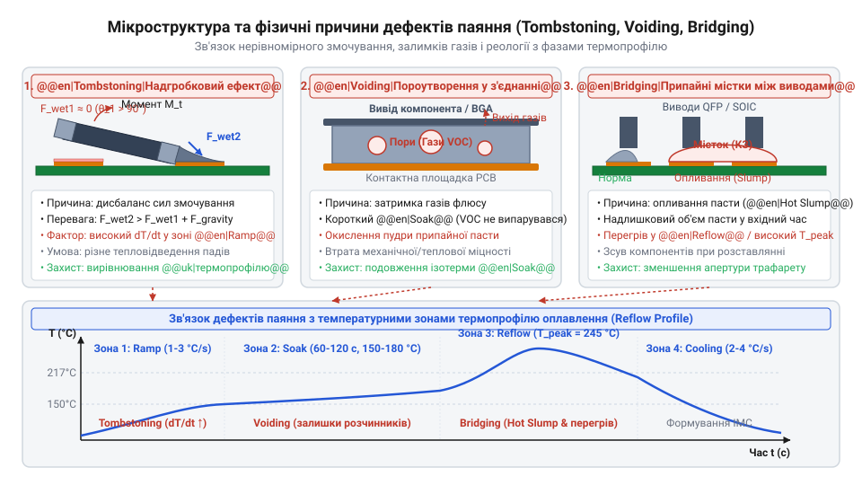
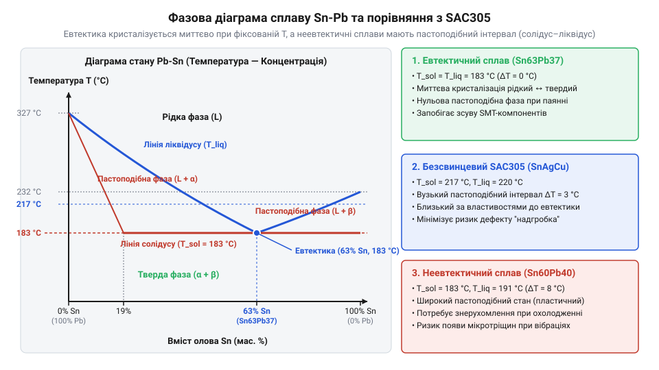
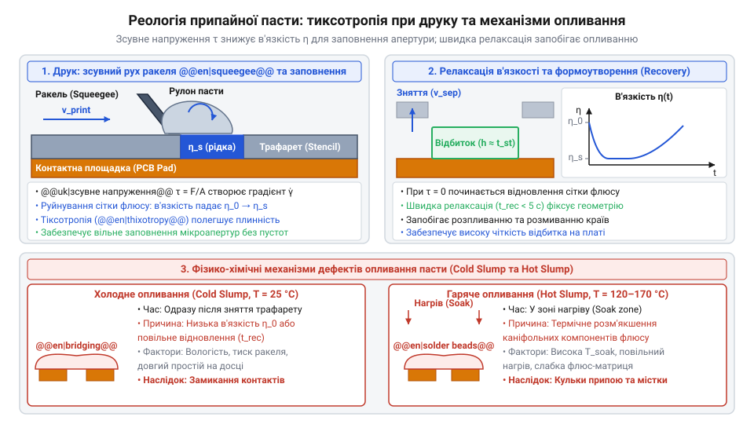

# Властивості та термопрофілі трубчастих припоїв і припайних паст

<preknowlist>
- [Припій / олово](root:cat-hw-instruments/solder-tin) — базові уявлення про роль припою у створенні електричного та механічного контакту між провідниками
- [Флюси та припої для монтажу електроніки](root:cat-hw-instruments/soldering-fluxes-and-solders) — принципове призначення флюсу для видалення оксидних плівок з металевих поверхонь
- [Хімічна класифікація та механізм дії безвідмивних флюсів (RO, OR, RE)](root:cat-hw-instruments/no-clean-fluxes-chemistry-and-classification) — базова класифікація флюсів за хімічним складом та залишковою активністю після паяння
- [Паяльні флюси та пасти для монтажу гарячим повітрям](root:cat-hw-instruments/smd-soldering-fluxes-and-pastes) — основне призначення припайних паст та використання гарячого повітря для поверхневого монтажу
</preknowlist>

## Небезпеки неправильної термообробки при паянні

Спрощене сприйняття паяння як розігріву вузла без урахування градієнтів температури призводить до руйнування плат. При швидкості підйому понад `3.0 °C/s` виникає термошок (англ. *thermal shock*, від грец. *therme* — тепло) через різницю розширення керамічного діелектрика й металізації, що спричиняє мікротріщини в конденсаторах. Перевищення температури склування `@@en|Tg@@` (англ. *glass transition temperature*) викликає розм'якшення та деламінацію (англ. *delamination*, від лат. *lamina* — пластина) FR-4 під тиском вологи.

Нерегламентований розігрів провокує вигоряння флюсу та закипання розчинників. Стрімке випаровування утворює бульбашки, що спричиняє [виникнення порожнин у галтелі](root:hw-pcb/pcb-defect-analysis-and-xray-inspection) та розбризкування припою. Дисбаланс сил поверхневого натягу на виводах створює надгробковий ефект. Уникнути відмов дозволяє налаштування [паяльних станцій гарячого повітря](root:cat-hw-instruments/baku-hot-air-stations-family).


*Причини виникнення термічних дефектів та зростання механічних напружень в елементах друкованого вузла*

## Фазові перетворення та металургія сплавів

Формування паяного з'єднання визначають фазові перетворення металевих сплавів. Межі солідусу (від лат. *solidus* — твердий) та ліквідусу (від лат. *liquidus* — рідкий) в евтектичного сплаву (від грец. *eutektos* — легкоплавкий) збігаються, забезпечуючи кристалізацію без пастоподібної фази (Sn63Pb37, `183 °C`). У неевтектичному `@@en|SAC305@@` (Sn-3.0Ag-0.5Cu) з ліквідусом `217–220 °C` існує інтервал кристалізації, де співвідношення фаз обчислюють за правилом важеля.

Директива `@@en|RoHS@@` (англ. *Restriction of Hazardous Substances*) обмежує свинець, але чисте олово викликає ріст нитчастих кристалів (вискерсів) під напруженнями, що створює короткі замикання. Дифузія на межі з міддю утворює інтерметаліди `Cu₆Sn₅` (фаза η) та `Cu₃Sn` (фаза ε) товщиною `0.5–2.0 мкм`. Перевищення термічного бюджету потовщує шар `Cu₃Sn`, формуючи порожнини Кіркендалла і знижуючи міцність контакту, що вимагає належно вибирати [класичні трубчасті припої](root:cat-hw-instruments/solder-tin).


*Фазові перетворення у евтектичних та неевтектичних сплавах при нагріві й охолодженні*

## Фізика змочування та активація флюсу

Термодинаміку формування паяного контакту визначає @@en|wetting@@ (англ. *wetting* — змочування), при якому рідкий припій розтікається по мідному провіднику. Геометрія краплі залежить від рівноважного кута змочування `θ` та балансу поверхневого натягу фаз тверде тіло — газ (`γ_SG`), тверде тіло — рідина (`γ_SL`) і рідина — газ (`γ_LG`), що описує рівняння Юнга-Дюпре:

```
γ_SG - γ_SL = γ_LG · cos(θ)      [рівняння Юнга-Дюпре для кута змочування]
cos(θ) = (γ_SG - γ_SL) / γ_LG    [вираження косинуса кута змочування]
```

Оксидні плівки міді (`CuO`, `Cu₂O`) знижують `γ_SG`, спричиняючи `θ > 90°` та незмочування. У діапазоні `130–180 °C` дикарбонові кислоти флюсу відновлюють оксиди міді до розчинних солей і води:

```
CuO + 2 R-COOH -> (R-COO)₂Cu + H₂O    [хімічне відновлення оксиду міді органічною кислотою]
```

Каніфольна основа запобігає повторному окисненню гарячого металу й знижує `γ_LG`, забезпечуючи `θ < 30°` та капілярне всмоктування сплаву. Надійність процесу задає [хімічна класифікація флюсів](root:cat-hw-instruments/no-clean-fluxes-chemistry-and-classification) при виборі складів [типового безвідмивного флюсу](root:cat-hw-instruments/flux-fvs7) та [безпечних паяльних матеріалів](root:cat-hw-instruments/soldering-fluxes-and-solders).

## Реологія та деградація припайних паст

Припайна паста є дисперсною системою металевої пудри у рідкому носії з флюсу та розчинників. Гранулометричний склад пасти регулює стандарт `@@en|IPC J-STD-005@@` (класифікація Type 3–6). Точний трафаретний друк визначає «правило 5 зерен»: апертура трафарету має вміщувати щонайменше 5 середніх діаметрів частинок припою.

За реологією паста є неньютонівською рідиною із властивостями псевдопластичності (від грец. *pseudes* — несправжній та *plastikos* — податливий) й тиксотропії (від грец. *thixis* — дотик та *trope* — зміна). Зсувне навантаження ракеля знижує в'язкість для заповнення апертур, після чого вона відновлюється, запобігаючи розтіканню відбитка. Порушення кондиціонування викликає конденсацію атмосферної вологи та осідання пасти з появою мостиків. Стабільність нанесення вимагає дотримання вимог до [матеріалів поверхневого монтажу](root:cat-hw-instruments/smd-soldering-fluxes-and-pastes).


*Залежність в'язкості припайної пасти від швидкості зсуву під час продавлювання через трафарет*

## Структура та оптимізація фазових термопрофілів

Якість оплавлення припайних паст забезпечує чотирьохзонний термопрофіль. Підйом температури `@@en|ramp-up@@` (англ. *ramp-up* — підйом температури) зі швидкістю `1.0–3.0 °C/s` запобігає термічному шоку. Витримування `@@en|soak@@` (англ. *soak* — витримування) при `150–200 °C` протягом `60–120 с` вирівнює тепловий стан і активує флюс.

Пікове оплавлення `@@en|reflow@@` (англ. *reflow* — оплавлення) досягає `235–245 °C` при ліквідусі `SAC305` (`217 °C`) із часом вище ліквідусу `@@en|TAL@@` (англ. *time above liquidus*) `45–90 с`. Охолодження `@@en|cooling@@` (англ. *cooling* — охолодження) зі швидкістю `2.0–4.0 °C/s` формує дрібнозернисту структуру. Залежно від плат обирають ступінчастий профіль `@@en|RSS@@` (англ. *ramp-soak-spike*) або лінійний `@@en|RTS@@` (англ. *ramp-to-spike*), а ручний режим контролюють у [сучасних смарт-паяльниках](root:cat-hw-instruments/usb-pd-soldering-irons) із [відкритою прошивкою IronOS](root:cat-hw-instruments/ironos-open-firmware-soldering).


*Розподіл температурно-часових зон термопрофілю для безсвинцевого сплаву SAC305*

## Діагностика та ліквідація дефектів паяння

Порушення реології пасти та температурних режимів викликає геометричні дефекти монтажу. Неспівпадання моментів сил поверхневого натягу на майданчиках спричиняє `@@en|tombstoning@@` (англ. *tombstoning* — ефект надгробка) з підйомом чип-компонента. Падіння в'язкості провокує `@@en|slump@@` (англ. *slump* — осідання пасти), що разом із надлишком сплаву формує `@@en|solder bridging@@` (англ. *solder bridging* — припайні містки) між виводами. Затримування випарів розчинників до затвердіння створює газові порожнини `@@en|voids@@` (англ. *voids* — порожнини) у галтелі.

Для видалення містків застосовують [всмоктувальне мідне плетіння](root:cat-hw-instruments/solder-wick), яке втягує розплав завдяки капілярному тиску. Контроль галтелей та верифікацію дефектів здійснюють через [оптичний мікроскоп для паяння](root:cat-hw-instruments/optical-microscope-soldering).


*Класифікація геометричних дефектів паяного контакту та шляхи їхньої корекції*