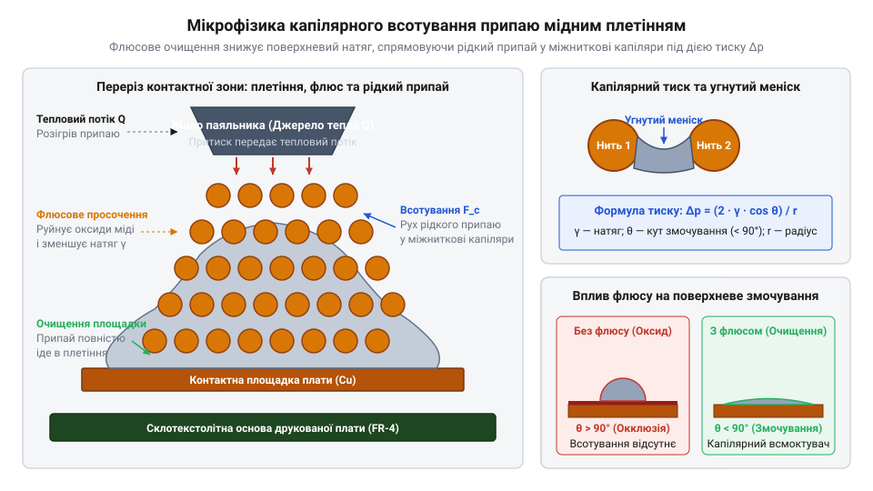
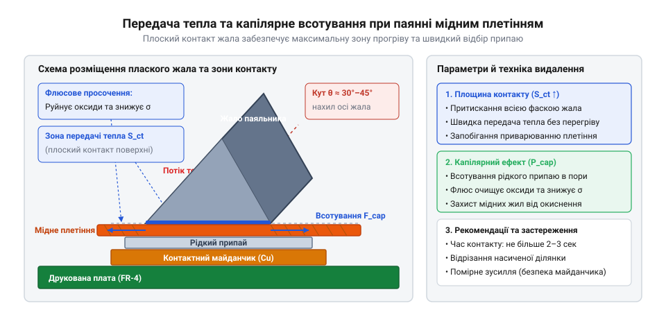
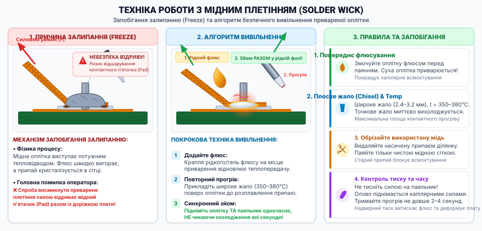

# Мідне плетіння для видалення припаю

<preknowlist>
- [Припій / олово](root:cat-hw-instruments/solder-tin) — температуру плавлення та поведінку рідкого припаю при нагріванні
- [Флюси та припої для монтажу електроніки](root:cat-hw-instruments/soldering-fluxes-and-solders) — роль флюсу в знятті оксидної плівки та покращенні змочуваності металів
- [Бокорізи](root:cat-hw-instruments/side-cutters) — прийоми точного зрізання відпрацьованого насиченого фрагмента оплітки
</preknowlist>

## Проблема зняття надлишкового припаю

Під час монтажу та ремонту сучасних електронних вузлів найпоширенішою перешкодою стає утворення небажаних струмопровідних з'єднань між близько розташованими контактами. При паянні мікросхем у корпусах із малим кроком виводів, таких як @@en|QFP@@ (від англ. @@en|Quad Flat Package@@) чи @@en|SOP@@ (від англ. @@en|Small Outline Package@@), надлишковий рідкий сплав миттєво затікає у вузькі міжвивідні зазори. Утворюється місток припаю (від англ. @@en|solder bridge@@), який коротить сусідні електричні кола пристрою. Намагання зняти цей надлишок звичайним паяльником часто лише погіршує ситуацію: поверхневий натяг розплавленого металу утримує його на кількох контактах одночасно, а спроби розмазати сплав призводять до виникнення нових перемичок та хаотичного забруднення поверхні друкованої плати (від англ. @@en|PCB@@ — @@en|Printed Circuit Board@@).

Для очищення контактних площадок (від англ. @@en|pad@@) після демонтажу зіпсованих @@en|SMD@@-компонентів майстри традиційно застосовують [механічні відсмоктувачі припаю](root:cat-hw-instruments/desoldering-pumps-and-vacuum-stations). Проте вакуумний демонтаж має виражені фізичні та технологічні обмеження. Жорсткий тефлоновий накінечник плунжерного відсмоктувача вимагає прямого притискання до зони розплавлення, що на мініатюрних поверхневих майданчиках спричиняє механічне зрізання або відрив тонкої мідної фольги від текстоліту. Крім того, вакуумний імпульс ефективно забирає лише великі об'єми рідкого [олово-свинцевого припаю](root:cat-hw-instruments/solder-tin) з наскрізних отворів, але виявляється безсилим проти тонкої плівки сплаву, яка силою поверхневого натягу утримується на пласкій металізованій площадці. Спроба прибрати залишки припаю струшуванням гарячої плати чи відшкрябуванням механічним інструментом незворотно пошкоджує захисну маску плати та розшаровує діелектричну основу. Звідси виникає гостра потреба в інструменті, який здатний вилучати рідкий сплав за рахунок внутрішніх фізичних сил без прямого механічного тиску на вразливу плату.

Історія винайдення та еволюції мідного плетіння сягає 1960-х років, коли стрімкий розвиток друкованого монтажу та поява перших інтегральних мікросхем (від англ. @@en|integrated circuit@@) гостро поставили проблему безпечного демонтажу багатовивідних елементів. Традиційні на той час механічні гумові груші та важкі вакуумні шприци регулярно руйнували тонкі доріжки перших двосторонніх плат. Винаходом, що кардинально змінив ремонтопридатність електроніки, стало застосування плетеного мідного джгута, просоченого каніфольним флюсом. Перехід від вакуумного всмоктування до капілярного збору рідкого сплаву дав змогу повністю виключити механічний удар по контактній площадці. Згодом хімічний склад просочення еволюціонував від агресивних каніфольних речовин до сучасних безвідмивних (від англ. @@en|No-Clean@@) флюсових систем, які не залишають струмопровідних залишків. Сьогодні мідне плетіння для видалення припаю (від англ. @@en|solder wick@@) геометрично та хімічно стандартизоване й входить до обов'язкових регламентів промислового ремонту електроніки згідно зі стандартами @@en|IPC/JEDEC@@.

Для безпечного відновлення плати потрібен матеріал, чия пориста структура створює капілярний тиск, значно вищий за сили поверхневого натягу рідкого припаю на пласкій площадці. Тільки так можна повністю осушити контактний майданчик до дзеркального стану, не піддаючи друковану плату ризику термомеханічного руйнування. Детальні кроки усунення перемичок між дрібними виводами мікросхем розглядаються в [практикумі з очищення SMD-майданчиків](root:cat-hw-instruments/solder-wick/proj-smd-pad-cleaning-and-debridging.md). Окремо відпрацьований насичений фрагмент стрічки зрізають, для чого використовують гострі [прецизійні бокорізи](root:cat-hw-instruments/side-cutters), що запобігає розплющуванню кінця оплітки.

## Капілярний ефект та флюсове просочення

Фізичною основою роботи мідного плетіння є капілярний ефект (від лат. @@la|capillaris@@ — волосяний), який полягає в самочинному всотуванні рідини у вузькі канали під дією сил поверхневого натягу. Стрічка оплітки виготовляється шляхом пресування та переплетення сотень тонких мідних мікрониток діаметром від 30 до 50 мікрометрів. Між цими нитками утворюється розгалужена сітка поміжних мікропор. Коли рідкий припій торкається чистої мідної поверхні джгута, виникає явище змочування: сили притягання між молекулами рідкого металу та атомами міді переважають сили зчеплення всередині самого розплаву. В результаті рідкий сплав прагне максимально збільшити площу контакту з мідними волокнами й затягується вглиб пористого об'єму стрічки проти дії сили тяжіння.

Проте сама по собі мідна сітка під час нагрівання на повітрі миттєво вкривається плівкою оксиду міді (від англ. @@en|copper oxide@@, Cu₂O та CuO). Оксидована поверхня має низьку поверхневу енергію, через що кут змочування θ між рідким сплавом і міддю стає тупим (понад 90°). У такому стані припій відштовхується від оплітки, і капілярне всотування зупиняється повністю. Щоб відновити змочуваність, оплітку просочують флюсом. Під дією температури паяльника флюс активується, вступає в хімічну реакцію з оксидами міді, розчиняє їх та очищує металеві поверхні. Тільки за умови хімічної чистоти контактної зони кут змочування θ стрімко зменшується майже до 0°, перетворюючи оплітку на потужний капілярний насос. Для глибокого розуміння розроблено [фізико-математичну модель капілярного всотування](root:cat-hw-instruments/solder-wick/math-capillary-and-thermal-dynamics-in-wicking.md), яка описує зв'язок між пористістю та в'язкістю сплаву.


*Схема перерізу мідного плетіння на контактній площадці та всотування припаю під дією капілярного тиску.*

Математично капілярний тиск, що змушує рідкий припій рухатися всередині мідного плетіння, описується рівнянням Юнга-Лапласа для циліндричних мікропор:

```
P_c = (2 · γ · cos θ) / r_eff
```
[рівняння Юнга-Лапласа для капілярного тиску в оплітці]

тут `P_c` — капілярний тиск всмоктування (Па), `γ` — коефіцієнт поверхневого натягу рідкого припаю (Н/м), `θ` — крайовий кут змочування між рідким припаєм і мідним волокном (рад), а `r_eff` — ефективний радіус капілярних пор між мідними нитками (м).

З формули видно, що капілярний тиск `P_c` прямує до максимуму при зменшенні радіуса пор `r_eff` та зменшенні кута змочування `θ` (тобто коли `cos θ` прямує до 1). Саме тому плетіння виготовляють із найтонших волокон, а застосування [якісного паяльного флюсу](root:cat-hw-instruments/soldering-fluxes-and-solders) є критичною умовою для досягнення `θ ≈ 0`.

Швидкість і глибину проникнення рідкого металу в пори стрічки в часі описує кінетичне рівняння Люкаса-Уошберна:

```
h² = (r_eff · γ · cos θ · t) / (2 · η)
```
[рівняння Люкаса-Уошберна для кінетики всотування припаю]

де `h` — висота підняття або глибина заповнення пор рідким припаєм (м), `t` — час термоконтакту (с), а `η` — динамічна в'язкість розплавленого сплаву (Па·с).

Рівняння Люкаса-Уошберна доводить, що просування припаю по оплітці сповільнюється пропорційно квадратному кореню з часу. Якщо динамічна в'язкість `η` припаю зростає через недостатнє нагрівання або якщо флюс вигоряє й кут `θ` збільшується, висота всотування `h` зупиняється. Це вимагає від оператора суворого дотримання температурного режиму: плата та оплітка мають бути прогріті вище точки ліквідусу сплаву, але не перегріті до термодеструкції флюсу. Більш детально хімічна класифікація просочень та їхній вплив на змочуваність висвітлені у матеріалі про [безвідмивні паяльні флюси](root:cat-hw-instruments/no-clean-fluxes-chemistry-and-classification).

## Вибір ширини та типу флюсу

Підбір правильної геометричної ширини стрічки та хімічного складу її просочення безпосередньо визначає якість очищення та безпеку друкованої плати. Металеве плетіння працює не лише як капілярний насос, але й як інтенсивний відвідник тепла. Мідь володіє високою теплопровідністю, тому прикладання надмірно широкої оплітки до маленького контактного майданчика миттєво відбирає тепло від жала паяльника. Якщо теплова потужність нагрівача паяльника нижча за швидкість тепловідведення крізь стрічку, температура в зоні контакта падає нижче лінії солідусу припаю. В результаті рідкий припій кристалізується всередині пор плетіння безпосередньо на платі, спричиняючи явище приварювання стрічки (від англ. @@en|wick freeze@@ чи @@en|wick sticking@@).

Щоб уникнути заморожування припаю та забезпечити високу швидкість всотування, ширину стрічки обирають відповідно до геометричних розмірів очищуваної площадки:
- Вузькі стрічки шириною 0,8–1,5 мм призначені для дрібних SMD-компонентів типорозмірів 0402/0603 та виводів мікросхем із малим кроком. Вони мають малу теплоємність і не переохолоджують чутливі елементи. - Середні стрічки шириною 2,0–2,5 мм є універсальним вибором для контактів 0805/1206, дискретних елементів та стандартних майданчиків. - Широкі стрічки шириною 3,0–5,0 мм застосовують для очищення масивних полігонів заземлення (від англ. @@en|ground plane@@), силових шин та великих контактних масивів під @@en|BGA@@-чипи. Для роботи з ними потрібен паяльник із високим запасом потужності, такий як [станція з термоповітряним феном](root:cat-hw-instruments/hot-air-station-baku) або потужний смарт-паяльник.


*Схема розміщення плаского жала паяльника поверх мідного плетіння на контактному майданчику.*

Крім геометричної ширини, вирішальне значення має тип хімічного просочення стрічки. Виробники випускають плетіння у трьох основних модифікаціях:
1. З каніфольним флюсом (@@en|Rosin Flux@@ / @@en|RMA@@ — від англ. @@en|Rosin Mildly Activated@@). Має високу активність і швидко видаляє навіть застарілі оксидні плівки. Проте каніфоль залишає липкий коричневий залишок, який після закінчення роботи необхідно ретельно видаляти органічними розчинниками, оскільки під дією вологи він здатний накопичувати пил та знижувати опір ізоляції. 2. З безвідмивним флюсом (@@en|No-Clean Flux@@). Просочення виготовляється на основі синтетичних смол та органічних кислот. Після нагрівання залишки флюсу розкладаються або утворюють прозору, хімічно інертну та негігроскопічну плівку. Таке плетіння є ідеальним для ремонту високочастотних цифрових плат та мобільних пристроїв, де промивання вузла ускладнене. 3. Без просочення (суха мідна оплітка). Вимагає самостійного нанесення зовнішнього флюсу перед кожним використанням. Перевага сухої оплітки полягає в можливості вибору спеціалізованого флюсового гелю, наприклад [безпечного безвідмивного гелю FVS-7](root:cat-hw-instruments/flux-fvs7) чи високоактивних паст під [безсвинцеві припайні сплави](root:cat-hw-instruments/solder-paste-and-lead-free-alloys-properties).

Якщо в процесі роботи оплітка все ж приварилася до контактного майданчика через відвід тепла, категорично забороняється відривати її силою. Механічний ривок приведе до негайного відриву мідної фольги від текстоліту та незворотного пошкодження друкованої плати. Вивільнення виконують покроково: на місце приварювання наносять свіжий рідкий флюс, прикладають пласке жало паяльника безпосередньо поверх стрічки й чекають повного розплавлення сплаву, після чого оплітку легко знімають убік.


*Покрокова схема вивільнення привареного плетіння шляхом повторного нагрівання жалом із додаванням флюсу проти спроби силового відриву.*

## Паяльна техніка та тепловий контакт

Правильний вибір геометричної ширини та просочення мідного плетіння є лише першим кроком; вирішальне значення для успішного видалення припаю має ефективність теплового контакту між паяльником, стрічкою та поверхнею друкованої плати. Мідна оплітка є об'ємним пористим тілом із високою теплопровідністю та великою площею поверхні. У момент притискання до контактної площадки вона працює як інтенсивний радіатор, відводячи тепло від паяльного накінечника в навколишнє середовище. Якщо тепловий потік від жала через стрічку до рідкого сплаву виявиться недостатнім, припій під опліткою не зможе перейти у повністю рідкий стан, і капілярне всотування зупиниться. Особливо гостро ця проблема постає під час роботи з багатошаровими друкованими платами, де внутрішні мідні полігони заземлення швидко поглинають теплову енергію.

Головна причина теплового збою полягає у використанні непридатних форм жал. Стандартні конічні накінечники торкаються плаского плетіння лише в одній точці, створюючи мінімальний тепловий контакт (від англ. @@en|thermal contact@@). У результаті жало локально перегрівається, але не здатне прогріти весь об'єм стрічки та підстильний шар припаю. Для якісного видалення сплаву застосовують викруткоподібні жала (від англ. @@en|chisel tip@@), зрізані жала (від англ. @@en|bevel tip@@), а також клиноподібні жала-ножі (від англ. @@en|knife tip@@). Плаский зріз такого жала повністю прилягає до стрічки, забезпечуючи максимальну площу прямої теплопередачі. Додатково перед притисканням до оплітки на жало наносять мікрокраплю припаю: цей рідкий метал заповнює найменші повітряні зазори між жалом і стрічкою, утворюючи ідеальний рідкий тепловий місток. Детальніше про особливості геометрії та розрахунок площі теплового контакту читайте в огляді про [скошені та клиноподібні жала паяльників](root:cat-hw-instruments/chisel-and-knife-soldering-tips).

Окрім геометрії жала, критичну роль відіграють температура та теплова потужність паяльного обладнання. Через інтенсивне тепловідведення мідної стрічки температура паяльника має бути на 20–30 °C вищою за стандартну температуру паяння конкретного сплаву. Для традиційних олово-свинцевих складів робочу температуру встановлюють у межах 330–350 °C, тоді як для безсвинцевих сплавів потрібен нагрів до 360–390 °C. Сучасні смарт-станції та [паяльники з підтримкою USB](root:cat-hw-instruments/usb-pd-soldering-irons), що працюють під управлінням [прошивкою IronOS](root:cat-hw-instruments/ironos-open-firmware-soldering), автоматично компенсують локальне падіння температури за рахунок зворотного зв'язку від вбудованого термодатчика. Проте навіть найпотужніший паяльник не забезпечить всотування без хімічного відновлення поверхні. Навіть якщо оплітка має заводське просочення, при нагріванні флюс швидко вигорає й випаровується. Перед початком роботи на оплітку або очищуваний майданчик обов'язково наносять краплю [безвідмивного рідкого флюсу FVS-7](root:cat-hw-instruments/flux-fvs7). Додатковий флюс миттєво знімає поверхневі оксиди, різко зменшує крайовий кут змочування та відновлює високий капілярний тиск.

Практична техніка маніпулювання вимагає строгого контролю кута нахилу паяльника та зусилля притискання. Жало прикладають до стрічки так, щоб його пласка грань повністю лежала на поверхні оплітки під кутом 15–30° до площини друкованої плати (від англ. @@en|PCB@@). Зусилля натиску має бути помірним. Поширеною помилкою є занадто сильний механічний тиск на жало: при цьому мідні мікронитки оплітки деформуються та сплющуються, а ефективний радіус пор `r_eff` зменшується. Використання конічних накінечників призводить до блокування капілярних каналів та створює ризик механічного відриву контактного майданчика (від англ. @@en|pad@@). При очищенні довгих рядків виводів мікросхем у корпусах @@en|QFP@@ або @@en|SOP@@ оплітку розміщують уздовж контакту й виконують плавне бічне переміщення (від англ. @@en|lateral movement@@) разом із жалом. Стрічка м'яко ковзає поверх майданчиків, а капілярна хвиля рідкого припаю всотується у пори без механічного шкребіння по захисній масці плати.

Здатність плетіння збирати рідкий метал обмежена його внутрішнім пористим об'ємом. По мірі заповнення мікропор припаєм капілярний тиск прямує до нуля (`P_c → 0`), а насичений ділянка стрічки перетворюється на суцільний брусок застиглого металу з високою теплоємністю. Утримувати такий насичений джгут на платі далі небезпечно, оскільки він втрачає всмоктувальну здатність і лише відводячи тепло від паяльника, перегріває навколишні доріжки та сусідні елементи. Як тільки стрічка наповнилася припаєм на довжину 5–10 мм, роботу зупиняють, паяльник та оплітку одночасно піднімають, а відпрацьований насичений кінець зрізають. Для цього застосовують [гострі прецизійні бокорізи](root:cat-hw-instruments/side-cutters), які роблять чистий перпендикулярний зріз. Використання тупих кусачок або межі ножиць призводить до сплющування кінців мідних волокон і запечатування капілярних входів, що робить наступне всотування неможливим.

## Запобігання приварюванню та відриву площадок

Попри високу ефективність мідного плетіння, порушення паяльної техніки може призвести до аварійних ситуацій і незворотного пошкодження друкованої плати. Найпоширенішою практичною помилкою під час демонтажу є передчасне відведення паяльника від поверхні стрічки. Якщо оператор піднімає жало паяльника раніше, ніж знімає мідну оплітку з контактного майданчика (від англ. @@en|pad@@), приплив тепла миттєво припиняється. Оскільки мідне плетіння має значну площу поверхні та високу теплопровідність, рідкий припій всередині мікропор кристалізується за частки секунди. У результаті оплітка надійно приварюється до металевого покриття плати (явище, відоме як @@en|wick freeze@@ або @@en|wick sticking@@).

Виникнення приварювання стрічки створює пряму загрозу механічного руйнування вузла. Основа друкованої плати виготовляється з склотекстоліту (наприклад, марки @@en|FR-4@@), на який мідна фольга контактних майданчиків і доріжок наклеєна тонким шаром епоксидного сполучного. При високих температурах міцність цього клейового шару природно знижується. Спроба силою відсмикнути або відірвати приварену оплітку від плати створює колосальне розривне зусилля. В результаті відбувається термічне та механічне відшарування мідної фольги (від англ. @@en|delamination@@) або утворення кратерів під площадками з вириванням шматків текстолітового волокна (від англ. @@en|pad cratering@@). Пошкоджений таким чином контактний майданчик втрачає зв'язок із внутрішніми провідниками плати, що робить подальший монтаж елемента неможливим без складного реставраційного ремонту.

Для безпечного вивільнення привареного плетіння існує чіткий алгоритм дій, який повністю виключає механічні ривки:
1. Категорично припинити будь-які спроби потягнути або відірвати стрічку руками чи пінцетом. 2. На місце приварювання нанести 1–2 краплі свіжого [паяльного флюсу для монтажу](root:cat-hw-instruments/soldering-fluxes-and-solders), який покращить теплопередачу та розчинить оксиди. 3. Прикласти пласке жало паяльника з великою площею контакта безпосередньо поверх привареної стрічки над точкою застрягання. 4. Дочекатися повного розплавлення припаю всередині пористої структури оплітки (зазвичай 1–2 секунди). 5. Одночасно плавно підняти паяльник та мідну стрічку вгору або змістити їх убік уздовж площини майданчика.

Якщо через систематичні перегріви площадка все ж зазнала руйнування, для відновлення працездатності плати застосовують методи [відновлення відшарованих площадок](root:cat-hw-instruments/pcb-pad-delamination-repair).

Окрім механічного відриву, суттєву небезпеку становить термічна деструкція основи через занадто тривалий контакт із гарячим паяльником. Якщо час нагрівання контактної площадки перевищує 3–5 секунд, температура склотекстоліту перетинає межу склування епоксидної смоли `T_g` (зазвичай 130–170 °C для стандартних плат). Смола розм'якшується, розшаровується й обвуглюється, що призводить до втрати діелектричних властивостей та відпадання сусідніх доріжок. Щоб запобігти перегріву, тривалість одного контактного підходу обмежують 2–3 секундами. Якщо за цей час припій не всотався повністю, робочу зону залишають охолонути до кімнатної температури, після чого повторюють процедуру з використанням додаткового флюсу або більшої геометричної ширини жала. Особливо обережно слід працювати поблизу дрібних керамічних конденсаторів та термочутливих напівпровідників, де тривалий локальний нагрів спричиняє появу мікротріщин.

Після завершення видалення припаю на поверхні плати завжди залишаються продукти термодеструкції просочення — продукти згоряння флюсу (від англ. @@en|flux residue@@). Навіть флюси класу @@en|No-Clean@@ залишають липкий наліт, який здатний притягувати пил, вологу та мікроскопічні кульки припаю, створюючи ризик струмів витоку між сусідніми доріжками. Фінальним етапом роботи є хімічна та механічна очистка. Поверхню плати промивають ізопропіловим спиртом (від араб. @@ar|al-kuḥl@@ — дрібний порошок) або спеціалізованими розчинниками для [хімічного змивання залишків флюсу](root:cat-hw-instruments/soldering-fluxes-and-solders) з використанням антистатичних щіток відповідно до [правил антистатичного захисту](root:cat-hw-instruments/esd-safe-soldering-practices). Якість очищення та цілісність контактних майданчиків контролюють під [професійним оптичним мікроскопом](root:cat-hw-instruments/optical-microscope-soldering). Очищені до дзеркального стану площадки без мікроперемичок і залишків нагару ідеально придатні для нового монтажу або для [підготовки площадок до реболінгу](root:cat-hw-instruments/bga-rework-and-balling).