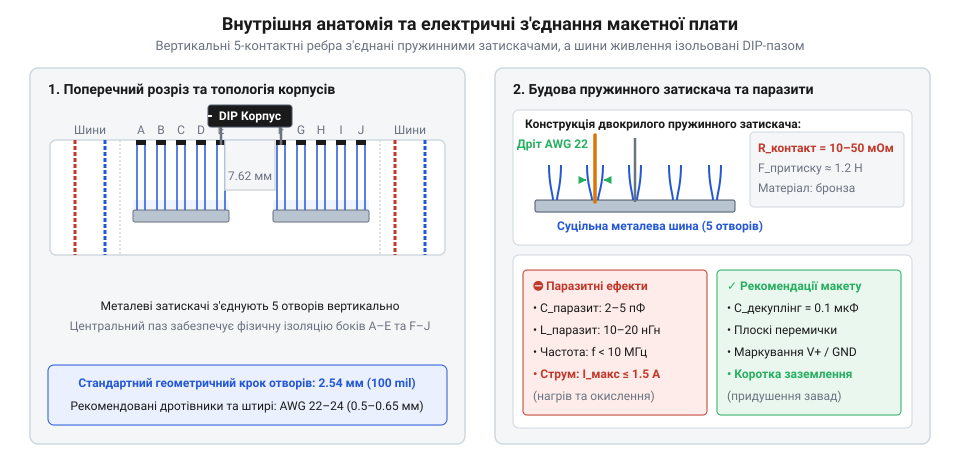
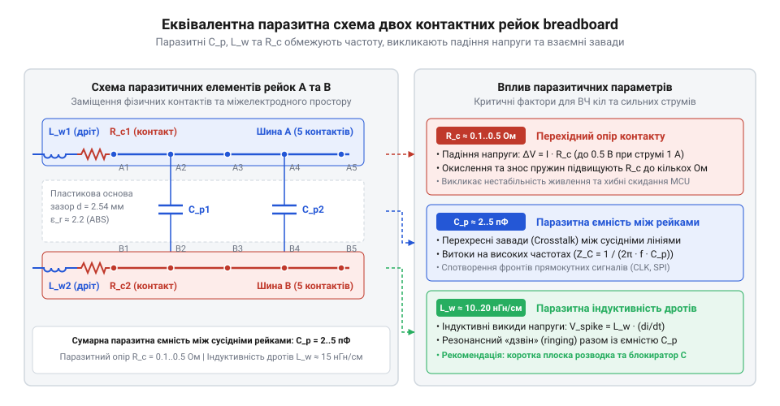
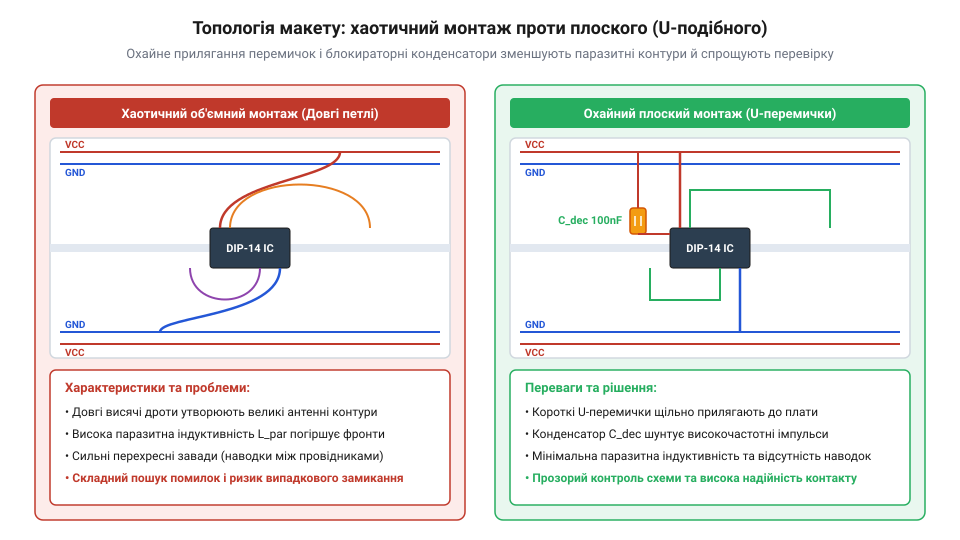

# Безпайкові макетні плати (Breadboard)

<preknowlist>
- [Паразитна ємність та опір контактів безпаяльних макетних плат](root:cat-hw-instruments/breadboard-parasitic-effects) — базова фізична природа перехідного опору механічних контактів та міжелектродної ємності
</preknowlist>

## Ненадійність навісного монтажу та потреба макетування

Перевірка концепції нової електричної схеми завжди починається з експерименту, але спосіб з'єднання компонентів визначає швидкість роботи та збереженість деталей. Якщо паяти виводи мікросхем і резисторів безпосередньо один до одного в повітрі, утворюється макет (від фр. @@fr|maquette@@ — модель, ескіз). Будь-яка зміна номіналу чи виправлення помилки в такій конструкції вимагає разогріву паяльника. Багаторазове запаювання й випаювання чутливих напівпровідникових компонентів створює ризик термічного пошкодження: перегрів виводу вище 260 °C понад 5–10 секунд призводить до деградації p-n переходу або розтріскування корпусу. Крім того, гнучкі виводи дротів без механічної фіксації легко зміщуються і торкаються сусідніх провідників, викликаючи коротке замикання й вихід схеми з ладу.

Спроба уникнути пайки шляхом скручування дротів ручним способом створює іншу проблему — ненадійність контакту. На повітрі мідь і виводи компонентів швидко покриваються оксидною плівкою. Без постійного механічного стискання перехідний опір у точці скручування коливається від часток Ома до кілоомів при найменшій вібрації. Це породжує плаваючі збої, які майже неможливо локалізувати мультиметром.

Для швидкого проєктування потрібна технологічна система, що поєднує три властивості: багаторазовість з'єднань, відсутність потреби в інструментах для монтажу та надійну фіксацію виводів у просторі. Альтернативні методики напівпостійного збирання, як-от [накрутка дротів та макетні плати під пайку](root:cat-hw-instruments/perfboard-and-stripboard), вирішують питання надійності, проте вимагають значних затрат часу на підготовку дротів і демонтаж. Для швидкої перевірки потрібні безпайкові макетні плати (англ. @@en|solderless breadboard@@), конструкція яких розвивалася десятиліттями.

Термін «@@en|breadboard@@» походить із перших років розвитку радіотехніки, коли інженери монтували експериментальні схеми прямо на дерев'яних дошках для різання хліба. У дерево забивали латунні цвяхи або штирі, до яких припаювали радіодеталі та масивні електронні лампи. Згодом на зміну кухонним дошкам прийшли керамічні й гетинаксові монтажні стійки (англ. @@en|terminal strips@@) з металевими пелюстками, а пізніше — технологія накрутки (англ. @@en|wire-wrap@@), де ізольований дріт намотувався спеціальним пістолетом на квадратні штирі під високим натягом. Справжній прорив відбувся у 1971 році, коли інженер Рональд Португал (англ. @@en|Ronald Portugal@@) із компанії @@en|E&L Instruments@@ запатентував матричну безпайкову плату. Він розмістив під пластиковим корпусом систему пружинних металевих затискачів із фіксованим кроком сітки 2.54 мм (100 @@en|mil@@). Така стандартизація геометрії ідеально збіглася з кроком виводів мікросхем у корпусах @@en|DIP@@ (англ. @@en|Dual In-line Package@@), визначивши стандарт макетування на наступні десятиліття.

Використання сучасних безпайкових плат дає змогу зібрати складний прототип за лічені хвилини. Для створення надійного макету необхідно розуміти внутрішню механіку прихованих металевих контактів.

## Внутрішня анатомія та механіка контактної матриці

Під зовнішньою панеллю з ударостійкого пластику @@en|ABS@@ (англ. @@en|Acrylonitrile Butadiene Styrene@@) прихована матриця з профільованих металевих смуг. Кожна така смуга виготовлена з фосфористої бронзи або нікельованої латуні — матеріалів, що володіють високою пружністю та корозійною стійкістю.


*Поперечний та поздовжній розріз макетної плати із зображенням металевих пружинних затискачів, 5-контактних вертикальних ребер, шин живлення та центрального пазу під DIP-корпуси.*

Основним елементом контактної матриці є подвійний вилочний пружинний затискач. Усередині пластикового отвору розміщено дві пружні металеві пелюстки, повернуті одна до одної. Коли у верхній квадратний отвір плати вставляють металевий вивід компонента діаметром від 0.3 до 0.8 мм (калібр AWG 20–28), пелюстки затискача розсуваються і стискають вивід з обох боків із зусиллям пружної деформації. Це забезпечує стабільний електричний контакт без застосування припою.

У центральному робочому полі плати затискачі об'єднані у вертикальні 5-контактні ребра (рейки). Усі п'ять отворів одного вертикального рядка підключені до єдиного суцільного металевого затискача. Це означає, що будь-які два виводи, вставлені в отвори одного 5-контактного рядка, стають електрично з'єднаними між собою, утворюючи вузол схеми.

По середині макетної плати проходить центральний розділювальний паз шириною 7.62 мм (300 @@en|mil@@). Ця геометрія розрахована спеціально під корпуса мікросхем типу @@en|DIP@@. Коли мікросхема встановлюється «верхи» над центральним пазом, її ліва й права шеренги виводів потрапляють у протилежні 5-контактні ребра. Паз фізично й електрично ізолює виводи протилежних боків мікросхеми один від одного, залишаючи для кожного виводу по чотири вільних отвори для підключення зовнішніх дротів та компонентів.

Уздовж верхнього та нижнього країв плати розташовані поздовжні шини живлення (англ. @@en|power rails@@). На відміну від 5-контактних вертикальних ребер, шини живлення орієнтовані горизонтально і слугують для розподілу напруги живлення (`V_CC`) та спільного дроту (`GND`) по всій площі макету. Залежно від розміру макетної плати, ці шини можуть бути як суцільними по всій довжині, так і розщепленими посередині. У розщеплених шинах металевий контакт переривається в центрі плати, що дає змогу використовувати дві незалежні лінії напруги (наприклад, +5 В та +3.3 В) на різних половинах макету. Якщо ж потрібна єдина лінія живлення, центральний розрив з'єднують зовнішньою дротовою перемичкою.

Розміри плат варіюються від компактних на 170 точок до повнорозмірних матриць на 830 точок. Для малих схем часто застосовують [міні-макетні плати](root:cat-hw-instruments/breadboard-mini), тоді як для складних блоків зручна [велика макетна плата](root:cat-hw-instruments/breadboard-large) з кількома групами шин. Детальні геометричні розміри матриці рейок, крок сітки та електричні специфікації викладено в [геометричній специфікації макетних плат](root:cat-hw-instruments/solderless-breadboard-prototyping/api-solderless-breadboard-pinout-geometry.md).

Зручність матричного підключення має зворотну сторону: механічні контакти й паралельні металеві рейки утворюють паразитно-зв'язане електричне середовище, яке накладає жорсткі обмеження на частоту та струм.

## Паразитні параметри та фізичні обмеження контакторів

Ідеальне провідне з'єднання на схемі має нульовий опір, нульову ємність та нульову індуктивність. У реальній макетній платі металеві рейки та з'єднувальні дроти утворюють складну еквівалентну схему з паразитною ємністю ($C_p$), індуктивністю ($L_p$) та перехідним опором ($R_c$).


*Еквівалентна електрична схема двох сусідніх рейок макетної плати із позначенням паразитної ємності між ними, індуктивності з'єднувальних дротів та опору контактних пружин.*

Паразитна ємність виникає між двома сусідніми металевими рейками, які діють як пластини паралельного конденсатора, розділені повітрям та пластиковим диелектриком @@en|ABS@@. Величина паразитної ємності між суміжними 5-контактними ребрами становить від 1 до 3 пФ. Для постійного струму або низькочастотних сигналів звукового діапазону ця ємність є невідчутною. Однак на високих частотах (понад 10 МГц) реактивний опір ємності знижується:

```
X_C = 1 / (2 × π × f × C_p)
```

При частоті $f = 20\text{ МГц}$ та $C_p = 3\text{ пФ}$ реактивний опір між сусідніми рейками падає приблизно до 2.65 кОм. Це створює шлях протікання високочастотного струму витоку між сусідніми провідниками (англ. @@en|crosstalk@@ — перехресні завади), спотворюючи цифрові фронти імпульсів та викликаючи хибні спрацьовування логічних елементів.

Паразитна індуктивність формується довгими з'єднувальними дротами та самими металевими рейками. Прямий монтажний дріт володіє власною індуктивністю порядку 1 нГн на кожен міліметр довжини (1 нГн/мм). У разі використання довгих дугоподібних дротів-петлей завдовжки 15–20 см індуктивність лінії досягає 150–200 нГн. При швидкому перемиканні цифрових мікросхем, коли струм споживання змінюється з високою швидкістю ($dI/dt$), на індуктивності провідника виникає імпульсна напруга самоіндукції:

```
V_spike = L_p × (dI / dt)
```

Ці сплески напруги викликають ефект розгойдування землі (англ. @@en|ground bounce@@) та просідання живлення, що призводить до збоїв у роботі мікроконтролерів та скидання їхніх регістрів.

Перехідний опір пружинного контакту ($R_c$) новенької макетної плати становить близько 10–20 мОм. Проте в процесі експлуатації опір зростає через окиснення металу та деформацію пружинних пелюсток при вставлянні дротів надмірного калібру. Якщо опір контакту досягає 50–100 мОм, проходження силового струму в 1.5 А створює відчутне падіння напруги та тепловиділення:

```
P_loss = I² × R_c
       = (1.5 A)² × 0.1 Ом     [закон Джоуля-Ленца для перехідного опору]
       = 0.225 Вт              [потужність тепловиділення на одному затискачі]
```

Локальне нагрівання контактора понад 70 °C викликає відпал металевої пружини, внаслідок чого вона втрачає пружність, і опір контакту незворотно зростає. Через це безпайкові макетні плати непридатні для постійного проходження струмів понад 1 А.


*Наочне порівняння хаотичного об'ємного монтажу з довгими дротами та охайного плоского монтажу з U-подібними перемичками й блокираторними конденсаторами.*

Для нейтралізації паразитних ефектів при роботі з чутливими макетами застосовують комплекс топологічних правил:
1. **Мінімізація довжини перемичок**: Використання жорстких U-подібних дротів калібру AWG 22–24 (0.5–0.64 мм), що щільно прилягають до пластикової поверхні плати. Це знижує індуктивність вихрових контурів. 2. **Локальні блокираторні конденсатори**: Встановлення керамічних конденсаторів ємністю 100 нФ (англ. @@en|decoupling capacitor@@) безпосередньо між виводами $V_{CC}$ та $GND$ кожної мікросхеми. Конденсатор слугує локальним джерелом енергії під час перехідних процесів, шунтуючи паразитною індуктивністю шини живлення. 3. **Розділення силових та сигнальних кіл**: Силові струми реле або моторів не повинні протікати тими ж шинами живлення, від яких живляться чутливі аналогові сенсори чи мікроконтролери.

Для аналітичного розрахунку еквівалентних схем скористайтеся [математичним моделюванням паразитних параметрів](root:cat-hw-instruments/solderless-breadboard-prototyping/math-breadboard-parasitic-effects.md). Покроковий порядок вимірювання перехідного опору за допомогою мікроометра наведено у [практичному тесті вимірювання опору](root:cat-hw-instruments/solderless-breadboard-prototyping/proj-breadboard-parasitics-bench-test.md). Техніка оптимального компонування складних аналого-цифрових вузлів показана у [практикумі з монтажу охайного макету](root:cat-hw-instruments/solderless-breadboard-prototyping/proj-clean-breadboard-topology-assembly.md).

Коли частота сигналів у схемі перевищує 10 МГц або струми споживання перевищують 1 А, макетна плата досягає межі застосовності. У таких випадках [паразітні ефекти у високочастотних макетах](root:hw-analog/high-frequency-prototyping-limitations) вимагають переходу до двошарових друкованих плат із суцільним шаром заземлення або використання спеціалізованих схем [керування шинами живлення](root:hw-power/breadboard-power-rail-management). Детальніше про загальну фізику контакторів читайте в огляді [паразитної ємності та опору контактів](root:cat-hw-instruments/breadboard-parasitic-effects).

## Правила топології та охайного плоского монтажу

Складання схеми з довгих гнучких дротів, що висять дугами над платою, перетворює макет на хаотичне «пташине гніздо» (англ. @@en|bird's nest wiring@@). Така конструкція не лише ускладнює візуальний контроль з'єднань, а й працює як об'ємна антена. Довгі дротові петлі захоплюють зовнішні електромагнітні наводки, підвищують паразитну індуктивність ліній та збільшують ризик випадкового висмикування провідника під час вимірювань. Перехід до плоскої топології монтажу (англ. @@en|flat wiring topology@@) розв'язує ці проблеми шляхом укладання перемичок паралельно поверхні плати з мінімально можливою довжиною провідників.

Фізичною основою якісного плоского монтажу є правильний вибір калібру та структури з'єднувальних дротів. Використання гнучкого багатожильного дроту (англ. @@en|stranded wire@@) без попереднього лудіння є типовою помилкою: окремі тонкі мідні нитки заламуються біля входу в отвір, розпушуються й викликають короткі замикання із сусідніми ребрами. Для макетних плат підходить виключно моножила (англ. @@en|solid core wire@@) з пружної міді. Стандартний американський калібр дротів AWG (англ. @@en|American Wire Gauge@@) визначає товщину жил: оптимальним є діапазон від @@en|AWG 22@@ (діаметр 0.64 мм) до @@en|AWG 24@@ (діаметр 0.51 мм). Занадто товстий дріт (калібр @@en|AWG 20@@ або товщий за 0.8 мм) незворотно деформує пелюстки пружинного затискача, відгинаючи їх за межу пружної деформації. Натомість занадто тонкий дріт (калібр @@en|AWG 26@@ або тонший за 0.4 мм) не забезпечує достатньої сили механічного стискання, бовтається в гнізді й створює нестабільний перехідний опір.

Формування U-подібних перемичок (англ. @@en|U-shaped jumper wires@@) вимагає знімання ізоляції на довжину 6–7 мм з кожного кінця та згинання кінців під прямим кутом 90°. Встановлена перемичка має щільно прилягати до пластикового корпусу плати, не утворюючи виступаючих дуг. Колірне маркування провідників слугує засічкою для миттєвого зчитування структури схеми. Для ліній живлення напруги V_CC традиційно використовують червоний або помаранчевий дріт, для спільної шини заземлення GND — чорний або синій. Сигнальні лінії розділяють за функціями: наприклад, жовтий колір для шин даних, зелений для тактових сигналів, білий для ліній скидання. Дотримання цієї системи захищає від помилок переполярності, які призводять до виходу з ладу напівпровідникових компонентів.

Розміщення активних і пасивних компонентів починають із центральних мікросхем. Інтегральні схеми у корпусах @@en|DIP@@ встановлюють прямо над центральним розділювальним пазом, орієнтуючи ключ корпусу в один бік по всьому макету. Схеми орієнтують так, щоб логічний потік сигналів проходив зліва направо: вхідні роз'єми та сенсори розташовують з лівого боку, обробку — по центру, а виконавчі елементи та виходи — праворуч. Безпосередньо біля виводів живлення V_CC та GND кожної мікросхеми встановлюють керамічний блокираторний конденсатор (англ. @@en|decoupling capacitor@@) ємністю 0.1 мкФ (100 нФ). Його ніжки роблять максимально короткими, вставляючи конденсатор у сусідні отвори тих самих рейок, де стоять виводи живлення. Це мінімізує площу паразитної індуктивної петлі між конденсатором та мікросхемою, придушуючи високочастотні імпульсні завади прямо в точці їх виникнення.

Системна організація шин живлення (англ. @@en|power rails@@) передбачає об'єднання всіх поздовжніх ліній V_CC та GND по периметру плати за допомогою коротких перемичок. Якщо в макеті поєднуються чутливі аналогові вузли та потужні силові навантаження (мотори, реле, світлодіодні матриці), застосовують розділення шин живлення. Силові струми перемикання утворюють імпульсні падіння напруги на загальному опорі шини, що викликає хибні спрацьовування аналого-цифрових перетворювачів. Щоб уникнути цього, аналогову та силову землі з'єднують лише в одній точці — безпосередньо біля клем джерела живлення, утворюючи зіркоподібне заземлення (англ. @@en|star grounding@@). Більш детально [архітектура розподілу живлення](root:hw-power/breadboard-power-rail-management) розбирає способи мінімізації наводок у складних макетах.

Практичний процес вибору дротів, формування перемичок та збирання аналого-цифрового блоку демонструє [складання охайного макету](root:cat-hw-instruments/solderless-breadboard-prototyping/proj-clean-breadboard-topology-assembly.md). Якщо ж зібраний макет розрахований на тривалу експлуатацію або піддається вібраціям, безпайкова плата поступається місцем напівпостійним технологіям, вимагаючи переходу на [макетні плати під пайку](root:cat-hw-instruments/perfboard-and-stripboard).

## Діагностика ненадійних контактів та локалізація несправностей

Найбільш складними дефектами під час відлагодження макетів є плаваючі несправності (англ. @@en|intermittent faults@@). Схема може працювати стабільно, а потім раптово перезавантажуватися від легкого дотику до столу чи зміни температури в кімнаті. Головна причина таких явищ полягає в локальній втраті електричного контакту всередині пружинного затискача. Внаслідок довготривалої експлуатації пружинні пелюстки з фосфористої бронзи зазнають механічної втоми або незворотно розгинаються після вставляння дротів надмірного діаметра. Крім того, поверхня мідних або латунних виводів компонентів покривається плівкою оксиду (англ. @@en|oxide film@@), яка створює високий бар'єрний опір для низьковольтних сигналів.

Пошук плаваючого дефекту вимагає системного підходу замість хаотичної заміни дротів. Першим кроком є перевірка цілісності живлення під навантаженням за допомогою мультиметра (англ. @@en|multimeter@@). Вимірювання напруги на виходах джерела живлення без підключеного макету може показувати ідеальні 5.0 В. Проте при проходженні робочого струму через окиснений контакт шини живлення виникає падіння напруги:

```
V_load = V_source - I_load × R_contact
       = 5.0 B - 0.2 A × 5 Ом     [обчислення напруги під навантаженням при контактному опорі 5 Ом]
       = 4.0 B                    [падіння напруги становить 1.0 B]
```

При струмі споживання I_load = 200 мА та зростанні перехідного опору R_contact до 5 Ом падіння напруги складає 1.0 В. У результаті мікросхема отримує лише 4.0 В, що нижче порогу її нормальної роботи. Щоб локалізувати проблемну ділянку, один щуп мультиметра фіксують на мінусовій клемі джерела, а другим послідовно вимірюють напругу на виводі GND кожної мікросхеми. Виявлення різниці потенціалів понад 50 мВ між земляними виводами вказує на наявність високого опору в контактному ланцюзі шини заземлення.

Для локалізації конкретної несправної точки в сигнальних колах застосовують тест на зсув (англ. @@en|wiggle test@@). Схему підключають до живлення та подають контрольний сигнал, контролюючи стан виходу мультиметром або осцилографом (англ. @@en|oscilloscope@@). За допомогою діелектричного пінцета або пластикової палички почергово злегка погойдують кожен дріт та вивід компонента. Переривання сигналу або стрибок напруги під час механічного впливу чітко вказує на конкретний зношений затискач. Інший метод полягає у вимірюванні падіння напруги безпосередньо на пружині: один щуп приладу торкається металевого виводу деталі, а другий вставляється у вільний сусідній отвір того ж 5-контактного ребра. Будь-яка напруга, відмінна від нуля, свідчить про високий перехідний опір між виводом та пелюстками затискача.

Поширеною пасткою при складанні макету є непомічені розриви в розщеплених шинах живлення. Зовні конструкція плати з двох половинок виглядає суцільною, проте металевий контакт посередині відсутній. Якщо перемичка-місток між половинами шини відсутня або має окиснений контакт, частина схеми залишається без живлення або працює через паразитну підтяжку (англ. @@en|parasite power@@) через захисні діоди вхідних портів мікросхем. Перевірку суцільності шин виконують у режимі прозвонки провідників при вимкненому живленні, вимірюючи опір між крайніми точками плати.

Після виявлення ненадійного контакту застосовують відновлювальні дії. Окиснені виводи компонентів та кінці дротів зачищають дрібним абразивом або обробляють спиртово-каніфольним флюсом і заново лудять припоєм. Якщо механічний затискач плати втратив пружність, його не можна відновити без повного розбирання корпусу. Натомість цей 5-контактний рядок маркують (наприклад, кольоровою точкою) і більше не використовують для відповідальних з'єднань. Інструментальні методи вимірювання опору контактів за допомогою чотирипровідної схеми детально висвітлює [вимірювання перехідного опору](root:cat-hw-instruments/solderless-breadboard-prototyping/proj-breadboard-parasitics-bench-test.md).

Системна діагностика та дотримання правил топології вичерпують практичний цикл роботи з безпайковими платами. Вони дають змогу швидко збирати й налагоджувати схеми без загрози пошкодження деталей. Проте коли макет виходить за межі допустимих струмів або зштовхується з [високочастотними обмеженнями макетування](root:hw-analog/high-frequency-prototyping-limitations), розробник має вчасно розпізнати цю межу і перейти до проєктування друкованих плат чи використати [макетні плати під пайку](root:cat-hw-instruments/perfboard-and-stripboard) для фінального виробу.