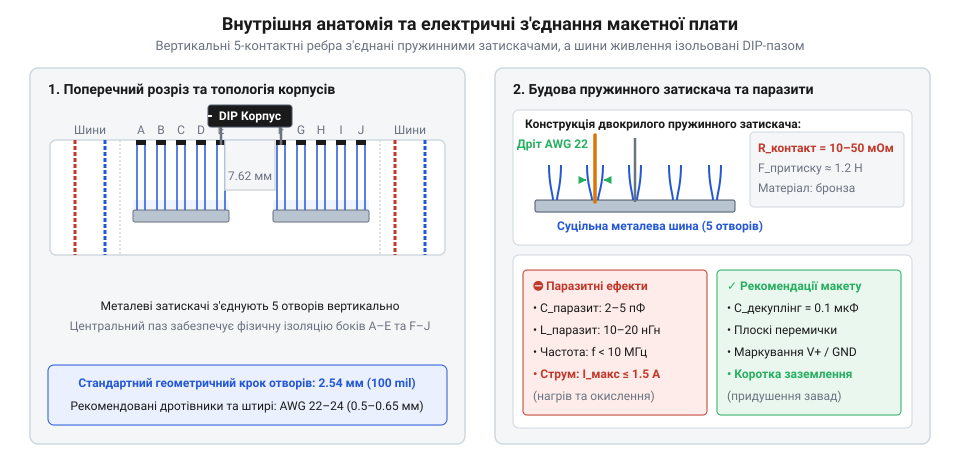
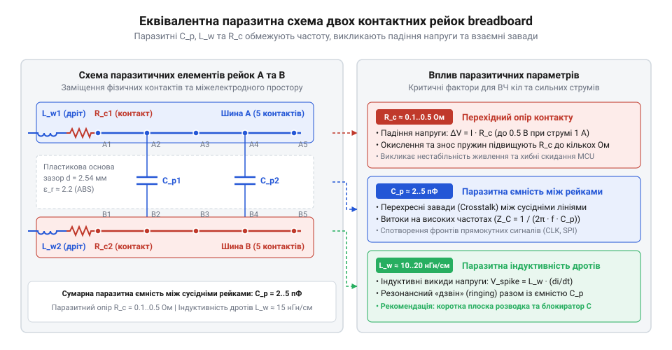
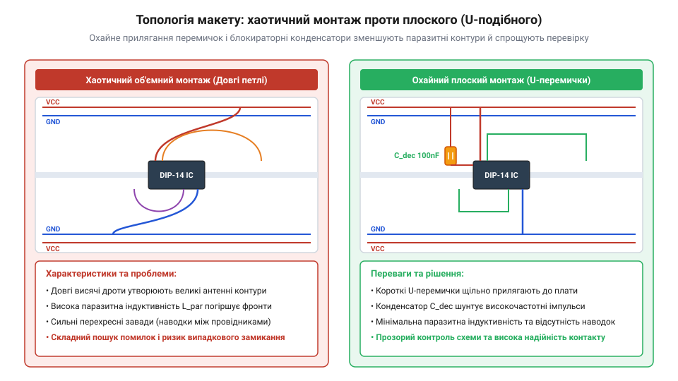

# Безпайкові макетні плати (Breadboard)

<preknowlist>
- [Паразитна ємність та опір контактів безпаяльних макетних плат](root:cat-hw-instruments/breadboard-parasitic-effects) — базова фізична природа перехідного опору механічних контактів та міжелектродної ємності
</preknowlist>

## Ненадійність навісного монтажу та потреба макетування

Спроба швидко зібрати схему скручуванням дротів або паянням виводів у повітрі призводить до хаосу та відмов. Оксидні плівки й механічні коливання скруток створюють високий перехідний опір і розривають коло, оголені дрітки спричиняють короткі замикання, а багаторазове паяння термічно деградує мікросхеми та ускладнює заміну деталей.

Для швидкого експериментування потрібна безпайкова система прототипування. На відміну від [макетних плат під пайку](root:cat-hw-instruments/perfboard-and-stripboard), де кожна зміна вимагає паяльника, вона забезпечує багаторазове використання деталей, швидку фіксацію виводів та захист від коротких замикань завдяки діелектричному корпусу.

Назва пристрою @@en|breadboard@@ походить від перших макетів, які збирали на дерев'яних дошках для хліба (від англ. *bread* — хліб та *board* — дошка). У 1971 році Рональд Дж. Португаль (англ. *Ronald J. Portugal*) Portugal*) запатентував матричну плату зі стандартизованим кроком сітки 2.54 мм (0.1 дюйма). Цей крок ідеально збігається з відстанню між ніжками мікросхем у корпусах @@en|DIP@@ (від англ. *Dual In-line Package* — дворядний корпус з виводами), що перетворило плату на світовий стандарт для швидкого збирання схем.

## Внутрішня анатомія та механіка контактної матриці

Під панеллю з @@en|ABS@@-пластику макетна плата @@en|breadboard@@ містить пружинні затискачі @@en|clip contacts@@ із фосфористої бронзи для фіксації та контакту виводів.

У робочому полі затискачі об'єднані у 5-контактні ребра — еквіпотенціальні вузли. Центральний паз (7.62 мм) під корпуси @@en|DIP@@ ізолює протилежні ряди виводів.

Поздовжні шини живлення @@en|power rails@@ (`VCC` і `GND`) бувають розщепленими для подачі різних напруг.


*Будова макетної плати: пружинні затискачі у 5-контактних ребрах, паз під DIP та шини живлення.*

Принцип сітки спільний для [міні макетних плат](root:cat-hw-instruments/breadboard-mini) і [великих макетних плат](root:cat-hw-instruments/breadboard-large).

## Паразитні параметри та фізичні обмеження контакторів

Паралельні металеві затискачі в діелектричному корпусі утворюють паразитну міжелектродну ємність (2–5 пФ між сусідніми ребрами). Довгі контактні пластини й дріт мають власну індуктивність (10–20 нГн), а механічний притиск пелюсток додає перехідний опір (0.05–0.1 Ом).

На частотах понад 10 МГц паразитна ємність проводить високочастотний струм, викликаючи перехресні завади @@en|crosstalk@@ між провідниками. Паразитна індуктивність при швидкій зміні струму (`di/dt`) формує індуктивні сплески напруги @@en|voltage spikes@@:

```
V_spike = L × (di ÷ dt)          [індуктивний сплеск напруги]
```

Ці сплески викликають підстрибування землі @@en|ground bounce@@, коли потенціал шини заземлення зміщується відносно нуля й провокує хибні спрацьовування цифрової логіки.


*Еквівалентна схема паразитних параметрів безпайкової макетної плати: міжелектродна ємність рейок, індуктивність провідників та перехідний опір затискачів.*

Пружинні затискачі розраховані на струм до 1 А (тривало — до 500 мА). Більший струм через перехідний опір викликає нагрівання й відпалювання бронзи: пелюстки втрачають пружність і перестають утримувати виводи. Детальніше кількісні оцінки розібрано у статті про [паразитну ємність та опір](root:cat-hw-instruments/breadboard-parasitic-effects).

## Правила топології та охайного плоского монтажу

Хаотичні петлі довгих дротів працюють як антени: ловлять зовнішні електромагнітні завади @@en|EMI@@ (від англ. *Electromagnetic Interference* — електромагнітні перешкоди) та випромінюють власні. Уникнути цього дозволяє охайний плоский монтаж.

З'єднання виконують моножильним мідним дротом калібру @@en|AWG 22–24@@ (від англ. *American Wire Gauge* — американський калібр дротів, діаметр 0.5–0.65 мм). Занадто тонкий дріт зминається без притиску, а товстий назавжди деформує пружинні затискачі.

З дроту формують короткі U-подібні перемички @@en|U-shaped jumpers@@ (від англ. *jumper* — перемичка), зачищені на 5–6 мм і притиснуті до плати. Червоний колір призначено для живлення (`VCC`), чорний або синій — заземлення (`GND`), інші — сигналів.

Біля виводів живлення мікросхем підключають керамічні блокираторні конденсатори @@en|decoupling capacitors@@ (від англ. *decouple* — розділяти/розв'язувати) ємністю 0.1 мкФ. Як локальне джерело енергії, вони компенсують індуктивність шин під час перемикань транзисторів і запобігають просіданню напруги.


*Порівняння топології монтажу: хаотичні петлі створюють завади, а плоский монтаж U-подібними перемичками забезпечує надійність і завадозахищеність.*

## Діагностика ненадійних контактів та локалізація несправностей

Схема на макетній платі може збоїти через плаваючі несправності @@en|intermittent faults@@ (від англ. *intermittent* — переривчастий). Їх спричиняють втрата пружності пелюсток після товстих виводів, окиснення металу та пил в отворах.

Поганий контакт локалізують вимірюванням падіння напруги @@en|voltage drop test@@ (від англ. *voltage drop* — падіння напруги) під навантаженням. Мультиметром у режимі мілівольт вимірюють напругу між виводом деталі та затискачем у сусідньому отворі того ж 5-контактного ребра. Падіння понад кілька десятків мілівольт свідчить про високий перехідний опір.

Швидкий тест на зсув @@en|wiggle test@@ (від англ. *wiggle* — погойдування) полягає в легкому погойдуванні дротів під час спостереження за приладом. Стрибок показань викриває деформовану пружину.

Суцільність розщеплених шин живлення перевіряють вимірюванням напруги між крайніми отворами плати, з'єднуючи розриви перемичками. Брудні виводи очищають ізопропіловим спиртом, а деформовані контакти минають, переносячи деталь у сусіднє ребро.