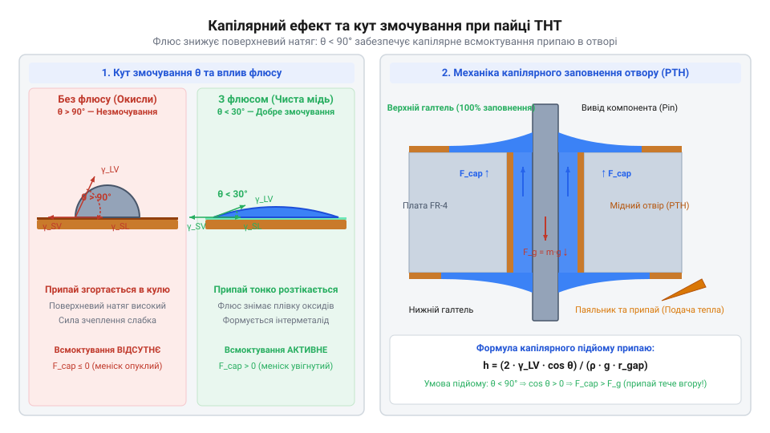
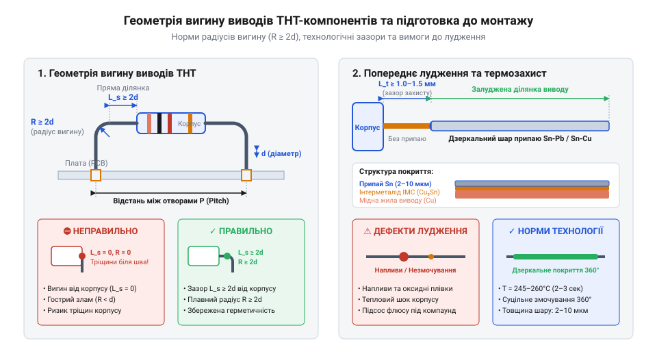

# Техніка монтажу в отвори (THT)

<preknowlist>
- [Припій / олово](root:cat-hw-instruments/solder-tin) — склад евотектичних сплавів та температури їх плавлення
- [Флюс FVS-7 (безвідмивний)](root:cat-hw-instruments/flux-fvs7) — хімічний механізм зняття оксидної плівки та забезпечення змочування
- [Паяльник USB TK-USB-DS (5 В, 260–420 °C)](root:cat-hw-instruments/usb-soldering-iron) — принцип контактної теплопередачі та вибір робочої температури жала
- [Хімічна класифікація та механізм дії безвідмивних флюсів (RO, OR, RE)](root:cat-hw-instruments/no-clean-fluxes-chemistry-and-classification) — класифікація каніфольних речовин та дисипація залишків після паяння
- [Мідне плетіння для видалення припаю](root:cat-hw-instruments/solder-wick) — ефект капілярного всмоктування рідкого припаю у мідну сітку
</preknowlist>

## Пастки неякісного монтажу вивідних компонентів

Уявіть ситуацію з реальної практики розробки: ви зібрали складний електронний модуль, ретельно впаяли всі вивідні компоненти, змили залишки забруднень і подали живлення. Пристрій успішно проходить первинне тестування на робочому столі та запускається без жодних зауважень. Однак після кількох днів експлуатації або під час першого ж транспортування починаються хаотичні збої: система раптово перезавантажується, аналогові сенсори дають хибні показання, а під навантаженням модуль взагалі перестає відповідати на запити. Розробник витрачає години на пошук багів у програмному забезпеченні або на перевірку справності мікросхем, проте причина нестабільності лежить у фізичній площині. Збій викликаний прихованим дефектом паяного шва `@@en|THT@@` (англ. *Through-Hole Technology* — технологія монтажу в отвори, від англ. *through* — крізь та *hole* — отвір).

Поширена помилка початківців полягає у сприйнятті паяння як простого склеювання металів за допомогою розплавленого рідкого припаю. У цій хибній моделі вважається достатнім розплавити краплю припаю на кінчику інструмента та «покласти» її зверху на контактний майданчик і вивід деталі. Проте таке поверхневе наплавлення створює лише тимчасовий електричний контакт із високим опіром. Без належного попереднього прогріву обох металевих поверхонь рідкий сплав миттєво охолоджується нижче своєї температури `@@en|liquidus@@` (англ. *liquidus* — температура межі рідкої фази сплаву) ще до того, як зможе вступити в хімічну взаємодію з міддю. На відміну від поверхневого монтажу, де контакти розміщені на площині друкованої плати, що детально описує [техніка поверхневого монтажу SMT](root:cat-hw-instruments/smt-surface-mount-soldering-techniques), монтаж у наскрізні отвори вимагає прогріву всієї тривимірної металевої конструкції вузла.

На поверхні будь-якого мідного провідника чи виводу компонента за умов контакту з повітрям негайно утворюється щільна плівка оксиду міді (`@@en|copper oxide@@`, CuO або Cu₂O). Якщо розплавлений припій подається на холодну або неочищену поверхню, він просто обволікає цей оксидний прошарок, утворюючи дефект, відомий як `@@en|cold solder joint@@` (англ. *cold joint* — холодний спай). На початковому етапі такий вузол може проводити струм за рахунок точкового тонелювання або механічного притискання. Але з часом під дією циклічних температурних розширень та мікровібрацій оксидний прошарок деградує, а в товщі припаю виникають мікротріщини. Контактний опір зростає, спричиняючи локальне нагрівання, прискорене окиснення та повну втрату провідності.

Справжня механічна міцність та електрична надійність паяного з'єднання забезпечуються утворенням суцільного міжметалевого шару `@@en|IMC@@` (англ. *intermetallic compound* — міжметалева сполука). Коли чиста мідь контактного майданчика та виводу прогрівається до робочої температури (зазвичай 220–240 °C) в присутності рідкого олова, атоми міді починають дифундувати в рідку фазу припаю. На межі розділу середовищ відбуваються термохімічні реакції з утворенням міжметалідів Cu₆Sn₅ (η-фаза) та Cu₃Sn (ε-фаза). Саме цей кристалічний міжметалевий шар товщиною від 0.5 до 2.0 мкм виступає монолітним містком, що зварює деталі на атомному рівні. Якщо час утримання температури `@@en|dwell time@@` (англ. *dwell time* — час витримки) занадто малий або поверхні недостатньо прогріті, шар `@@en|IMC@@` взагалі не формується. Навпаки, тривалий перегрів призводить до надмірного потовщення шару міжметалідів (понад 5 мкм), роблячи шов крихким і вразливим до механічних ударів.

Аналізуючи історичний розвиток електроніки, можна простежити, як ускладнення вимог до щільності та надійності монтажу змінило саму конструкцію друкованих плат. Докладний розгляд процесу переходу від турелей до платованих отворів описано в матеріалі про [еволюцію монтажу в отвори](root:cat-hw-instruments/through-hole-soldering-techniques/hist-tht-soldering-evolution.md). У перших електронних пристроях 1930-х років застосовувався навісний монтаж на стійках, де виводи механічно скручували перед облуджуванням. Із появою односторонніх друкованих плат у 1950-х роках припій утримував деталь лише за плаский кільцевий майданчик з одного боку. Справжнім технологічним проривом стало винайдення металізованих наскрізних отворів `@@en|PTH@@` (англ. *Plated-Through Hole* — металізований наскрізний отвір). Внутрішнє мідне покриття отвору перетворило пласке з'єднання на тривимірний капілярний циліндр, що збільшило площу міжметалевого контакту в кілька разів.

Відсутність контролю термодинаміки та хімічної активації під час монтажу `@@en|THT@@` призводить до цілої низки характерних дефектів. Крім холодного спаю, поширеними пастками є `@@en|solder bridge@@` (англ. *solder bridge* — місток припаю, який замикає сусідні виводи при надлишку припаю), `@@en|insufficient fillet@@` (недостатнє заповнення отвору рідким сплавом через брак тепла) та `@@en|blowhole@@` (утворення кратерів і пустот `@@en|pinhole@@` унаслідок закипання вологи всередині текстурувального ламінату). Суворі критерії оцінки таких дефектів встановлюються міжнародними [стандартами контролю якості IPC-A-610](root:cat-hw-instruments/ipc-a-610-solder-joint-inspection-standards).

Характерні структурні відмінності між якісним з'єднанням та дефектними вузлами показано на схемі нижче:


*Порівняльна схема еталонного паяного з'єднання та типових дефектів: холодного спаю, містка припаю та неповного заповнення.*

Як видно зі схеми, формування правильного галтеля вимагає не просто розплавлення матеріалу, а повного термодинамічного керування процесів змочування та капілярного заповнення отвору.

## Фізика змочування та капілярного заповнення

Формування якісного міжметалевого з'єднання спирається на два фундаментальних фізичних явища: змочування твердих металів рідким розплавом та капілярне всмоктування припаю в кільцевий зазор металізованого отвору. Змочування характеризує здатність рідкої фази розтікатися по твердій поверхні замість згортання в ізольовані краплі. На межі контакту трьох фаз (твердий метал, рідкий припій, газове середовище або флюс) виникає рівновага сил поверхневого натягу, яка описується рівнянням Юнга-Дюпре:

γ_SG = γ_SL + γ_LG · cos θ

де `γ_SG` — питома поверхнева енергія на межі твердого металу й газу, `γ_SL` — міжфазна енергія на межі твердого металу й рідкого припаю, `γ_LG` — поверхневий натяг рідкого припаю на межі з газом, а `θ` — кут змочування (`@@en|wetting angle@@`).

Сухий оксидований мідний майданчик має вкрай низьку поверхневу енергію `γ_SG`, через що кут змочування перевищує 90° (стан неефективного змочування, `@@en|non-wetting@@`). Рідкий [припій на основі олова](root:cat-hw-instruments/solder-tin) у цьому стані прагне набути сферичної форми з мінімальною площею поверхні. Фізико-хімічні параметри різних бессвинцевих та свинецьвмісних сплавів розкрито в матеріалі про [властивості трубчастих припоїв та паст](root:cat-hw-instruments/solder-paste-and-lead-free-alloys-properties). Для кардинального зниження кута змочування необхідно застосовувати `@@en|flux@@` (англ. *flux* — флюс, від лат. *fluxus* — течія). Під час нагрівання хімічно активні компоненти флюсу вступають у реакцію з оксидами міді, розчиняють їх та утворюють легкозмивні солі. Вибір хімічного складу флюсу деталізує класична [хімія та класифікація паяльних флюсів](root:cat-hw-instruments/j-std-004-flux-classification-and-testing-methods).

Очищена від оксидів металева поверхня різко збільшує значення `γ_SG`, а сам флюс вкриває рідкий припій, знижуючи міжфазну напругу `γ_SL` та `γ_LG`. В результаті кут змочування `θ` зменшується до значень менше 30° (стан якісного змочування, `@@en|good wetting@@`), що змушує рідкий припій тонким шаром розтікатися по поверхні виводу та контактного майданчика. Подробиці щодо хімічних процесів видалення оксидів можна дізнатися, вивчаючи [механізми дії безвідмивних флюсів](root:cat-hw-instruments/no-clean-fluxes-chemistry-and-classification).

У металізованому отворі `@@en|PTH@@` змочений припій потрапляє під дію капілярних сил. Кільцевий зазор `h_gap` між циліндричною стінкою отвору радіуса `r_hole` та виводом компонента радіуса `r_pin` утворює вузький капіляр:

h_gap = r_hole - r_pin

Капілярний тиск `P_cap`, який затягує рідкий припій вгору проти сили тяжіння, розраховується за формулою:

P_cap = (2 · γ_LG · cos θ) / h_gap

Розрахуємо величину капілярного тиску для типових параметрів монтажу: радіальний зазор `h_gap = 0.15 мм = 0.00015 м`, поверхневий натяг припаю `γ_LG = 0.48 Н/м`, а кут змочування після активації флюсом `θ = 15°`:

```
P_cap = (2 · γ_LG · cos θ) / h_gap
      = (2 · 0.48 · cos 15°) / 0.00015       [підстановка γ_LG=0.48 Н/м, θ=15°, h_gap=0.00015 м]
      = (0.96 · 0.9659) / 0.00015            [обчислення косинуса кута 15°]
      = 0.9273 / 0.00015                     [множення чисельника]
      = 6182 Па ≈ 6.18 кПа                   [підсумковий капілярний тиск]
```

Значення капілярного тиску у 6.18 кПа здатне підняти стовпчик рідкого припаю на висоту понад 50 мм, що значно перевищує стандартну товщину друкованої плати (1.6 мм). Отже, при належному змочуванні припій самостійно заповнює весь об'єм отвору знизу доверху за частки секунди. Більш розгорнуту математичну фізико-хімічну модель розкрито у матеріалі про [модель капілярного змочування](root:cat-hw-instruments/through-hole-soldering-techniques/math-tht-capillary-wetting-physics.md).

Взаємозв'язок між поверхневим натягом, кутом змочування та капілярним підйомом ілюструється нижче:


*Наочна схема капілярного підйому рідкого припаю в металізованому отворі та залежність кута змочування від дії флюсу.*

Однак високий капілярний тиск працює лише за умови, що металізований отвір і вивід прогріті вище температури плавлення припаю. Інтенсивність і швидкість передачі тепла від жала паяльника до контактного вузла визначаються законами термодинаміки. Згідно із законом Фур'є, тепловий потік `Q_dot` через контактну зону дорівнює:

Q_dot = (k · A · (T_tip - T_joint)) / d_bridge

де `k` — коефіціент теплопровідності матеріалу контакту, `A` — площа фізичного контакту, `T_tip` — температура жала паяльника, `T_joint` — поточна температура контактної групи, а `d_bridge` — товщина прошарку рідкого припаю.

Коли розробник використовує гостре конічне жало `@@en|conical tip@@`, площа фізичного контакту `A` прагне до мікроскопічної точки (`A → 0`). У результаті швидкість передачі тепла `Q_dot` виявляється недостатньою для компенсації відводу тепла у масивні мідні шари плати. Намагаючись компенсувати брак тепла, користувач підвищує температуру жала до 400 °C, що спричиняє вигорання флюсу, деструкцію сполучного ламінату та відшарування контактного майданчика `@@en|pad lifting@@` (англ. *pad lifting* — відшарування майданчика).

Правильний підхід полягає у виборі клиноподібного жала `@@en|chisel tip@@` або зрізаного конуса `@@en|bevel tip@@`, які забезпечують плоский контакт уздовж лінії або площини, збільшуючи `A` в десятки разів. Крім того, критично важливо створити рідкий тепловий місток `@@en|thermal bridge@@`: торкання жалом сухого майданчика передає тепло лише через шорсткості металу, тоді як подача мікрокраплі припаю у точку контакту миттєво заповнює зазори рідким прошарком `d_bridge`, прискорюючи прогрів вузла до 1–2 секунд.

Розрахуємо потужність теплопередачі для клиноподібного жала з рідким містком при `k = 50 Вт/(м·К)`, площі контакту `A = 3 мм² = 0.000003 м²`, перепаді температур `T_tip - T_joint = 350 °C - 230 °C = 120 K` та товщині містка `d_bridge = 0.05 мм = 0.00005 м`:

```
Q_dot = (k · A · (T_tip - T_joint)) / d_bridge
      = (50 · 0.000003 · (350 - 230)) / 0.00005    [підстановка k=50 Вт/(м·К), A=3 мм², ΔT=120 K, d=0.05 мм]
      = (0.00015 · 120) / 0.00005                 [обчислення температурного перепаду]
      = 0.018 / 0.00005                           [множення в чисельнику]
      = 360 Вт                                    [підсумкова потужність теплопередачі]
```

Потужність у 360 Вт гарантує миттєвий прогрів контактного вузла без термічного перевантаження елемента. Використовуючи сучасні [портативні паяльники TK-USB-DS](root:cat-hw-instruments/usb-soldering-iron) або професійні [станції з термостабілізацією жала](root:cat-hw-instruments/soldering-irons-and-thermal-control-stations), майстер отримує точний контроль температури, що запобігає перегріву та забезпечує швидке формування дзеркального конусоподібного галтеля. Детальний аналіз термодинамічних рівнянь наведено у матеріалі про [розрахунки теплового балансу](root:cat-hw-instruments/through-hole-soldering-techniques/math-tht-thermal-balance-and-heating.md).

## Підготовка компонентів та вибір матеріалів

Уявіть типову помилку на етапі складання електронного вузла: розробник бере з упаковки вивідний резистор чи діод із прямими жорсткими ніжками, безпідставно згинає їх під гострим кутом біля самого корпусу звичайними пасатижами та силою заштовхує в отвори друкованої плати. Під час паяння метал розширюється, а після остигання створює постійне механічне напруження на крихкий корпус компонента. У результаті скляна колба діода тріскається, або всередині керамічного конденсатора утворюються мікротріщини, які виявляються лише через місяці експлуатації. Механічна підготовка виводів та правильно дібрані витратні матеріали є тією фундаментальною основою, без якої навіть найкраща техніка володіння паяльником не забезпечить довговічності пристрою.

Процес підготовки виводів `@@en|lead forming@@` (англ. *lead forming* — формування виводів) підпорядковується суворим геометричним правилам. Головний принцип полягає у запобіганні передачі механічного зусилля на місце входу металевого провідника в корпус деталі. Радіус вигину `r` повинен становити не менше двох діаметрів виводу `d` (`r ≥ 2d`), а найближча точка вигину має відступати від корпусу принаймні на відстань `L_min ≥ 1.5–2.0 mm`. Для компенсації температурних розширень у жорстких умовах експлуатації (наприклад, у автомобільній або промисловій електроніці) на виводах формують спеціальний вигин розвантаження `@@en|strain relief@@` (англ. *strain relief* — розвантаження від механічних напружень) у вигляді U-подібної петлі або ступенчатого вигину. Для формування слід використовувати круглогубці або спеціальні формовочні матриці із гладкими губками, адже звичайні [бокорізи](root:cat-hw-instruments/side-cutters) із гострими кромками залишають на мідному виводі глибокі насічки, що стають осередками концентрації напружень та корозії.

Геометричні вимоги до формування виводів та створення захисного прошарку показано на схемі:


*Схема правильного формування радіуса вигину виводів компонентів та геометрія попереднього лудження.*

Наступний критичний крок — очищення та попереднє лудження `@@en|tinning@@` (англ. *tinning* — лудження поверхні). Виводи компонентів, що тривалий час зберігалися на складі, вкриваються щільним шаром оксидів та сульфідів міді чи срібла. Якщо такий вивід впаяти в металізований отвір без підготовки, рідкий припій не зможе змочити його поверхню, залишивши приховані газові порожнини. Для очищення використовують стекловолоконні пензлі або м'які абразиви, після чого поверхню знежирюють ізопропіловим спиртом. Потім на вивід наносять [безвідмивний флюс FVS-7](root:cat-hw-instruments/flux-fvs7) і торкаються жалом паяльника з невеликою кількістю припаю, рівномірно вкриваючи метал тонким дзеркальним шаром. Лудження гарантує утворення первинного міжметалевого шару IMC ще до монтажу компонента на плату.

Вибір діаметра трубчастого припаю `@@en|solder wire core@@` безпосередньо визначає точність дозування рідкої фази у контактному вузлі. Класичний [припій та олово](root:cat-hw-instruments/solder-tin) у вигляді дроту містить всередині один або кілька каналів із каніфольним чи синтетичним флюсом (зазвичай 2.0–3.0% від маси дроту). Детальні фізичні [властивості трубчастих припоїв](root:cat-hw-instruments/solder-paste-and-lead-free-alloys-properties) описують залежність плинності сплаву від складу флюсового ядра. Для роботи обирають один із трьох стандартних калібрів:

- `d_wire = 0.5 mm` — для високощільного монтажу, дрібнокрокових роз'ємів та чутливих сигнальних кіл, де надлишок припаю негайно призводить до замикання;
- `d_wire = 0.8 mm` — універсальний діаметр для більшості дискретних THT-компонентів із кроком 2.54 мм (резистори, конденсатори, транзистори в корпусах TO-92);
- `d_wire = 1.0–1.2 mm` — для масивних силових клем, трансформаторів та контактних майданчиків, з'єднаних із великими мідними полігонами живлення.

Необхідний об'єм припаю `V_total` для повного заповнення циліндричного отвору радіуса `r_hole` із виводом радіуса `r_pin` на платі товщиною `h_board` та формування двох увігнутих менісків висотою `h_f` на контактних майданчиках радіуса `R_pad` розраховується за формулою:

```
V_hole = π · (r_hole² - r_pin²) · h_board
       = 3.1416 · (0.50² - 0.25²) · 1.60       [об'єм кільцевого циліндра PTH]
       = 3.1416 · (0.25 - 0.0625) · 1.60
       = 0.942 mm³

V_fillets = 2 · [(1/3) · π · h_f · (R_pad² + R_pad · r_pin - 2 · r_pin²)]
          = 2 · [(1/3) · 3.1416 · 0.40 · (0.80² + 0.80 · 0.25 - 2 · 0.25²)]  [об'єм двох менісків]
          = 0.603 mm³

V_total = V_hole + V_fillets
        = 0.942 + 0.603                       [сумарна потреба у припаї]
        = 1.545 mm³
```

Звідси довжина подачі дроту `L_feed` обчислюється як `L_feed = V_total / (π · (d_wire / 2)²)`. Якщо використовувати занадто товстий дріт (1.2 мм) на малому майданчику, точна подача 1.545 мм³ вимагатиме просування лише 1.36 мм дроту, що важко контролювати вручну й призводить до передозування. Для дроту 0.8 мм ця довжина становить 3.07 мм, що дає майстру повний візуальний контроль над процес подачі.

Завершальний етап підготовки — вибір геометрії жала та налаштування температурного режиму інструмента. Використання конічного жала (`@@en|conical tip@@`, англ. *conical tip* — конічне жало) для паяння THT є поширеною помилкою: точка контакту конуса з плоським майданчиком занадто мала, що блокує передачу тепла. Для монтажу в отвори слід застосовувати клинчасте жало (`@@en|chisel tip@@`, англ. *chisel tip* — клинчасте жало) або скошене жало (`@@en|bevel tip@@`, англ. *bevel tip* — зрізане/скошене жало), плоска грань якого забезпечує максимальну площу дотику одночасно до майданчика та виводу. 

Робоча температура жала обирається залежно від використовуваного сплаву та теплоємності вузла: для традиційних евтектичних свинецьвмісних припоїв (Sn63Pb37) встановлюють `T_tip = 300–320 °C`, а для бессвинцевих сплавів (SAC305) — `T_tip = 350–370 °C`. Якщо контактний майданчик з'єднаний із внутрішнім заземленим полігоном, який інтенсивно відводь тепло, стандартні [паяльні станції та системи термостабілізації](root:cat-hw-instruments/soldering-irons-and-thermal-control-stations) мають компенсувати втрати шляхом підвищення температури на 20–30 °C або застосування попереднього підігріву плати. Для портативної роботи зручно використовувати смарт-інструменти, такі як [паяльник USB TK-USB-DS](root:cat-hw-instruments/usb-soldering-iron), на який встановлено [прошивку IronOS](root:cat-hw-instruments/ironos-open-firmware-soldering) для точної термокомпенсації. Математичний розрахунок теплового балансу та часу прогріву контактного вузла описує [тепловий баланс та розрахунок часу прогріву](root:cat-hw-instruments/through-hole-soldering-techniques/math-tht-thermal-balance-and-heating.md).

## Покроковий алгоритм паяння THT елементів

Маючи підготовлені компоненти, обраний дріт припаю та налаштовану температуру жала, майстер переходить до безпосереднього виконання паяного з'єднання. Якісний результат гарантується лише суворим дотриманням часової та просторової послідовності дій.

Процес контактного паяння складається з шести послідовних кроків:

1. **Механічна фіксація деталі.** Компонент встановлюють у металізовані отвори до упору або із заданим зазором (1.0–1.5 мм для потужних резисторів, що нагріваються). З зворотного боку плати виводи злегка відгинають на кут 15–30° для запобігання випаданню елемента під час перевертання плати. 2. **Створення теплового містка та одночасний прогрів.** Жало паяльника очищують у розетці з бронзової стружки, наносять на його кінчик мікрокраплю свіжого припаю для формування теплового містка `@@en|thermal bridge@@` (англ. *thermal bridge* — тепловий місток) і прикладають плоску грань клинчастого жала так, щоб воно одночасно торкалося мідного майданчика плати та виводу компонента. 3. **Теплова витримка.** Вузол утримують під нагрівом протягом витримки `@@en|dwell time@@` (англ. *dwell time* — час теплової витримки) тривалістю 1.0–1.5 секунди. За цей час обоє металеві поверхні прогріваються до температури, що перевищує точку плавлення припаю. 4. **Подача припаю.** Дріт припаю вносять у зону контакту із протилежного боку від жала паяльника `@@en|solder feed@@` (англ. *solder feed* — подача припаю). Категорично забороняється плавити припій безпосередньо на жало паяльника: флюс всередині дроту миттєво згорить, не виконавши очищення поверхні. Торкаючись гарячого майданчика та виводу, припій плавиться від їхнього власного тепла, а активний флюс очищає метал і затягує рідкий сплав всередину металізованого отвору під дією капілярних сил. 5. **Виведення витратного матеріалу та інструмента.** Після утворення суцільного меніска спочатку виймають дріт припаю, і лише через 0.5–1.0 секунди плавно знімають жало паяльника вздовж осі виводу. Загальний час контакту жала з платою не повинен перевищувати 2.5–3.5 секунди. 6. **Кристалізація та нерухомість.** З'єднання залишають абсолютно нерухомим протягом 1.5–2.0 секунд до повної кристалізації сплаву. Будь-який механічний зсув виводу в момент переходу припаю з рідкої фази в тверду призводить до утворення дефекту зрушеного спаю `@@en|disturbed joint@@` (англ. *disturbed joint* — зрушений спай) із сірою тріщинуватою структурою та низькою механічною міцністю.

Взаємне розташування інструмента, подачу припаю та етапи формування галтеля детально проілюстровано нижче:


*Покрокова ілюстрація позиціонування жала паяльника для одночасного прогріву та послідовність утворення конусоподібного галтеля.*

Аналіз готового паяного з'єднання здійснюється шляхом візуального контролю відповідно до вимог міжнародних [стандартів контролю якості IPC-A-610](root:cat-hw-instruments/ipc-a-610-solder-joint-inspection-standards). Еталонне паяне з'єднання THT повинно відповідати наступним критеріям:

- **Форма галтеля:** припій утворює правильний увігнутий конусоподібний меніск `@@en|concave fillet@@` (англ. *concave fillet* — увігнутий галтель) із кутом змочування `θ < 30°`. Галтель починається від зовнішнього краю контактного майданчика й плавно піднімається по виводу компонента. - **Видимість контуру:** контур виводу виразно проглядається під шаром припаю; припій не повинен утворювати масивну кулясту краплю, яка приховує геометрію виводу. - **Заповнення отвору:** рідкий припій повністю заповнює кільцевий зазор металізованого отвору по всій висоті плати (100% заповнення для відповідальних виробів Класу 3 та не менше 75% для загальної електроніки Класу 2). - **Стан поверхні:** шов має гладку дзеркально-блискучу поверхню (для свинецьвмісних припоїв) або рівномірну шовковисту текстуру без тріщин та викривлень (для бессвинцевих сплавів). На поверхні відсутні сосульки `@@en|solder icicles@@` (англ. *solder icicles* — сосульки/бурульки припаю) та кульки припаю `@@en|solder balls@@` (англ. *solder balls* — кульки припаю).

Для ретельного огляду дрібних елементів та перевірки наявності мікротріщин доцільно використовувати спеціалізований [оптичний мікроскоп для паяння](root:cat-hw-instruments/optical-microscope-soldering).

Якщо під час паяння або контролю виявлено відхилення, необхідно застосувати відповідну техніку виправлення або демонтажу:

- **При виникненні містка припаю (solder bridge) або надлишку матеріалу:** на вузол наносять краплю флюсу, очищають жало паяльника й торкаються контакту на 1–2 секунди. Надлишок сплаву перейде на жало під дією сил поверхневого натягу. Для повного видалення надлишків застосовують [мідне плетіння для видалення припаю](root:cat-hw-instruments/solder-wick) (`@@en|solder wick@@`, англ. *solder wick* — мідна оплітка для видалення припаю), вкрите флюсом: оплітку притискають плоским жалом до контактного майданчика, і припій всмоктується у мідну сітку за рахунок капілярного ефекту. - **При виділенні газів та утворенні пустот (blowholes / pinholes):** причиною є закипання вологи, що проникла у текстурувальний ламінат плати й виривається крізь мікропори металізації отвору `@@en|outgassing@@` (англ. *outgassing* — дегазація/виділення газів). Проблема усувається попереднім просушуванням друкованої плати в термошафі при температурі 100–105 °C протягом 2–4 годин перед паянням. - **При локальному перегріві та відшаруванні майданчика (pad lifting):** тривале утримання паяльника (понад 5 секунд) руйнує адгезивний шар між мідною фольгою та склотекстолітом `@@en|pad lifting@@` (англ. *pad lifting* — відшарування контактного майданчика). Відшаровані майданчики вимагають встановлення ремонтних пістонів або відновлення провідників дрібним дротом. - **При повній заміні або демонтажі компонента:** для звільнення металізованого отвору від припаю застосовують пружинний олововідсмоктувач (`@@en|desoldering pump@@`, англ. *desoldering pump* — пружинний олововідсмоктувач). Припій у контактному вузлі розплавляють паяльником, прикладають термостійкий фторопластовий наконечник відсмоктувача вертикально до отвору й спускають пружинний фіксатор. Вакуумний імпульс миттєво всмоктує рідкий сплав у циліндр інструмента. Вичерпний опис демонтажного обладнання пропонують спеціалізовані [інструменти та методи демонтажу й ремонту](root:cat-hw-instruments/desoldering-pumps-and-vacuum-stations).

Схему практичного застосування олововідсмоктувача та мідної оплітки наведено нижче:


*Схема використання олововідсмоктувача та мідної оплітки для видалення припаю з металізованого отвору.*

Під час проведення будь-яких ремонтних та паяльних робіт із мікросхемами обов'язково використовують [антистатичний захист ESD](root:cat-hw-instruments/esd-safe-soldering-practices) для запобігання пробою чутливих напівпровідникових структур. Для закріплення навичок та відпрацювання демонтажу скористайтеся інструкцією з [монтажу та контролю якості на навчальній платі](root:cat-hw-instruments/through-hole-soldering-techniques/proj-tht-soldering-practice-board.md).

## Діагностика дефектів та візуальний контроль

Візуальний контроль готового паяного з'єднання є першим і найважливішим етапом верифікації друкованого вузла до подачі електричного живлення. Непомічений мікроскопічний дефект під час роботи пристрою спричиняє нестабільний контакт, коротке замикання або повну відмову обладнання під дією вібрацій та температурних коливань. Системна діагностика полягає не просто у виявленні зовнішніх відхилень, а в розумінні фізико-хімічних процесів, які відбулися у контактному вузлі під час паяння.

Головним показником якісного з'єднання є формування суцільної міжметалевої фази — міжметалевого з'єднання (англ. *intermetallic compound*, скорочено @@en|IMC@@), яке виникає внаслідок взаємної дифузії атомів міді та олова. Для формування цього шару метал контактного майданчика й вивід компонента мусять прогрітися вище температури @@en|liquidus@@ припаю, а флюс має повністю зняти оксидну плівку. Якщо хоча б одна з умов порушується, виникають характерні структурні дефекти.

Холодний спай (англ. *cold solder joint*, від давньоангл. *cald* — холодний) виникає через недостатнє підведення тепла до контактного вузла або при додаванні припаю на холодне жало паяльника до розігріву металізації. Оскільки поверхня міді не досягла температури змочування, рідкий припій не утворює хімічного зв'язку з провідником, а лише механічно покриває його. Зовні такий спай має тьмяний, зернистий або шорсткий вигляд із вираженими мікротріщинами по межі контакту. Через відсутність шару @@en|IMC@@ з'єднання має високий електричний опір і руйнується при найменшому механічному навантаженні.

Перегрів контактного вузла та відшарування провідника (англ. *pad lifting*, від сер.-ниж.-нім. *pad* — підошва/подушка, та давньосканд. *lypta* — піднімати) є термомеханічним дефектом. Він виникає при надто тривалому часі контакту (англ. *dwell time*) жала з платою або при перевищенні допустимої робочої температури інструмента. Епоксидна смола склотекстоліту FR-4 втрачає адгезійну міцність при критичному нагріві, що призводить до термодеструкції сполучного шару — розшарування (англ. *delamination*, від лат. *lamina* — пластинка). В результаті мідна фольга контактного майданчика відривається від діелектричної основи разом із металізованим отвором, унеможливлюючи подальшу експлуатацію доріжки.

Місток припаю (англ. *solder bridge*, від давньоангл. *brycg* — міст) являє собою небажане замикання між сусідніми провідниками чи виводами. Основною першопричиною утворення містків є внесення надлишкового об'єму припаю у поєднанні з передчасним випаровуванням активних компонентів флюсу. Сила поверхневого натягу рідкого металу без достатньої кількості флюсу не може розділити розплавлену краплю на окремі меніски, і припай затікає на сусідні відкриті ділянки міді. Також містки виникають при неправильному напрямку відведення жала — жало слід відводити вздовж осі провідника, а не поперек сусідніх контактів.

Недостатнє капілярне заповнення (англ. *insufficient fillet*, від лат. *filum* — нитка) металізованого наскрізного отвору (англ. *PTH*) характеризується відсутністю припаю у верхній частині кільцевого зазору з боку компонентів. Для перевірки глибини капілярного заповнення та відповідності розрахункам за [фізико-математичною моделлю капілярного підйому](root:cat-hw-instruments/through-hole-soldering-techniques/math-tht-capillary-wetting-physics.md) оцінюють висоту меніска. Причиною відсутності вертикального підйому є недогрів верхньої зони отвору через високу теплоємність внутрішніх мідних шарів плати (особливо сильних шин живлення та заземлення без застосування теплових бар'єрів — англ. *thermal relief*, від лат. *relevare* — полегшувати). Висока теплопровідність масивних мідних полігонів відводить тепло від отвору швидше, ніж жало паяльника здатне його передати, через що припій твердне на півшляху. За критеріями стандарту IPC-A-610 для надійних електронних пристроїв вертикальне капілярне заповнення отвору припаєм має становити не менше 75% його висоти. Докладні методики розрахунку геометричних параметрів теплових розв'язок на внутрішніх шарах описує [проєктування теплових бар'єрів у друкованих платах](root:hw-pcb/thermal-relief-design-in-pcb-layout).

Газові раковини (англ. *blowhole*, від англ. *blow* — дути) та мікропори (англ. *pinhole*, від англ. *pin* — шпилька) утворюються внаслідок інтенсивного газовиділення (англ. *outgassing*) під час кристалізації сплаву. Якщо друкована плата всотала атмосферну вологу через мікротріщини в гальванічній міді отвору, при швидкому нагріванні паяльником вода миттєво перетворюється на пару вибухового тиску. Водяна пара розриває рідку плівку припаю, залишаючи на поверхні галтеля наскрізні кратери або приховані внутрішні порожнини.

Зсунутий або зрушений спай (англ. *disturbed joint*, від лат. *turbare* — колотити) формується у випадку, коли вивід компонента зазнав механічного зміщення в момент переходу припаю з рідкого стану у твердий (у інтервалі кристалізації). Таке з'єднання втрачає дзеркальний блиск, покривається сірою сіткою мікротріщин і має вкрай низьку механічну тривкість. Неповнота змочування (англ. *non-wetting*) та дезмочування (англ. *dewetting*, від давньоангл. *wæt* — вологий, з префіксом *de-* — усунення) спостерігаються при паянні окиснених виводів, коли рідкий припій спочатку покриває поверхню, а потім згортається у краплі через високий кут змочування.

Контроль якості проводять за допомогою оптичних приладів при бічному освітленні під кутом 45 градусів. Дрібні мікротріщини та порожнини зручно досліджувати за допомогою [лабораторного оптичного мікроскопа](root:cat-hw-instruments/optical-microscope-soldering), який дає необхідне збільшення й бічне освітлення. Оцінку геометрії галтеля проводять за [стандартами контролю IPC-A-610](root:cat-hw-instruments/ipc-a-610-solder-joint-inspection-standards), де чітко розмежовано допустимі відхилення та дефекти. Еталонне з'єднання повинно мати гладеньку, дзеркальну поверхню з плавною увігнутою формою галтеля (англ. *concave fillet*) та чітко видимим контуром виводу. Відпрацювати навички візуального визначення дефектів можна на [навчально-калібрувальній платі THT](root:cat-hw-instruments/through-hole-soldering-techniques/proj-tht-soldering-practice-board.md), де навмисно зібрано вузли з різною теплоємністю.

## Методи демонтажу та виправлення помилок

Виявлення дефекту або необхідність заміни несправного THT-компонента вимагають виконання процедури демонтажу без пошкодження друкованого монтажу. Спроба висмикнути вивід компонента силою при частково розплавленому припаї неминуче призводить до розриву металізованого циліндра отвору @@en|PTH@@ та здирання мідного провідника з плати. Безпечний демонтаж ґрунтується на повному розплавленні припаю по всьому об'єму зазору та його ефективному видаленні за допомогою капілярних або вакуумних інструментів.

Основним інструментом для видалення лишків припаю з поверхні контактних майданчиків є оплітка з тонких мідних дротиків — мідне плетіння (англ. *solder wick*, від давньоангл. *wice* — ґніт). Принцип її дії базується на капілярному всмоктуванні рідкого металу у дрібну сітчасту структуру з високою поверхневою енергією. Для збирання лишків рідкого припаю з поверхні контактного майданчика застосовують капілярне всмоктування за допомогою [мідного плетіння для видалення](root:cat-hw-instruments/solder-wick) припаю.

Стрічку оплітки, просочену каніфольним флюсом, прикладають безпосередньо до паяного шовчика й притискають пласкою зрізаною частиною жала — викруткоподібним жалом (англ. *chisel tip*, від давньофранц. *cisel* — зубило). Тепло від паяльника передається крізь мідну сітку до припаю. Як тільки припій досягає стану рідкості, капілярний тиск втягує його у плетіння. Важливим технічним правилом є одночасне знімання оплітки й жала з плати: якщо спочатку забрати паяльник, мідна стрічка миттєво припаяється до контактного майданчика, і при спробі її відірвати відбудеться відшарування провідника (англ. *pad lifting*).

Для повного звільнення металізованого отвору від припаю використовують плунжерний олововідсмоктувач (англ. *desoldering pump*, від лат. *solidare* — скріплювати, з префіксом *de-* — видалення, та нім. *Pumpe* — насос). Інструмент створює короткочасний перепад вакуумного тиску за допомогою пружинного поршня. Конусний тефлоновий наконечник відсмоктувача притискають щільно до контактного майданчика під кутом 90 градусів після того, як припій повністю розплавився під жалом паяльника. При натисканні на кнопку спуску поршень різко рухається вгору, і перепад тиску буквально всмоктує рідку краплю всередину циліндра, залишаючи вивід повністю вільним у центрі отвору. Вибір конкретного пристосування залежить від типу контактного вузла та описаний у списку [інструментів і методів демонтажу](root:cat-hw-instruments/desoldering-pumps-and-vacuum-stations) електронних компонентів.

При виправленні дефектів або повторній пайці критично важливим є правило додаткового внесення флюсу. Повторний прогрів без захисного середовища призводить до миттєвого окиснення, тому перед доторком жала обов'язково додають порцію [безвідмивного флюсу FVS-7](root:cat-hw-instruments/flux-fvs7) безпосередньо в зону відновлення. Свіжий флюс розчиняє оксидну плівку, знижує поверхневий натяг припаю та запобігає появі повторних містків (англ. *solder bridge*).

Коли потрібно демонтувати корпус із багатьма виводами, локальний прогрів паяльником не працює, і застосовують потік гарячого повітря від [термоповітряної станції BAKU](root:cat-hw-instruments/hot-air-station-baku) для одночасного розплавлення всіх з'єднань. Гаряче повітря рівномірно прогріває всі виводи компонента до температури плавлення сплаву, дозволяючи витягти елемент без механічного зусилля. Для запобігання деструкції діелектрика при повторних термоциклах між спробами демонтажу витримують паузу для охолодження вузла нижче 100 °C. Під час маніпуляцій із чутливими напівпровідниками важливо також дотримуватися вимог [захисту від статичної електрики](root:cat-hw-instruments/esd-safe-soldering-practices), щоб не пошкодити кристал витоком струму.

Після завершення ремонту або виправлення дефекту зону монтажу необхідно ретельно очистити від залишків флюсу ізопропіловим спиртом або спеціальним відмивальним розчином. Залишки флюсу, навіть безвідмивного, у вологих умовах можуть спричиняти струми витоку та прискорену корозію мідних провідників. Очищена поверхня повинна мати чистий діелектричний проміжок без залишків кульок припаю (англ. *solder ball*) чи обвугленої органіки.