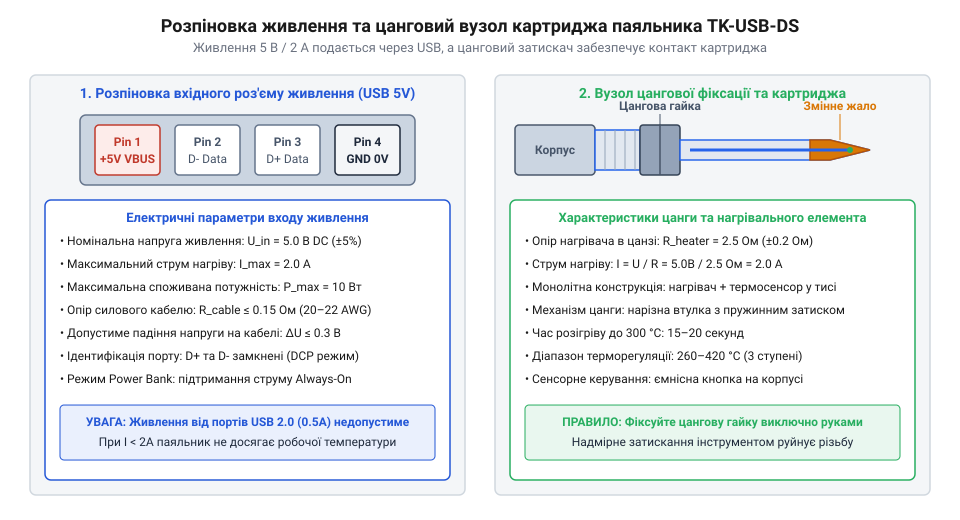
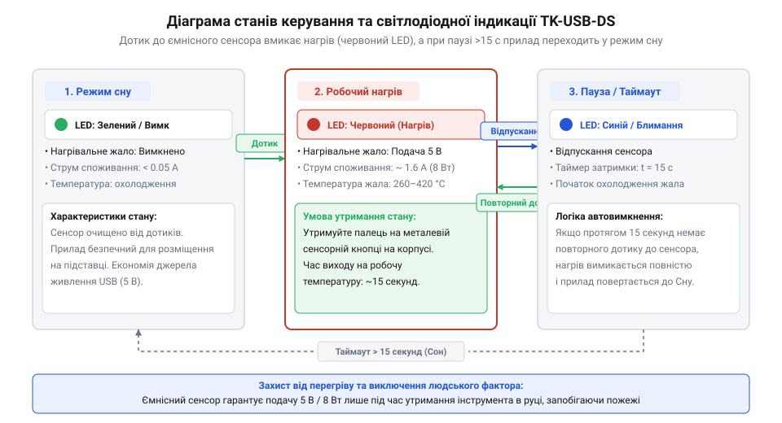

# Залізний інтерфейс та характеристики паяльника TK-USB-DS

<preknowlist>
- [Припій / олово](root:cat-hw-instruments/solder-tin) — Знання процесів нагріву й передачі тепла при контактному паянні.
- [Флюс FVS-7 (безвідмивний)](root:cat-hw-instruments/flux-fvs7) — Розуміння температурних режимів активації флюсу.
</preknowlist>

## Проблема невідповідності джерел живлення та перегріву

Підключення низьковольтного USB-паяльника до випадкових портів ноутбуків, дешевих павербанків або застарілих зарядних пристроїв часто призводить до того, що інструмент або взагалі не розігрівається до температури плавлення [припою](root:cat-hw-instruments/solder-tin), або раптово вимикається під час торкання до масивного виводу деталі. Причина полягає у падінні напруги (`@@en|voltage drop@@`) під навантаженням: при спробі спожити номінальний струм `2 А` слабке джерело живлення знижує напругу нижче порогових `4.2–4.5 В`. У відповідь внутрішня схема захисту паяльника перезапускається, перериваючи процес паяння та утворюючи холодні непропаяні з'єднання. При цьому результуючий опір з'єднувального провідника складається з об'ємного опору мідних жил та перехідного опору контактних пар (англ. @@en|contact resistance@@) роз'ємів USB-A та мікроконтактів. Фізичний механізм виникнення цього опору зумовлений мікрошорсткістю поверхонь: справжній дотик металевих елементів відбувається лише у дискретних мікроточках (англ. @@en|asperities@@, від *asperity* — мікронерівність). Це викликає деформацію та звуження ліній проходження струму (англ. @@en|constriction resistance@@, опір звуження) біля контактних плям, що в сукупності з поверхневими оксидами та малою силою притиску створює додатковий опір `R_contact`. Щоб оцінити критичність лінії живлення, визначають граничний опір кабелю `R_кабелю`, при якому напруга на вході інструмента `U_паяльника` падає до порогових `4.2 В` при напрузі джерела `U_джерела = 5.0 В` та струмі `I = 2 А`. Допустиме падіння напруги `ΔU_max` розраховують як різницю напруг, після чого за законом Ома обчислюють граничний опір провідників:

```
ΔU_max = U_джерела - U_паяльника
       = 5.0 - 4.2
       = 0.8 В                         [різниця джерельної та порогової напруг]

R_кабелю = ΔU_max ÷ I
         = 0.8 ÷ 2.0
         = 0.4 Ом                      [граничний опір за законом Ома]
```

Якщо сумарний опір двох жил кабелю живлення та контактних переходів перевищує `0.4 Ом`, падіння напруги при струмі `2 А` перевищить `0.8 В`, через що інструмент отримуватиме менше `4.2 В` і вимикатиметься.

З іншого боку, тривале утримання паяльника ввімкненим без відводу тепла на деталь спричиняє неконтрольований перегрів тиса. Оскільки пристрій не має активного термостата з електронним ПІД-регулятором, неперервна подача струму розігріває кінчик понад `400 °C`. Це випалює активні компоненти, які містить [безвідмивний рідкий флюс](root:cat-hw-instruments/flux-fvs7), та запускає механізм термічного деградування робочої поверхні. При температурному вибігу понад `400 °C` прискорюється міжметалева дифузія між мідним осердям і захисним залізним покриттям тиса, а атмосферний кисень інтенсивно окислює метал із утворенням незмочуваних оксидних плівок. У результаті захисне покриття лущиться й руйнується, оголюючи мідну основу, що швидко вигоряє та робить подальше змочування поверхні припоєм неможливим. Для забезпечення безаварійної роботи оператор має чітко розуміти електричні межі приладу та правила його теплового контролю.

## Електричні характеристики та енергоспоживання

Низьковольтний паяльник TK-USB-DS розрахований на роботу від фіксованого постійного струму напругою `U_1 = 5.0 В`. Електричною основою нагрівача є ніхромовий або металокерамічний елемент із постійним опіром `R = 2.8–3.1 Ом`. Згідно із законом Ома, споживаний струм `I_1` та номінальна електрична потужність `P_1` розраховуються за співвідношеннями напруги й опору. При падінні напруги на лінії живлення до зниженого рівня `U_2 = 4.5 В` вихідна потужність `P_2` та струм `I_2` зменшуються, а втрата потужності `ΔP` визначається як різниця між номінальним та зниженим значеннями:

```
I_1 = U_1 ÷ R
    = 5.0 ÷ 3.1
    = 1.61 А                   [струм при номінальній напрузі 5.0 В]

P_1 = U_1 × I_1
    = 5.0 × 1.61
    = 8.05 Вт                  [номінальна потужність при 5.0 В]

I_2 = U_2 ÷ R
    = 4.5 ÷ 3.1
    = 1.45 А                   [струм при зниженій напрузі 4.5 В]

P_2 = U_2 × I_2
    = 4.5 × 1.45
    = 6.53 Вт                  [потужність при зниженій напрузі 4.5 В]

ΔP = P_1 - P_2
   = 8.05 - 6.53
   = 1.52 Вт                   [втрата вихідної потужності]
```

Зменшення вхідної напруги лише на `0.5 В` (на `10 %`) знижує теплову потужність інструмента майже на `1.52 Вт` (на `19 %`), що сповільнює розігрів і погіршує відновлення температури тиса при розплавленні [припою](root:cat-hw-instruments/solder-tin) на масивних виводах.

```
I = U ÷ R
= 5 ÷ 3.1                      [розрахунок мінімального споживаного струму]
= 1.61 А                       [струм при опорі 3.1 Ом]

P = U × I
= 5 × 1.61                     [розрахунок електричної потужності]
= 8.05 Вт                      [номінальна споживана потужність]
```

Для забезпечення вказаної потужності `8 Вт` джерело живлення мусить мати струмовий запас не менше `2.0 А`. При підключенні до інформаційних портів комп'ютера зі стандартним номіналом `0.5 А` (порт `@@en|USB 2.0@@`) або `0.9 А` (`@@en|USB 3.0@@`, від англ. @@en|Standard Downstream Port@@; `SDP`) виникає перевантаження за струмом. Контролер хоста апаратно й програмно обмежує відбір енергії до завершення перелічення пристрою (англ. @@en|USB enumeration@@, від *enumeration* — перелічення): спроба пасивного нагрівача відібрати понад `1.6 А` без передачі дескрипторів викликає хибне спрацьовування захисту від перевантаження за струмом (англ. @@en|overcurrent protection@@), що аварійно вимикає шину VBUS. Натомість спеціалізовані порти живлення (англ. @@en|Dedicated Charging Port@@, `DCP`) у мережевих адаптерах та павербанках містять закорочені між собою лінії даних D+ і D- із внутрішнім опором менше `200 Ом` (згідно зі специфікацією `BC 1.2`). Таке апаратне замкнення сигналізує приладу про відсутність обміну даними та дозволяє силовому каскаду безперешкодно віддавати струм `1.5–2.1 А` (і до `2.4 А` у високопотужних блоках) без програмного узгодження та без загрози вимкнення живлення.

Параметри електричного інтерфейсу та теплового режиму TK-USB-DS зведені в специфікаційну таблицю:

| Параметр | Значення | Примітка |
| :--- | :--- | :--- |
| Вхідна напруга (`U`) | `5.0 В` постійного струму | Стандартний діапазон `4.75–5.25 В` |
| Номінальний струм (`I`) | `1.6–2.0 А` | Вимагає порт із підтримкою `2 A` |
| Споживана потужність (`P`) | `8.0 Вт` | При номінальній напрузі `5.0 В` |
| Опір нагрівача (`R`) | `2.8–3.1 Ом` | Виміряний при температурі `20 °C` |
| Максимальна температура | `450 °C` | В режимі безперервного нагріву |
| Час розігріву до `300 °C` | `15 с` | За умови напруги `5.0 В` на роз'ємі |

## Конструкція роз'ємів та розпіновка затискача

Подача живлення та фіксація змінних елементів у паяльнику TK-USB-DS реалізовані через два роз'єднаних залізничних вузли. Вхідним електричним інтерфейсом є шнур із роз'ємом штекера `@@en|USB-A@@` (від англійського *Universal Serial Bus*; `@@en|USB@@`), що підключається до вихідного гнізда живлення. Усередині кабелю використовуються лише два силові провідники підвищеного перерізу: позитивна лінія `VBUS` (+5 В, червоний провід) та заземлення `GND` (0 В, чорний провід). Інформаційні лінії `D+` та `D-` відсутні або закорочені усередині кабелю для сигналізації джерелу про споживання аналогового струму.

Вихідний вузол кріплення нагрівального елемента являє собою металевий цанговий затискач (від нім. *Zange* — кліщі; `@@de|цанга@@`). Змінне тис має керамічний або металевий цоколь із двома кільцевими контактами, розділеними ізоляційною втулкою. Фізична електрична схема комутації влаштована так, що при встановленні картриджа зовнішнє контактне кільце з'єднується з позитивною лінією `VBUS` (+5 В) через латунні пелюстки цанги, а торцеве або внутрішнє кільце контактує з заземлювальною лінією `GND` через внутрішній пружний латунний штифт гнізда. При закручуванні різьбової гайки конусна фаска втулки стискає пелюстки цанги, створюючи рівномірне радіальне зусилля, що забезпечує механічну фіксацію тиса та мінімальний початковий опір контакту (`R_contact < 0.05 Ом`). Проте при тривалій експлуатації високі робочі температури та контакт із повітрям спричиняють термічне окислення латунних пелюсток цанги. Зростання товщини поверхневої оксидної плівки підвищує перехідний опір `R_contact` до `0.3–0.5 Ом`, що під час проходження струму до `2 А` призводить до паразитних втрат потужності `P_loss = I² × R_contact`, локального перегріву цангового патрона, підгоряння контактів та небажаного падіння напруги на нагрівачі.


*Будова з'єднувальних вузлів TK-USB-DS: розпіновка силового USB-кабелю живлення та конструкція цангового патрона з пружними контактами нагрівача.*

Для запобігання пошкодженню керамічного основання нагрівача встановлення та заміна тиса виконується суворо за знеструмленого стану інструмента. Гайка цанги послаблюється на 1–2 оберти, після чого тис вставляється до упору й затискається помірним зусиллям руки без використання додаткового інструмента.

## Ємнісний сенсор та світлодіодна індикація станів

Керування робочими режимами паяльника TK-USB-DS здійснюється безмеханічним шляхом через вбудований ємнісний сенсор (від англійського *capacitive sensor*; `@@en|capacitive sensor@@`), виведений на металеву шайбу в передній частині рукоятки. Візуальний контроль станів забезпечує триколірний світлодіод (від англійського *light-emitting diode*; `@@en|LED@@`), вмонтований у корпус пристрою. Фізичний механізм роботи сенсора базується на вимірюванні зміни паразитної ємності. В ізольованому стані металева шайба має власну початкову ємність `C_0` відносно загальної землі приладу порядку `10–15 пФ`. При доторку руки тіло оператора виступає об'ємним провідником, додаючи паралельну паразитну ємність `ΔC` значенням `50–100 пФ`. Мікроконтролер періодично вимірює час заряджання й розряджання електрода `t` через фіксований внутрішній опір `R`, визначаючи сумарну ємність `C_total`:

```
C_total = C_0 + ΔC              [сумарна ємність сенсорного вузла]
t = R × C_total                 [тривалість циклу заряджання ємності]
```

Збільшення тривалості циклу `t` підтверджує зростання ємності на величину `ΔC`, що перевищує внутрішній поріг спрацьовування та розпізнається контролером як навмисне торкання пальцем.

При підключенні живлення пристрій перебуває в режимі очікування (`@@en|standby mode@@`): нагрів вимкнено, а світлодіод світиться статичним червоним або зеленим кольором (залежно від ревізії плати), сигналізуючи про наявність напруги `5 В`. Для активації нагріву оператор торкається металевої шайби й утримує палець протягом `2 секунд`. Внутрішній мікроконтролер вмикає подачу струму на нагрівач, а індикатор переходить у режим червоного блимання.


*Діаграма станів паяльника TK-USB-DS: переходи між режимами очікування, активного нагріву та засинання за сигналами ємнісного сенсора й таймера.*

Логіка автоматичного керування та часові інтервали системи наведені у таблиці станів:

| Стан пристрою | Сигнал сенсора / умова | Колір та режим LED | Стан нагрівача |
| :--- | :--- | :--- | :--- |
| Відключено | Відсутність живлення | Індикатор вимкнено | Немає струму (`0 В`) |
| Очікування (`Standby`) | Подача живлення `5 В` | Зелений / Червоний (сталий) | Немає струму (`0 В`) |
| Активний нагрів | Торкання шайби `2 с` | Червоний (миготіння) | Повна подача (`5 В / 2 А`) |
| Підтримання температури | Утримання пальця / робота | Червоний (сталий) | Подача струму (`5 В`) |
| Автозасинання | Бездіяльність `25 с` | Синій (миготіння) | Струм вимкнено, охолодження |
| Глибокий сон | Бездіяльність `15 хв` | Вимкнено / Сталий зелений | Струм вимкнено |

Якщо після нагріву оператор знімає палець із сенсорної шайби й кладе паяльник на підставку, через `25 секунд` бездіяльності контролер автоматично вимикає подачу струму. Індикатор перемикається на синє блимання, попереджаючи, що тис ще гарячий, але поступово охолоджується. Пороговою умовою скидання таймера автозасинання у цій фазі або під час активної роботи є коротке торкання сенсора тривалістю `t_touch ≥ 200 мс`. Контролер фільтрує короткочасні наводки за допомогою цифрового фільтра брязкоту (англ. @@en|debounce filter@@, від *debounce* — усунення брязкоту): торкання, коротші за `200 мс`, ігноруються, тоді як утримання пальця понад цей поріг миттєво скидає внутрішній відлік `25 секунд` у нуль і відновлює повне живлення нагрівача `5 В / 2 А`. Якщо ж паяльник залишається без руху та доторків понад `15 хвилин`, пристрій переходить у режим глибокого сну із повним відключенням нагріву для збереження ресурсу тиса та запобігання пожежі.
