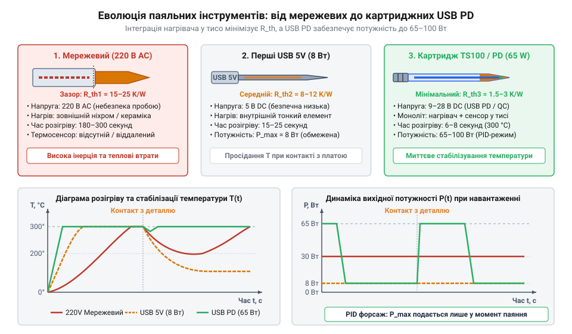

# Історія еволюції портативних та USB-паяльників

<preknowlist>
- [Припій / олово](root:cat-hw-instruments/solder-tin) — Знання процесів плавлення припою та необхідності передачі теплової енергії в точку паяння.
- [Флюс FVS-7 (безвідмивний)](root:cat-hw-instruments/flux-fvs7) — Розуміння ролі флюсу при змочуванні поверхонь та видаленні оксидів під час нагріву.
</preknowlist>

## Проблема мережевих інерційних паяльників

Низьковольтні портативні паяльники з'явилися як відповідь на принципові обмеження мережевого паяльного інструменту, що домінував протягом майже всього XX століття. Паяльник (від праслов'янського *piti* / *pojiti* — з'єднувати, споювати) традиційно являв собою масивний мідний стержень, огорнутий ніхромовою нагрівальною спіраллю (від назв елементів нікель @@en|nickel@@ та хром @@en|chromium@@), яка підключалася безпосередньо до мережі `220 В`.

Головним недоліком цієї конструкції була висока теплоємність та значний тепловий опір між спіраллю, повітряним прошарком і робочим кінчиком. Для забезпечення здатності розплавляти припій на масивних виводах ніхромовий нагрівач мав постійно видавати потужність `40–60 Вт`. За відсутності зворотного зв'язку та термосенсорів паяльник у стані спокою розігрівався до випалювальних температур `350–450 °C`. Це призводило до швидкого окислення мідного тиса та миттєвого випаровування активних речовин, коли на кінчик наносився [безвідмивний рідкий флюс](root:cat-hw-instruments/flux-fvs7). Фізичною причиною такого повільного розігріву є термодинамічна інерція масивного робочого органа. Щоб нагріти суцільний мідний тис масою `m = 50 г` (`0.05 кг`) з питомою теплоємністю `c = 385 Дж/(кг·К)` від кімнатної температури `T₁ = 20 °C` до робочої температури `T₂ = 320 °C` (різниця температур `ΔT = 300 °C`), потрібна теплова енергія `Q`. При корисній потужності нагрівача `P = 50 Вт` тривалість розігріву `t` становить:

```
Q = c · m · ΔT
= 385 × 0.05 × (320 - 20)      [теплова енергія для підйому температури на 300 °C]
= 5775 Дж                       [необхідний запас теплоти]

t = Q ÷ P
= 5775 ÷ 50                    [теоретичний час розігріву при потужності 50 Вт]
= 115.5 с                      [мінімальна тривалість без втрат]
```

Отриманий розрахунковий час у `115.5 с` (майже дві хвилини) є лише теоретичною нижньою межею за відсутності витоків тепла. У реальному приладі через високий тепловий опір повітряного зазору та розсіювання енергії корпусом у довкілля вихід на робочий режим розтягується до 5–10 хвилин.

Другою критичною проблемою була електробезпека. Мережева напруга `220 В` на спіралі створювала ризик ємнісного наведення або пробою ізоляції на корпус. При торканні тисом виводів чутливих напівпровідникових мікросхем статичний потенціал чи витік струму миттєво випалювали тонкі p-n переходи. Окрім цього, масивний корпус вагою понад `200–300 г` вимагав тривалого розігріву (5–10 хвилин) та виключав можливість швидкого виїзного ремонту електронних приладів.

## Перехід до картриджних низьковольтних тис

Поштовхом до створення сучасного портативного інструмента став технологічний прорив у галузі стаціонарного паяльного обладнання наприкінці 1980-х років. Японська компанія Hakko під керівництвом інженерів розробила концепцію монолітного картриджного тиса (від фр. @@fr|cartouche@@ — паперовий згортчик), у якому керамічний нагрівач та термопара (від грец. @@el|therme@@ — тепло, лат. @@la|par@@ — пара) були об'єднані в єдиний нерозбірний вузол.

Усунення повітряного прошарку між нагрівачем та робочим кінчиком радикально зменшило тепловий опір. Термопара, розміщена на відстані кількох міліметрів від точки контакту, реєструвала найменше падіння температури за мілісекунди. Завдяки цьому аналогова електронна схема паяльної станції подавала імпульсну потужність точно в момент торкання до деталі. Математично коефіцієнт теплового опору контакту `R_th` виражається через товщину розділювального прошарку `d`, коефіцієнт теплопровідності середовища `λ` та площу контакту `A`. Для класичного паяльника з повітряним зазором `d_повітря = 0.2 мм` (`2 × 10⁻⁴ м`), теплопровідністю повітря `λ_повітря = 0.03 Вт/(м·К)` і площею контакту `A = 1 см²` (`1 × 10⁻⁴ м²`) опір становить `R_th1`. У монолітному картриджі повітря замінено керамічним заповненням із `d_кераміка = 0.05 мм` (`5 × 10⁻⁵ м`) і теплопровідністю `λ_кераміка = 25 Вт/(м·К)`, що дає опір `R_th2`:

```
R_th1 = d_повітря ÷ (λ_повітря · A)
= (2 × 10⁻⁴) ÷ (0.03 × 1 × 10⁻⁴)    [тепловий опір повітряного прошарку]
= 2 ÷ 0.03
= 66.7 К/Вт                          [значення опору роздільної повітряної гільзи]

R_th2 = d_кераміка ÷ (λ_кераміка · A)
= (5 × 10⁻⁵) ÷ (25 × 1 × 10⁻⁴)     [тепловий опір керамічного контакту]
= 0.5 ÷ 25
= 0.02 К/Вт                          [значення опору в монолітному картриджі]
```

Пряме зіставлення отриманих обчислень показує падіння теплового опору контакту `R_th` у 3335 разів (з `66.7 К/Вт` до `0.02 К/Вт`), що практично ліквідує затримку передачі тепла й робить вимірювання температури термопарою миттєвим.

Зменшення маси нагрівального елемента знизило його теплову інерцію в десятки разів. Робоча температура `300 °C` досягалася за `10–12 секунд` замість кількох хвилин. Малоінерційність дозволила ефективно проводити [плавлення легкоплавкого припою](root:cat-hw-instruments/solder-tin) за значно нижчої середньої потужності, що відкрило шлях до відмови від важких мережевих трансформаторів та переходу на низьковольтне живлення `12–24 В`.

## Перші USB-паяльники та компроміс 8 Вт

Масова комп'ютеризація початку 2010-х років зробила інтерфейс @@en|USB@@ (від англ. @@en|Universal Serial Bus@@) найпоширенішим джерелом низьковольтного живлення. Прагнення створити кишеньковий паяльник для виїзного ремонту призвело до появи перших 5-вольтових приладів (наприклад, поширеної моделі ZD-200C).

Проте розробники зіткнулися з жорстким фізичним обмеженням шини USB 2.0/3.0. За фіксованої напруги `5 В` та максимального припустимого струму порту `1.6 А` гранична вихідна потужність становила всього `8 Вт`.


*Схема еволюції конструкції паяльного тиса та порівняльний графік потужності й розігріву.*

Щоб розігріти тис за потужності `8 Вт`, інженерам довелося зменшити його вагу до кількох грамів. Перші USB-паяльники чудово працювали з тонким монтажним проводом, але виявлялися безсилими при спробі запаяти компонент на багатошаровій друкованій платі. Масивні мідні провідники плати миттєво відбирали тепло, а обмеження в `8 Вт` не дозволяло компенсувати відвід енергії, через що припій лишався твердим, а тис заморожувався.

Фізичну причину цього обмеження описує критерій теплового балансу `ΔP = P_heat - P_loss`, де `P_heat` — згенерована потужність нагрівача, а `P_loss` — сумарний тепловий потік, який розсіюється платою. При торканні розжареного тиса до мідного полігону площею `A = 10 см²` природна конвекція та висока теплопровідність мідного шару відбирають понад `8.5 Вт` потужності при робочій температурі `300 °C`. Оскільки `P_loss > 8 Вт`, результуючий тепловий бюджет стає від'ємним (`ΔP < 0`), через що накопичена теплоємність малогабаритного нагрівача вичерпується за частки секунди, а температура опускається нижче [температури плавлення припою](root:cat-hw-instruments/solder-tin).

## Епоха протоколів USB Power Delivery

Революційний стрибок відбувся в другій половині 2010-х років із появою роз'єму Type-C та протоколів динамічного узгодження живлення @@en|USB Power Delivery@@ (USB-PD) та @@en|Quick Charge@@ (QC). Вони дозволили джерелу живлення підвищувати напругу з базових `5 В` до `9 В`, `12 В`, `20 В` і навіть `28 В`.

У 2015 році китайські інженери компанії @@en|Miniware@@ створили культовий смарт-паяльник TS100, вбудувавши у компактну ручку 32-бітний мікроконтролер та інверсорний РК-дисплей. Нова архітектура використовувала малоінерційні картриджі серії TS з опором нагрівача `R = 6.2 Ом`. При подачі максимальної напруги за протоколом @@en|USB Power Delivery@@ `U = 20 В` у момент перехідного процесу під час холодного розгону нагрівача (при коефіцієнті заповнення ШІМ `D = 100%`) виникає вихідний імпульсний струм `I_peak = U ÷ R = 20 ÷ 6.2 ≈ 3.23 А`. Такий піковий струм створює миттєву електричну потужність `P = 64.5 Вт`, вимагаючи від джерела живлення чи павербанка здатності витримувати короткочасне кидкове навантаження понад `3.2 А` без спрацьовування захисту від перевантаження за струмом (від англ. @@en|Overcurrent Protection@@, OCP).

Залежність вихідної потужності від напруги живлення описується формулою:

```
P = U² ÷ R
= 20² ÷ 6.2           [підстановка напруги 20 В та опору картриджа 6.2 Ом]
= 400 ÷ 6.2           [ділення квадрата напруги на опір]
≈ 64.5                [вихідна потужність у ватах]
```

За напруги `20 В` вихідна потужність кишенькового інструмента зросла з `8 Вт` до `65 Вт` (а в сучасних моделях TS101 та Pinecil v2 за напруги `28 В` — до `100 Вт`). Цифровий ПІД-регулятор (від англ. @@en|PID controller@@) опитує термосенсор сотні разів на секунду, розганяючи нагрівач до `300 °C` всього за `6 секунд`. Інтеграція відкритих прошивок IronOS перетворила портативний паяльник на повноцінну інтелектуальну станцію, яка розміщується в кишені та живиться від звичайного павербанка. Детальніше про алгоритми ПІД-терморегуляції, налаштування профілів сну та розширене конфігурування смарт-паяльників розповідає [відкрита прошивка IronOS](root:cat-hw-instruments/ironos-open-firmware-soldering).
