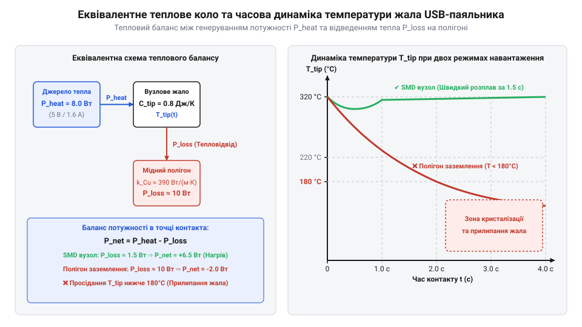

# Математика низьковольтного електронагріву та теплового бюджету

<preknowlist>
- [Припій / олово](root:cat-hw-instruments/solder-tin) — температура плавлення та фазовий перехід припою для визначення необхідного теплового бюджету
- [Флюс FVS-7 (безвідмивний)](root:cat-hw-instruments/flux-fvs7) — температурне вікно активації флюсу та межі допустимого просідання температури
</preknowlist>

## Падіння напруги та недогрів нагрівача

При використанні портативного паяльного інструмента з живленням від стандартного порту USB з напругою `5 В` фахівці регулярно стикаються з парадоксальною апаратною проблемою: пристрій із паспортною потужністю `8 Вт` виявляється неспроможним розплавити [припій / олово](root:cat-hw-instruments/solder-tin) на друкованій платі. Паспортний розрахунок спирається на ідеальне джерело напруги `U_source = 5.0 В` та холодний опір нагрівача `R_0 = 3.1 Ом` за кімнатної температури `T_0 = 20 °C`. За такої базової умови ідеальне тепловиділення на холодній спіралі становить `P_nominal = U² / R_0 = 5.0² / 3.1 ≈ 8.06 Вт`. Проте під час нагріву до робочої температури `T = 300 °C` опір ніхромової спіралі зростає за формулою температурної залежності `R_heater(T) = R_0 · (1 + α_R · (T - T_0))`, де температурний коефіцієнт опору (англ. @@en|temperature coefficient of resistance@@) для ніхрому становить `α_R ≈ 0.00017 K⁻¹`. Розрахунок гарячого опору дає значення `R_heater(300 °C) = 3.1 · (1 + 0.00017 · 280) ≈ 3.25 Ом`, що знижує навіть потенційну граничну потужність до `P_hot = 5.0² / 3.25 ≈ 7.69 Вт`. Коли ж на практиці додається просідання напруги на з'єднувальному кабелі, при доторку жала до масивної мідної доріжки припій взагалі не переходить у рідку фазу, а [флюс FVS-7 (безвідмивний)](root:cat-hw-instruments/flux-fvs7) не досягає температурного вікна активації.

Причина цього явища полягає в нехтуванні повним омічним опором з'єднувальної лінії живлення `R_cable`. USB-кабель містить дві силові жили VBUS та GND з малим перерізом міді, а також послідовні контактні переходи роз'ємів USB-A та мікроконтактів на боці паяльника. Результуючий опір `R_cable` складається з об'ємного опору мідних жил та перехідного опору контактних пар (англ. @@en|contact resistance@@). Фізичний механізм виникнення опору на контактних переходах зумовлений мікрошорсткістю поверхні металу: реальний дотик штирів роз'єму USB-A та пелюсток мікроконтактів відбувається лише у дискретних мікроскопічних точках (англ. @@en|asperities@@, від *asperity* — мікронерівність). Це спричиняє звуження та викривлення ліній проходження струму (англ. @@en|constriction resistance@@, опір звуження) біля плям контакту, що разом із поверхневими оксидними плівками та малою силою пружного притиску створює помітний опір `R_contact`. Еквівалентне електричне коло являє собою послідовне з'єднання внутрішнього опору жил кабелю, перехідних контактів та нагрівача. У результаті проходження струму частина напруги джерела безповоротно втрачається на дрітах і роз'ємах кабелю, знижуючи фактичну напругу безпосередньо на нагрівальному елементі `U_heater < U_source`. Оскільки виділювана теплова потужність пропорційна квадрату напруги, навіть незначне омічне просідання на з'єднувальних лініях призводить до катастрофічного падіння теплового бюджету (англ. @@en|thermal budget@@, від *thermal budget* — тепловий баланс) пристрою.

## Обчислення електричної потужності та втрат

Для точного кількісного аналізу електронагріву розрахуємо параметри електричного кола із джерелом `U_source = 5.0 В`, нагрівачем `R_heater = 3.1 Ом` та сумарним опором кабелю й роз'ємів `R_cable = 0.5 Ом`. Загальний опір кола обчислюють як суму послідовних елементів `R_total = R_heater + R_cable = 3.1 + 0.5 = 3.6 Ом`.

Важливим інженерним показником низьковольтного електронагріву є електричний коефіцієнт корисної дії (англ. @@en|electrical efficiency@@) системи `η`, що визначає частку енергії джерела, яка перетворюється на корисне тепло на спіралі нагрівача: `η = P_heater / (P_heater + P_loss) = R_heater / (R_heater + R_cable)`. Математично опір обох жил кабелю прямо пропорційний його довжині `L` та обернено пропорційний перерізу жил `S`: `R_cable = 2 · ρ_Cu · L / S`. У тонкому сигнальному кабелі калібру AWG28 (`S ≈ 0.081 мм²`) опір двох провідників досягає `0.42 Ом/м`, тому при довжині `L = 1.5 м` сумарний опір `R_cable ≈ 0.63 Ом` знижує ККД до `η = 3.1 / (3.1 + 0.63) ≈ 83.1 %`. У той же час перехід на силовий кабель калібру AWG20 (`S ≈ 0.52 мм²`) з лінійним опором лише `0.066 Ом/м` зменшує опір короткого метражного шнура `L = 0.5 м` до `R_cable ≈ 0.033 Ом`. Це піднімає електричний ККД системи до `η = 3.1 / (3.1 + 0.033) ≈ 98.9 %`, забезпечуючи практично повну передачу номінальної потужності джерела на нагрівальний елемент.

Струм `I`, що протікає через нагрівальний елемент та кабель, обчислюють за законом Ома для повного кола:

```
I = U_source / (R_heater + R_cable)
= 5.0 / (3.1 + 0.5)                      [закон Ома для повного кола]
= 5.0 / 3.6                              [додавання опору нагрівача та кабелю]
≈ 1.389 А                                [обчислення струму в колі]
```

Знаючи струм у колі, знайдемо дісне падіння напруги на нагрівальному елементі `U_heater`:

```
U_heater = I · R_heater
= 1.389 · 3.1                            [падіння напруги на нагрівачі]
≈ 4.306 В                                [дійсне значення напруги на спіралі]
```

Реальну теплову потужність `P_heater`, яка виділяється на нагрівальному елементі для розігріву жала, обчислюють за законом Джоуля-Ленца:

```
P_heater = I² · R_heater
= (1.389)² · 3.1                         [квадрат струму помножений на опір]
= 1.929 · 3.1                            [обчислення квадрата струму]
≈ 5.98 Вт                                [корисна теплова потужність нагрівача]
```

Водночас частина електричної енергії марно розсіюється у вигляді тепла на провідниках USB-кабелю. Омічні втрати потужності `P_loss` становлять:

```
P_loss = I² · R_cable
= (1.389)² · 0.5                         [втрати на опорі кабелю]
≈ 0.96 Вт                                [паразитне розсіювання потужності в кабелі]
```

Розрахунок показує, що замість очікуваних паспортних `8.06 Вт` нагрівач отримує лише `5.98 Вт` (втрата понад `25.8 %` корисного теплового бюджету). Ця обчислена величина `P_heater = 5.98 Вт` слугує вхідним енергетичним потоком для моделювання теплообміну паяльного інструмента з друкованою платою.

## Теплообмін із мідним полігоном плати

Під час паяння монтажного вузла відбувається кондуктивний теплообмін (англ. @@en|thermal conductance@@, від латинського *conductio* — зведення; теплова провідність, `G_thermal`) між розігрітим жалом паяльника та мідним полігоном плати. Еквівалентне значення `G_thermal` визначається геометрією контактної зони, площею заземлювального полігона та товщиною мідної фольги друкованої плати. При переході від тонкого сигнального шару завтовшки `18 мкм` (0.5 oz/ft²) до стандартного силового полігона завтовшки `35 мкм` (1.0 oz/ft²) поперечний переріз для відводу тепла подвоюється. Оскільки коефіцієнт теплопровідності міді дуже високий (`k_Cu ≈ 390 Вт/(м·°C)`), це зрощує еквівалентну теплопровідність відводу з `G_thermal ≈ 0.018 Вт/°C` до `G_thermal ≈ 0.035 Вт/°C`. Чим більша площа та товщина мідного шару, тим інтенсивніший радіальний відтік тепла в глибину плати, що створює ефект масивного теплового відводу й різко знижує рівноважну температуру контактної зони.


*Еквівалентна теплова схема з джерелом потужності нагрівача, теплоємністю жала та кондуктивним відводом тепла в мідну шину плати.*

Математична модель описує зміну температури жала `T_tip` за рахунок різниці між тепловим припливом від нагрівача `P_heater` та відводом тепла у мідний шар плати із температурою `T_board`:

```
C_tip · (dT_tip / dt) = P_heater - G_thermal · (T_tip - T_board)  [динаміка теплового балансу жала]
```

де `C_tip` — ефективна теплоємність жала паяльника (для компактного `5 В` інструмента `C_tip ≈ 1.2 Дж/°C`), а `G_thermal` — коефіцієнт теплової провідності контактної зони (для середовища з мідним полігоном `G_thermal ≈ 0.035 Вт/°C`).

При тривалому контакті жала з платою система переходить у стаціонарний стан (`dT_tip / dt = 0`), де температура жала стабілізується на рівноважному рівні `T_eq`. Виведемо рівняння рівноважної температури при початковій температурі плати `T_board = 25 °C`:

```
T_eq = T_board + (P_heater / G_thermal)
= 25 + (5.98 / 0.035)                    [підстановка дісної потужності нагрівача]
= 25 + 170.86                            [обчислення температурного приросту]
≈ 195.8 °C                               [рівноважна температура жала при контакті]
```

Отриманий результат пояснює фізичну причину відмови низьковольтного інструмента: стаціонарна температура `195.8 °C` ледве перевищує точку плавлення стандартного припою Sn63Pb37 (`183 °C`), а для безсвинцевих сплавів (`217 °C`) вона виявляється абсолютно недостатньою. При доторку до плати жало миттєво охолоджується, і рідка фаза припою кристалізується.

## Розрахунок теплового балансу та режимів

Інерційність теплової системи визначається тепловою часовою константою `τ_thermal`, яка описує швидкість зміни температури жала при стрибкоподібній зміні навантаження:

Окрім динамічного остигання жала, швидкість формування паяного з'єднання обмежується витратою теплоти на фазовий перехід плавлення. Для розплавлення дозованої порції [припій / олово](root:cat-hw-instruments/solder-tin) масою `m_solder = 20 мг` необхідна мінімальна енергія `E_phase`, що складається з теплоти нагріву до точки плавлення `T_melt = 183 °C` та питомої теплоти плавлення (англ. @@en|latent heat of fusion@@) `L_fusion ≈ 40 Дж/г`. З врахуванням питомої теплоємності сплаву `c_solder ≈ 0.17 Дж/(г·°C)` енергія нагріву до плавлення становить `E_sensible = m · c · ΔT = 0.020 · 0.17 · (183 - 25) ≈ 0.54 Дж`, а безпосередньо енергія фазового переходу — `E_fusion = m · L = 0.020 · 40 = 0.80 Дж`, що дає сумарну енергію `E_phase = 0.54 + 0.80 = 1.34 Дж`. За наявності результуючого корисного теплового потоку в контактній зоні `P_net = 2.0 Вт` тривалість затримки початку плавлення становить `t_delay = E_phase / P_net = 1.34 / 2.0 ≈ 0.67 с`. При просіданні ж корисної потужності через втрати на кабелі до `P_net = 0.5 Вт` затримка плавлення зростає до `t_delay = 1.34 / 0.5 = 2.68 с`, що суттєво уповільнює роботу й збільшує ризик перегріву сусідніх деталей.

```
τ_thermal = C_tip / G_thermal
= 1.2 / 0.035                            [ділення теплоємності на теплопровідність]
≈ 34.3 с                                 [теплова часова константа системи]
```

Динаміку просідання температури жала від початкового холостого стану `T_initial = 320 °C` до рівноважного значення `T_eq = 195.8 °C` під час контакту тривалістю `t` розраховують за експоненціальним законом:

```
T_tip(t) = T_eq + (T_initial - T_eq) · e^(-t / τ_thermal) [закон охолодження жала]
```

Обчислимо температуру жала через `t = 2.0 с` після початку торкання мідного полігону:

```
T_tip(2) = 195.8 + (320 - 195.8) · e^(-2.0 / 34.3)
= 195.8 + 124.2 · e^(-0.0583)            [обчислення показника експоненти]
= 195.8 + 124.2 · 0.94347                [значення згасаючої експоненти]
≈ 313.0 °C                               [температура жала через 2 секунди]
```

Розрахунок свідчить, що протягом перших двох секунд паяння акумульована в металі жала теплова енергія дозволяє утримувати температуру на рівні `313.0 °C`. Проте при утриманні контакту понад `5–10` секунд запас тепла виснажується, і температура опускається до критичних `195.8 °C`.

Для підтримки якісного паяного з'єднання низьковольтним `5 В` обладнанням необхідно дотримуватися двох практичних правил:
1. **Зменшення омічних втрат кабелю**: використання коротких кабелів (до `0.5 м`) з перерізом жил `AWG20` (`R_cable < 0.1 Ом`) підвищує виділювану потужність нагрівача з `5.98 Вт` до `7.5 Вт`, що збільшує рівноважну температуру `T_eq` до `239.3 °C`.
2. **Імпульсна тактика паяння**: здійснення точкових торкань тривалістю `1–2` секунди з паузами `5–8` секунд дозволяє нагрівачеві повністю відновити вихідну температуру жала `320 °C` у паузі.
3. **Попередній підігрів плати**: застосування допоміжного обладнання, такого як [термофен BAKU BK-8033](root:cat-hw-instruments/hot-air-station-baku), для розігріву мідного полігону до `100 °C` підвищує `T_eq` до `270.8 °C`, усуваючи ризик утворення холодної пайки.
