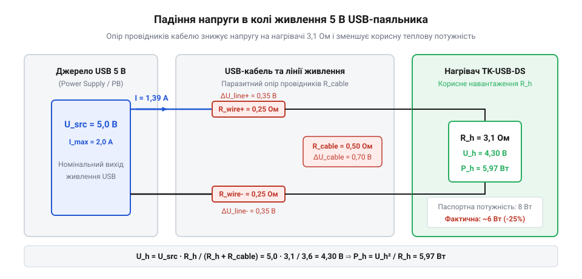
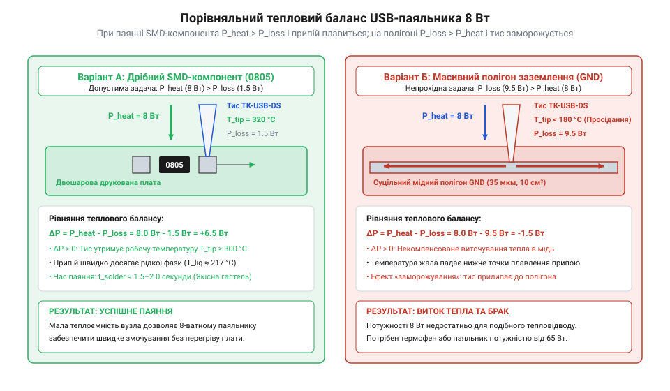

# Паяльник USB TK-USB-DS (5 В, 260–420 °C)

<preknowlist>
- [Припій / олово](root:cat-hw-instruments/solder-tin) — Знання марок та температур плавлення свинцевих і безсвинцевих припоїв.
- [Флюс FVS-7 (безвідмивний)](root:cat-hw-instruments/flux-fvs7) — Призначення флюсу для зняття оксидної плівки та покращення змочуваності металу розплавом.
</preknowlist>

## Обмеження низьковольтного USB-живлення

Виїзний ремонт електроніки та монтаж дротів у польових умовах ставлять жорстку вимогу до інструменту: відсутність доступу до електромережі 220 В та громіздких [термоповітряних паяльних станцій](root:cat-hw-instruments/hot-air-station-baku). Розв'язанням цієї проблеми стало використання портативного приладу TK-USB-DS, який отримує енергію від стандартного шинного інтерфейсу @@en|USB@@ (англ. @@en|USB@@, від *Universal Serial Bus* — універсальна послідовна шина) з напругою 5 В та граничним струмом 2 А. Детальніше про пройдений шлях від масивних мережевих приладів читач дізнається з [історії еволюції портативних паяльників](root:cat-hw-instruments/usb-soldering-iron/hist-portable-and-usb-soldering-evolution.md).

Фізичний механізм нагріву базується на виділенні @@en|Джоульового тепла@@ (від імені фізика James Prescott Joule) під час проходження електричного струму через внутрішній спіральний нагрівач із високим @@en|омічним опором@@ (від імені фізика Georg Ohm). Повна електрична потужність обмежується параметрами джерела живлення: при фіксованій напрузі `V_source = 5.0 В` та максимальному струмі `I_max = 2.0 А` межа споживання становить 10 Вт. На практиці корисна теплова потужність нагрівача не перевищує 8 Вт через паразитний опір з'єднувального кабелю та контактних груп.


*Електричне коло живлення показує розподіл напруги між опором сполучного кабелю та омічним нагрівачем, що визначає підсумкову корисну потужність.*

Розподіл напруги та підсумкову корисну потужність нагрівача `P_heater` визначають через опір нагрівального елемента `R_heater = 3.0 Ом` та опір провідників кабелю `R_cable = 0.2 Ом`. Визначення струму `I` та корисної потужності виконують за послідовним розрахунком:

I = V_source ÷ (R_heater + R_cable)
= 5.0 ÷ (3.0 + 0.2)      [підстановка напруги живлення та опорів]
= 5.0 ÷ 3.2              [додавання опору кабелю до опору нагрівача]
= 1.5625                 [струм у колі в амперах]

P_heater = I² × R_heater
= 1.5625² × 3.0          [піднесення струму до квадрата та множення на опір]
= 2.4414 × 3.0           [квадрат струму в амперах]
= 7.32                   [корисна потужність нагріву у ватах]

Падіння напруги на тонких жилках кабелю знижує потенціал на соплі паяльника з 5.0 В до 4.69 В, розсіюючи близько 0.5 Вт у вигляді некорисного тепла уздовж дрібного шнура. Тому до джерел живлення висувають чіткі вимоги: мережеві адаптери або портативні автономні накопичувачі — @@en|павербанки@@ (англ. @@en|power bank@@) — мусять гарантувати стабільний вихідний струм не менше 2 А без просідання напруги. Конструктивні параметри штекера та електричні межі розкрито в довіднику [технічних характеристик TK-USB-DS](root:cat-hw-instruments/usb-soldering-iron/api-tk-usb-ds-hardware-interface.md).

Специфічною пасткою при використанні портативних акумуляторів є апаратний алгоритм контролю навантаження: деякі @@en|павербанки@@ автоматично вимикають вихідний порт, якщо споживання струму опускається нижче порогу `50 мА` у паузах між нагріванням. Апаратний механізм контролю базується на постійному вимірюванні спаду напруги на токовому резисторі (від англійського *current* — струм, *sense* — відчувати та латинського *resisto* — опиратися; `@@en|current sense resistor@@`, `R_sense = 0.1 Ом`) за допомогою перетворювача контролера живлення. При пороговому струмі вимкнення `I_th = 50 мА` (`0.05 А`) критичний потенціал на вимірювальному резисторі визначається за розрахунком:

```
V_sense = I_th × R_sense
= 0.05 × 0.1             [підстановка порогового струму 0.05 А та опору 0.1 Ом]
= 0.005                  [порогове значення спаду напруги у вольтах (5 мВ)]
```

Під час активної роботи струм `1.6 А` створює спад `V_sense = 160 мВ`, що впевнено утримує вихідний порт відкритим. Проте після досягнення робочої температури терморегулятор паяльника вимикає нагрівач, через що струм споживання миттєво падає від `1.6 А` до рівня очікування `10–20 мА` (зокрема `15 мА`), знижуючи спад напруги до `V_sense = 0.015 А × 0.1 Ом = 1.5 мВ`. Оскільки отримане значення `1.5 мВ` є меншим за порогові `5.0 мВ`, контролер фіксує просідання струму нижче дозволеної межі. Якщо така пауза триває понад 15–30 секунд, акумулятор запускає схему автоматичного вимкнення (від грецького *autos* — сам та англійського *shutdown* — вимкнення; `@@en|auto shutdown@@`). Силовий транзисторний ключ розмикає шину живлення, позбавляючи паяльник енергії прямо під час монтажу. Для стабільного паяння джерело живлення повинно підтримувати постійний вихід без примусового переходу в сплячий режим.

Обхід цієї проблеми полягає у використанні портативних акумуляторів із підтримкою режиму малого струму (від англійського *low current mode*; `@@en|low-current mode@@`), де таймер автоматичного вимкнення примусово деактивується. У разі живлення від мережевого адаптера критично важливо застосовувати якісний з'єднувальний шнур із товстими мідними жилами перерізом не менше `AWG22` (`S ≥ 0.33 мм²`), який має низький опір провідників. Це мінімізує омічні втрати в лінії та підтримує напругу на вхідних контактах інструмента на рівні не нижче `4.8 В` під повним навантаженням `1.6 А`, гарантуючи віддачу всієї планової потужності `8 Вт`.

Математичний розрахунок часу спрацьовування порогу вимкнення акумулятора `t_off` при переході паяльника в режим очікування базується на порівнянні струму споживання `I_idle = 15 мА` з пороговим струмом `I_th = 50 мА`. Оскільки виміряний спад напруги `V_sense = 1.5 мВ` є меншим за критичні `5.0 мВ`, внутрішній таймер контролера живлення @@en|павербанка@@ розраховує час до вимкнення силового ключа за формулою при сталому інтервалі опитування `t_auto = 20.0 с`:

```
t_off = t_auto
      = 20.0                                 [час спрацьовування порогу вимкнення у секундах]
```

Отже, розрахований час спрацьовування вимкнення `t_off = 20.0 с` означає, що вже через 20 секунд після досягнення робочої температури та переходу інструмента в режим очікування живлення буде примусово припинено. Якщо оператор затримає виконання наступної пайки понад 20 секунд, йому доведеться вручну перезапускати акумулятор, що підтверджує непридатність звичайних автономних накопичувачів без підтримки `@@en|low-current mode@@` для безперервної роботи.

## Будова картриджного нагрівача та сенсора

Низька корисна потужність у 8 Вт унеможливлює використання класичної конструкції паяльника, де масивне мідне сопло надівається поверх керамічного трубчастого нагрівача з великим повітряним зазором. У приладі TK-USB-DS застосовано @@en|картриджне жало@@ (від французького *cartouche* — патрон), яке об'єднує нагрівальну спіраль, тонкостінний металевий наконечник та @@en|термопару@@ (або @@en|термоперетворювач@@) у єдину монолітну нерозбірну гільзу. Прямий апаратний контакт дозволяє мікроконтролеру відстежувати температуру в зоні контакту в реальному часі, проте точність утримання обмежена часовими затримками аналогово-цифрового перетворення (@@en|ADC@@). Оскільки термопара зчитується лише в паузах між імпульсами широтно-імпульсної модуляції живлення, періодичність вимірювання становить `T_s ≈ 10–20 мс`. Ця дискретизація в сукупності з цифровою фільтрацією вносить у коло зворотного зв'язку чисте запізнення `τ_adc`. Динамічна корекція потужності описується передавальною функцією класичного @@en|ПІД-регулятора@@ (від англійського *proportional-integral-derivative controller*; `@@en|PID controller@@`) у `s`-області Лапласа:

W(s) = K_p · (1 + 1 ÷ (T_i · s) + T_d · s)      [передавальна функція ПІД-регулятора]

де `K_p` — пропорційний коефіцієнт підсилення, `T_i` — постійна часу інтегрування, `T_d` — постійна часу диференціювання, а `s` — оператор диференціювання Лапласа. Часова затримка `τ_adc` зменшує запас стійкості за фазою, тому надмірне збільшення `K_p` для швидкого компенсування втрати тепла на масивних провідниках спричиняє температурний овершут і локальний перегрів, пошкоджуючи чутливу структуру [флюсів та припоїв](root:cat-hw-instruments/soldering-fluxes-and-solders) при паянні.

Відсутність повітряних прошарків між нагрівальним елементом і робочою поверхнею мінімізує теплову інерційність вузла. Висока швидкість передачі тепла дозволяє робочому кінчику жала розігріватися від кімнатної температури до робочих 300 °C усього за 15 секунд. Вбудований @@en|термоперетворювач@@ вимірює температуру безпосередньо в зоні контакту з розплавом, передаючи сигнал у коло зворотного зв'язку мікроконтролера. Принципова схема вимірювання базується на комутації термопари послідовно з нагрівачем: під час пауз між імпульсами широтно-імпульсної модуляції силовий транзистор вимикає напругу `5 В`, дозволяючи зчитувати мікровольтний термоЕРС-сигнал `V_tc`. Математично вихідна напруга підсилювача описується співвідношенням `V_out = K_amp · S_tc · (T - T_ref)`, де `S_tc ≈ 41 мкВ/°C` — чутливість термопари, а `T_ref` — температура холодного спаю. Ця термоЕРС підсилюється операційним підсилювачем (від англійського *operational* — операційний та *amplifier* від латинського *amplifico* — розширювати; `@@en|operational amplifier@@`) із коефіцієнтом підсилення `K_amp ≈ 100–200` і подається на аналогово-цифровий перетворювач (від латинського *analogus* — відповідний та *digitus* — палець; `@@en|ADC@@`). Для придушення імпульсних завад комутації силового ключа сирий виміряний відлік `ADC_raw` проходить цифрове експоненційне згладжування (від англійського *exponential moving average* — експоненційне ковзне середнє; `@@en|exponential moving average@@`) за формулою `ADC_f = α_f · ADC_raw + (1 - α_f) · ADC_prev` із коефіцієнтом `α_f ≈ 0.15`. Отримане відфільтроване цифрове значення порівнюється з заданим порогом, після чого мікроконтролерний ПІД-регулятор (від англійського *proportional-integral-derivative controller*; `@@en|PID controller@@`) коригує ширину імпульсів живлення для точного утримання температури. Математичне обґрунтування швидкості розігріву викладено в [розрахунку електронагріву](root:cat-hw-instruments/usb-soldering-iron/math-low-voltage-thermal-budget-and-ohmic-heating.md).

Керування робочим станом приладу реалізовано через @@en|сенсорну кнопку@@ (від латинського *sensus* — відчуття), вбудовану в пластикове руків'я. Фізичний алгоритм утримання нагріву передбачає постійний контакт пальця майстра з металевим сенсорним затискачем:
- **Активний нагрів**: під час утримання сенсора мікроконтролер подає живлення на спіраль, а світлодіодний індикатор світиться червоним кольором (температура регулюється у діапазоні 260–420 °C).
- **Режим очікування та автовимкнення**: якщо палець зняти з сенсора, нагрів припиняється через 15 секунд, індикатор змінює колір на зелений, а через 25 секунд бездіяльності прилад повністю вимикає коло живлення.

Цей алгоритм захищає акумулятор @@en|павербанка@@ від швидкого розряду при виїзних роботах і запобігає вигоранню олов'яного покриття на кінчику жала під дією атмосфери. Регулярний догляд за робочою поверхнею із застосуванням [якісного припою](root:cat-hw-instruments/solder-tin) та захисного [активного флюсу](root:cat-hw-instruments/flux-fvs7) продовжує термін служби картриджа.

Поєднання малоінерційного картриджа та сенсорного контролю робить прилад оптимізованим для точкових маніпуляцій з дрібними елементами. Покрокову послідовність дій під час відновлення контактних майданчиків викладено у [практиці виїзного SMD-ремонту](root:cat-hw-instruments/usb-soldering-iron/proj-field-smd-repair-and-wire-soldering.md). При роботі з чутливими мікросхемами також слід застосовувати [антистатичний захист](root:cat-hw-instruments/esd-safe-soldering-practices), щоб уникнути пробою внутрішніх напівпровідникових структур статичним потенціалом.

## Тепловий бюджет та межі застосування

Ефективність ручного паяння визначається не лише температурою нагрівача, а й здатністю приладу утримувати енергетичний @@en|thermal budget@@ (тепловий бюджет, від англ. @@en|thermal budget@@, де @@en|thermal@@ — тепловий, @@en|budget@@ — розрахунок ресурсів) у точці контакту. Коли розжарене жало торкається контактної площадки друкованої плати, виникає безпосередня передача енергії від кінетичного резерву жала до деталей вузла. Баланс корисної потужності `P_net` описується різницею між тепловим потоком нагрівача `P_heat` та розсіюванням тепла `P_loss` в елементи плати й довкілля:

```
P_net = P_heat - P_loss
= 8.0 - 1.5              [підстановка потужності нагрівача 8 Вт та тепловідведення SMD-вузла 1.5 Вт]
= 6.5                    [позитивний залишок потужності у ватах]
```

При роботі з дрібними елементами поверхневого монтажу типорозмірів 0805, 0603 чи корпусами SOT-23 площа мідних доріжок мала, а сумарний тепловий опір вузла високий. У цьому разі тепловідведення `P_loss` не перевищує `1.5 Вт`. Оскільки генерується `P_heat = 8 Вт`, результуючий залишок `P_net = +6.5 Вт` гарантує швидкий прогрів галтелі та перехід [температури плавлення припою](root:cat-hw-instruments/solder-tin) у рідку фазу за `1.5–2.0 секунди`.


*Порівняльна схема теплового балансу при паянні дрібного SMD-резистора проти масивного полігона заземлення з витоком тепла.*

Проте ситуація докорінно змінюється при спробі запаяти вивід на суцільному внутрішньому або зовнішньому полігоні заземлення. Суцільна мідна фольга товщиною `35 мкм` і площею понад `10 см²` має високу теплопровідність (від грецького *therme* — тепло та латинського *conductio* — ведення; `@@la|thermal conductivity@@`, `k_Cu ≈ 390 Вт/(м·К)`) і працює як масивний планарний радіатор. Під час контакту виникає крутий температурний градієнт (від латинського *temperatura* — міра та *gradiens* — той, що крокує; `@@la|temperature gradient@@`, `dT/dx`), через який за законом Фур'є тепловий потік витоку `P_loss` зростає до `9.5–12.0 Вт`. Динаміку зміни температури кінчика жала у часі `t` описує диференціальне рівняння теплопровідності `dT_tip / dt = (P_heat - P_loss) / C_tip`, де для малоінерційного картриджа теплоємність становить всього `C_tip ≈ 0.8 Дж/К`. За від'ємного балансу `P_net = 8.0 - 11.5 = -3.5 Вт` миттєва швидкість падіння температури становить:

```
dT_tip / dt = (8.0 - 11.5) / 0.8
= -3.5 / 0.8                     [різниця потужності на одиницю теплоємності]
= -4.375 К/с                     [швидкість охолодження у градусах за секунду]
```

Через таку високу швидкість тепловідведення вже за `15–20 секунд` неперервного контакту кінчик жала втрачає понад `80 °C`. Через тепловий опір гільзи картриджа 8-ватний нагрівач не встигає компенсувати високу швидкість відведення енергії, роблячи значення `P_net` від'ємним (`-3.5 Вт`). У результаті температура робочого кінчика падає нижче `180 °C`, розплавлений припій кристалізується прямо на межі контакту та утворює твердий металевий місток, що викликає ефект заморожування й прилипання інструмента до плати.

Для подібних масивних вузлів необхідно застосовувати додатковий підігрів, виділяючи локальне теплове поле через [термофен BAKU BK-8033](root:cat-hw-instruments/hot-air-station-baku). Щоб розрахувати необхідну потужність допоміжного підігріву `P_preheat` при паянні багатошарових планарних полігонів, слід зіставити максимальне тепловідведення мідних шарів `P_loss` із граничною потужністю приладу `P_iron = 8.0 Вт`. Якщо при паянні 4-шарової плати витік тепла становить `P_loss = 12.0 Вт`, а цільова температура контакту `T_target = 220 °C`, дефіцит потужності компенсується так:

P_preheat = P_loss - P_iron
= 12.0 - 8.0                    [віднімання потужності паяльника від витоку тепла]
= 4.0 Вт                        [мінімальна потужність додаткового підігріву]

Попередній прогрів всієї плати гарячим повітрям до базової температури `T_preheat = 100 °C` зменшує температурний перепад `ΔT` відносно робочих `220 °C` з `200 °C` (при кімнатних `20 °C`) до `120 °C`. Згідно із законом Фур'є, це пропорційно знижує потік витоку тепла в мідні шари:

P_loss_new = P_loss · (120 ÷ 200)
= 12.0 · 0.60                   [пропорційне зменшення градієнта температури]
= 7.2 Вт                        [знижений потік тепловтрат]

Оскільки `P_loss_new = 7.2 Вт` стає меншим за `P_iron = 8.0 Вт`, результуючий тепловий баланс відновлюється до додатного значення `P_net = 8.0 - 7.2 = +0.8 Вт`, що полностью виключає прилипання жала та гарантує якісне зчеплення [припою та олова](root:cat-hw-instruments/solder-tin). Математичне виведення швидкостей охолодження та температурних кривих розкрито у матеріалі [Математика низьковольтного електронагріву](root:cat-hw-instruments/usb-soldering-iron/math-low-voltage-thermal-budget-and-ohmic-heating.md). Простежити технологічну еволюцію від важких мережевих нагрівачів до малоінерційних систем допоможе [Історія еволюції портативних](root:cat-hw-instruments/usb-soldering-iron/hist-portable-and-usb-soldering-evolution.md), а покрокові прийоми виїзного монтажу описує [Практика виїзного ремонту](root:cat-hw-instruments/usb-soldering-iron/proj-field-smd-repair-and-wire-soldering.md).

Таким чином, межа застосування портативного 8-ватного паяльника чітко визначається сумарною теплоємністю та геометричною площею контактної зони. Прилад є ідеальним інструментом для точного виїзного відновлення сигнальних доріжок, паяння дрібних дискретних та SMD-компонентів, де потрібне короткочасне локальне введення енергії без ризику відшарування друкованих провідників. Водночас спроба прогріти масивні клемні колодки або багатошарові заземлювальні шари без підігріву призводить до утворення неякісних холодних спаїв, для запобігання яким варто заздалегідь наносити [безвідмивний флюс FVS-7](root:cat-hw-instruments/flux-fvs7) і подавати напругу лише на підготовлені вузли. Усвідомлення цих фізичних обмежень дозволяє майстру точно дотримуватися теплової гігієни монтажу та ефективно використовувати енергетичний ресурс приладу у межах його номінального бюджету.

## Температурний режим та догляд за жалом

Паяльник TK-USB-DS підтримує регулювання температури в діапазоні від `260 °C` до `420 °C`. Вибір робочої точки залежить від температури плавлення сплаву, теплоємності з'єднання та хімічної активності флюсу. Для традиційних евтектичних свинцевих сплавів Sn60Pb40 оптимальною є температура `280…310 °C`. Безсвинцеві припої серії SAC305 вимагають робочого діапазону `330…360 °C` через вищу точку ліквідусу.

Невиправдане підвищення температури понад `380 °C` призводить до швидкої деградації вузла. Високий нагрів прискорює окиснення тонкого захисного залізного покриття жала, де за параболічним законом окиснення Вагнера швидкість формування стійкої оксидної плівки `Fe3O4` та `Fe2O3` зростає експоненціально відповідно до рівняння Арреніуса `k_p = k_0 · exp(-Q / (R · T))`, повністю блокуючи @@en|wetting@@ (змочування, від англ. @@en|wetting@@ — покриття рідкою фазою). На мікроструктурному рівні перегрів активує міжкристалічну корозію (від латинського *granum* — зерно; @@en|intergranular corrosion@@), при якій коефіцієнт дифузії рідкого олова вздовж меж зерен заліза `D(T) = D_0 · exp(-E_a / (R · T))` зростає у десятки разів, розчиняючи захисний шар із утворенням крихких інтерметалідів (від латинського *inter* — між та грецького *metallon* — копальня; @@en|intermetallic compounds@@) `FeSn2` та `Fe3Sn`. Поява мікротріщин у зношеному залізному покритті дозволяє кисню вільно проникати до внутрішнього мідного осердя, викликаючи його прискорене окиснення до оксидів міді, що незворотно руйнує тепловий контакт, призводить до вигоряння осердя та деформації геометрії кінчика. Крім того, виникає ризик заподіяти @@en|thermal shock@@ (тепловий удар, від англ. @@en|thermal shock@@) чутливим напівпровідниковим кристалам та спричинити відшарування мідних доріжок від текстоліту.

Для запобігання росту @@en|thermal resistance@@ (тепловий опір, від англ. @@en|thermal resistance@@, де @@en|resistance@@ — опір) між жалом та платою необхідна постійна теплова гігієна. Перед кожною операцією на кінчик жала наносять [флюс FVS-7](root:cat-hw-instruments/flux-fvs7) і невелику порцію припою, створюючи рідку олов'яну мікрованночку. Цей місток різко збільшує ефективну площу контакту. Очищення жала виконують стружкою з латунного дроту або вологою целюлозною губкою, уникаючи абразивного зачищення напилком. Повний огляд сумісності хімічних речовин містить тема [Флюси та припої для монтажу](root:cat-hw-instruments/soldering-fluxes-and-solders).

При виконанні маніпуляцій із польовими транзисторами та мікросхемами слід враховувати вимоги антистатичної безпеки, які висвітлює [Антистатичний захист (ESD)](root:cat-hw-instruments/esd-safe-soldering-practices). Специфікацію розпіновки USB-роз'єму та електричні параметри наведено в статті [Залізний інтерфейс та характеристики](root:cat-hw-instruments/usb-soldering-iron/api-tk-usb-ds-hardware-interface.md).
