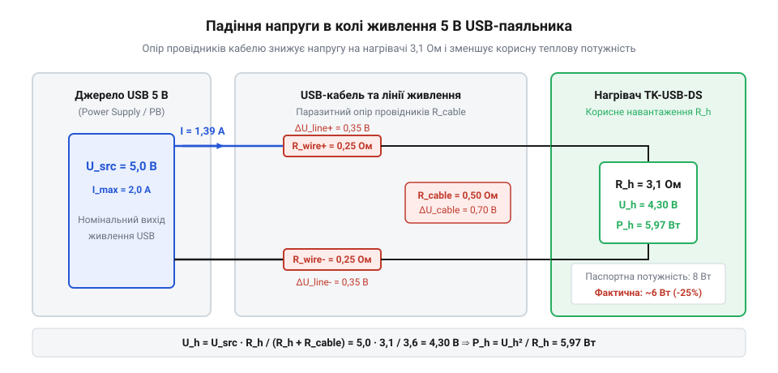
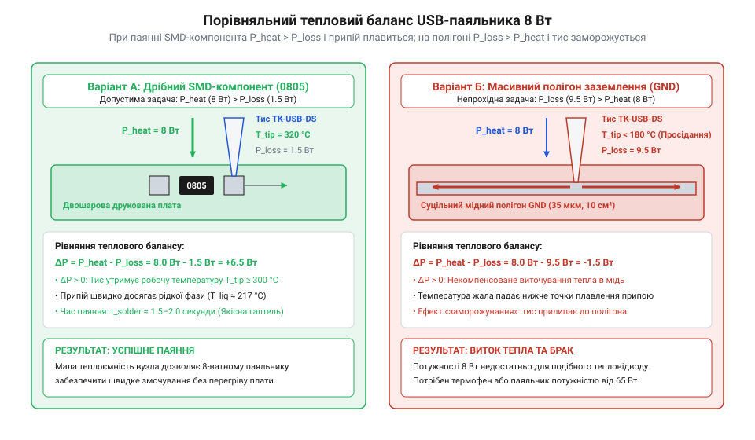

# Паяльник USB TK-USB-DS (5 В, 260–420 °C)

<preknowlist>
- [Припій / олово](root:cat-hw-instruments/solder-tin) — знання марок та температур плавлення свинцевих і безсвинцевих припоїв
- [Флюс FVS-7 (безвідмивний)](root:cat-hw-instruments/flux-fvs7) — призначення флюсу для зняття оксидної плівки та покращення змочування металу розплавом
</preknowlist>

## Обмеження портативного USB-живлення

Виїзний ремонт електроніки вимагає автономного джерела живлення, проте стандартний шинний порт @@en|USB@@ видає постійну напругу 5 В при максимальному струмі до 2 А. За законом Джоуля — Ленца це обмежує граничну електричну потужність портативного паяльника TK-USB-DS значенням P = U · I = 5 В · 2 А = 10 Вт. Проте через омічний опір провідників кабелю та контактних з'єднань реальна потужність у точці паяння падає до 8 Вт.

*Падіння напруги та лінійні втрати в USB-кабелі живлення паяльника TK-USB-DS.*

Апаратною пасткою автономного живлення від павербанка (англ. *@@en|power bank@@*) є автоматичне знеструмлення виходу: під час паузи нагріву струм споживання падає нижче 50 мА, і павербанк вважає навантаження відключеним. Для стабільної роботи слід обирати джерела з режимом безперервної подачі малого струму.

Для мінімізації омічного падіння напруги під навантаженням рекомендують застосовувати максимально короткі з'єднувальні шнури довжиною до 0.5–1 м з потовщеними силовими жилами стандарту @@en|AWG22@@ (від англ. *@@en|American Wire Gauge@@*, «американський калібр проводів»). Тонкі стандартні кабелі зв'язку з жилами AWG28 мають значний внутрішній опір, який при струмі 2 А спричиняє просідання напруги на 0.5–1 В ще до надходження на роз'єм паяльника, що знижує корисну потужність нагріву майже на чверть. Для подолання обмежень стандартного живлення 5 В використовують потужніші [паяльники з підтримкою USB Power Delivery](root:cat-hw-instruments/usb-pd-soldering-irons), що працюють під напругою до 20 В.

## Конструкція картриджного нагрівача й сенсора

Для ефективної роботи при обмеженій потужності 8 Вт інструмент оснащено монолітним малоінерційним картриджем (англ. *@@en|cartridge@@*), у якому ніхромовий нагрівальний елемент та @@en|термопара@@ (від грец. *@@el|therme@@* — тепло) вбудовані безпосередньо всередину металевого жала. На відміну від класичних паяльників із повітряним зазором між ніхромовою спіраллю й насадкою, картридж мінімізує контактний тепловий опір.

Вбудована мікроконтролерна плата здійснює імпульсне ПІД-регулювання (від англ. *@@en|PID@@*): у мікросекундних паузах між імпульсами живлення контролер зчитує термо-ЕРС сенсора, підтримуючи задану температуру в діапазоні 260–420 °C. Сенсорний датчик на корпусі виявляє дотик пальця, виводячи прилад зі стану сну та забезпечуючи розігрів до 300 °C за 15 секунд.

## Тепловий бюджет і межі застосування

Тепловий бюджет визначає співвідношення між швидкістю надходження тепла від картриджа та швидкістю його відтоку в плату. При монтажі дрібних деталей типу @@en|SMD@@ (англ. *@@en|SMD@@*, від *Surface-Mount Device*) площа контакту мала, тож 8 Вт повністю покривають тепловтрати.

*Порівняння теплового бюджету та відтоку тепла при паянні дрібного SMD-компонента і масивного заземлювального полігону.*

Якщо ж торкнутися масивного мідного полігону заземлення, виникає від'ємний тепловий бюджет: висока теплопровідність міді миттєво відводить тепло, жало остигає нижче точки плавлення припою і прилипає до плати («заморожується»). Для паяння масивних елементів необхідно застосовувати додатковий підігрів, залучаючи [термофен BAKU BK-8033](root:cat-hw-instruments/hot-air-station-baku).

## Температурний режим і обслуговування жала

Робочу температуру добирають залежно від складу сплаву: для свинцевого [припою](root:cat-hw-instruments/solder-tin) достатньо 280–320 °C, а безсвинцеві вимагають 340–360 °C. Встановлення температури понад 380 °C призводить до деградації захисного залізного покриття жала та міжкристалічної корозії під дією кисню повітря.

Окиснене жало втрачає здатність утримувати розплавлений метал. Для відтворення теплового контакту обов'язково застосовують безвідмивний [флюс FVS-7](root:cat-hw-instruments/flux-fvs7) (нім. *@@de|Fluss@@* — потік) та регулярно виконують первинне лудження кінчика жала припоєм. Олов'яний місток розплаву різко зменшує поверхневий опір і забезпечує швидке плавлення без перегріву напівпровідникових деталей.
