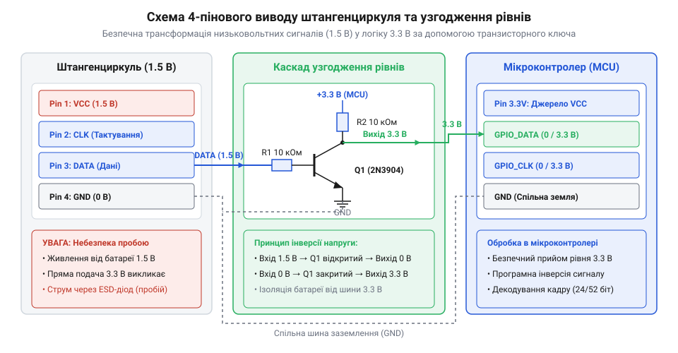
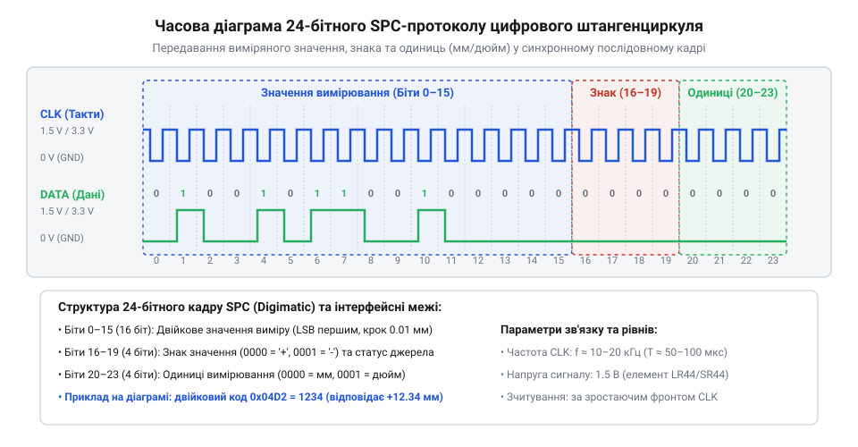

# Апаратний інтерфейс виводу даних цифрового штангенциркуля

## Потреба в автоматизованій фіксації розмірів

Під час серійного виготовлення деталей, технічного контролю або випробувань приладів оператору доводиться регулярно вимірювати геометричні параметри об'єктів. Ручний перепис свідчень з рідкокристалічного дисплея приладу, яким є @@en|штангенциркуль@@ (від нім. @@de|Stangenzirkel@@), до паперових журналів чи таблиць уповільнює роботу й створює ризик людської помилки. Для автоматичного збирання даних більшість цифрових вимірювачів оснащено прихованим 4-піновим апаратним портом виводу даних, що працює за стандартом @@en|SPC@@ (від англ. @@en|Statistical Process Control@@ — статистичний контроль процесів) або протоколом @@en|Digimatic@@.

Однак безпосереднє підключення цього інтерфейсу до обчислювачів створює високий ризик виходу з ладу вимірювального пристрою. Внутрішня електронна схема штангенциркуля живиться від мініатюрної дискової батареї напругою 1.5 В (елементи LR44 або SR44) або 3.0 В (елементи CR2032). Якщо подати вихідні лінії безпосередньо на цифровий @@en|мікроконтролер@@ (від грец. @@el|mikros@@ — малий та англ. @@en|controller@@), високовольтні сигнали 3.3 В або 5.0 В викличуть електричний пробій внутрішнього вимірювального чипа. Крім того, низький рівень напруги виходу штангенциркуля не сприймається цифровими входами стандартних мікроконтролерів як логічна одиниця, що робить розведення й узгодження логічних рівнів обов'язковою передумовою автоматичного зчитування.

Небезпека прямого з'єднання пояснюється наявністю вбудованих захисних діодів (від англійського *electrostatic discharge diode*; `@@en|ESD diode@@`), які сполучають кожен логічний вивід чипа штангенциркуля з його низьковольтною шиною живлення `1.5 В`. Якщо подати на лінію виводу напругу `3.3 В` або `5.0 В` від мікроконтролера, верхній кремнієвий діод відкривається в прямому напрямку, оскільки різниця потенціалів перевищує поріг відкриття `V_f ≈ 0.5 В`. Через діод виникає паразитний струм (від англійського *parasitic powering*; `@@en|parasitic powering@@`), який починає насильно підтягувати шину живлення штангенциркуля від `1.5 В` вгору до `2.7–2.8 В`. Це явище викликає перегрів чипа, викривлення символів рідкокристалічного дисплея, а при тривалому контакті призводить до незворотного вигорання напівпровідникових `n-p` переходів або блокування передавання даних через спотворення фронтів сигналів.

Зі зворотного боку спроба безпосереднього зчитування сигналів також зазнає невдачі через невідповідність порогів спрацьовування вхідних логічних вентилів. Вихідні імпульси від схеми живлення `1.5 В` @@en|штангенциркуля@@ мають амплітуду не вище ніж `1.2–1.5 В`. Стандартні цифрові входи пристроїв з живленням `3.3 В` або `5.0 В` вимагають для розпізнавання логічної одиниці напругу `V_IH ≈ 0.7·V_CC`, що становить щонайменше `2.3 В` та `3.5 В` відповідно. Оскільки сигнал амплітудою `1.5 В` не досягає цього порогу, @@en|мікроконтролер@@ сприймає будь-який стан лінії як постійний логічний нуль. Отже, надійне автоматичне протоколювання розмірів вимагає спеціалізованого вузла узгодження, який захищає прилад від @@en|parasitic powering@@ та перетворює низьковольтні імпульси на повноцінні рівні логічного приймача.

## Апаратне розведення та електричні рівні

Роз'єм виводу даних цифрового штангенциркуля розташований під пластиковою кришкою у верхній частині електронного блоку. Інтерфейс містить чотири контактні площадки з кроком 1.27 мм або 2.54 мм, що мають наступне фізичне призначення:
- `VCC`: позитивний полюс живлення (+1.5 В або +3.0 В відносно спільного виводу).
- `GND`: спільний провідник (земля), з'єднаний із металевою штангою інструмента.
- `CLK`: вихід тактового сигналу (від англ. @@en|Clock@@ — годинник), який формується внутрішнім процесором.
- `DATA`: вихід послідовних даних (від англ. @@en|Data@@ — дані), синхронізованих із тактовими імпульсами.

*Схема апаратного розведення та транзисторного узгоджувача рівнів.*

За схемотехнікою вихідних каскадів штангенциркулі поділяються на два класи. Бюджетні моделі китайських виробників реалізують прямі @@en|CMOS@@ (від англ. @@en|Complementary Metal-Oxide-Semiconductor@@) комплементарні виходи з високим внутрішнім вихідним опором `R_out ≈ 10–100 кОм`, де логічному нулю відповідає напруга `0 В`, а логічній одиниці — `1.5 В`. Високий опір `R_out` робить ці виходи вкрай чутливими до навантаження: спроба підключити зовнішню підтяжку створює дільник напруги, який викривляє логічні рівні та паразитно підживлює чип. Натомість професійні вимірювачі Mitutoyo використовують виходи з відкритим колектором (від англійського *open collector*; `@@en|open collector@@`), які вимагають зовнішнього резистора @@en|pull-up@@ (від англ. @@en|pull-up resistor@@ — підтягувальний резистор) до лінії живлення `V_CC = 3.3 В` або `5.0 В`. Мінімальне значення опору підтяжки розраховують за гранично допустимим струмом протікання `I_sink ≈ 1 мА` через відкритий транзистор: `R_pullup_min = V_CC ÷ I_sink = 3.3 ÷ 0.001 = 3.3 кОм`. Верхню межу опору `R_pullup_max ≈ 47–100 кОм` обмежують ємністю лінії `C_line ≈ 50 пФ` для забезпечення фронту спаду імпульсів `CLK` та `DATA`. Оскільки поріг розпізнавання високого рівня для 3.3 В логіки становить не менше 2.31 В, напруга 1.5 В без підсилення сприймається мікроконтролером як постійний логічний нуль.

## Часові діаграми та протоколи передавання

Передавання вимірювальних пакетів відбувається ініціативно з боку штангенциркуля з періодичністю від 3 до 8 разів на секунду. Інтерфейс є одностороннім синхронним послідовним портом, де лінія `CLK` задає частоту зчитування інформації з лінії `DATA`.

*Часова діаграма передачі пакета даних з сигналом тактування.*

Тактовий сигнал складається з послідовності негативних або позитивних імпульсів тривалістю 10–50 мкс із частотою від 9 кГц до 90 кГц. Зчитування стану лінії `DATA` виконується на кожному спадному фронті сигналу `CLK`. У практиці застосовуються два основні формати пакетів:
1. 24-бітний двійковий протокол (китайський стандарт): посилка складається з 6 ніблів (по 4 біти), які передаються молодшим бітом уперед (LSB first). Біти 0–19 містять значення зміщення у сотих частках міліметра (або тисячних частках дюйма), біт 20 кодує знак (0 — плюс, 1 — мінус), а біт 23 визначає одиниці вимірювання (0 — мм, 1 — дюйми).
2. 52-бітний протокол Digimatic: кадр складається з 13 ніблів у кодуванні @@en|BCD@@ (від англ. @@en|Binary-Coded Decimal@@ — двійково-кодований десятковий). Перші 4 ніблі передають службову інформацію та знак, наступні 6 ніблів містять десяткові цифри виміру, а останні розряди визначають положення десяткової крапки.

Маркером початку нового пакета слугує пауза між посилками на лінії `CLK` тривалістю понад 10 мс, під час якої тактовий сигнал утримується у високому стані.

Стабільність часових параметрів сигналу `CLK` істотно залежить від стану елемента живлення LR44. Оскільки вимірювальна мікросхема штангенциркуля використовує ненастабілізований @@en|RC-oscillator@@ (від англ. @@en|RC oscillator@@ — RC-генератор), просідання напруги батарейки з номінальних 1.55 В до критичних 1.1…1.2 В та зростання її внутрішнього опору викликають зниження частоти тактування з 90 кГц до 10–15 кГц. Тривалість тактових імпульсів розширюється від 10 мкс до 50 мкс, а фазовий @@en|jitter@@ (від англ. @@en|jitter@@ — часовий джитер або розкид інтервалів) між сусідніми бітами в межах одного кадру може сягати 20–30%. Відповідно, пауза між посилками також розтягується з 10 мс до 30–50 мс. Через такі допуски алгоритм зчитування в мікроконтролері не повинен розраховувати на фіксовану частоту `CLK` або жорсткі програмні затримки; декодування слід будувати на обробці спадних фронтів через асинхронні переривання й розпізнаванні початку кадру за пороговим тайм-аутом утримування лінії у високому стані (не менше 15–20 мс). Практичні алгоритми аналізу кадру та [декодування протоколів](root:sf-devices/digimatic-spc-protocol-decoding) дозволяють надійно зчитувати дані навіть при нестабільній частоті тактування.

## Схеми узгодження рівнів і підключення

Для безпечного спряження низьковольтного виводу штангенциркуля з входами 3.3 В або 5.0 В мікроконтролера застосовують активні схеми узгодження логічних рівнів. Найпростішим розв'язком для кожного каналу (`CLK` та `DATA`) є дискретний ключ, у якому використовується біполярний @@en|транзистор@@ (від англ. @@en|transfer resistor@@) структури NPN (наприклад, BC847 або 2N3904).

Базу транзистора підключають до лінії штангенциркуля через обмежник струму опором 10 кОм, емітер з'єднують зі спільною землею `GND`, а колектор підтягують резистором 4.7 кОм до джерела живлення мікроконтролера 3.3 В. Така схема перетворює вихідний імпульс 1.5 В на повноамплітудний сигнал 3.3 В з інверсією логіки (напруга 1.5 В відкриває транзистор і формує 0 В на колекторі, а 0 В закриває його й піднімає рівень до 3.3 В). Інверсію легко компенсують програмно у прошивці мікроконтролера.

Для підвищення завадостійкості та збереження фази сигналу використовують аналоговий @@en|компаратор@@ (від лат. @@la|comparare@@ — порівнювати) з відкритим колектором (наприклад, LM393 або LMV331). Прямий вхід компаратора підключають до сигнальної лінії штангенциркуля, а на інверсний вхід подають опорну напругу 0.75 В від резистивного дільника. Вихід підтягують резистором до шини 3.3 В, отримуючи круті фронти крутизною менше 100 нс. У разі використання довгих вимірювальних кабелів (понад 0.5 м) повільне зростання фронтів та високочастотні завади викликають багатократне прикротисте перемикання виходу у зоні порогу. Для повного придушення цього брязкоту в схему вводять позитивний зворотний зв'язок через резистор опором 1 МОм між виходом та прямим входом. Це створює @@en|гістерезис@@ (від грец. @@el|hysteresis@@ — відставання) величиною 10–20 мВ, що розносить пороги спрацьовування й відпускання та гарантує формування єдиного чистого імпульсу тактування `CLK` чи даних `DATA`. Обов’язковою умовою стабільної роботи є надійне гальванічне об'єднання провідника `GND` штангенциркуля з землею плати керування.
