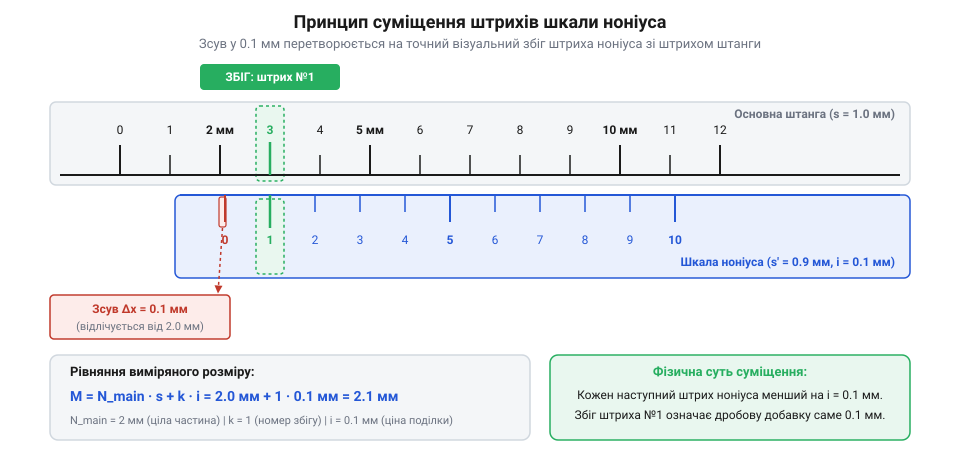

# Історія створення ноніуса та лінійного штангенінструмента

## Межі прямого лінійного відліку

Виготовлення точних механічних деталей, навігаційне орієнтування та розмітка матеріалів вимагають вимірювання довжини з високою точністю. Традиційні лінійки спираються на пряме зіставлення краю предмета зі штрихами шкали. Однак фізичні обмеження людського зору створюють непереборний бар'єр: роздільна здатність ока на відстані найсприятливішого бачення (близько 25 см) становить 0.1 мм. Якщо край вимірюваного предмета потрапляє між двома сусідніми поділками лінійки з кроком 1 мм, оператор змушений оцінювати дробову частку на око.

Першою спробою перейти від пасивного зіставлення до механізованого затискання деталі стали давньоримські розсувні калібри (англ. *sliding calipers*), виявлені під час археологічних розкопок античного міста @@la|Помпеї@@ (лат. *Pompeii*, I століття н. е.). е.). Виготовлені з бронзи чи твердих порід деревини, ці інструменти мали суцільну штангу з фіксованою губкою та рухому рамку, яка пересувалася вздовж направляючої для захоплення предмета. Римський прилад дозволяв механічно фіксувати зовнішні геометричні розміри деталі й переносити їх на еталонну лінійку, що усувало хибне зміщення при прицілюванні. Проте відсутність на штанзі дробової відлікової шкали лишала точність вимірювання обмеженою кроком поділок звичайної лінійки, зберігаючи потребу в суб'єктивній оцінці часток на око.

Оцінювання відстані між штрихами на око спричиняє суб'єктивну похибку, яка залежить від освітленості, втоми зору та кута спостереження. Спостереження не під прямим кутом викликає @@gr|паралакс@@ (грец. *παράλλαξις* — зміщення) — оптичний зсув лінії прицілювання відносно шкали через товщину лінійки чи відстань до деталі. Спроба зменшити крок поділки лінійки до 0.1 мм або 0.2 мм робить штрихи нерозрізними: зливаючись у суцільну смугу, вони стомлюють зір і спричиняють помилки зчитування. Для досягнення точності, кращої за 0.1 мм, виникла потреба в механічному або геометричному способі посилення відліку без ускладнення оптичної системи.

## Винахід дробової шкали П'єра Верньє

До XVII століття спробою розв'язати проблему дробового відліку була система португальського математика @@pt|Педру Нуніша@@ (порт. *Pedro Nunes*), запропонована ним у 1542 році. Його метод полягав у нанесенні на квадрант чи астролябію 45 концентричних дугових шкал із різною кількістю поділок (від 90 на зовнішній дузі до 46 на внутрішній). При вимірюванні визирна лінія показувала точний збіг лише на одній із цих дуг, дозволяючи обчислити дробову частку градуса, проте така система вимагала надскладного вручну нарізання штрихів для кожної з 45 дуг та виснажливих математичних перерахунків пропорцій. У 1631 році французький математик і інженер @@fr|П'єр Верньє@@ (фр. *Pierre Vernier*) запропонував суттєво простіше й елегантніше геометричне рішення: єдину додаткову рухому шкалу, що ковзає уздовж основної.

*Принцип суміщення штрихів основної шкали та рухомого ноніуса для визначення дробової частини поділки.*

Механізм Верньє спирається на оптичний феномен: людське око значно точніше помічає повне суміщення двох паралельних штрихів в одну лінію, ніж оцінює відстань між ними. Якщо додаткова шкала має `N` поділок, які за сумарною довжиною дорівнюють `N - 1` поділкам основної шкали, то крок допоміжної шкали відрізняється від кроку основної рівно на `1 / N` частку. При зсуві рухомої рамки на цю частку лише один конкретний штрих @@fr|верньєра@@ точне збігається зі штрихом основної шкали. Цей геометричний принцип дозволив підвищити точність відліку у 10–50 разів (до 0.1–0.02 мм) без використання оптичних лінз та з [математичним обґрунтуванням ціни поділки](root:cat-hw-instruments/vernier-caliper/math-vernier-scale-math.md).

## Стандартизація та масове виробництво Брауна

Упродовж двох століть після винаходу Верньє шкала застосовувалася переважно в унікальних наукових приладах — секстантах, теодолітах та астрономічних інструментах. Кожен такий інструмент виготовлявся вручну висококваліфікованими майстрами, а штрихи наносилися різцем під мікроскопом, що робило прилади надзвичайно дорогими й недоступними для звичайної металообробки. Промислова революція XIX століття та розвиток машинобудування вимагали взаємозамінності деталей, для чого знадобився масовий та доступний вимірювальний @@de|штангенінструмент@@ (нім. *Stangenzirkel* — стержневий циркуль).

У 1851 році американський механік і винахідник @@en|Джозеф Браун@@ (англ. *Joseph R. Brown*), засновник компанії @@en|Brown & Sharpe@@, створив першу автоматичну ділильну машину для точного лінійного нанесення штрихів на металеві штанги. Brown*), засновник компанії @@en|Brown & Sharpe@@, створив першу автоматичну ділильну машину для точного лінійного нанесення штрихів на металеві штанги. Конструкція верстата спиралася на прецизійний ходовий гвинт із зубчастим ділильним колесом, який кроково переміщував каретку зі сталевою заготовкою на фіксовану відстань, після чого загартований різець автоматично наносив штрих однакової глибини. Така механізація нарізання поділок усунула суб'єктивні помилки ручного розмічання під мікроскопом, давши змогу розпочати серійний випуск перших у світі доступних металевих калібрів — @@de|штангенциркуль@@ з лінійкою Верньє. Автоматизоване нарізання шкал забезпечило ідентичну точність кожного виготовленого приладу та кардинально знизило його собівартість, перетворивши прецизійний відлік із лабораторного привілею на стандартний робочий інструмент заводського цеху.

## Спірна атрибуція та історичні міфи

У науковій та технічній термінології виникла суттєва плутанина щодо назви відлікової шкали. У німецькомовних та східноєвропейських країнах за шкалою закріпилася назва @@la|ноніус@@ (на честь латинізованого імені Педру Нуніша — *Petrus Nonius*), тоді як у франко-, англо- та іспаномовних країнах інструмент називають @@fr|верньєром@@ (англ. *vernier*) на честь П'єра Верньє. Історично це призвело до хибного уявлення, ніби Нуніш і Верньє створили один і той самий пристрій, або що Верньє лише скопіював ідею Нуніша.

Насправді оригінальна система Нуніша була кутовою концентричною сіткою й не мала рухомого елемента, що робило її громіздкою та практично непридатною для розмірних лінійних вимірювань. Механізм Верньє був самостійним винаходом, який застосував різницю кроків двох шкал на єдиній рухомій штанзі. Іншим поширеним міфом є твердження, ніби Верньє сам винайшов сучасний @@de|штангенциркуль@@ із губками: Верньє розробив лише математичну й геометричну шкалу для астрономічного півкола, а конструкція сучасного кишенькового штангенциркуля з вимірювальними губками сформувалася значно пізніше завдяки працям Джозефа Брауна та інших інженерів XIX століття.

Важливу роль у поширенні цієї термінологічної плутанини відіграв німецький математик та астроном Христофор Клавіус (латинською *Christophorous Clavius*). У своїй праці про астрономічні прилади 1593 року Клавіус детально виклав і вдосконалив кутовий метод Нуніша, закріпивши за ним латинізовану назву @@la|nonius@@. Завдяки великому впливу підручників Клавіуса в навчальних закладах Священної Римської імперії назва ноніус стала загальноприйнятим позначенням для будь-яких пристроїв точного дробового відліку в німецькомовній та східноєвропейській школі. Тому після появи у 1631 році лінійного винаходу Верньє у цих регіонах нову рухому шкалу продовжили називати ноніусом, тоді як у Франції та Англії закріпився термін верньєр.
