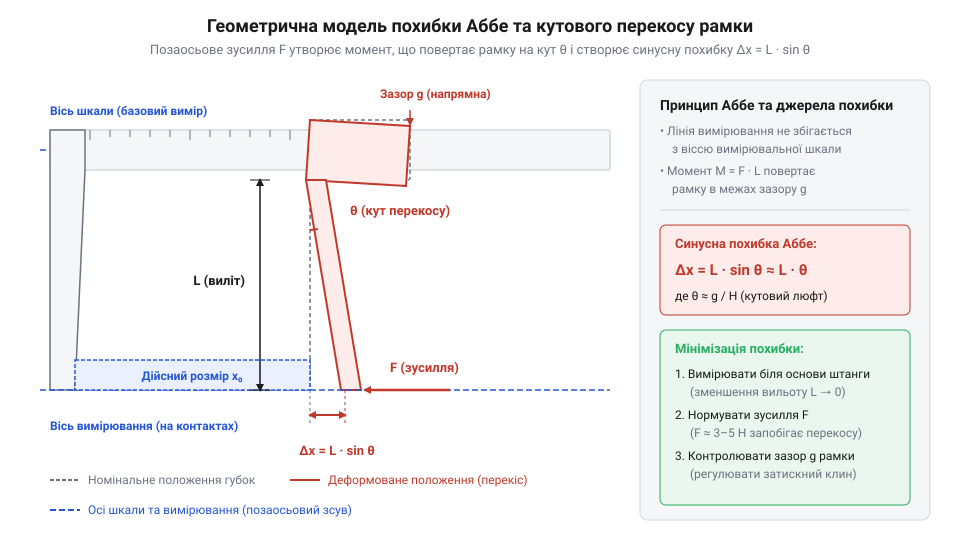

# Математика шкали ноніуса та геометрія вимірювальної похибки

## Обмеження дискретності штанги та дробовий відлік

Пряме візуальне вимірювання лінійного розміру за шкалою металевої штанги обмежене фізичним кроком її поділок `s = 1.0 мм`. Роздільна здатність ока людини (`@@en|visual resolution limit@@`) дозволяє розрізняти два сусідні штрихи під кутом зору не менше 1 минути (`1'`), що на стандартній відстані найкращого зору `250 мм` відповідає лінійному зазору `Δx ≈ 0.07–0.10 мм`. Спроба оцінити дробові частки міліметра "на око" між двома основними позначками призводить до суб'єктивної похибки інтерполяції та залежить від кута зору й освітленості.

Для подолання цієї фізичної межі без застосування оптичних збігних систем використовують геометричний метод диференціального відліку. На рухому рамку приладу наносять допоміжну шкалу — ноніус (від латинського прізвища математика *Nonius*; `@@la|ноніус@@`, або шкала Верньє, `@@fr|Vernier@@`), крок поділок якої незначно відрізняється від кроку основної штанги. Рівномірний зсув штрихів перетворює малу лінійну різницю на чіткий зоровий орієнтир — точний збіг одного зі штрихів ноніуса зі штрихом основної шкали.

Проте при практичній оцінці збігу штрихів виникає оптична похибка паралаксу (@@en|optical parallax@@), зумовлена наявністю конструктивного повітряного зазору та фаски `Δh ≈ 0.1–0.2 мм` між площинами основної штанги та рухомого ноніуса. Якщо промінь зору оператора відхиляється від нормалі до поверхні шкал на кут `θ_sight`, фізична товщина зазору створює уявний лінійний зсув `Δx_par = Δh · ctg(θ_sight)`, викликаючи помилкове визначення збіжного штриха. Додатково на сприйняття впливає кутова орієнтація джерела освітлення: бокове падаюче світло формує асиметричні тіні у заглибленнях гравірованих рисок, що візуально зміщує оптичний центр ліній і створює явище хибного перекриття сусідніх штрихів. Крім геометричних чинників, граничну точність розпізнавання обмежують технологічні допуски товщини гравірованих рисок (від англійського *line width tolerance*; @@en|line width tolerance@@). При стандартній ширині штриха `b_line ≈ 0.08–0.15 мм` та її виробничому відхиленні `Δb_line ≈ ±0.02 мм` зорова система фіксує не математичну точку перетину, а смугу перекриття шириною `Δx_zone = b_line - |s - s'|`. Якщо товщина рисок перевищує ціну поділки ноніуса, кілька сусідніх штрихів здаються однаково збіжними, створюючи оптичну зону невизначеності. Для нейтралізації цих спотворень краю рамки надають скіс під кутом `10°–15°` для наближення шкал, суворо нормують глибину та товщину нанесення рисок, а вимірювання виконують при строго перпендикулярному напрямку погляду.

## Математичний вивід ціни поділки ноніуса

Нехай крок основної шкали штанги дорівнює `s = 1.0 мм`, а допоміжна шкала ноніуса містить `n` поділок. Конструктивно загальна довжина ноніусної шкали `L_n` дорівнює довжині `n - 1` поділок основної штанги:

```
L_n = (n - 1) · s               [загальна довжина шкали ноніуса]
```

Звідси довжина однієї поділки ноніуса `γ` становить:

```
γ = L_n ÷ n
= ((n - 1) · s) ÷ n             [підстановка виразу загальної довжини L_n]
= s · (1 - 1 ÷ n)               [розкладання на співмножники]
```

Ціна поділки ноніуса `i` (найменша дискретність вимірювання) визначається як різниця між кроком основної шкали `s` та кроком ноніуса `γ`:

```
i = s - γ
= s - s · (1 - 1 ÷ n)           [підстановка кроку ноніуса γ]
= s - s + s ÷ n                 [розкриття дужок]
= s ÷ n                         [підсумкова формула ціни поділки]
```

Залежно від кількості поділок `n` формуються базові модифікації механічних шкал:
- **Дискретність 0.1 мм (`n = 10`)**: 10 поділок ноніуса відповідають 9 мм штанги (`L_n = 9 мм`), крок ноніуса `γ = 0.9 мм`, ціна поділки `i = 1 ÷ 10 = 0.1 мм`.
- **Дискретність 0.05 мм (`n = 20`)**: для полегшення візуального сприйняття застосовують розтягнутий ноніус (`@@en|extended vernier@@`). Фізичний механізм розтягнутої шкали полягає у збільшенні просторового зазору між сусідніми штрихами: у звичайному ноніусі 20 поділок займають `19 мм` штанги, що дає стиснутий крок `γ_norm = 19 ÷ 20 = 0.95 мм`, важкий для зорового розрізнення. У розширеній схематиці 20 поділок розтягують на `2n - 1 = 39 мм` штанги, завдяки чому крок збільшується більше ніж удвічі — до `γ_ext = 39 ÷ 20 = 1.95 мм`. Порівняльний розрахунок підтверджує збереження дискретності: `i = 2 · s - γ_ext = 2.0 - 1.95 = 0.05 мм` проти звичайного `i = s - γ_norm = 1.0 - 0.95 = 0.05 мм`, що суттєво зменшує втому очей при зчитуванні.
- **Дискретність 0.02 мм (`n = 50`)**: 50 поділок розтягнутого ноніуса відповідають 49 мм штанги (`L_n = 49 мм`), крок ноніуса `γ = 0.98 мм`, ціна поділки `i = 1 ÷ 50 = 0.02 мм`.

Окремий клас складає зворотний ноніус або ноніус другого роду (`@@en|retrograde vernier@@`), у якому математична умова задається рівністю загальної довжини `n` поділок ноніуса довжині `n + 1` поділок основної штанги:

```
L_n = (n + 1) · s               [довжина шкали ноніуса другого роду]
```

Звідси крок однієї поділки ноніуса `γ` становить:

```
γ = L_n ÷ n
  = ((n + 1) · s) ÷ n           [підстановка довжини L_n]
  = s · (1 + 1 ÷ n)             [розкладання на співмножники]
```

Оскільки крок поділки ноніуса є більшим за крок штанги (`γ > s`), ціна поділки `i` обчислюється як різниця між кроком ноніуса та кроком основної шкали:

```
i = γ - s
  = s · (1 + 1 ÷ n) - s         [підстановка виразу кроку γ]
  = s + s ÷ n - s               [розкриття дужок]
  = s ÷ n                       [підсумкова дискретність шкали]
```

Алгебрична рівність `i = s ÷ n` доводить, що ноніус другого роду забезпечує тотожну дискретність вимірювання, проте його штрихи відраховуються у зворотному напрямку відносно напрямку нумерації основної штанги. Це збільшує інтервал між штрихами до `γ = 1.1 мм` (при `s = 1.0 мм` та `n = 10`), полегшуючи зоровий контроль збігу без зміни підсумкової формули розміру `M = N_main · s + k · i`.

Повний виміряний розмір `M` обчислюється як сума цілого числа міліметрів `N_main` (визначається за нулем ноніуса) та дробової частки, де `k` — номер штриха ноніуса (`0 ≤ k < n`), який точно збігся зі штрихом штанги:

```
M = N_main · s + k · i          [формула підсумкового розміру]
```

**Умова: визначення діаметра вала штангенциркулем із ціною поділки `i = 0.05 мм`, де нуль ноніуса перетнув позначку `14 мм`, а збіг штрихів зафіксовано на `k = 7` поділянці.**

```
M = N_main · s + k · i
= 14 · 1.0 + 7 · 0.05           [підстановка цілих міліметрів, номера штриха та ціни поділки]
= 14.0 + 0.35                   [обчислення дробової частки]
= 14.35                         [підсумковий розмір у міліметрах]
```

Висновок: дійсний розмір деталі становить `14.35 мм`.

## Геометрична похибка Аббе та перекос рамки

Для досягнення першого порядку точності розмірного вимірювання вимірювальна вісь приладу повинна збігатися з віссю відлікової шкали (принцип Аббе; `@@en|Abbe principle@@`). У конструкції штангенциркуля вимірювальна лінія (`@@en|measuring line@@`), що проходить через губки, паралельна вісь штанги (`@@en|scale line@@`), але зміщена від неї на відстань вильоту губок `h_jaw` (зазвичай `40–50 мм`).

При прикладанні вимірювального зусилля `F_meas` на кінцях губок виникає згинальний момент `M_bend = F_meas · h_jaw`. Цей момент не лише повертає рухому рамку в межах конструктивного зазору напрямних `Δg_guide` на кут `α_clearance ≈ Δg_guide / w_frame`, а й спричиняє пружну деформацію вигину самої сталевої штанги. Для прямокутного перерізу штанги товщиною `b_beam = 3.5 мм` та висотою `h_beam = 16.0 мм` момент інерції `I_z` обчислюють так:

```
I_z = (b_beam · h_beam³) ÷ 12
= (3.5 · 16.0³) ÷ 12                  [формула моменту інерції прямокутного перерізу штанги]
= (3.5 · 4096) ÷ 12                   [піднесення висоти штанги до куба]
= 1194.67 мм⁴                         [осьовий момент інерції перерізу сталевої штанги]
```

Під дією згинального моменту `M_bend = F_meas · h_jaw` на вильоті рамки `x_meas = 100 мм` пружний кут повороту перерізу штанги `θ_beam` за моделлю вигину консольного променя визначається співвідношенням:

```
θ_beam = (F_meas · h_jaw · x_meas) ÷ (E · I_z)
= (10 · 40 · 100) ÷ (210000 · 1194.67) [підстановка сили F_meas = 10 Н та модуля Юнга E = 210000 Н/мм²]
= 40000 ÷ 250880700                   [ділення моменту на згинальну жорсткість]
= 0.000159 рад                        [пружний кут кутового відхилення штанги]
```

Пружне відхилення штанги додає до лінійного зміщення кінчиків губок величину `ΔL_beam = h_jaw · θ_beam = 40 · 0.000159 = 0.0064 мм`. Сумарний кут перекосу `α` об'єднує механічний люфт рамки `α_clearance = Δg_guide ÷ w_frame` та пружне деформування штанги `θ_beam`:

```
α = α_clearance + θ_beam
  = (Δg_guide ÷ w_frame) + ((F_meas · h_jaw · x_meas) ÷ (E · I_z)) [сумування зазору напрямних та пружного кута вигину]
```

Підставляючи отриманий підсумковий кут перекосу `α` у вираз синусної похибки Аббе `ΔL_Abbe = h_jaw · sin(α) ≈ h_jaw · α`, отримуємо повне алгебричне рівняння вимірювального відхилення:

```
ΔL_Abbe = h_jaw · sin(α)
        ≈ h_jaw · α                                            [наближення для малих кутів sin(α) ≈ α]
        = h_jaw · ((Δg_guide ÷ w_frame) + ((F_meas · h_jaw · x_meas) ÷ (E · I_z))) [підстановка сумарного кута α]
        = (h_jaw · Δg_guide) ÷ w_frame + (F_meas · h_jaw² · x_meas) ÷ (E · I_z)  [алгебричне об'єднання складових похибки]
```

Отримане алгебричне об'єднання показує, що геометрична похибка складається з двох компонентів: люфтової складової, яка зростає лінійно з вильотом губок `h_jaw`, та пружної складової, яка залежить від квадрата вильоту `h_jaw²` і прикладеного зусилля `F_meas`.

```
α ≈ Δg_guide ÷ w_frame           [кут кутового перекосу рамки в радіанах]
```

де `w_frame` — поздовжня база (ширина) рухомої рамки. Внаслідок цього кутового відхилення виникає синусна похибка Аббе `ΔL_Abbe`, яка прямо пропорційна вильоту губок:

```
ΔL_Abbe = h_jaw · sin(α)
≈ h_jaw · α                     [спрощення для малих кутів sin(α) ≈ α]
= h_jaw · (Δg_guide ÷ w_frame)  [геометричне рівняння похибки Аббе]
```


*Схема виникнення кутового перекосу рухомої рамки штангенциркуля під дією вимірювального зусилля та геометричне формування синусної похибки Аббе.*

При вильоті губок `h_jaw = 40 мм`, зазорі напрямних `Δg_guide = 0.03 мм` та базі рамки `w_frame = 30 мм` кутова похибка становить `ΔL_Abbe = 40 · (0.03 ÷ 30) = 0.04 мм`, що у два рази перевищує ціну поділки ноніуса `0.02 мм`.

## Температурне розширення та сумарна невизначеність

Зміна температурного режиму навколишнього середовища викликає лінійне розширення матеріалів деталі та вимірювальної штанги. Відхилення температури від нормальної умови `T_norm = 20 °C` описується законом теплового розширення:

```
ΔL_temp = L_0 · α_temp · (T - 20) [теплова деформація розміру]
```

де `L_0` — вимірюваний розмір, `α_temp` — температурний коефіцієнт лінійного розширення (`@@en|coefficient of thermal expansion@@`, для вуглецевої сталі штанги `α_steel ≈ 11.5 · 10⁻⁶ К⁻¹`). Якщо вимірюється деталь зі сталі при тій самій температурі (`T_det = T_cal`), теплові розширення компенсуються. Проте при вимірюванні деталі з алюмінієвого сплаву (`α_alum ≈ 23.0 · 10⁻⁶ К⁻¹`) виникає диференціальна температурна похибка `ΔL_diff`:

```
ΔL_diff = L_0 · (α_alum - α_steel) · (T - 20) [диференціальне теплове відхилення]
```

Підсумкова сумарна вимірювальна невизначеність (`@@en|combined measurement uncertainty@@`, `u_c`) розраховується як геометрична сума незалежних випадкових і систематичних складових. Коли межі відхилень кожної окремої складової (дискретність шкали, кутовий перекіс рамки чи диференційна теплова деформація) визначені оціночним інтервалом без виділеного піка, застосовують рівномірний прямокутний закон розподілу ймовірностей (`@@en|uniform distribution@@`). За цього розподілу стандартна невизначеність складової дорівнює півширині інтервалу, діленій на `√3` (зокрема `u_scale = i ÷ √3`, `u_Abbe = ΔL_Abbe ÷ √3`, `u_temp = ΔL_diff ÷ √3`), що описує її середньоквадратичне відхилення:

```
u_c = √((u_scale)² + (u_Abbe)² + (u_temp)²) [квадратичне підсумовування невизначеностей]
```

Оскільки сумування кількох незалежних джерел невизначеності за центральною граничною теоремою наближає підсумковий розподіл похибок до нормального закону (`@@en|normal distribution@@`), для оцінки гарантованого інтервалу вимірювання обчислюють розширену вимірювальну невизначеність (`@@en|expanded uncertainty@@`, `U`):

```
U = k · u_c [розширена невизначеність вимірювання]
```

де `k` — коефіцієнт покриття (`@@en|coverage factor@@`). Для забезпечення довірчої ймовірності 95% (`@@en|confidence level@@`) приймають коефіцієнт покриття `k = 2`. Це означає, що результат вимірювання `L ± U` з ймовірністю 95% охоплює істинне значення розміру деталі з урахуванням апаратних, кутових та температурних факторів.

```
u_c = √((u_scale)² + (u_Abbe)² + (u_temp)²) [квадратичне підсумовування невизначеностей]
```

де `u_scale = i ÷ √3` — стандартна невизначеність дискретності шкали, `u_Abbe = ΔL_Abbe ÷ √3` — невизначеність від кутового перекосу, `u_temp = ΔL_diff ÷ √3` — невизначеність від теплового розширення. Врахування всіх трьох складових дозволяє розрахувати реальний довірчий інтервал вимірювання та обґрунтувати допустимі межі точності приладу.
