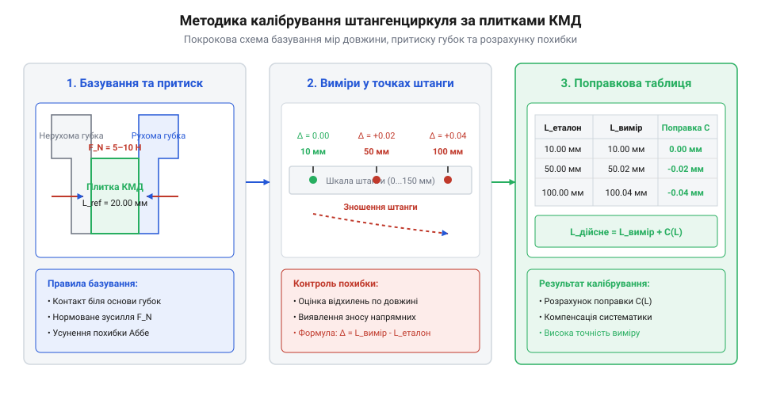

# Практична методика вимірювань та повірка штангенциркуля

## Підготовка інструмента та перевірка нуля

Точність будь-якого вимірювання за допомогою @@de|штангенциркуля@@ (нім. *@@de|Stangenzirkel@@*, від *@@de|Stange@@* — штанга та *@@de|Zirkel@@* — циркуль) визначається початковим станом його вимірювальних поверхонь та правильністю налаштування нуля. Навіть найменше забруднення, шар консерваційного мастила чи дрібна металева стружка товщиною `0.02 мм` на робочих губках спричиняють систематичну похибку, яка робить подальші заміри хибними.

Підготовку починають із механічного очищення: вимірювальні губки та штангу ретельно протирають сухою безворсовою серветкою. Після цього виконують візуальний контроль на просвіт. Губки плавно зводять до повного зімкнення з помірним зусиллям `3–5 Н`. Утримуючи інструмент проти джерела світла, оглядають лінію контакту. Око людини здатне помітити світловий зазор товщиною від `0.001–0.002 мм` (`1–2 мкм`). Рівномірне волосяне просвічування шириною менше `0.005 мм` є допустимим для інструмента з ціною поділки `0.05 мм` або `0.1 мм`. Проте якщо світловий зазор має клиноподібну форму, є нерівномірним або перевищує `0.01 мм` (`10 мкм`) — особливо біля верхівок чи основи губок, — це свідчить про критичний локальний знос або вигин губок, що унеможливлює виконання прецизійних замірів із точністю `0.02 мм`.

Останнім кроком перевіряють @@en|нульовий зсув@@ (англ. *@@en|zero offset@@*). При повністю зімкнутих губках нульовий штрих рухомої рамки @@la|ноніуса@@ (лат. *@@la|Nonius@@*) має суворо збігатися з нулем основної шкали штанги. Якщо спостерігається зміщення на величину `Δx_zero`, це значення фіксують як постійну систематичну поправку. Під час усіх наступних замірів отримане сире значення `X_meas` коригують відніманням цього зсуву:

Для прецизійної оцінки стану робочих поверхонь візуального контролю на просвіт буває недостатньо, тому виявлення дефектів геометрії кромок виконують за допомогою оптичного мікроскопа (від грецького *mikros* — малий та *skopeo* — дивитися; @@el|microscope@@) з малим збільшенням (`10×–50×`). Лабораторний мікроскопічний аналіз дає змогу виявити мікроскопічні подряпини, забоїни та місцевий знос губок, який утворюється від вимірювання деталей із твердих матеріалів. Астигматична деформація вимірювальних поверхонь — тобто нерівномірне зношування зі зсувом площини контакту — спричиняє перекіс деталей під час затискання, через що інструмент дає нестабільні показники залежно від глибини заведення предмета. За наявності глибоких подряпин чи асиметричного зносу кромок понад `0.005 мм` губки підлягають прецизійному доведенню на притиральних плитах або інструмент вилучають з експлуатації.

```
X_real = X_meas - Δx_zero
```

Якщо нульовий зсув є додатним (`Δx_zero > 0`), інструмент завищує показники і поправку віднімають, а якщо від'ємним (`Δx_zero < 0`) — додають. На цифрових штангенциркулях нульовий зсув скидають електронно кнопкою `ZERO` при зімкнутих губках, тоді як на ноніусних механічних приладах цю математичну корекцію обов'язково вносять у кожен підсумковий запис журналу вимірювань.

## Техніки вимірювання зовнішніх і внутрішніх розмірів

При вимірюванні зовнішніх розмірів ключовим фактором є мінімізація [похибки Аббе](root:cat-hw-instruments/abbe-error) (англ. *@@en|Abbe error@@*, на честь німецького фізика Ернста Аббе). Ця геометрична похибка виникає через те, що деталь розміщують на віддалі `L` від вимірювальної шкали штанги. Будь-який люфт рухомої рамки `Δs` створює кутовий перекіс `θ ≈ Δs / H`, що спричиняє додатковий зсув губок `Δx = L · sin(θ)`. Наприклад, при кутовому люфті рамки `Δs = 0.05 мм` на базі `H = 25 мм` кут перекосу становить `θ ≈ 0.05 / 25 = 0.002 рад`. Якщо затиснути деталь на кінчиках губок при вильоті `L = 40 мм`, похибка сягає `Δx = 40 · 0.002 = 0.08 мм`, що в чотири рази перевищує ціну поділки ноніуса `0.02 мм`. Зсув деталі до основи штанги зменшує плече до `L = 5 мм`, знижуючи похибку до `Δx = 5 · 0.002 = 0.01 мм`. Тому для збереження точності деталь завжди затискають якнайближче до основи штанги, а не на крайках губок.

Для вимірювання внутрішніх отворів і пазів використовують верхні загострені губки. Оскільки ножеподібні кромки мають власну товщину, при заведенні в циліндричний отвір необхідно знайти справжній діаметр через пошук @@la|екстремуму@@ (лат. *@@la|extremum@@*). Інструмент злегка похитують у двох площинах:
* у поздовжній осі отвору шукають **максимальне** значення відліку (справжній діаметр);
* у поперечній площині шукають **мінімальне** значення, усуваючи перекіс губок.

Особливу увагу приділяють вимірюванню отворів малого діаметра (менше `10 мм`), де проявляється геометричне обмеження товщини самих губок. Верхні загострені кромки мають технологічне скруглення або плоску фаску товщиною `b ≈ 0.5–1.0 мм`. При заведенні в малий циліндр губки торкаються стінок отвору не у діаметрально протилежних точках, а по хорді, що спричиняє систематичний недооблік розміру `ΔD ≈ b² / (4D)`. При вимірюванні отвору діаметром `5 мм` це створює від'ємну похибку до `-0.05 мм`, тому до виміряного значення вносять паспортну поправку на товщину губок або застосовують нутромір.

При будь-якому вимірюванні дотримуються оптимального притискного зусилля в межах `3–5 Н`. Надмірний тиск призводить до пружної деформації рамки й поверхні деталі, а недостатній — до недообліку реального розміру.

## Вимірювання глибини та ступенчатих уступів

Конструкція штангенциркуля дозволяє вимірювати глибину глухих отворів за допомогою висувного штиря @@en|глибиноміра@@ (англ. *@@en|depth gauge@@*). Торцевий зріз штанги спирають на верхню базову площину деталі. Основна вимога полягає у забезпеченні суворої перпендикулярності (90°) штанги до базової поверхні. Будь-який відхил на кут `φ` збільшує довжину висунутого штиря пропорційно `1 / cos(φ)`, що призводить до хибного завищення глибини. При вимірюванні пазів із радіусним скругленням дна (жолобників після торцевих фрез) плоский торець висувного штиря перетином `0.8 × 3.0 мм` спотикається об радіусне галтельне скруглення `R`, що викликає недохід до справжнього дна і занижує реальну глибину. Щоб оминути радіусний перехід, торець глибиноміра позиціонують суворо вздовж поздовжньої осі пазу подалі від кутових заокруглень або використовують плоский зріз рамки як допоміжну базу.

Для вимірювання ступенчатих уступів використовують вимірювальні торці рухомої рамки та торцевий виступ непорушної штанги. Торцеву площину рамки притискають до нижнього уступу деталі, а торець штанги опускають на верхню сходинку до повного прилягання.

При вимірюванні у важкодоступних зонах рамку фіксують @@en|стопорним гвинтом@@ (англ. *@@en|locking screw@@*) перед зніманням інструмента з деталі. Це запобігає зсуву ноніуса під час переміщення приладу до очей і усуває похибку оптичного @@el|паралаксу@@ (грец. *@@el|паралаксис@@* — відхилення), забезпечуючи зчитування штрихів під прямим кутом зору.

## Повірка та калібрування за плитками КМД

Перевірка нуля в одній точці не ґарантує точності інструмента по всій довжині штанги через можливий нерівномірний механічний знос. Для повноцінної повірки застосовують еталонні кінцеві міри довжини — [плитки КМД](root:cat-hw-instruments/gauge-blocks). @@en|Калібрування@@ (англ. *@@en|calibration@@*) проводять у 5–6 контрольних точках, рівномірно розподілених уздовж робочого діапазону (наприклад: `10 мм`, `25 мм`, `50 мм`, `75 мм`, `100 мм` та `140 мм`). При цьому критично важливим є дотримання нормальної температури навколишнього середовища `20 °C`. Сталеві плитки КМД мають коефіцієнт лінійного теплового розширення `α ≈ 11.5 · 10⁻⁶ K⁻¹`. Відхилення температури на `ΔT = +5 °C` (робота при `25 °C`) викликає подовження `100-мм` еталонного блока на `ΔL = 100 · (11.5 · 10⁻⁶) · 5 ≈ 0.006 мм`. Тепло людських рук при тривалому триманні плиток без термоізоляційних рукавичок створює додатковий температурний дрейф, що спотворює результати калібрування з точністю ноніуса `0.02 мм`.


*Схема калібрування штангенциркуля за допомогою еталонних кінцевих мір довжини (КМД).*

У кожній контрольній точці між губками затискають відповідний блок КМД із нормованим зусиллям. Зчитують виміряне значення `X_meas` і розраховують локальне відхилення від еталонного розміру `X_exact`:

```
ΔX_i = X_meas - X_exact
```

Якщо відхилення `ΔX_i` перевищує паспортну похибку приладу (наприклад, `±0.02 мм`), інструмент потребує юстування або введення математичної поправки.

## Побудова поправкової таблиці та розрахунок похибки

Результати калібрування за плитками КМД систематизують у вигляді @@en|поправкової таблиці@@ (англ. *@@en|correction table@@*). Поправка `C_i` для кожної контрольної точки є величиною, протилежною за знаком до виявленого відхилення:

```
C_i = -ΔX_i = X_exact - X_meas
```

При практичному вимірюванні деталі з отриманим значенням `X_raw` визначають уточнений розмір `X_corr` шляхом додавання поправки для найближчої контрольної точки або за допомогою лінійної інтерполяції між сусідніми точками. Наприклад, якщо при калібруванні отримано поправки `C_1 = -0.02 мм` для точки `X_1 = 25 мм` та `C_2 = +0.04 мм` для точки `X_2 = 50 мм`, а реальний замір становить `X_raw = 35 мм`, поправку розраховують як `C(35) = C_1 + (C_2 - C_1) · (35 - X_1) / (X_2 - X_1)`. Обчислення дає `C(35) = -0.02 + 0.06 · 10 / 25 = +0.004 мм`, звідки скоригований розмір дорівнює `X_corr = 35.00 + 0.004 = 35.004 мм`.

```
X_corr = X_raw + C(X_raw)
```

Підсумкова гранична похибка вимірювання `Δ_sum` обчислюється як квадратний корінь із суми квадратів невиключеного залишку систематичної похибки `Δ_sys` та дискретності ноніуса `δ_nonius`:

```
Δ_sum = √(Δ_sys² + δ_nonius²)
```

Такий підхід дає змогу компенсувати локальний знос штанги та отримувати достовірні результати вимірювання навіть при використанні інструмента із частковим зносом.
