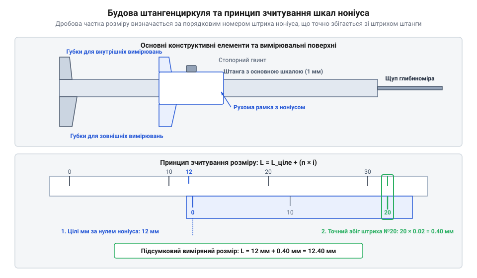
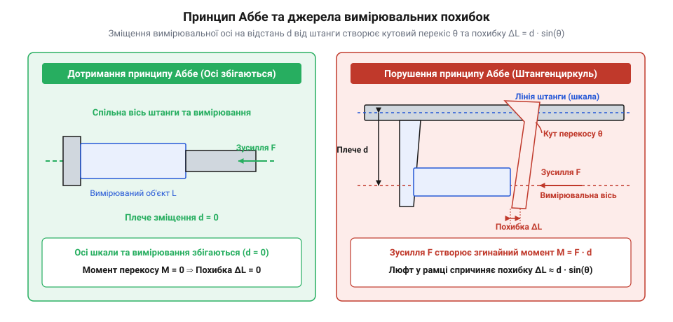

# Штангенциркуль

## Межі лінійки та вимірювальний контакт

При спробі виміряти зовнішній діаметр вала або внутрішній діаметр глухого отвору за допомогою звичайної вимірювальної лінійки майстер неминуче стикається з двома суттєвими джерелами похибок: перекосом зорової лінії (`@@en|parallax error@@`) та відсутністю надійного фізичного базування. Візуальне зіставлення штрихів плоскої лінійки з краями циліндричної деталі дає похибку до `0.5 мм`, а виміряти внутрішній паз чи глибину глухої отвори лінійкою без суттєвого викривлення результату фізично неможливо. Розв'язанням цієї задачі є застосування контактного вимірювального інструмента з рухомою штангою — штангенциркуля (від німецького *Stangenzirkel* — циркуль зі штангою; `@@de|штангенциркуль@@`). Базові віхи розвитку таких приладів розкрито в [історії створення ноніуса](root:cat-hw-instruments/vernier-caliper/hist-vernier-scale-invention.md).

Конструктивна ідея приладу полягає у створенні двох паралельних площин вимірювального контакту, між якими затискається деталь, або які розсуваються до дотику зі стінками отвору. Нижні губки приладу призначені для зовнішніх вимірювань, а верхні за загостреними лезами — для внутрішніх діаметрів. При вимірюванні циліндричних деталей плоскі робочі поверхні нижніх губок створюють лінійний базисний контакт уздовж твірної циліндра, що забезпечує автоматичне самовирівнювання деталі. Проте тривала експлуатація викликає абразивний знос робочих країв губок із формуванням радіуса зношення `r_wear`. При затисканні циліндричної деталі радіусом `R_cyl` між зношеними губками лінійний контакт порушується: циліндр западає в заглиблену ділянку на величину `Δd_wear ≈ r_wear² ÷ (2 · R_cyl)`, що створює систематичну похибку заниження виміряного діаметра та призводить до перекосу деталі. На протилежному кінці штанги розташовано висувний штифт-глибиномір, орієнтований уздовж поздовжньої осі приладу в поздовжньому пазі: плоский перпендикулярний торець штанги слугує базовою поверхнею, яку притискають до краю деталі, поки тонкий штифт висувається разом із рамкою до дна отвору. Для точного вимірювання глухих отворів торець штанги вимагає суворої співвісності з віссю отвору: перекіс осі на кут `θ` піднімає один край бази, утворюючи геометричну похибку відхилення `Δh = R_отвору · tan(θ)`. Крім того, на точність впливає геометрія дна отвору, оскільки технологічний радіус закруглення чи кутова галтель `r_дно` після обробки свердлом унеможливлює дотик штифта прямокутного перерізу до найнижчої точки. Торкання плоского кінця штифта закругленої кромки замість плаского центра дна спричиняє систематичну похибку заниження глибини, що вимагає позиціонування щупа строго поза зоною галтелі. Механічна жорсткість прямокутного штифта глибиноміра перерізом `b_pin = 1.2 мм` та `h_pin = 3.5 мм` визначається осьовим моментом інерції `I_z`:

```
I_z = (b_pin · h_pin³) ÷ 12
= (1.2 · 3.5³) ÷ 12             [формула моменту інерції прямокутника]
= 4.2875 мм⁴                   [геометричний момент інерції штифта]
```

Отримане значення моменту інерції дозволяє обчислити пружний прогин щупа при вимірювальному контакті.

I_z = (b_pin · h_pin³) ÷ 12
= (1.2 · 3.5³) ÷ 12             [формула моменту інерції прямокутника]
= 4.2875 мм⁴                   [геометричний момент інерції штифта]

При висуванні щупа на вимірювальну довжину `L_pin = 50 мм` та наявності бокового зусилля притиску `F_contact = 2 Н` величина прогину `f` за моделлю консольної балки Бернуллі обчислюється так:

f = (F_contact · L_pin³) ÷ (3 · E · I_z)
= (2 · 50³) ÷ (3 · 210000 · 4.2875) [модуль Юнга сталі E = 210000 Н/мм²]
= 0.093 мм                     [пружний прогин щупа глибиноміра]

Прогин у `0.093 мм` суттєво перевищує ціну поділки шкал (`0.02–0.05 мм`), що вимагає строго виваженого зусилля торкання. Для вимірювання висоти уступів використовують прецизійно шліфовані торцеві бази самої штанги й рамки: у закритому стані вони лежать в одній площині, що дозволяє спирати основу рамки на нижній рівень сходинки, а штангу — на верхній, уникаючи перекосів і забезпечуючи жорстке базування. Покрокові прийоми базування губок та компенсацій наведено у [практичній методиці вимірювань](root:cat-hw-instruments/vernier-caliper/proj-caliper-measurement-and-calibration.md).

Фізичний контакт губок із поверхнею виключає похибку паралаксу, оскільки відстань фіксується механічно між штангою та рухомою рамкою. Завдяки плоским контактним поверхням губки самовирівнюються уздовж твірної циліндра, що забезпечує стабільність відліку. Проте точність обмежена мінімальною ціною поділки основної лінійки в `1 мм`, для подолання якої застосовують спеціальні допоміжні шкали та відлікові пристрої.

## Геометрія шкал та вимірювальні штанги

Для підвищення дискретності відліку без зменшення інтервалу між штрихами на рухомій рамці штангенциркуля розміщують допоміжну шкалу — ноніус (від латинського прізвища математика *Nonius*; `@@la|ноніус@@`, або шкала Верньє, `@@fr|Vernier@@`). Ноніусна шкала містить `n` поділок, сумарна довжина яких дорівнює `n - 1` поділкам основної шкали штанги. При суміщенні нульових штрихів перший штрих ноніуса відстає від першого штриха штанги на величину ціни поділки `i = 1 / n мм`. Детальний розрахунок та геометричний вивід шкал дискретністю `0.1 мм`, `0.05 мм` та `0.02 мм` викладено в [математиці шкали ноніуса](root:cat-hw-instruments/vernier-caliper/math-vernier-scale-math.md).


*Конструкція штангенциркуля та принцип зчитування дробових часток за збігом штрихів основної шкали штанги й допоміжного ноніуса.*

Зчитування розміру за ноніусом здійснюється у два кроки: ціле число міліметрів визначають за позицією нуля ноніуса на основній штанзі, а дробову частку — за порядковим номером штриха ноніуса, який точно збігається зі штрихом основної шкали. Для усунення помилок суб'єктивного суміщення штрихів розроблені альтернативні модифікації відлікових пристроїв:
- **Стрілочний (циферблатний) штангенциркуль**: переміщення рамки через зубчасту рейку передається на [індикатор годинникового типу](root:cat-hw-instruments/dial-indicator), де стрілка показує сотні частки міліметра.
- **Цифровий (електронний) штангенциркуль**: під захисною наклейкою штанги розміщено друкований ємнісний статор, а рухома рамка містить зчитувальний ротор із мікроконтролером.

Внутрішня робота ємнісного датчика цифрового штангенциркуля ґрунтується на вимірюванні фазового зсуву (@@en|phase shift@@) високочастотних сигналів. На друкованій платі статора, що закріплена вздовж усієї довжини штанги, нанесено масив ізольованих мідних обкладок із фіксованим просторовим кроком `W = 5.08 мм`. Зчитувальна плата рухомої рамки подає на свої передавальні електроди високочастотні змінні напруги зі зсувом фаз, створюючи біжуче ємнісне поле. При переміщенні рамки відносно штанги змінюється ємнісний зв'язок між обкладками статора та ротора, що спричиняє фазовий зсув наведеного струму на приймальних електродах. При швидкому переміщенні рамки (швидкість до `v = 1.5 м/с`) мікроконтролер приладу застосовує двокомпонентний алгоритм обробки фазового сигналу: підраховує число повних просторових періодів `N_cycles` та інтерполює миттєвий фазовий кут `θ`. Загальне лінійне переміщення `L` обчислюється так:

Для збереження відлікової бази при вимкненні живлення або переході в режим сну мікроконтролер використовує вбудовану енергонезалежну пам'ять (від англійського *electrically erasable programmable read-only memory*; `@@en|EEPROM@@`). Під час натискання кнопки скидання `ZERO` поточні координати просторових періодів `N_zero` та базисного фазового кута `θ_zero` записуються в енергонезалежні регістри як абсолютний нульовий зсув `L_offset`. Під час увімкнення приладу чи автопробудження від руху рухомої рамки мікроконтролер зчитує збережені значення та виконує автоматичне калібрування нуля, віднімаючи `L_offset` від поточного лінійного переміщення. Якщо ж відбулося повне знеструмлення через заміну батареї, пам'ять обнуляється, що вимагає повторного зведення вимірювальних губок до упору для ініціалізації базової позиції `ORIGIN` (від англійського *origin*; `@@en|ORIGIN@@`).

Однак слабким місцем такої ємнісної системи є висока чутливість до діелектричних властивостей середовища у вимірювальному зазорі між штангою та рамкою. У сухому стані міжелектродний зазор заповнений повітрям із відносною діелектричною проникністю `ε_r ≈ 1`, що забезпечує стабільну ємність обкладок на рівні кількох пікофарад. Потрапляння на поверхню статора вологи (`ε_r ≈ 80`) або масляної плівки охолоджувальної рідини шунтує сусідні мідні сегменти й різко збільшує паразитну ємність (`@@en|parasitic capacitance@@`). Це викривляє амплітуду та фазовий кут `θ` зчитуваного високочастотного сигналу. У результаті мікроконтролер помилково підраховує число просторових періодів `N_cycles`, що викликає системні збої відліку — хаотичні стрибки показань на дисплеї на краті значення `5.08 мм` або появу помилки декодування.

L = N_cycles · W + (θ ÷ 360°) · W
= N_cycles · 5.08 + (θ ÷ 360°) · 5.08 [розрахунок переміщення за періодами й фазою]
= L_підсумкове                    [підсумкове лінійне значення в міліметрах]

Таке двохрівневе обчислення дозволяє миттєво перераховувати фазовий кут у лінійне переміщення з дискретністю `0.01 мм`. Якщо швидкість переміщення рамки перевищує граничну частоту дискретизації датчика, лічильник цілих періодів втрачає синхронізацію, що викликає помилку відліку `Err` і вимагає повторного скидання нуля.

Цифрові моделі забезпечують дискретність `0.01 мм`, дозволяють проводити обнулення в будь-якій точці та перемикатися між метричною та дюймовою системами. Апаратне підключення приладу до систем автоматизованого збору даних описує специфікація [інтерфейсу виводу даних](root:cat-hw-instruments/vernier-caliper/api-digital-caliper-spc-data-interface.md). Проте при вимірюваннях із підвищеними вимогами до точності слід враховувати, що грань між дискретністю відліку та реальною похибкою інструмента визначається жорсткістю штанги й дотриманням вимірювальних умов, де більш прецизійним аналогом виступає [мікрометр](root:cat-hw-instruments/micrometer).

## Джерела похибок та принцип Аббе

При виконанні прецизійних вимірювань штангенциркулем головним лімітуючим чинником точності є недотримання принципу Аббе (від імені німецького фізика Ernst Abbe; `@@de|Abbe principle@@`). Згідно з цим фундаментальним метрологічним правилом, лінія вимірювальної шкали повинна лежати суворо на одній осі з лінією вимірюваного розміру. У штангенциркулі ця вимога порушена за конструкцією: вимірювальна лінія проходить уздовж контактних губок, паралельно основній штанзі, зі зміщенням на плече губки `h`. Математичну геометрію кутового відхилення викладено у [геометрії вимірювальної похибки](root:cat-hw-instruments/vernier-caliper/math-vernier-scale-math.md).


*Схема виникнення похибки Аббе через геометрію відхилення вимірювальної лінії від напрямної штанги.*

Наявність конструктивного зазору між штангою та рухомою рамкою призводить до того, що під час прикладення вимірювального зусилля `F` рамка повертається на мікроскопічний кут `α`. При довжині губок `h` кутовий перекіс спричиняє додаткову лінійну похибку `ΔL`, яку обчислюють за формулою:

```
ΔL = h × sin(α)                        [похибка Аббе від кутового перекосу]
```

Крім того, при зміні напрямку руху рамки конструктивний зазор напрямних викликає гістерезис (від грецького *hysteresis* — запізнення; `@@en|hysteresis@@`) та похибку зворотного ходу. Під час переходу від зведення губок до їх розведення напрямок сил тертя змінюється на протилежний, що змушує рамку перекладати кутовий люфт з одного краю напрямної штанги на інший. Цей гістерезисний люфт `ΔL_hyster` створює систематичну різницю відліків залежно від того, з якого боку рамка підходила до вимірювальної точки.

Окрім кутового перекосу рамки та гістерезису зворотного ходу, на підсумкову точність вимірювання впливають такі фізичні та механічні чинники:
- **Надмірне зусилля притискання**: стискання деталей із силою понад `5–10 Н` спричиняє пружну деформацію губок та м'яких матеріалів деталі.
- **Знос вимірювальних поверхонь**: стирання робочих граней утворює просвіт біля основи губок, що спотворює результати при вимірюванні тонких пластин.
- **Геометрія внутрішніх губок**: скінченна товщина `b_jaw` та радіус закруглення граней внутрішніх губок (від англійського *internal jaws*; `@@en|internal jaws@@`) не дозволяють їм суміститися зі справжньою діаметральною лінією отвору. Під час вимірювання малих отворів губки торкаються стінок по коротшій хорді, спричиняючи систематичне заниження виміряного діаметра `D_вимір < D_справжній`.
- **Температурне розширення та різниця матеріалів**: зміна температури приладу та деталі відносно нормальних `20 °C` зміщує розміри на величину `ΔL_t = L · α_t · ΔT`, де `α_t` — коефіцієнт лінійного розширення сталі (`11.5 · 10⁻⁶ K⁻¹`). При вимірюванні деталей із кольорових металів та пластиків виникає додатковий диференціальний зсув через різницю коефіцієнтів `Δα_t = α_деталь - α_сталь`. Для алюмінію (`α_Al ≈ 23 · 10⁻⁶ K⁻¹`) ця різниця подвоює температурний дрейф, а для конструкційних пластиків (поліамід, PTFE, де `α_пластик ≈ 90–120 · 10⁻⁶ K⁻¹`) коефіцієнт розширення перевищує сталевий у `8–10` разів. При відхиленні температури на `ΔT = +10 °C` диференціальне розширення пластикової деталі довжиною `100 мм` створює похибку `ΔL_диф ≈ 0.08–0.11 мм`, що суттєво перевищує ціну поділки шкал інструмента й вимагає температурної витримки або математичної компенсації.
- **Некомпенсований нульовий зсув**: забруднення або зсув електронного нуля призводить до систематичної похибки відліку.

```
ΔL = h × sin(α)                        [похибка Аббе від кутового перекосу]
```

Окрім кутового перекосу рамки, на підсумкову точність вимірювання впливають такі фізичні та механічні чинники:
- **Надмірне зусилля притискання**: стискання деталей із силою понад `5–10 Н` спричиняє упругу деформацію губок та м'яких матеріалів деталі.
- **Знос вимірювальних поверхонь**: стирання робочих граней утворює просвіт біля основи губок, що спотворює результати при вимірюванні тонких пластин.
- **Геометрія внутрішніх губок**: скінченна товщина `b_jaw` та радіус закруглення граней внутрішніх губок (від англійського *internal jaws*; `@@en|internal jaws@@`) не дозволяють їм суміститися зі справжньою діаметральною лінією отвору. Під час вимірювання малих отворів губки торкаються стінок по коротшій хорді, спричиняючи систематичне заниження виміряного діаметра `D_вимір < D_справжній`. З прямокутного трикутника, утвореного радіусом отвору `R = D / 2`, половиною хорди `D_вимір / 2` та товщиною лез `b_jaw / 2`, систематичну похибку `ΔD_jaw` обчислюють за формулою:
- **Температурне розширення та різниця матеріалів**: зміна температури приладу та деталі відносно нормальних `20 °C` зміщує розміри на величину `ΔL_t = L · α_t · ΔT`, де `α_t` — коефіцієнт лінійного розширення сталі (`11.5 · 10⁻⁶ K⁻¹`). При вимірюванні деталей із кольорових металів та пластиків виникає додатковий диференціальний зсув через різницю коефіцієнтів `Δα_t = α_деталь - α_сталь`. Для алюмінію (`α_Al ≈ 23 · 10⁻⁶ K⁻¹`) ця різниця подвоює температурний дрейф, а для конструкційних пластиків (поліамід, PTFE, де `α_пластик ≈ 90–120 · 10⁻⁶ K⁻¹`) коефіцієнт розширення перевищує сталевий у `8–10` разів. При відхиленні температури на `ΔT = +10 °C` диференціальне розширення пластикової деталі довжиною `100 мм` створює похибку `ΔL_диф ≈ 0.08–0.11 мм`, що суттєво перевищує ціну поділки шкал інструмента й вимагає температурної витримки або математичної компенсації.
- **Некомпенсований нульовий зсув**: забруднення або зсув електронного нуля призводить до систематичної похибки відліку.

```
D² = D_вимір² + b_jaw²
D_вимір = √(D² - b_jaw²)               [значення виміряної хорди]
ΔD_jaw = D - √(D² - b_jaw²)            [похибка від товщини губок]
```

При вимірюванні отвору діаметром `D = 10.00 мм` губками з товщиною лез `b_jaw = 1.00 мм` обчислення похибки дає:

```
D_вимір = √(10.00² - 1.00²)
= √(100 - 1)                           [різниця квадратів]
= √99                                  [значення під коренем]
≈ 9.950 мм                             [обчислена хорда]

ΔD_jaw = 10.00 - 9.950
= 0.050 мм                             [систематичне заниження]
```

Похибка `0.050 мм` дорівнює ціні поділки прецизійного ноніуса, тому під час вимірювання малих отворів цей систематичний зсув обов'язково враховують.
- **Температурне розширення**: зміна температури приладу та деталі відносно нормальних `20 °C` зміщує розміри на величину `ΔL_t = L · α_t · ΔT`, де `α_t` — коефіцієнт лінійного розширення сталі (`11.5 · 10⁻⁶ K⁻¹`).
- **Некомпенсований нульовий зсув**: забруднення або зсув електронного нуля призводить до систематичної похибки відліку.

Для усунення систематичного зсуву перед початком робіт губки повністю зводять і контролюють нульову позначку, а для періодичної перевірки геометричного зносу використовують [концеві міри довжини](root:cat-hw-instruments/gauge-blocks).

## Практичні техніки вимірювання та догляд

Для досягнення високої повторюваності вимірювань оператор має дотримуватися правильної техніки позиціонування приладу відносно вимірюваного елемента. Під час вимірювання зовнішніх діаметрів деталь розташовують якомога ближче до основи штанги, а не на самих кінчиках губок. Це мінімізує плече `h` та зменшує вплив похибки Аббе. При вимірюванні отворів верхні губки орієнтують діаметрально протилежно, вишукуючи максимальне значення показника для циліндра або мінімальне для паза. Покроковий алгоритм виконання всіх типів вимірювань та повірки узагальнено у [практичній методиці вимірювань](root:cat-hw-instruments/vernier-caliper/proj-caliper-measurement-and-calibration.md).

При вимірюванні глибини торцеву площину штанги притискають суворо перпендикулярно до базової поверхні деталі, а щуп глибиноміра плавно висувають до торкання дна. Закріплення виміряного розміру здійснюють стопорним гвинтом на рухомій рамці, що дозволяє витягти інструмент із важкодоступної зони без зсуву показів.

Для збереження плавності ходу рамки та виключення кутового перекосу під час вимірювань у конструкції застосовують регульовану притисну планку (від німецького *Keilleiste*; `@@de|Keilleiste@@`, або клиноподібний вкладиш). Ця латунна чи загартована сталева планка розміщена між внутрішньою стінкою рухомої рамки та робочою поверхнею штанги, забезпечуючи рівномірний розподіл тертя ковзання. Методика регулювання зазору полягає в юстуванні декількох стопорних мікрогвинтів, розташованих уздовж верхньої грані рамки: після попереднього очищення та змащення штанги мікрогвинти послідовно підтягують малим викрутковим інструментом із постійним контролем зусилля просування рамки від нуля до максимального вильоту. Кожен мікрогвинт точково тисне на притисну планку, усуваючи бічний люфт і компенсуючи локальне зношення контактних граней. Занадто сильне затискання гвинтів викликає тугий хід із явищем переривчастого тертя (`@@en|stick-slip@@`) та ускладнює відчуття вимірювального зусилля, тоді як недостатнє затягування призводить до перекосу рамки й суттєвого зростання похибки. Оптимальне налаштування досягається тоді, коли рамка рухається плавно й монотонно вздовж всієї штанги без відчутного хитання, після чого налаштувальні мікрогвинти фіксують від самодовільного відкручування.

Правильний догляд та збереження вимірювальних поверхонь гарантують довговічність та стабільність інструмента:
1. **Перевірка нуля**: перед кожним вимірювальним циклом губки закривають і перевіряють відсутність просвіту на світло та збіг нульових штрихів.
2. **Очищення та змащення**: після завершення робіт штангу й губки протирають безворсовою серветкою та наносять тонкий шар антикорозійного мастила.
3. **Розмагнічування губок**: при використанні інструмента поблизу магнітних плит металорізальних чи шліфувальних верстатів сталеві губки намагнічуються та притягують дрібну феромагнітну стружку. Налипання металевого пилу утворює зазор `0.02–0.1 мм` і дряпає шліфовані грані, що вимагає періодичної обробки приладу портативним розмагнічувачем (від англійського *demagnetizer*; `@@en|demagnetizer@@`): інструмент повільно проводять через змінне електромагнітне поле й відводять на відстань понад `1 м` до вимкнення пристрою.
4. **Правила зберігання**: прилад зберігають у жорсткому футлярі з розведеними на `1–2 мм` губками й послабленим стопорним гвинтом для запобігання напруженням у механізмі.

Дотримання цих правил гарантує збереження класу точності приладу протягом усього терміну експлуатації у виробничих та лабораторних умовах.
