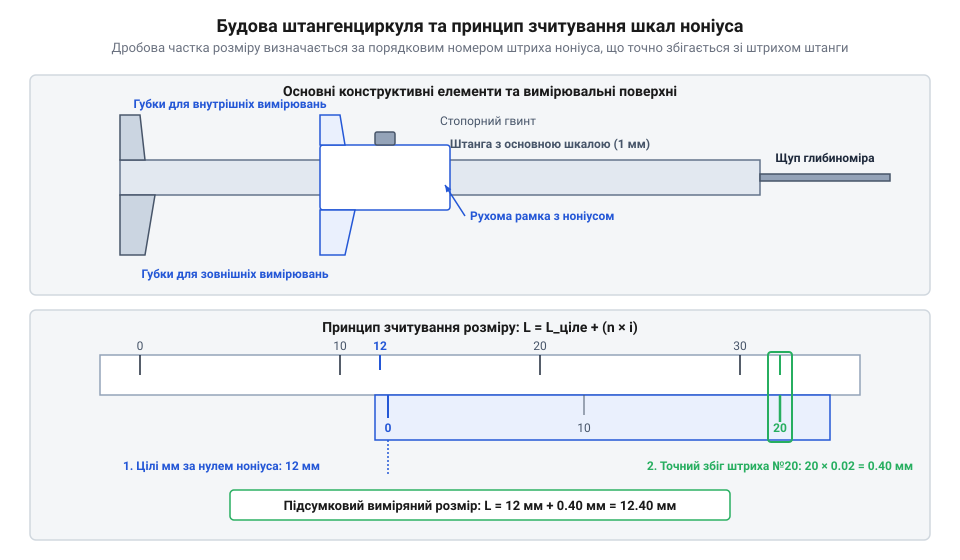

# Штангенциркуль

## Межі лінійки та три вимірювальні бази

Вимірювання розмірів деталей звичайною плоскою лінійкою обмежене відсутністю механічного фіксування та похибкою зорового перекосу. Виміряти внутрішній паз чи глибину глухого отвору лінійкою без спотворення результату фізично неможливо. Розв'язанням цієї проблеми є @@de|штангенциркуль@@ (нім. *Stangenzirkel*, від *Stange* — штанга та *Zirkel* — циркуль) — контактний інструмент із рухомою рамкою, що забезпечує жорстке базування між паралельними поверхнями.

Прилад реалізує три види вимірювальних операцій за допомогою окремих конструктивних елементів:
- **Зовнішні вимірювання**: нижні широкі губки охоплюють деталь із двох боків, створюючи лінійний контакт уздовж твірної циліндра.
- **Внутрішні вимірювання**: верхні загострені леза розсуваються до дотику зі внутрішніми стінками отвору чи паза.
- **Вимірювання глибини**: висувний штифт-глибиномір спирається на дно отвору, поки торець штанги притискається до його зовнішньої базової площини.

Фізичний дотиковий контакт губок усуває похибку зорового суміщення, проте роздільна здатність основної шкали лінійки обмежена значенням `1 мм`.

## Принципи відліку та зчитування дробових часток

Для підвищення дискретності відліку без зменшення інтервалу між штрихами на рухомій рамці розміщують допоміжну шкалу — @@la|ноніус@@ (лат. *Nonius*, за прізвищем математика, також відомий як шкала Верньє, @@fr|Vernier@@). Ноніусна шкала містить `n` поділок, загальна довжина яких відповідає `n - 1` поділкам основної штанги. Завдяки цьому перший штрих ноніуса відстає від першого штриха штанги на ціну поділки `i = 1 / n мм`.

*Конструкція штангенциркуля та принцип зчитування дробових часток за збігом штрихів основної шкали штанги й допоміжного ноніуса.*

Зчитування розміру відбувається у два кроки: цілі міліметри визначають за позицією нуля ноніуса на штанзі, а дробові частки — за номером штриха ноніуса, який точно збігається з будь-яким штрихом основної шкали.

У сучасних модифікаціях застосовують альтернативні відлікові пристрої:
- **Стрілочний прилад**: рамка через зубчасту рейку обертає стрілку циферблата з дискретністю `0.02 мм`.
- **Цифровий прилад**: живиться від батареї та вимірює @@en|phase shift@@ (зсув фази) високочастотного сигналу між ємнісними обкладками штанги й рамки. Мікроконтролер миттєво обчислює підсумкове переміщення `L` із дискретністю `0.01 мм`.

        L = N_cycles · W + (θ ÷ 360°) · W   [перетворення фазового кута в довжину]

Тут `N_cycles` — число повних просторових періодів кроком `W = 5.08 мм`, а `θ` — миттєвий фазовий кут.

## Принцип Аббе та джерела вимірювальних похибок

Головним метрологічним обмеженням штангенциркуля є порушення правила, яке описує @@de|Abbe principle@@ (нім. *Abbe-Prinzip*, за ім'ям фізика Ернста Аббе). Згідно з цим принципом, вимірювальна шкала повинна лежати строго на одній лінії з вимірюваним розміром. У штангенциркулі вимірювальна лінія губок зміщена відносно штанги на плече `h`.

Під дією зусилля притискання `F` зазор між рамкою та штангою викликає кутовий перекіс рамки на кут `α`, що створює лінійну похибку `ΔL`.

        ΔL = h · sin(α)                     [похибка Аббе від кутового перекосу]

Крім кутового перекосу Аббе, на підсумкову точність вимірювання впливають три основні фізичні чинники:
- **Похибка товщини внутрішніх губок**: скінченна товщина лез `b_jaw` не дозволяє їм суміститися з діаметральною лінією малого отвору, що спричиняє заниження виміряного діаметра `D_вимір < D`.
- **Температурне розширення**: відхилення температури деталі від нормальних `20 °C` створює диференціальний зсув розміру `ΔL_t = L · Δα_t · ΔT` через різницю коефіцієнтів розширення сталі приладу та матеріалу деталі.
- **Знос вимірювальних граней**: стирання робочих країв утворює просвіт біля основи губок.

Для компенсації похибок перед початком роботи перевіряють нульовий зсув при повністю зведених губках та контролюють притискне зусилля в межах `5–10 N`.
