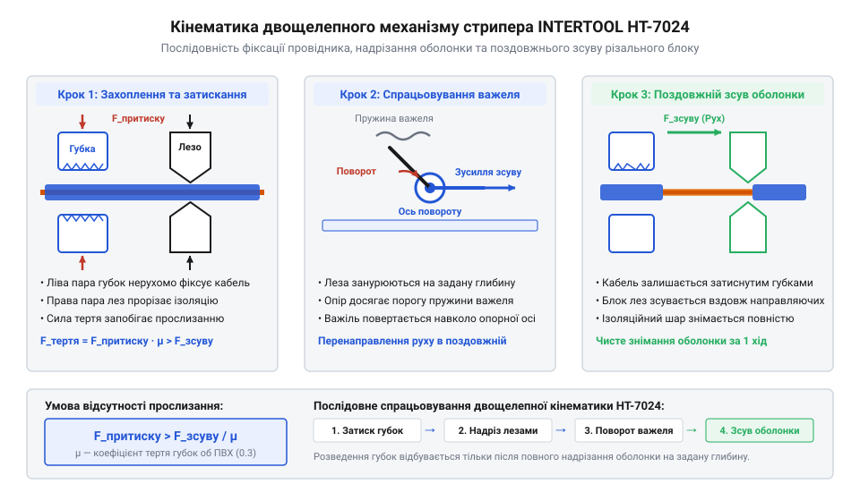
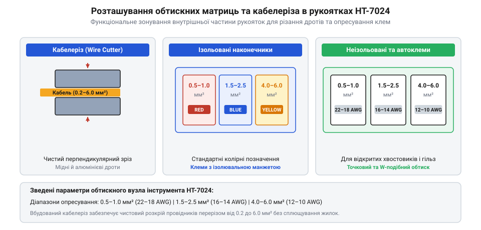

# Специфікація та кінематична схема стрипера INTERTOOL HT-7024

<preknowlist>
- [Обтискні кліщі (Dupont/JST)](root:cat-hw-instruments/crimp-tool) — призначення та види опресування контактів
- [Бокорізи](root:cat-hw-instruments/side-cutters) — базові прийоми перерізання мідних провідників
</preknowlist>

## Принцип дії двощелепної кінематики

Під час підготовки електричних дротів до монтажу зачищення ізоляційної оболонки за допомогою традиційного ножа або нерегульованих кліщів пов'язане з ризиком випадкового надрізання мідних жил. Пошкодження окремих провідників зменшує ефективний переріз дрібного кабелю, збільшує локальний опір і призводить до перегріву з'єднання. Автоматичний @@en|стрипер@@ (від англ. *stripper*; `@@en|стрипер@@`) моделі INTERTOOL `HT-7024` усуває цей ризик завдяки використанню двощелепного механізму, у якому розділено функції фіксації та зсуву ізоляції.

В основі роботи інструмента лежить підпружинена @@el|кінематика@@ (від грец. *kinematikos* — той, що рухає; `@@el|кінематика@@`), що приводиться в дію стисканням рукояток. Під час зведення важелів ліва пара зубчастих губок нерухомо захоплює провідник, запобігаючи його поздовжньому зсуву. Одночасно права пара прецизійних лез надрізає ізоляцію на задану глибину і під дією шарнірного важеля відходить убік, знімаючи підрізану оболонку з кінця дроту за один робочий хід.

Узгоджена послідовність дій забезпечується підпружиненим поворотним важелем, який функціонує як механічний перемикач траєкторії зусилля. На початку ходу рукояток стискання спрямовується на затискання кабелю та проникнення лез в оболонку. Щойно леза досягають граничної глибини, притискний опір перевищує поріг попереднього натягу пружини важеля, змушуючи його повернутися навколо опорної осі. Цей поворот перенаправляє подальший рух важелів у поздовжній зсув різального блоку вздовж направляючих, гарантуючи, що розведення губок відбудеться лише після повного надрізання ізоляції.

Для запобігання прослизанню провідника під час зсуву оболонки сила тертя затискних губок `F_тертя` повинна перевищувати поздовжнє зусилля зсуву ізоляції `F_зсуву`. Оскільки сила тертя дорівнює добутку сили притиску `F_притиску` на коефіцієнт тертя `μ` між сталевими зубцями та матеріалом оболонки, мінімальне необхідне зусилля фіксації визначають за математичною нерівністю:

```
F_притиску > F_зсуву / μ
```

**Приклад розрахунку для ПВХ-оболонки з `F_зсуву = 15 Н` та `μ = 0.3`:**

```
F_притиску > F_зсуву / μ
= 15 / 0.3                      [підстановка F_зсуву = 15 Н та μ = 0.3]
= 50 Н                          [мінімальне необхідне зусилля притиску]
```

З обчислення видно, що для впевненого зняття ПВХ-ізоляції із зусиллям зсуву `15 Н` зубчасті губки повинні забезпечувати нормальне притискне зусилля не менше `50 Н`. З цієї залежності випливає, що для матеріалів із низьким коефіцієнтом тертя (зокрема тефлону) потрібна значно більша сила нормального притиску `F_притиску`, ніж для м'якого ПВХ. Кінематичний важіль інструмента розрахований так, що сила затискання пропорційно зростає зі збільшенням опору зсуву, гарантуючи стійку фіксацію протягом усього робочого ходу.

```
F_притиску > F_зсуву / μ
```

З цієї залежності випливає, що для ізоляційних матеріалів із низьким коефіцієнтом тертя (зокрема тефлону) потрібна значно більша сила нормального притиску `F_притиску`, ніж для м'якого ПВХ. Кінематичний важіль інструмента розрахований так, що сила затискання пропорційно зростає зі збільшенням опору зсуву, гарантуючи стійку фіксацію протягом усього робочого ходу.


*Покрокова кінематична схема розведення й зсуву ізоляційної оболонки двощелепним механізмом.*

## Діапазони перерізів та регулювання зусилля

Автоматичний стрипер `HT-7024` розрахований на роботу з одножильними та багатожильними провідниками перерізом від `0.2 мм²` до `6.0 мм²`, що відповідає діапазону від `24 AWG` до `10 AWG` за стандартом @@en|AWG@@ (від англ. *American Wire Gauge*; `@@en|AWG@@`). Для точного дозування довжини оголеного провідника пристрій оснащено висувним пластиковим обмежувачем (стопором), який можна встановлювати у діапазоні від `5 мм` до `20 мм`.

Глибина занурення різальних лез регулюється поворотним гвинтовим мікрорегулятором, розташованим у головній частині інструмента. При роботі з м'якою або тонкою ізоляцією (наприклад, силіконовою) регулятор повертають проти годинникової стрілки, зменшуючи стискання губок для запобігання підрізанню тонких мідних жилок. Для силіконового дрібножильного проводу налаштування виконують покроково: гвинт повністю послаблюють проти годинникової стрілки до ковзання губок по пружній оболонці, після чого виконують пробні зрізи, повертаючи регулятор за годинниковою стрілкою на `1/4` оберту за крок до досягнення чистого зрізу зсувом і перевіряючи відсутність пошкоджень мікрожилок. Для жорстких матеріалів (оболонки з ПВХ або тефлону) гвинт закручують за годинниковою стрілкою, збільшуючи зусилля надрізання для впевненого зняття щільного шару. Проте в граничному випадку надмірного закручування мікрорегулятора леза створюють надлишкове радіальне стискання товстостійкої ПВХ-оболонки. Замість чистого зсуву пластичний матеріал видавлюється під кромкою, що призводить до викривлення та зминання зрізаного краю ізоляції, а також підвищує ризик деформації мідних жил.

Окремим чинником, що ускладнює налаштування мікрорегулятора, є геометричний ексцентриситет кабелю — зміщення струмопровідної жили відносно геометричного центру ізоляційної оболонки. Через нерівномірну товщину стінки леза пристрою занурюються у матеріал асиметрично: на стоншеній ділянці виникає ризик надрізання периферійних мідних жилок, тоді як на потовщеному боці оболонка зрізається не повністю. У таких випадках притискний гвинт послаблюють проти годинникової стрілки, орієнтуючись на мінімальну товщину стінки для збереження жилок, а залишковий місток ізоляції надривається механічним зусиллям зсуву під час розведення губок.

## Сумісність матриць обтиску та різак

У нижній частині рукояток стрипера `HT-7024` інтегровано додатковий @@de|кабелоріз@@ (від нім. *Kabel* — кабель та укр. *різати*; `@@de|кабелоріз@@`) та пристрій для @@en|опресування@@ (від англ. *crimping*; `@@en|опресування@@`) стандартних кабельних наконечників. Вбудований різак призначений для чистого обрізання мідних та алюмінієвих провідників перерізом до `6.0 мм²`. Для акуратного точкового підрізання елементів на друкованих платах замість вбудованого леза використовують спеціалізовані [бокорізи](root:cat-hw-instruments/side-cutters).

Опресувальний вузол рукоятки містить три профільні матриці з кольоровим та цифровим маркуванням:
- **Ізольовані наконечники (червоні, сині, жовті):** діапазон перерізів від `0.5 мм²` до `6.0 мм²` (`22–10 AWG`).
- **Неізольовані клемні роз'єми:** два окремих гнізда для перерізів `0.5–2.5 мм²` (`22–14 AWG`) та `4.0–6.0 мм²` (`12–10 AWG`).
- **Автомобільні клеми запалювання:** гніздо для стандартного обтиску високовольтних дротів діаметром `7–8 мм`.

Під час обтиску штирьових втулкових наконечників НШВІ матриця створює профільоване стискання металевої гільзи довкола багатожильного провідника. Формування чотиригранного (квадратного) профілю @@en|опресування@@ рівномірно стискає тонкостінну електролітичну мідну гільзу з чотирьох боків, переупаковуючи круглі жилки багатожильного пучка у щільний монолітний масив без внутрішніх повітряних порожнин. Якість сформованого з'єднання перевіряють за відсутністю окремих жилок поза втулкою, цілісністю ізоляційної манжети та механічною міцністю на виривання кабелю. Правильно @@en|опресований@@ хвостовик має симетричну чотиригранну форму без тріщин металу, забезпечуючи максимальну площу контакту та мінімальний перехідний опір при фіксації провідника у гвинтових або пружинних клемниках.

Конструкція вбудованого кабелоріза базується на ножичній кінематиці з радіусним профілем різальних лез, що суттєво відрізняє його від плоскопаралельних бокорізів. Під час зведення рукояток увігнуті кромки охоплюють провідник по колу, утримуючи багатожильний пучок у циліндричній геометрії. Завдяки ножичному зсуву матеріал розрізається під дією дотичного напруження без попереднього радіального зминання, що запобігає сплющуванню та розпушуванню мідних жилок і зберігає круглу форму зрізу для подальшого монтажу.


*Схема розташування губок кабелоріза та профілів обтиску наконечників.*

Для монтажу малогабаритних сигнальних роз'ємів із кроком `2.54 мм` замість комбінованого інструмента застосовують професійні [обтискні кліщі](root:cat-hw-instruments/crimp-tool).

## Межі застосування та обслуговування

Для збереження високої точності та запобігання передчасному зносу лез стрипера `HT-7024` слід суворо дотримуватися експлуатаційних обмежень. Інструмент не призначений для різання та зачищення сталевого дроту, самонесучих ізольованих дротів з внутрішнім сталевим сердечником або броньованих кабелів. Висока твердість сталі призводить до викривлення кромкових губок та утворення відколів на прецизійних різальних поверхнях.

Технічне обслуговування полягає у періодичному очищенні зубчастих фіксувальних губок від залишків пластикової стружки за допомогою жорсткої щітки. Для забезпечення плавності ходу двощелепного важеля шарнірні осі та поворотно-пружинний механізм змащують краплею машинного масла після кожних 1000 циклів спрацьовування. Поява надривів на ізоляції замість чистого зрізу або прослизання лез по оболонці свідчать про знос різальних кромкових губок. Знімний блок лез замінюють шляхом викручування фіксуючих гвинтів на головці інструмента, вилучення зношеного модуля з посадкових пазів та встановлення нового комплекту з подальшим вирівнюванням притискного мікрорегулятора.

Окрім механічного видалення стружки, зубчасті фіксатори потребують регулярної хімічної деконтамінації (від латинського *de-* — усунення та *contaminatio* — забруднення; @@la|decontaminatio@@) від нальоту оксидів міді та залишкових антипіренів (від грецького *anti-* — проти та *pyr* — вогонь; @@el|antipyrenes@@), які виділяються з ізоляції при терті та спричиняють прослизання провідника. Для усунення окисленої мідної пилюки та протипожежних домішок ПВХ-оболонки робочі поверхні губок обробляють безводним ізопропіловим спиртом (англ. @@en|isopropyl alcohol@@) або спеціалізованим розчинником оксидів за допомогою м'якої латунної щітки. Застосування сталевих щіток чи агресивних кислотних розчинів неприпустиме, оскільки це руйнує захисне покриття інструмента `HT-7024`, прискорює корозію мікрозубців та призводить до передчасної втрати надійності затискання кабелю.

Після зачищення провідника стрипером зачищену ділянку можна ізолювати [термоусадковою трубкою](root:cat-hw-instruments/heat-shrink-tubing) або залудити за допомогою [USB-паяльника TK-USB-DS](root:cat-hw-instruments/usb-soldering-iron), використовуючи [безвідмивний флюс FVS-7](root:cat-hw-instruments/flux-fvs7) і [свинцевий або безсвинцевий припій](root:cat-hw-instruments/solder-tin).
