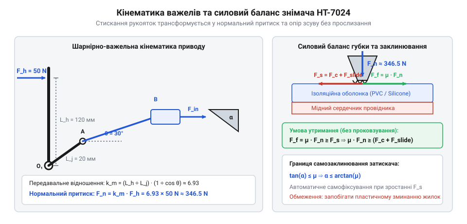

# Кінематика важелів та розрахунок зусилля зсуву ізоляції

## Фізика заклинювання та розкладання сил

Під час механічного видалення ізоляційної оболонки з електричного провідника звичайним різальним інструментом, як-от [бокорізами](root:cat-hw-instruments/side-cutters), майстер змушений одночасно контролювати глибину врізання та прикладати поздовжнє зусилля витягування. Автоматичний @@en|стрипер@@ (англ. *stripper*, від англ. *strip* — знімати шар) виконує обидві операції за один хід рукояток завдяки узгодженій роботі затискних та підрізних губок. Для успішного зняття оболонки без її прослизання в затискачі та без розриву мідних жилок у точці контакту має виконуватися жорсткий силовий баланс. Характер розподілу контактних напружень під зубцями затискача суттєво залежить від структури мідної серцевини провідника. Для суцільного монолітного провідника нормальне зусилля `Fₙ` створює високу локальну концентрацію напружень `σ_c = Fₙ ÷ A_c` на жорсткому металевому осерді, де деформація обмежується поверхневим врізанням зубців в ізоляцію. У багатожильному провіднику пучок тонких дротів під дією радіального стискання легко перебудовується та сплющується, розподіляючи напруження по більшій контактній площі, проте локальні піки напружень на периферійних жилках створюють ризик їх пластичного перетискання або зрізу ще до початку поздовжнього зсуву оболонки. Практична конструкція та правила роботи з поширеним [автоматичним знімачем INTERTOOL HT-7024](root:cat-hw-instruments/wire-stripper/api-ht7024-spec-and-blade-geometry.md) детально розібрані в окремому практичному керівництві.

На затискні губки інструмента з боку ізоляції діють дві взаємопов'язані сили: нормальна сила притиску `Fₙ` та виникаюча сила тертя спокою `F_f`. Водночас підрізний ніж створює поздовжній опір зсуву оболонки `F_s`. Щоб губки не ковзали по поверхні кабелю, сила тертя повинна перевищувати або дорівнювати силі зсуву.

        F_f = μ · Fₙ                        [визначення сили тертя спокою]
        ≥ F_s                               [умова відсутності прослизання]

Тут `μ` — @@en|коефіцієнт тертя@@ спокою між сталевими зубцями губок та полімерною оболонкою. У двощелепному механізмі притискне зусилля формується через заклинювальний важіль із кутом нахилу робочого клина `α`. Поздовжнє переміщення приводного штока з силою `F␑` трансформується в нормальне стискання.

        Fₙ = F␑ ÷ sin(α)                    [розкладання сили на похилій площині клина]

Якщо кут клина `α` занадто великий, виникає проскок затискача. Явище, за якого затискач утримує кабель самостійно під дією зростаючого навантаження зсуву, називається @@en|самозаклинювання@@ (англ. *self-jamming*). Геометрична умова самозаклинювання виводиться з рівності тангенса кута клина та коефіцієнта тертя.

        tan(α) ≤ μ                          [гранична умова самозаклинювання]
        α ≤ arctan(μ)                       [максимально припустимий кут клина]

Коли кут `α` відповідає цій умові, зростання опору зсуву `F_s` автоматично пропорційно збільшує нормальний притиск `Fₙ`, запобігаючи зсуву губок. Проте надмірне збільшення `Fₙ` небезпечне: воно викликає пластичне зминання мідних жилок під зубцями.

## Кінематика важелів та передавальне відношення

Створення необхідного нормального притиску `Fₙ` без надмірного втомлення руки оператора забезпечується шарнірно-важельним механізмам інструмента. Привід складається з двох підпружинених важелів, з'єднаних проміжними тягами з затискною та різальною щелепами.

*Кінематика важелів двощелепного знімача ізоляції та силовий баланс у шарнірних вузлах.*

Стискання рукояток силою `F_h`, прикладеною на плечі `L_h` від осі обертання, створює крутильний момент `M = F_h · L_h`. Коротке плече важеля довжиною `L_j` передає зусилля на шарнірний повзун під кутом `θ` до напрямку стискання губок. @@en|передавальне відношення@@ (англ. *leverage ratio*, від фр. *levier* — важіль) механізму `k_m` визначає механічне підсилення системи.

        k_m = Fₙ ÷ F_h                      [визначення передавального відношення]
            = (L_h ÷ L_j) · (1 ÷ cos(θ))    [геометрія плечей та кута розхилу]

Розглянемо покроковий розрахунок підсилення для типових геометричних параметрів автоматичного стрипера: `L_h = 120 мм`, `L_j = 20 мм`, поточний кут відхилення тяги `θ = 30°`.

**Розрахунок передавального відношення та притискної сили:**

        k_m = (120 ÷ 20) · (1 ÷ cos(30°))   [підстановка геометричних розмірів]
            = 6 · (1 ÷ 0.866)               [значення тригонометричної функції]
            ≈ 6.93                          [коефіцієнт підсилення важелів]

При прикладанні оператором помірного зусилля `F_h = 50 N` на рукоятки, нормальне зусилля притиску губок `Fₙ` становить:

        Fₙ = k_m · F_h                      [зв'язок нормальної сили з вхідним зусиллям]
           = 6.93 × 50                      [підстановка розрахованого коефіцієнта]
           ≈ 346.5 N                        [сумарне притискне зусилля]

Отримане значення `Fₙ ≈ 346.5 N` гарантує утримання оболонки, якщо нормальна сила створює силу тертя `F_f = μ · Fₙ`, яка перевищує граничний опір зрізу та зсуву конкретного матеріалу ізоляції.

## Граничне зусилля зсуву типів ізоляції

Повне зусилля зсуву ізоляції `F_s` складається з двох послідовних фізичних компонент: зусилля підрізання оболонки ножами `F_c` та зусилля протягування зрізаного циліндра вздовж мідної жили `F_slide`.

        F_s = F_c + F_slide                 [загальне зусилля зсуву оболонки]

Зусилля підрізання `F_c` визначається як добуток площі поперечного зрізу полімерної стінки `A_c` на @@en|границю міцності@@ на зсув `τ` для даного матеріалу. Площа кільцевого зрізу обчислюється через зовнішній діаметр кабелю `D_out` та діаметр мідної жили `D_in`.

        A_c = π · (D_out² - D_in²) ÷ 4       [площа кільцевого перерізу оболонки]
        F_c = τ · A_c                       [сила врізання різальних крайок]

Сила протягування `F_slide` залежить від площі внутрішнього контакту `A_int = π · D_in · l_strip` на довжині знімання `l_strip` та питомого напруження адгезійного тертя `σ_f` між міддю та полімером.

        F_slide = π · D_in · l_strip · σ_f  [опір сухого тертя при зсуві]

Порівняємо необхідне зусилля зсуву для провідника перерізом 1.5 мм² (`D_in = 1.38 мм`, товщина стінки `t = 0.6 мм`, `D_out = 2.58 мм`, довжина знімання `l_strip = 10 мм`) для трьох поширених матеріалів оболонки.

**1. @@en|полівінілхлорид@@ (PVC):** `τ ≈ 15 МПа`, `σ_f ≈ 0.8 МПа`.

        A_c = 3.1416 × (2.58² - 1.38²) ÷ 4
            = 3.1416 × (6.6564 - 1.9044) ÷ 4 [різниця квадратів діаметрів]
            ≈ 3.73 мм²                      [площа кільця ізоляції]
        F_c = 15 × 3.73 ≈ 55.95 N           [зусилля підрізання PVC]
        F_slide = 3.1416 × 1.38 × 10 × 0.8
                ≈ 34.68 N                   [зусилля протягування PVC]
        F_s = 55.95 + 34.68 ≈ 90.63 N       [повне зусилля зсуву PVC]

**2. @@en|силікон@@ (Silicone):** `τ ≈ 5 МПа`, підвищене тертя `σ_f ≈ 1.2 МПа`.

        F_c = 5 × 3.73 ≈ 18.65 N            [зусилля підрізання силікону]
        F_slide = 3.1416 × 1.38 × 10 × 1.2
                ≈ 52.02 N                   [зусилля протягування силікону]
        F_s = 18.65 + 52.02 ≈ 70.67 N       [повне зусилля зсуву силікону]

**3. @@en|фторопласт@@ (PTFE):** `τ ≈ 25 МПа`, наднизьке тертя `σ_f ≈ 0.2 МПа`.

        F_c = 25 × 3.73 ≈ 93.25 N           [зусилля підрізання фторопласту]
        F_slide = 3.1416 × 1.38 × 10 × 0.2
                ≈ 8.67 N                    [зусилля протягування фторопласту]
        F_s = 93.25 + 8.67 ≈ 101.92 N       [повне зусилля зсуву фторопласту]

Для малих перерізів 0.2 мм² (24 AWG) зусилля `F_s` не перевищує 15–25 N, тоді як для товстих кабелів 6.0 мм² (10 AWG) воно зростає до 220–280 N.

## Аналітичне налаштування мікрорегулятора притиску губок

Для запобігання підрізанню тонких мідних жилок або проковзуванню губок на твердій ізоляції двощелепний стрипер оснащується механізмом точного підлаштування. @@en|мікрорегулятор@@ (англ. *micro-adjuster*, від грец. *mikros* — малий та лат. *regulare* — впорядковувати) змінює вихідне положення упору різальних губок за допомогою регулювального гвинта з кроком різі `p = 0.5 мм/оберт`.

Оптимальний зазор між ножами `g_opt` мусить лежати у вузькому діапазоні між діаметром струмопровідної жили `D_in` та зовнішнім діаметром ізоляції `D_out`.

        D_in < g_opt < D_out                [строге обмеження на зазор ножиць]

Для виключення надрізання жили вводиться коефіцієнт безпечного зазору `δ ≈ 0.12` (12% від товщини стінки ізоляції `t = (D_out - D_in) ÷ 2`).

        g_opt = D_in + 2 · δ · t            [формула розрахунку безпечного зазору]

Зміна зазору `Δg` відносно заводського налаштування `g_default` визначає необхідний кут повороту гвинта мікрорегулятора `ϕ` у градусах.

        Δg = g_opt - g_default              [необхідний зсув упору]
        ϕ = 360° · (Δg ÷ p)                 [кут повороту регулювального гвинта]

**Розрахунок налаштування для тонкого провідника 0.2 мм² (24 AWG):**

Вхідні параметри: `D_in = 0.51 мм`, `D_out = 1.11 мм`, `t = 0.30 мм`, заводський зазор `g_default = 0.90 мм`.

        g_opt = 0.51 + 2 × 0.12 × 0.30
              = 0.51 + 0.072                [допуск на захисну товщину]
              ≈ 0.582 мм                    [цільовий зазор ножів]

        Δg = 0.582 - 0.90
           = -0.318 мм                      [величина зменшення зазору]

        ϕ = 360° × (-0.318 ÷ 0.5)
          = 360° × (-0.636)                 [частка повного оберту]
          = -228.96°                        [кут повороту гвинта]
          ≈ -229°                           [поворот проти годинникової стрілки]

Точне підлаштування зазору забезпечує повне підрізання оболонки без надсікання крайових жилок. Це гарантує збереження механічної міцності кабелю при подальшому паянні [паяльником USB](root:cat-hw-instruments/usb-soldering-iron) або ізоляції з'єднання [термоусадковою трубкою](root:cat-hw-instruments/heat-shrink-tubing).
