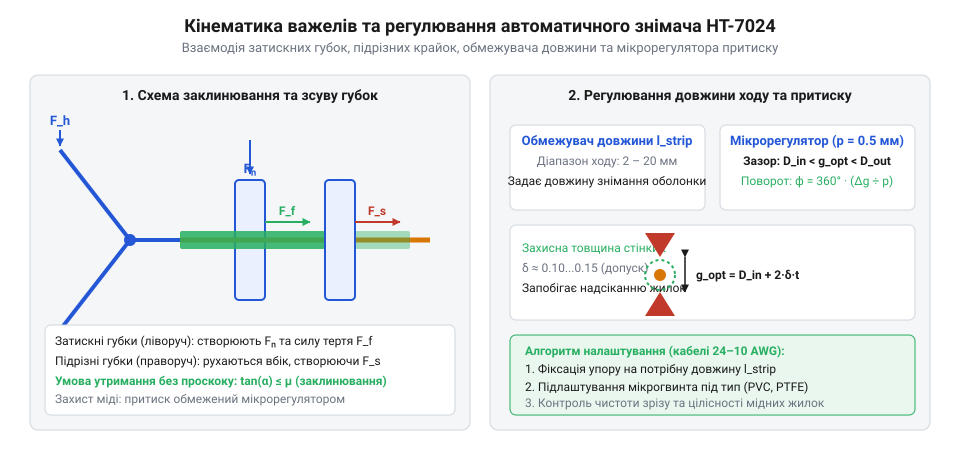

# Серійна підготовка кабельного джгута та опресування клем автоматичним знімачем

<preknowlist>
- [Обтискні кліщі (Dupont/JST)](root:cat-hw-instruments/crimp-tool) — Принцип формування механічного контакту клеми з зачищеною жилкою провідника.
- [Бокорізи](root:cat-hw-instruments/side-cutters) — Особливості точного зрізу оболонки та запобігання деформації мідних жилок перед зачищенням.
</preknowlist>

## Проблеми ручної підготовки та зачищення провідників

Виготовлення кабельних джгутів для мікроконтролерних модулів і планарних блоків вимагає масової підготовки провідників одинакової довжини з чисто зачищеними кінцями. Спроба обробляти багатожильний кабель [ручними бокорізами](root:cat-hw-instruments/side-cutters) або звичайним ножем призводить до двох типових видів браку: підрізання окремих мідних жилок та нестабільної довжини знятої оболонки. При підрізанні жилок зменшується робочий переріз провідника, а в місці надрізу виникає концентратор механічного напруження, що спричиняє відлам жилки при вібрації або вигинах джгута. Наприклад, якщо в 7-жильному провіднику перерізом 0.22 мм² (24 @@en|AWG@@) випадково підрізати 2 дрібні нитки, втрата сукупної площі перерізу становитиме `(2 ÷ 7) × 100% ≈ 28.6%`. Оскільки електричний опір обернено пропорційний площі перерізу `S`, локальний опір у місці пошкодження зростає на 40%, що за законом Джоуля — Ленца (`P = I² · R`) спричиняє пропорційне збільшення тепловиділення, деструкцію сусідньої ізоляції та прискорене окиснення металу під робочим струмовим навантаженням.

Нестабільність довжини зачищеної ділянки ускладнює наступні технологічні операції. Якщо зачистити занадто короткий фрагмент, провідник не ввійде на повну глибину обтискної гільзи, що знизить механічну міцність і збільшить контактний опір. Занадто довга зачищена ділянка залишає оголену мідь за межами захисного корпусу клеми, створюючи ризик короткого замикання на сусідні контакти. Коли використовуються [профільні обтискні кліщі](root:cat-hw-instruments/crimp-tool), відхилення в довжині зачищення на 1–2 мм робить неможливим одночасне якісне опресування як жильного, так і ізоляційного фіксатора клеми.

Серійне складання вимагає застосування спеціалізованого інструмента, який забезпечує автоматичне дозування глибини підрізання та фіксовану довжину ходу. Це виключає людський фактор, прискорює обробку кожного провідника до кількох секунд і гарантує абсолютну повторюваність параметрів у межах всієї партії кабельної продукції.

## Механізм дії та налаштування автоматичного знімача

Автоматичний знімач ізоляції (англ. @@en|wire stripper@@, від @@en|to strip@@ — зачищати, знімати оболонку) на прикладі моделі @@en|INTERTOOL HT-7024@@ працює за принципом розділення функцій фіксації та поздовжнього зсуву оболонки за один робочий хід рукояток. Його двоважільний кінематичний механізм складається з двох пар губок: ліві губки затискають зовнішню ізоляцію кабелю, а праві губки з вбудованими підрізними лезами підрізають оболонку та зсувають її вздовж мідної жили.

*Двоважільний кінематичний механізм знімача HT-7024 забезпечує фіксацію кабелю та зсув ізоляції за один робочий хід.*

Для адаптації інструмента під конкретний кабель використовуються два регулювальних елементи. Регулятор довжини зачищення є рухомим упором, який встановлює відстань від торця провідника до лінії зрізу в діапазоні від 5 до 15 мм. Мікрогвинт зусилля притиску регулює глибину занурення різальних кромок в оболонку відповідно до її механічної твердості та пружності. Тверда полівінілхлоридна ізоляція (ПВХ) вимагає закручування мікрогвинта за годинниковою стрілкою для створення достатнього зусилля підрізу. Натомість еластична силіконова оболонка легко деформується й розтягується під ніжками лез, через що надмірне притискання продавлює м'який пластик і надрізає мідні нитки — для силікону мікрогвинт послаблюють проти годинникової стрілки. Особливо складний фторопласт (політетрафторетилен, @@en|PTFE@@) через низький коефіцієнт тертя та високу щільність потребує прецизійного збігу глибини заглиблення леза з товщиною стінки: за недостатнього підрізу зсувні губки ковзають по тефлону, а за надмірного — підрізають жилу. Алгоритм налаштування полягає у виконанні пробних зрізів на відрізку кабелю: гвинт повністю послаблюють до ковзання губок, а потім послідовно повертають на 1/4 оберту за годинниковою стрілкою до досягнення чистого зсуву оболонки без жодного торкання мідного сердечника.

Налаштування інструмента для провідників перерізом 0.2–6.0 мм² (24–10 @@en|AWG@@, від @@en|American Wire Gauge@@ — американський калібр проводів) виконують на тестовому відрізку кабелю. Провідник вводять до упору в регулятор довжини та стискають рукоятки до повного спрацьовування механічного скидання. Якщо на зачищеній мідній жилі помітні надрізи або вирвані жилки, зусилля притиску зменшують обертанням мікрогвинта проти годинникової стрілки.

## Серійне зачищення та опресування клем джгута

Серійна підготовка кабельного джгута починається з розкрою провідників необхідної довжини за допомогою вбудованого кабелеріза у внутрішній частині рукояток @@en|INTERTOOL HT-7024@@. Завдяки загартованим різальним кромкам кабелеріз виконує чистий перпендикулярний зріз без сплющування та розпушування мідного сердечника. Після цього оператор виставляє регулятор довжини зачищення відповідно до глибини обтискного бар'єра обраних клем (наприклад, 6 мм для наконечників NSHVI або клем типів Dupont і JST).

Операція зачищення виконується в один рух: провідник позиціонується в губках до контактного упору, після чого рукоятки повністю стискаються. Вбудована поворотна пружина миттєво повертає важільно-зубчастий механізм у вихідний стан після зсуву ізоляційного дампу. Повторюваність цієї процедури дає змогу зачищати десятки провідників за хвилину із суворим дотриманням розмірних допусків.

Після зачищення ізольованих кінців виконується опресування (від англійського *to crimp* — «обтискати, загинати»; @@en|crimp@@) клем за допомогою обтискних матриць, інтегрованих у рукоятку інструмента @@en|INTERTOOL HT-7024@@, або спеціалізованих [обтискних кліщів](root:cat-hw-instruments/crimp-tool). Зачищена жила вставляється в хвостовик клеми та затискається у відповідному профільному гнізді (0.5–1.0, 1.5–2.5 або 4.0–6.0 мм²). Механіка якісного з'єднання спирається на геометрію двозонного B-подібного обтиску (від англійського *B-crimp*; @@en|B-crimp@@): жильний фіксатор під тиском матриці симетрично загинає металеві пелюстки всередину пучка, вдавлюючи їх у центр мідних волокон і створюючи газонепроникне холодне зварювання з мінімальним перехідним опором, тоді як ізоляційний фіксатор охоплює захисну оболонку дроту для розвантаження від механічних натягів і вібрацій. Якщо технологічний процес вимагає монтажу під паяння, замість опресування кінці провідників обробляють [безвідмивним флюсом FVS-7](root:cat-hw-instruments/flux-fvs7) і лудять [якісним припоєм](root:cat-hw-instruments/solder-tin) за допомогою [компактного паяльника](root:cat-hw-instruments/usb-soldering-iron), після чого захищають контакт [термоусадковою трубкою](root:cat-hw-instruments/heat-shrink-tubing), усадженою [термофеном BAKU](root:cat-hw-instruments/hot-air-station-baku).

## Контроль якості та обслуговування автоматичного знімача

Контроль якості підготовлених провідників охоплює візуальну перевірку геометричних параметрів та механічне випробування на розрив. При візуальному огляді під збільшенням перевіряють відсутність надрізаних або зрізаних мідних жилок, рівність зрізу оболонки без розривів та відсутність залишкових волокон ізоляції на металевій поверхні. Для опресованих клем перевіряють заходження жилавого пучка на всю довжину контактного гнізда та надійність охоплення зовнішньої ізоляції фіксувальними вусиками.

Механічний контроль виконують шляхом контрольного прикладного зусилля на висмикування (від англійського *pull-off force*; @@en|pull-off force@@) провідника з опресованої клеми, випробування якої проводять [обтискними кліщами](root:cat-hw-instruments/crimp-tool) або розривним динамометром. Зачищена жила повинна витримувати нормативне натяжне зусилля без вимикання з обтискного бар'єра та без ковзання всередині металевої гільзи. Згідно з міжнародним стандартом IEC 60352-2, мінімально припустиме зусилля висмикування суворо нормується залежно від перерізу провідника: для тонкого дроту перерізом 0.22 мм² воно становить не менше 28 Н, для 0.5 мм² — 60 Н, для 1.5 мм² зростає до 150 Н, а для максимального перерізу 6.0 мм² досягає 360 Н. Виявлення дефектів або передчасне висмикування жили при менших навантаженнях свідчить про некоректне налаштування регулятора притиску знімача, розпушування мідних волокон або невідповідність калібру клеми перерізу кабелю.

Довговічність та точність роботи @@en|INTERTOOL HT-7024@@ залежать від регулярного технічного обслуговування. Притискні зубчасті губки необхідно періодично очищати від залишків зрізаного пластику та металевої пилюки за допомогою жорсткої пластикової щітки. Шарнірні з'єднання важелів та поворотну пружину змащують кількома краплями машинного масла через кожні 5000 циклів спрацьовування, щоб запобігти заклинюванню механізму та зберегти плавність ходу.
