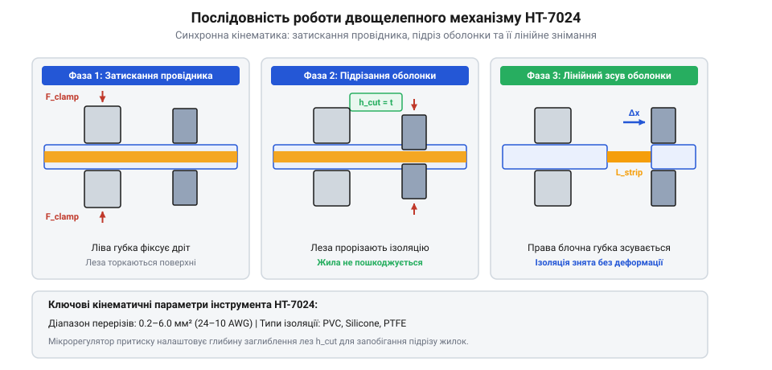
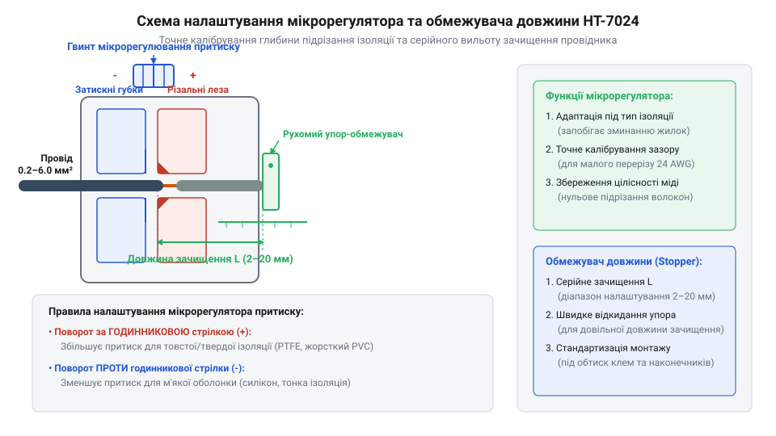

# Знімач ізоляції автоматичний (INTERTOOL HT-7024)

<preknowlist>
- [Бокорізи](root:cat-hw-instruments/side-cutters) — різниця між ручним механічним підрізом та автоматичним зсувом ізоляції
- [Обтискні кліщі (Dupont/JST)](root:cat-hw-instruments/crimp-tool) — геометрія й типи клем для опресування
</preknowlist>

## Пошкодження жилок при ручному зачищенні

Під час монтажу вбудованої електроніки та силового оснащення найпоширенішою технологічною операцією є оголення струмоведучих жил перед паянням або опресуванням. Спроба зачистити кабель монтерським ножем або використати ручні @@en|бокорізи@@ ([механічне підрізання бокорізами](root:cat-hw-instruments/side-cutters)) неминуче супроводжується ризиком випадкового надрізання або вищипування окремих мідних волокон у [багатожильних мідних провідниках](root:hw-components/solid-vs-stranded-copper-conductors). Навіть непомітна мікрокарбувальна насічка на поверхні міді створює локальний @@en|концентратор напружень@@ (лат. @@la|concentratio@@ — зосередження). За наявності надрізу глибиною `a` та радіуса кромки `r_tip` коефіцієнт концентрації напружень `K_t` (від англійського *stress concentration factor*; `@@en|stress concentration factor@@`) різко зростає відносно номінального згинального напруження `σ_ном`:

```
K_t = 1 + 2 · √(a ÷ r_tip)            [коефіцієнт концентрації напружень у вершині надрізу]
```

Для мікронасічки глибиною `a = 0.05 мм` із радіусом вершини `r_tip = 0.005 мм` обчислення дає:

```
K_t = 1 + 2 · √(0.05 ÷ 0.005)
= 1 + 2 · √10                          [відношення глибини до радіуса заокруглення]
≈ 7.32                                 [підсумковий коефіцієнт підсилення напруження]
```

Підсилення локального напруження у 7.3 раза перевищує межу текучості міді `σ_yield ≈ 100 МПа`, що призводить до пластичної деформації металу біля вершини тріщини. При вібраціях або повторюваних вигинах джгута у цій локальній зоні накопичуються дислокаційні зсуви, прискорюючи зародження та розповсюдження втомних тріщин (від англійського *fatigue failure*; `@@en|fatigue failure@@`). У результаті ресурс витривалості провідника піддається механічній втомі та падає в сотні разів, викликаючи раптовий злам жили саме в місці надрізу.

Зменшення ефективної площі поперечного перерізу провідника через пошкодження частинок жилок спричиняє пропорційне зростання електричного опору `R` та локальної щільності струму `j`. Якщо у багатожильному кабелі номінальним перерізом `S₀ = 0.5 мм²` із 19 тонких мідних волокон під час ручного підрізання зрізано 3 волокна (`n = 16`), залишковий переріз становить `S = S₀ · (16 ÷ 19) = 0.421 мм²`. При проходженні робочого струму `I = 3 А` зміна щільності струму визначається так:

```
j₀ = I ÷ S₀
= 3 ÷ 0.5                      [ділення струму на початковий переріз]
= 6.00 А/мм²                   [початкова щільність струму]

j = I ÷ S
= 3 ÷ 0.421                    [ділення струму на залишковий переріз]
= 7.13 А/мм²                   [збільшена щільність струму]
```

Зростання щільності струму на 18.8% викликає підвищення виділення питомої теплової потужності `p = j² · ρ` у місці пошкодження на 41.2%, оскільки `(7.13 ÷ 6.00)² ≈ 1.412`. Одночасно шар полімерної ізоляції з товщиною стінки `t_ins` чинить тепловий опір `R_th` відведенню тепла в навколишнє середовище, який залежить від теплопровідності полівінілхлориду `λ_pvc ≈ 0.17 Вт/(м·К)` та відношення зовнішнього радіуса `r_out` до радіуса жили `r_in`:

```
R_th = ln((r_in + t_ins) ÷ r_in) ÷ (2 · π · λ_pvc)            [питомий тепловий опір шару ізоляції]
```

Для товщини ізоляції `t_ins = 0.50 мм` високий тепловий опір `R_th` затримує відведення тепла від звуженої ділянки жили, внаслідок чого температура металу швидко долає термодеструкційний поріг пластифікованого полівінілхлориду (@@en|PVC@@) `T_deg = 70 °C`. Перевищення цієї межі спричиняє термоокислювальну деструкцію полімеру з виділенням хлороводню, розм'якшенням ізоляційного шару та виникненням пожежонебезпечного пробою.

j₀ = I ÷ S₀
= 3 ÷ 0.5                      [ділення струму на початковий переріз]
= 6.00 А/мм²                   [початкова щільність струму]

j = I ÷ S
= 3 ÷ 0.421                    [ділення струму на залишковий переріз]
= 7.13 А/мм²                   [збільшена щільність струму]

Зростання щільності струму на 18.8% викликає підвищення виділення питомої теплової потужності `p = j² · ρ` у місці пошкодження на 41.2%, оскільки `(7.13 ÷ 6.00)² ≈ 1.412`. Це призводить до локального перегріву контактної зони понад допустиму норму `70 °C`, термодеструкції полімерної ізоляції (@@en|PVC@@), прискореного окислення міді та пожежонебезпечного пробою.

Історично еволюція інструментів для зняття ізоляції пройшла шлях від звичайних ножиць і ручних зачищувальних кусачок із фіксованими пазами до напівавтоматичних та автоматичних кінематичних кліщів. Висока трудомісткість, ручне центрування та людський фактор при роботі з ручними зачищувачами спонукали розробку двощелепних механізмів із самоналаштовуванням під діаметр провідника. Удосконалення притискних губок, підпружинених лез та важелів дозволило повністю виключити залежність глибини надрізу від досвіду оператора й автоматизувати серійне знімання ізоляції в промисловості.

Саме принциповий поділ функцій затискання та лінійного зсуву дозволив автоматичним @@en|стриперам@@ (англ. @@en|stripper@@, від @@en|strip@@ — здирати) досягти бездоганної чистоти зачищення без потреби підбирати прецизійні калібровані отвори під кожен @@en|gauge@@. На відміну від кусачок, де оператор власноруч дозує зусилля і ризикує підрізати струмоведучі жили, автоматичний інструмент фіксує кабель рифленими притискними губками, після чого підпружинені ножі підрізають виключно шар [ізоляційного матеріалу](root:hw-components/wire-insulation) і зсувають його уздовж поздовжньої осі провідника. Такий кінематичний розв'язок гарантує цілісність найдрібніших волокон міді та забезпечує стабільну якість підготовки дротів при монтажі складних схем.

## Двощелепний кінематичний механізм INTERTOOL HT-7024

Автоматичний @@en|стрипер@@ (англ. @@en|strip@@ — знімати оболонку) @@en|INTERTOOL HT-7024@@ вирішує проблему пошкодження жилок завдяки використанню двощелепного кінематичного механізму. Внутрішня геометрія лез та специфікація рухомого блоку детально подані у довіднику [специфікація та кінематика HT-7024](root:cat-hw-instruments/wire-stripper/api-ht7024-spec-and-blade-geometry.md).

Принцип дії інструмента базується на узгодженій кінематичній взаємодії двох пар підпружинених губок, шарнірного передавального важеля та потужної повертальної пружини. При стисканні рукояток первинне зусилля оператора `F_hand = 100 H` через центральну вісь передається на рухомий кулісно-важільний механізм. Математичний розрахунок передавального відношення механізму `i_mech` та розподілу притискного зусилля затискних губок `F_clamp` і поздовжнього зусилля зсуву `F_strip` при плечах рукоятки `L_handle = 120 мм` та шарніра `L_pivot = 20 мм` виконують за покроковим розрахунком:

```
i_mech = L_handle ÷ L_pivot
       = 120 ÷ 20                    [відношення плеча рукоятки до плеча шарніра]
       = 6.0                         [передавальне відношення кулісного важеля]

F_clamp = F_hand × i_mech
        = 100 × 6.0                  [множення зусилля руки на передавальне відношення]
        = 600 N                      [сумарне притискне зусилля лівих губок у ньютонах]

F_strip = F_clamp × tan(α)
        = 600 × 0.25                 [розподіл зусилля на зсувну групу при куті шарніра α = 14°]
        = 150 N                      [поздовжнє зусилля надрізання та зсуву ізоляції у ньютонах]
```

Для запобігання поздовжньому проковзуванню кабелю при зусиллі зсуву `F_strip = 150 N` ліва пара притискних щелеп (англ. @@en|clamping jaws@@) має клиноподібний пилоподібний профіль засічок із кроком зубців `p_tooth = 1.0 мм` та кутом загострення `β = 60°`. Під дією нормального зусилля `F_clamp = 600 N` вершини зубців утискаються в полімерну оболонку на глибину `h_pen ≈ 0.15 мм`, утворюючи механічне формове зачеплення. Гранична сила утримання `F_hold` визначається зсувною міцністю затиснутого полімеру `τ_shear ≈ 10 МПа` та ефективною площею зсуву `S_shear`:

```
F_hold = S_shear × τ_shear
       = 25.0 × 10                   [множення площі зачеплення 25.0 мм² на зсувну міцність полімеру 10 МПа]
       = 250 N                       [гранична сила утримання оболонки від проковзування]
```

Оскільки гранична сила зачеплення `F_hold = 250 N` перевищує необхідне зусилля зсуву `F_strip = 150 N`, кабель надійно фіксується без поздовжнього проковзування та без продавлювання провідних жил.

```
i_mech = L_handle ÷ L_pivot
       = 120 ÷ 20                    [відношення плеча рукоятки до плеча шарніра]
       = 6.0                         [передавальне відношення кулісного важеля]

F_clamp = F_hand × i_mech
        = 100 × 6.0                  [множення зусилля руки на передавальне відношення]
        = 600 N                      [сумарне притискне зусилля лівих губок у ньютонах]

F_strip = F_clamp × tan(α)
        = 600 × 0.25                 [розподіл зусилля на зсувну групу при куті шарніра α = 14°]
        = 150 N                      [поздовжнє зусилля надрізання та зсуву ізоляції у ньютонах]
```

На першому етапі важіль із передавальним відношенням `i_mech = 6.0` долає початковий опір пружини й стискає ліві затискні губки зусиллям `F_clamp = 600 H`, надійно фіксуючи кабель. Після досягнення граничного притиску подальший рух важеля перерозподіляє механічний момент на праву різально-зсувну групу, створюючи поздовжнє зусилля `F_strip = 150 H`, яке змушує леза надрізати оболонку й лінійно відсувати її праворуч. Під час всього робочого ходу повертальна пружина акумулює потенціальну енергію деформації, що дозволяє після відпускання рукояток миттєво повернути шарнірні важелі та щелепи у вихідне розтиснуте положення для наступного циклу зачищення.

1. **Фіксація провідника**: Ліва пара рифлених притискних щелеп затискає зовнішню ізоляційну оболонку кабелю дрібними засічками, утримуючи його непорушно.
2. **Підрізання ізоляції**: Права пара підпружинених лез змикається та надрізає оболонку точно на глибину її товщини, не торкаючись мідного осердя.
3. **Лінійний зсув**: Завдяки шарнірно-важільному передавальному відношенню права щелепа автоматично відсувається праворуч уздовж осі провідника, скидаючи надрізаний фрагмент ізоляції.


*Послідовність роботи двощелепного механізму автоматичного стрипера від фіксації кабелю до зсуву відрізаної ізоляційної оболонки.*

Фізико-математичний розрахунок кінематики важелів та розподілу зусиль підрізання й зсуву описано в матеріалі [кінематика важелів та розрахунок зусилля зсуву](root:cat-hw-instruments/wire-stripper/math-wire-stripping-kinematics-and-shear-force.md). Автоматичне підлаштування дає змогу працювати з провідниками перерізом від `0.2 мм²` до `6.0 мм²` (діапазон `24–10 AWG`).

## Налаштування мікрорегулятора зусилля та обмежувача

Різні [ізоляційні матеріали провідників: PVC, силікон, PTFE](root:hw-components/wire-insulation) володіють різною твердістю й еластичністю. Для м'яких силіконових оболонок високе зусилля надрізу може спричинити проминання ізоляції без зсуву, тоді як для жорсткого фторопласту (@@en|PTFE@@) недостатнє зусилля призведе до проковзування різальних крайок.

Інструмент @@la|INTERTOOL HT-7024@@ оснащено поворотним мікрогвинтом регулювання притиску:
- Обертання за годинниковою стрілкою (знак `+`) збільшує глибину занурення ножів для тонкої або твердої ізоляції.
- Обертання проти годинникової стрілки (знак `-`) зменшує зусилля для м'яких еластомерних матеріалів.

Для досягнення стабільної довжини оголеної ділянки жили при підготовці проводів під опресування [накінечників та клем](root:cat-hw-instruments/wire-terminals-and-crimp-connectors) застосовують позиційний пластиковий обмежувач. Встановлення упору на необхідну позначку `L_set` у діапазоні `5–15 мм` гарантує базову геометричну орієнтацію заготовки. Проте під час темпової серійної роботи динамічний удар торця провідника об пластиковий платик викликає поздовжнє відхилення через пружну деформацію матеріалу та механічний люфт напрямної. При імпульсному зусиллі подачі `F_feed = 8.0 Н`, жорсткості консольного упору `k_stop = 16.0 Н/мм` та люфті слайдера `ΔL_play = 0.3 мм` сумарна похибка поздовжнього позиціювання `ΔL_total` обчислюється як сума пружного відгину `ΔL_flex` і люфту:

```
ΔL_flex = F_feed ÷ k_stop
= 8.0 ÷ 16.0             [підстановка ударного зусилля 8.0 Н та жорсткості упору 16.0 Н/мм]
= 0.5                    [пружний відгин обмежувача в міліметрах]

ΔL_total = ΔL_play + ΔL_flex
= 0.3 + 0.5              [додавання люфту напрямної 0.3 мм та пружної деформації]
= 0.8                    [базове механічне відхилення у міліметрах]
```

Додатковим чинником зсуву розкрою під час тривалої роботи є температурне розширення полімерного упору довжиною `L_stop = 20.0 мм`. Оскільки коефіцієнт лінійного розширення ABS-пластику `α_therm ≈ 90 · 10⁻⁶ K⁻¹` у вісім разів перевищує показник сталі, при підвищенні температури інструмента в долонях або виробничому приміщенні на `ΔT = 25 °C` додатковий температурний розширювальний зсув `ΔL_temp` становить:

```
ΔL_temp = L_stop × α_therm × ΔT
= 20.0 × (90 · 10⁻⁶) × 25  [підстановка довжини упору 20 мм та перепаду температури 25 °C]
= 0.045 мм               [температурне видовження полімерного стопора]
```

З урахуванням температурного зміщення підсумкова похибка поздовжнього позиціювання зростає до `ΔL_total = 0.3 + 0.5 + 0.045 = 0.845 мм` (розкидання довжини `L_actual = 10.0 ± 0.85 мм`). Це вимагає від оператора періодичного контролю температури інструмента та плавного підведення провідника до стопора без ударного навантаження.

```
ΔL_flex = F_feed ÷ k_stop
= 8.0 ÷ 16.0             [підстановка ударного зусилля 8.0 Н та жорсткості упору 16.0 Н/мм]
= 0.5                    [пружний відгин обмежувача в міліметрах]

ΔL_total = ΔL_play + ΔL_flex
= 0.3 + 0.5              [додавання люфту напрямної 0.3 мм та пружної деформації]
= 0.8                    [підсумкове відхилення довжини зачищення у міліметрах]
```

Через результуюче розкидання довжини оголеного кінця `L_actual = 10.0 ± 0.8 мм` реальний розмір зачищення може виходити за межі допуску трубчастих гільз, що вимагає від оператора плавного доведення провідника до упору без сильних ривків для збереження прецизійності розміру.


*Розташування обертового мікрорегулятора притискного зусилля лез та налаштування позиційного обмежувача довжини зачищення дротів.*

Детальний алгоритм серійної підготовки джгута та монтажу клем подано в практичному посібнику [серійна підготовка кабельного джгута та опресування клем](root:cat-hw-instruments/wire-stripper/proj-wire-stripper-harness-preparation.md).

Кінематично глибина занурення різальних крайок `h_cut` лінійно залежить від кута повороту різьбового мікрогвинта `α`. Обертання регулятора переміщує упорну клинову втулку вздовж дрібної метричної різьби з кроком `P = 0.5 мм`. Завдяки передаточному відношенню важільного механізму щелеп `k_lever ≈ 0.4`, зміна глибини підрізу описується пропорцією `Δh_cut = (α ÷ 360°) · P · k_lever`. Повний оборот гвинта на `360°` змінює заглиблення ножа на `0.20 мм`, а точна повертнева корекція на чверть оберту (`90°`) зсуває леза лише на `0.05 мм`. Такий дрібний крок налаштування дозволяє плавно підігнати зазор під товщину оболонки, запобігаючи пошкодженню тонких жил, коли підготовці піддаються [багатожильні мідні провідники](root:hw-components/solid-vs-stranded-copper-conductors).

## Вбудований кабелеріз та прес-кліщі клем

Окрім основного механізму зачищення, автоматичний стрипер @@la|INTERTOOL HT-7024@@ об'єднує в собі додатковий функціонал для повного циклу підготовки дротів. У внутрішній зоні шарнірного вузла рукояток інтегровано прецизійний кабелеріз гільйотинного типу. Завдяки загартованому різальному блоку він забезпечує перпендикулярний чистий зріз [одножильних та багатожильних мідних провідників](root:hw-components/solid-vs-stranded-copper-conductors) та алюмінієвих дротів перерізом від `0.2 мм²` до `6.0 мм²`. На відміну від роздавлювання бокорізами, гільйотинний зріз не деформує геометричну форму жили та запобігає розплітанню волокон.

У нижній частини двокомпонентних рукояток розміщено профільовані матриці для опресування (англ. @@en|crimp@@ — обтискати) популярних [накінечників та клем](root:cat-hw-instruments/wire-terminals-and-crimp-connectors):
- **Ізольовані наконечники**: трьохколірна матриця з овально-точковим профілем обтискання для стандартизованих клем червоного (`0.5–1.5 мм²` / `22–16 AWG`), синього (`1.5–2.5 мм²` / `16–14 AWG`) та жовтого (`4.0–6.0 мм²` / `12–10 AWG`) маркування.
- **Неізольовані наконечники**: універсальне клинчасте прес-гніздо для відкритих і трубчастих латунних та мідних контактів перерізом `0.5–6.0 мм²`.
- **Автомобільні клеми запалювання**: профільований паз під кільцеве опресування високовольтних дротів системи запалювання діаметром `7–8 мм`.

Геометрія профілю обтискних губок розрахована на пластичну деформацію металевої хвостової гільзи клеми спільно з мідними жилами для утворення суцільного газонепроникного контакту. Для повного руйнування поверхневих оксидних плівок і холодного зварювання мікроконтактів необхідний контактний тиск деформації має досягати `p_crimp ≥ 300 Н/мм²`. При ефективній проекційній площі матриці `A_die = 12 мм²` необхідне пікове зусилля стискання губок `F_jaw` становить:

```
F_jaw = p_crimp × A_die
= 300 × 12                            [множення контактного тиску 300 Н/мм² на площу матриці 12 мм²]
= 3600 Н                              [необхідне обтискне зусилля (3.6 кН / 367 кгс)]
```

Такий тиск забезпечує ущільнення жил до `85–90%` від щільності суцільної міді, усуваючи міжжильні повітряні зазори. Підсумкова сила утримання провідника у хвостовику після опресування (від англійського *pull-out force*; `@@en|pull-out force@@`, `F_pull`) визначається межею текучості деформованого металу `σ_yield ≈ 120 Н/мм²` та ефективною площею зсуву `S_contact`. Для мідного провідника перерізом `S = 1.5 мм²` мінімально необхідне зусилля виривання становить:

```
F_pull = σ_yield × S_contact
= 120 × 1.5              [множення межі текучості деформованої гільзи 120 Н/мм² на переріз жили 1.5 мм²]
= 180                    [порогова сила виривання провідника у ньютонах (180 Н / 18.3 кгс)]
```

Проте через відсутність у важелях рукояток апаратного хропового механізму повне змикання матриць залежить від фізичного зусилля руки оператора. Неповний стиск губок (зменшення глибини деформації всього на `0.2 мм`) призводить до збереження мікрозазорів між жилами, що знижує силу виривання до `F_pull < 60 Н` та спричиняє зростання перехідного опору контакту з загрозою локального перегріву під навантаженням.

Хоча вбудовані матриці задовольняють більшість монтажних потреб, порівняно зі спеціалізованим інструментом, таким як [обтискні кліщі Dupont/JST](root:cat-hw-instruments/crimp-tool), вони не мають храпового механізму контролю повного циклу опресування.

З цієї причини вбудований обтискний блок оптимально підходить для експрес-монтажу, польового ремонту та побутових робіт, де пріоритетом є швидкість підготовки кабелю без постійної зміни інструментів. Для відповідальних силових кіл, авіоніки та промислової автоматики рекомендують застосовувати спеціалізовані прес-кліщі із хроповим блокуванням, яке не дозволяє розтулити рукоятки до досягнення повного обтискного профілю. При використанні ж комбінованого стрипера оператор має контролювати доведення важелів до упору вручну, візуально перевіряючи відсутність люфту жильних жилок у клемному хвостовику.

## Типові помилки, безпека та обслуговування

Тривала та безвідмовна експлуатація стрипера @@la|INTERTOOL HT-7024@@ залежить від дотримання технологічних обмежень матеріалів та правильного догляду за кінематикою.

Найпоширенішою помилкою, що призводить до негайного виходу інструмента з ладу, є спроба різання або зачищення сталевих провідників, сталевого бронепокриття кабелів чи загартованих цвяхів. Леза та затискні щелепи розраховані виключно на м'які кольорові метали. Фізико-механічною причиною негайного пошкодження лез є локальна концентрація контактних напружень: леза інструмента із гартованої інструментальної сталі (твердість `52–56 HRC`) мають низьку ударну в'язкість. При контакті зі сталевою жилою високої твердості площа опирання надгострої кромки є мікроскопічною, через що контактне напруження `σ_local` миттєво перевищує межу міцності матеріалу на зсув та сколювання (`σ_local > σ_ult`). Замість пластичної деформації у структурі леза виникає крихке руйнування (`@@en|brittle fracture@@`) з викришенням фрагментів сталі вздовж лінії зрізу. Таке викришення створює зазубрини й незворотну деформацію важелів, після чого леза втрачають здатність прорізати полімерну ізоляцію. Критерієм граничного зносу лез є поява закруглення різальної кромки з радіусом `r_edge > 0.05 мм` або зазубрин глибиною понад `0.1 мм`, при яких зачищувальні губки не надрізають оболонку, а розминають її з заминанням жильних волокон. Огляд механізму передбачає перевірку поперечного люфту осей шарнірного паралелограма: збільшення зазору між затискними та підрізними щелепами понад `0.3 мм` призводить до перекосу лез, через що різальні крайки заходять одна на одну зі скошуванням лінії зрізу та підклинюванням пружинного повернення.

Важливим аспектом безпеки є пам'ятати, що двокомпонентне пластикове покриття рукояток виконане для забезпечення зручного хвату та не має електроізоляційного сертифіката (відсутнє маркування @@en|VDE@@ / `1000V`). Будь-які маніпуляції дозволяється проводити виключно на знеструмленому обладнанні.

Обслуговування інструмента полягає у регулярному чищенні затискних губок та лез від залишків полімерної стружки після роботи з м'якими силіконовими оболонами. Для збереження плавності ходу та запобігання підклинюванню при поверненні щелеп рекомендується періодично змащувати шарнірні осі та поворотні пружини краплею нейтральної машинного масла.
