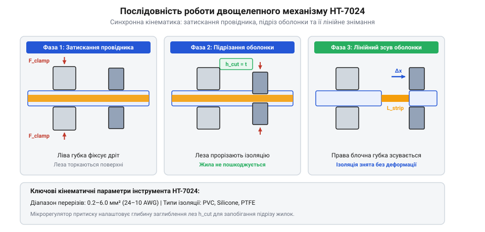
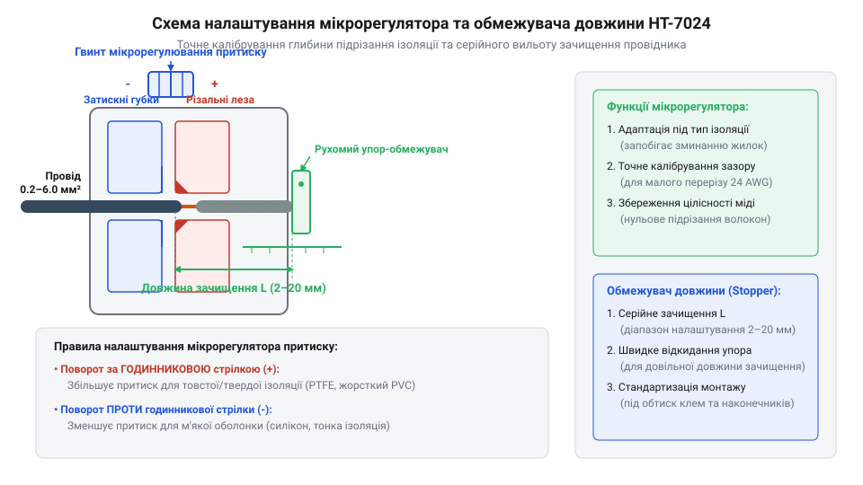

# Знімач ізоляції автоматичний (INTERTOOL HT-7024)

<preknowlist>
- [Бокорізи](root:cat-hw-instruments/side-cutters) — різниця між ручним підрізанням та автоматичним зсувом оболонки
- [Обтискні кліщі (Dupont/JST)](root:cat-hw-instruments/crimp-tool) — призначення та види опресування контактних клем
</preknowlist>

## Ризики ручного зачищення провідників

Видалення полімерної оболонки з електричного кабелю за допомогою звичайного монтажного ножа або [бокорізів](root:cat-hw-instruments/side-cutters) неминуче супроводжується ризиком надрізання струмопровідної жили. Коли різальна кромка торкається міді, на поверхні дроту утворюється кільцева карбування, яка виконує роль @@en|концентратора напружень@@ (англ. *stress concentrator*). У багатожильних провідниках це спричиняє вищипування та підрізання окремих тонких волокон, що зменшує фактичний поперечний переріз міді.

Зменшення робочого перерізу провідника призводить до двох негативних наслідків:
- **Локальний перегрів**: у пошкодженій зоні зростає електричний опір, що викликає додаткове виділення тепла за законом Джоуля — Ленца під навантаженням.
- **Втомне руйнування**: під дією експлуатаційних вібрацій надрізані жилки швидко ламаються в точці концентрації напружень, створюючи прихований обрив кола.

Уникнути пошкодження мідного осердя дозволяє автоматизація процесу затискання й зсуву оболонки.

## Двощелепний механізм та принцип дії

Автоматичний @@en|стрипер@@ (англ. *stripper*, від *strip* — знімати шар) INTERTOOL HT-7024 вирішує проблему безпечного оголення жил завдяки двощелепному кінематичному механізму. В інструменті функцію утримання кабелю та функцію зсуву ізоляції розділено між двома парами підпружинених губок.

*Схема послідовного спрацьовування затискних та підрізних губок двощелепного стрипера.*

Під час стискання рукояток механізм працює у два послідовні етапи:
1. **Фіксація**: ліві рифлені губки міцно затискають зовнішню оболонку провідника без її деформації.
2. **Підрізання та зсув**: праві підрізні ножі врізаються у полімер на регульовану глибину й рухаються вбік, стягуючи зрізаний циліндр уздовж жили.

Інструмент розрахований на роботу з провідниками перерізом від `0.2 до 6.0 мм²` (від `24 до 10 AWG`), забезпечуючи однакове чистове зачищення як монолітних, так і гнучких багатожильних дротів.

## Налаштування мікрорегулятора та обмежувача довжини

Точне підлаштування інструмента під фізичні властивості матеріалу оболонки виконується за допомогою двох органів регулювання. @@en|мікрорегулятор@@ (англ. *micro-adjuster*, від грец. *mikros* — малий та лат. *regulare* — впорядковувати) змінює зазор між різальними крайками для компенсації товщини стінки.

*Розміщення позиційного обмежувача довжини та поворотного мікрогвинта притиску.*

Порядок налаштування робочих параметрів включає два кроки:
- **Встановлення довжини**: рухомий пластиковий обмежувач виставляють за шкалою на необхідну довжину оголення жили `l_strip` у діапазоні від `5 до 15 мм`.
- **Регулювання притиску**: поворот мікрогвинта за годинниковою стрілкою збільшує врізання ножів для твердого полівінілхлориду (ПВХ) чи тефлону, а поворот проти стрілки зменшує зусилля для м'якого силікону.

Правильне регулювання забезпечує повне підрізання ізоляційного шару без торкання поверхні мідних жилок.

## Додатковий функціонал, безпека та обслуговування

Крім зачищення оболонки, стрипер HT-7024 оснащений вбудованим гільйотинним кабелерізом біля основи рукояток та профільованими матрицями. Матриці виконують @@en|опресування@@ (англ. *crimping*) ізольованих і неізольованих клем перерізом `0.5–6.0 мм²`, виконуючи частину функцій спеціалізованих [обтискних кліщів](root:cat-hw-instruments/crimp-tool).

Під час експлуатації слід дотримуватися суворих правил безпеки:
- **Заборона роботи під напругою**: інструмент не має діелектричної ізоляції рукояток і призначений лише для знеструмлених мереж.
- **Обмеження матеріалів**: заборонено різати сталевий дріт, саморізи та броньовані кабелі для запобігання викрошуванню крайок.

Технічне обслуговування полягає у регулярному очищенні рифлених затискних губок від стружки та нанесенні мастила на шарніри механізму.
