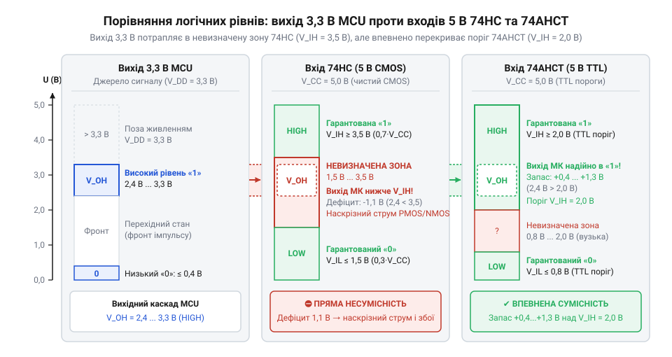
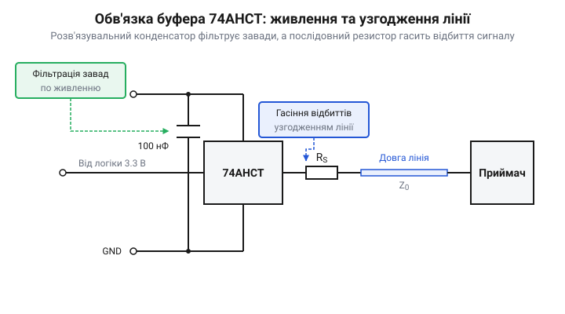
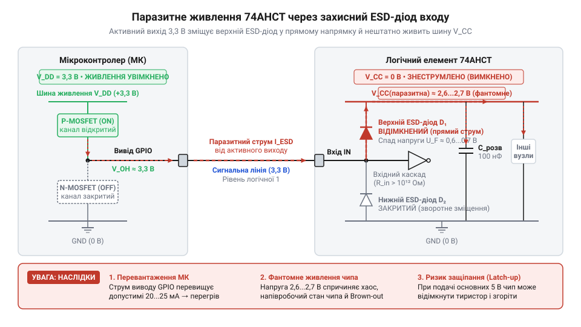
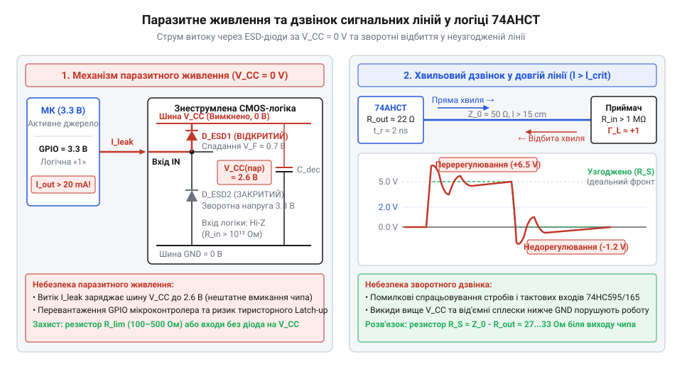

# Логіка серії 74AHCT у системній схемотехніці

<preknowlist>
- [Буфер із трьома станами виходу 74LVC1G125](root:cat-hw-parts/logic-buffer-74lvc1g125) — принцип буферизації сигналів та керування виводом у високоімпедансному стані (Hi-Z)
- [Перетворювач логічних рівнів](root:cat-hw-parts/logic-level-converter) — загальні принципи та проблеми узгодження цифрових сигналів між різними напругами живлення
</preknowlist>

## Конфлікт цифрових рівнів у змішаних системах

Сучасна цифрова схемотехніка систематично зіштовхується з ситуацією, коли на одній друкованій платі співіснують компоненти з різною робочою напругою живлення. Усі актуальні мікроконтролери та обчислювальні ядра, як-от @@en|ARM Cortex@@, @@en|ESP32@@, @@en|RP2040@@ чи @@en|STM32@@, виготовляються за глибоко субмікронними напівпровідниковими технологіями й живляться від напруги 3,3 В (або навіть 1,8 В чи 1,2 В). Водночас значний масив периферійних пристроїв — силові релейні модулі, покажчики на рідких кристалах, ультразвукові давачі, світлодіодні стрічки @@en|WS2812B@@ та класичні цифрові мікросхеми розширення — продовжує вимагати стандартного 5-вольтового живлення. Спроба безпосередньо з'єднати цифровий вихід 3,3-вольтового мікроконтролера з цифровим входом 5-вольтового пристрою спричиняє прихований конфлікт електричних рівнів, який руйнує надійність роботи цифрового вузла.

Суть проблеми полягає в електричній розбіжності між напругою, яку здатний видати вихідний каскад мікроконтролера, та напругою, яку вимагає вхідний каскад 5-вольтової периферії для безпомилкового визначення логічної одиниці. Коли вивід @@en|GPIO@@ (від @@en|General-Purpose Input/Output@@ — цифровий вивід загального призначення) 3,3-вольтового мікроконтролера переводиться у стан логічної одиниці, його двотактний (@@en|push-pull@@) вихідний каскад підключає вивід до внутрішньої шини живлення `V_DD` через відкритий канал верхнього p-канального польового транзистора (@@en|PMOS@@). Через наявність залишкового опору каналу `R_DS(on)` та струмове навантаження вихідна напруга високого рівня `V_OH` (від @@en|Voltage Output High@@) завжди нижча за напругу живлення `V_DD`. Для більшості мікроконтролерів при живленні `V_DD = 3.3 V` гарантована виробником мінімальна вихідна напруга `V_OH_min` становить лише від 2,4 В до 2,9 В залежно від струму навантаження.

З іншого боку, класична 5-вольтова логіка родини @@en|74HC@@ (від @@en|High-Speed CMOS@@ — високошвидкісна комплементарна логіка на метал-оксид-напівпровідниках, де «complementary» означає комплементарність p- та n-канальних транзисторів) побудована на симетричних вхідних каскадах на @@en|MOSFET@@-транзисторах (від @@en|Metal-Oxide-Semiconductor Field-Effect Transistor@@ — польовий транзистор із ізольованим затвором). Вхідні порогові напруги таких мікросхем жорстко прив'язані до їхньої власної напруги живлення `V_CC`. Щоб 5-вольтова мікросхема серії @@en|74HC@@, як-от [зсувний регістр 74HC595](root:cat-hw-parts/74hc595) або [дешифратор 74HC138](root:cat-hw-parts/74hc138), гарантовано розпізнала на своєму вході логічну одиницю, вхідна напруга має перевищувати мінімальний поріг `V_IH_min` (від @@en|Voltage Input High@@). Для серії @@en|74HC@@ цей поріг обчислюється за прямим співвідношенням:

V_IH_min = 0.7 × V_CC
= 0.7 × 5.0 V      [підстановка напруги живлення 5 В]
= 3.5 V            [розрахунок мінімального порогу високого рівня для 74HC]

Порівняння отриманих значень викриває критичний електричний дефіцит. Гарантований вихідний рівень мікроконтролера `V_OH_min` (2,4 В ... 2,9 В) виявляється суттєво нижчим за мінімальний поріг сприйняття високого рівня `V_IH_min` (3,5 В) 5-вольтового входу. Різниця між ними створює від'ємний дефіцит напруги:

V_OH_min - V_IH_min = 2.4 V - 3.5 V
= -1.1 V            [дефіцит напруги для впевненого розпізнавання логічної одиниці]


*Порівняння логічних рівнів: вихід 3,3 В мікроконтролера гарантує лише 2,4 В високого рівня, що недостатньо для входу 5 В CMOS-серії 74HC, але повністю перекриває знижений поріг 2,0 В серії 74AHCT.*

Коли вихідна напруга мікроконтролера (наприклад, 2,8 В) потрапляє в діапазон між максимальним порогом логічного нуля `V_IL_max` (1,5 В для @@en|74HC@@ при 5 В) та мінімальним порогом логічної одиниці `V_IH_min` (3,5 В), сигнальна лінія опиняється в так званій невизначеній зоні (@@en|indeterminate zone@@). У цьому стані логічний вентиль не гарантує жодного конкретного значення на своєму виході. Система стає надзвичайно вразливою до високочастотних перешкод, пульсацій напруги живлення та температурного дрейфу. На практиці це призводить до спорадичних збоїв: адресні світлодіодні стрічки втрачають синхронізацію та відображають хаотичні кольори, прийомопередача даних через [зсувний регістр 74HC165](root:cat-hw-parts/74hc165) пропускає біти, а реле самовільно клацають.

Окрім логічних помилок зчитування, тривале перебування вхідної напруги в невизначеній зоні створює небезпечний фізичний режим роботи вхідного інвертора. Класичний @@en|CMOS@@-інвертор складається з послідовно з'єднаних p-канального (@@en|PMOS@@) та n-канального (@@en|NMOS@@) транзисторів. За нормальних умов, коли на вхід подається чистий 0 В або 5 В, один із транзисторів повністю закритий, а інший повністю відкритий, завдяки чому статичний струм споживання прямує до нуля. Проте, якщо вхідна напруга зафіксована на проміжному рівні 2,7 В, обоє транзисторів підключаються до каналу одночасно й опиняються у напіввідкритому стані.

Цей стан формує пряме низькоомне коло між шиною живлення `V_CC` та землею `GND`. Через транзистори починає протікати постійний [наскрізний струм перемикання](root:hw-digital/shoot-through-current-in-cmos) (@@en|shoot-through current@@), який викликає додатковий струм споживання `I_CC`. Мікросхема починає сильно нагріватися, створює імпульсні завади по шині живлення та може передчасно вийти з ладу через тепловальний деградаційний процес.

Спроби розв'язати цю проблему спрощеними пасивними методами зазвичай виявляються неефективними або шкідливими. Підтягувальний резистор (@@en|pull-up@@), підключений до шини 5 В, не можна застосовувати, якщо вивід мікроконтролера не має специфічного захисту від підвищеної напруги (не є @@en|5V-tolerant@@). У разі підключення резистора до 5 В струм починає протікати через верхній внутрішній захисний діод @@en|ESD@@ (від @@en|Electrostatic Discharge@@ — захист від електростатичного розряду) мікроконтролера в його шину 3,3 В. Це небезпечне явище, описане як [паразитне живлення шини](root:hw-digital/phantom-powering-in-digital-circuits), здатне вивести з ладу обчислювальне ядро або підняти напругу шини 3,3 В до руйнівного рівня.

Застосування звичайних дільників напруги взагалі нездатне підняти амплітуду сигналу, а під час використання [спеціалізованих трансляторів рівнів](root:cat-hw-parts/logic-level-converter) на польових транзисторах із пасивним підтягуванням виникає завелика стала часу `RC`. Пасивний фронт сигналу затягується на сотні наносекунд, що унеможливлює передачу високочастотних сигналів (наприклад, @@en|SPI@@ (від @@en|Serial Peripheral Interface@@) із частотою понад 10 МГц або швидкісні протоколи керування світлодіодами).

Для надійного, високошвидкісного та енергоефективного узгодження ліній напрямку 3,3 В → 5 В необхідний активний буферний елемент із модифікованими пороговими напругами входу, які відповідають стандартам біполярної логіки (@@en|TTL@@, від @@en|Transistor-Transistor Logic@@), але живляться від 5 В і мають потужний двотактний @@en|CMOS@@-вихід. Саме для вирішення цієї схемотехнічної задачі було розроблено серію мікросхем @@en|74AHCT@@.

## Електрична структура та TTL-входи серії 74AHCT

Абревіатура @@en|74AHCT@@ розшифровується як @@en|Advanced High-Speed CMOS with TTL thresholds@@ — вдосконалена високошвидкісна комплементарна логіка із пороговими напругами входу, сумісними з транзисторно-транзисторною логікою. Літери `AHC` вказують на використання субмікронного технологічного процесу виготовлення @@en|CMOS@@-транзисторів із малими паразитною ємністю затвора та затримкою поширення, а буква `T` означає, що вхідний каскад мікросхеми навмисно модифіковано для роботи із пониженими пороговими напругами біполярного стандарту @@en|TTL@@.

Щоб зрозуміти [історичні передумови створення](root:cat-hw-parts/74ahct-logic-family/hist-74ahct-evolution.md) цієї серії, варто згадати еволюцію цифрових мікросхем. Рання біполярна логіка @@en|TTL@@ (серії 74 та 74LS) будувалася на біполярних транзисторах (@@en|BJT@@, від @@en|Bipolar Junction Transistor@@). Її вхідні пороги перемикання визначалися напругою p-n переходів і становили `V_IL_max = 0.8 V` для логічного нуля та `V_IH_min = 2.0 V` для логічної одиниці. Коли на зміну біполярній логіці прийшла серія @@en|74HC@@, інженери перейшли на польові транзистори для досягнення нульового статичного споживання струму. Проте порогові напруги @@en|74HC@@ зробили симетричними (`0.5 × V_CC`), що створило бар'єр для прямого підключення джерел із рівнем 3,3 В. Для збереження сумісності було створено серію @@en|74HCT@@, а подальше вдосконалення швидкодії привело до появи сучасної серії @@en|74AHCT@@.

Фізична інженерія вхідного каскаду @@en|74AHCT@@ полягає в навмисній асиметрії геометрії каналів вхідних @@en|MOSFET@@-транзисторів. У класичному вхідному інверторі @@en|74AHC@@ геометричне співвідношення ширини до довжини каналу `W/L` (від @@en|Width-to-Length ratio@@) для p-канального (@@en|PMOS@@) та n-канального (@@en|NMOS@@) транзисторів підбирається так, щоб їхні крутизни (@@en|transconductance@@) `g_mp` та `g_mn` були однаковими при вхідній напрузі `V_CC / 2 = 2.5 V`. У мікросхемах @@en|74AHCT@@ геометрію каналів зміщено: ширину каналу `W` n-канального транзистора значно збільшують відносно p-канального транзистора, або доповнюють схемою зсуву рівня.

Завдяки цьому крутизна n-канального транзистора `g_mn` стає суттєво вищою за крутизну p-канального транзистора `g_mp`. Коли вхідна напруга зростає від 0 В і досягає лише 1,4 В ... 1,5 В, струм провідності n-канального транзистора вже повністю перевищує струм p-канального транзистора, і внутрішній вузол схеми стрибкоподібно розряджається на землю. Таким чином, фізичний поріг перемикання інвертора переміщується з 2,5 В до ~1,4 В.

За офіційною специфікацією для серії @@en|74AHCT@@ при напрузі живлення `V_CC` від 4,5 В до 5,5 В гарантуються такі вхідні електричні параметри:
- Максимальна вхідна напруга логічного нуля `V_IL_max = 0.8 V`. - Мінімальна вхідна напруга логічної одиниці `V_IH_min = 2.0 V`.

Для свідомого вибору мікросхеми порівняємо вхідні пороги та швидкодію основних родин цифрової логіки при живленні від 5,0 В:

1. @@en|74HC@@ (5 В): `V_IL_max = 1.5 V`, `V_IH_min = 3.5 V`, затримка поширення сигналу `t_pd ≈ 15 ns`, вихідний струм `I_OUT = ±4 mA`. 2. @@en|74AHC@@ (5 В): `V_IL_max = 1.5 V`, `V_IH_min = 3.5 V`, затримка поширення сигналу `t_pd ≈ 5.5 ns`, вихідний струм `I_OUT = ±8 mA`. 3. @@en|74HCT@@ (5 В): `V_IL_max = 0.8 V`, `V_IH_min = 2.0 V`, затримка поширення сигналу `t_pd ≈ 15 ns`, вихідний струм `I_OUT = ±4 mA`. 4. @@en|74AHCT@@ (5 В): `V_IL_max = 0.8 V`, `V_IH_min = 2.0 V`, затримка поширення сигналу `t_pd ≈ 5.5 ns`, вихідний струм `I_OUT = ±8 mA`.

Обчислимо гарантований запас завадостійкості (@@en|noise margin@@) при узгодженні 3,3-вольтового мікроконтролера з буфером @@en|74AHCT@@. У режимі високого рівня мінімальна вихідна напруга мікроконтролера `V_OH_min` становить 2,4 В. Оскільки мінімальний вхідний поріг @@en|74AHCT@@ `V_IH_min` дорівнює 2,0 В, запас завадостійкості обчислюється так:

Margin_HIGH = V_OH_min - V_IH_min
= 2.4 V - 2.0 V          [віднімання необхідного порогу входу від мінімального виходу МК]
= 0.4 V                  [гарантований запас завадостійкості у високому стані]

За нормальних умов без значного струмового навантаження вихідна напруга мікроконтролера сягає близько 3,0 В, що дає реальний запас завадостійкості `3.0 V - 2.0 V = 1.0 V`.

У режимі низького рівня максимальна вихідна напруга мікроконтролера `V_OL_max` (від @@en|Voltage Output Low@@) становить близько 0,4 В, а допустимий поріг логічного нуля для @@en|74AHCT@@ `V_IL_max` дорівнює 0,8 В:

Margin_LOW = V_IL_max - V_OL_max
= 0.8 V - 0.4 V          [віднімання максимального виходу МК від допустимого порогу входу]
= 0.4 V                  [гарантований запас завадостійкості у низькому стані]

Отже, мікросхема @@en|74AHCT@@ створює симетричний і надійний запас завадостійкості в обох логічних станах.

Вихідний каскад мікросхем серії @@en|74AHCT@@ живиться від повноцінної 5-вольтової шини `V_CC` і є потужним двотактним @@en|CMOS@@-драйвером. Вихідні параметри забезпечують вихідну напругу високого рівня `V_OH` від 4,5 В до 4,9 В при навантаженні струмом `I_OH = -8 mA` та напругу низького рівня `V_OL` від 0,1 В до 0,4 В при струмі `I_OL = +8 mA`. Завдяки крутим фронтам перемикання (тривалість наростання й спаду `t_r`, `t_f` становить лише 2 ... 3 нс) та малій затримці поширення (`t_pd ≈ 5.5 ns`), @@en|74AHCT@@ працює як високошвидкісний однонапрямний перетворювач логічних рівнів з 3,3 В у 5 В. Докладні обчислення втрат потужності містить [розрахунок динамічних параметрів](root:cat-hw-parts/74ahct-logic-family/math-74ahct-dynamic-parameters.md) мікросхем.

Важливо враховувати межі застосування: серія @@en|74AHCT@@ є виключно однонапрямним перетворювачем рівнів (3,3 В → 5 В). Вона не може використовуватись для зворотного перетворення (5 В → 3,3 В), оскільки її вихід завжди генерує амплітуду 5 В. Для зворотного зниження напруги сигналів застосовується [тристановий логічний буфер](root:cat-hw-parts/logic-buffer-74lvc1g125) серії @@en|74LVC@@, що живиться від 3,3 В і має входи, стійкі до напруги 5 В (@@en|5V-tolerant inputs@@). 

Дізнатися більше про порівняння інших родин логіки можна у матеріалі про [родини цифрових мікросхем](root:hw-digital/logic-subfamilies). Схемотехнічні призначення ніжок та функціональні таблиці істинності чипів містить [схемотехнічний довідник 74AHCT](root:cat-hw-parts/74ahct-logic-family/api-74ahct-hardware-spec.md). Практичну побудову високошвидкісного драйвера для керування світлодіодами та шинами подано у [проєкті шинного драйвера](root:cat-hw-parts/74ahct-logic-family/proj-3v3-to-5v-bus-driver.md), а для захисту довгих ліній від відбиттів використовують [узгодження сигнальних ліній](root:com-medium/termination).

## Динамічні характеристики та енергоспоживання серії 74AHCT

Високошвидкісна цифрова схема вимагає від логічних елементів не лише коректного розпізнавання напруг, а й миттєвої реакції на зміну сигналів. Коли 3,3-вольтовий мікроконтролер передає тактові імпульси чи дані на периферійні пристрої з частотою 10–30 МГц, логічний елемент перестає бути ідеальним безінерційним перемикачем. Сигнал на його виході змінюється не миттєво, а з певною часовою затримкою, яка визначається швидкістю перезаряджання внутрішніх паразитичних ємностей напівпровідникового кристала. Цей параметр називається затримкою поширення (англ. *propagation delay*, від латинського *propagare* — поширювати, та старофранцузького *delaier* — відкладати) і позначається як `t_pd`.

У класичних мікросхемах родини 74HC затримка поширення за напруги живлення 4,5 В становить від 15 до 25 нс. Для порівняльно повільних інтерфейсів це не становить проблеми, проте на високих частотах така затримка спотворює фазові співвідношення сигналів і суттєво обмежує максимальну частоту роботи цифрової шини. Серія 74AHCT розроблена на основі технології Advanced CMOS, де завдяки зменшенню проектних норм літографії та товщини підзатворного діелектрика вдалося скоротити затримку `t_pd` до 5–8 нс при живленні 5 В. Про історичні передумови створення цієї родини та її зв'язок із попередніми біполярними й польовими серіями можна дізнатися з [історичного нарису еволюції 74AHCT](root:cat-hw-parts/74ahct-logic-family/hist-74ahct-evolution.md). За часовими параметрами серія 74AHCT зрівнялася з швидкими біполярними серіями TTL, зберігши при цьому характерне для польових структур низьке статичне споживання струму. Системне зіставлення її характеристик із сусідніми логічними родинами наведено у [загальному огляді 74-ї серії](root:hw-digital/logic-subfamilies).

Поряд із коротким часом затримки `t_pd`, серія 74AHCT вирізняється високою крутизною фронтів (англ. *slew rate*, від англійського *slew* — повертати, та *rate* — швидкість). Час наростання `t_r` та спаду `t_f` вихідного сигналу становить лише 2–4 нс. Така висока швидкість зміни напруги в часі `dV/dt` забезпечує круті фронти, що зменшує чутливість до завад у моменти переходу. Однак настільки швидкі процеси створюють специфічні динамічні явища всередині самих транзисторів.

Внутрішня структура комплементарного логічного елемента @@en|CMOS@@ містить P-канальний польовий транзистор @@en|MOSFET@@ у верхньому плечі вихідного каскаду (підключений до шини живлення `V_CC`) та N-канальний у нижньому плечі (підключений до спільного провідника `GND`). У статичному стані один із транзисторів повністю закритий, тому струм від джерела живлення на землю не протікає, за винятком мікроскопічних струмів витоку напівпровідникового p-n переходу. Проте в момент перемикання вхідна напруга перетинає проміжну зону (близько 1,5 В), де обидва транзистори короткочасно опиняються у відкритому стані одночасно.

Цей короткий проміжок часу тривалістю в частки наносекунди створює прямий провідний канал між шиною `V_CC` та шиною `GND`. Через нього протікає імпульс наскрізного струму перемикання (англ. *shoot-through current*). Крім того, вихідний каскад змушений за одиниці наносекунд перезаряджати внутрішні паразитичні ємності транзисторів та ємність зовнішньої лінії друкованої плати разом із вхідною ємністю наступних мікросхем `C_L`.

У результаті динамічне струмове споживання серії 74AHCT прямо залежить від частоти перемикання сигналів. Якщо в статичному стані мікросхема споживає менше 10 мкА, то на частоті 10 МГц струм зростає до кількох міліампер на кожен логічний елемент. Щоб спростити розрахунок втрат потужності, виробники об'єднують внутрішні ємнісні втрати кристала та наскрізний струм перемикання в єдиний еквівалентний параметр — ємність розсіювання потужності (англ. *power dissipation capacitance*) `C_pd`.

Загальне динамічне споживання потужності складається з внутрішніх втрат у напівпровідниковій структурі та енергії, витраченої на перезаряджання зовнішнього навантаження `C_L`:

P_dyn = V_CC² · f · (C_pd + C_L)
= V_CC² · f · C_pd + V_CC² · f · C_L    [розкриття дужок для виділення внутрішніх і зовнішніх втрат]

Формула показує, що динамічна потужність зростає лінійно зі збільшенням частоти перемикання `f` та в квадратичній залежності від напруги живлення `V_CC`.

Розглянемо практичний розрахунок динамічних втрат для одного вентиля мікросхеми 74AHCT00 при живленні від джерела 5,0 В, який працює на частоті 12 МГц і навантажений на провідник плати з ємністю 30 пФ. Виробник вказує в специфікації типове значення `C_pd = 15 pF`.

P_dyn = (5.0)² · (12 · 10⁶) · (15 · 10⁻¹² + 30 · 10⁻¹²)
= 25 · (12 · 10⁶) · (45 · 10⁻¹²)    [обчислення квадрата напруги та суми ємностей]
= 300 · 10⁶ · 45 · 10⁻¹²             [множення квадрата напруги на частоту]
= 13500 · 10⁻⁶ W = 13.5 mW          [переведення результату в мілівати]

Отже, один елемент на частоті 12 МГц розсіює 13,5 мВт. Якщо в корпусі працюють усі чотири вентилі або восьмиканальний шинний буфер, загальне динамічне споживання перевищує сотню міліватів. У малих корпусах для поверхневого монтажу (наприклад, TSSOP-14 з тепловим опором кристалу до навколишнього середовища `R_θJA ≈ 140 °C/W`) це призводить до помітного розігріву корпусу на 15–20 °C відносно температури плати. Докладні формули розрахунку для довільних комбінацій навантаження та частот наведено у спеціальному матеріалі про [динамічні параметри та енергоспоживання 74AHCT](root:cat-hw-parts/74ahct-logic-family/math-74ahct-dynamic-parameters.md).

Короткі піки струму амплітудою в десятки міліампер, що виникають за 2–3 нс під час кожного фронту перемикання, створюють високі значення крутизни струму `dI/dt`. Якщо шина живлення має паразитну індуктивність, ці піки викликають локальні просідання напруги та високочастотні завади. Окрім того, швидка зміна вихідної напруги на довгих провідниках плати породжує відбиття сигналів і електромагнітні завади. Для запобігання цим явищам необхідне суворе дотримання правил схемотехнічного обв'язування.

## Правила схемотехнічного обв'язування та монтажу 74AHCT

Висока швидкість перемикання 74AHCT робить цю серію чутливою до якості розведення друкованої плати та схемотехнічного обв'язування. Швидкі фронти сигналів створюють імпульсні кидки струму в колах живлення та землі. Якщо провідники живлення мають навіть невелику паразитну індуктивність `L`, імпульс струму `dI/dt` створює на них сплеск напруги згідно з законом самоіндукції `ΔV = L · (dI / dt)`.

Наслідком цього є локальне падіння напруги живлення та явище земляного відскоку (англ. *ground bounce*, від середньоанглійського *bounsen* — підскакувати), коли потенціал локальної землі мікросхеми короткочасно піднімається відносно загального нуля плати. Це може призвести до помилкового спрацьовування сусідніх логічних елементів. Для нейтралізації цього ефекту безпосередньо біля виводів живлення кожної мікросхеми встановлюють розв'язувальний конденсатор (англ. *decoupling capacitor*, від французького *découpler* — роз’єднувати, та латинського *condensare* — згущувати).

Розв'язувальний конденсатор виконує роль локального резервуара енергії, який віддає струм у момент перемикання транзисторів, не даючи напрузі на виводі `V_CC` просідати. Для серії 74AHCT стандартним вибором є керамічний конденсатор ємністю 100 нФ типу MLCC з низькою власною індуктивністю (ESL) та опором (ESR), виконаний у корпусі 0603 або 0402. Його слід розміщувати на відстані не більше 2–3 мм від виводу живлення мікросхеми, зв'язуючи із земляним полігоном короткими та широкими провідниками або окремими перехідними отворами.

Другим важливим правилом є обробка невикористаних вхідних виводів. Вхідні каскади CMOS мають надзвичайно високий вхідний опір (понад 10¹² Ом). Якщо вхід логічного елемента залишити незаключеним («висячим»), він працює як антена, збираючи наводки від сусідніх провідників та наводячи статичний заряд на ємність затвора.

Вхідний потенціал незакріпленого входу довільно дрейфує і неминуче потрапляє в проміжну зону (поблизу 1,5 В). У результаті P-канальний та N-канальний транзистори вхідного інвертора виявляються частково відкритими одночасно. Через них починає безперервно протікати наскрізний струм величиною у десятки міліампер. Це призводить до розігріву мікросхеми, появи хаотичних завад на виході та безпідставного зростання енергоспоживання усієї плати. Тому абсолютно всі невикористані входи серії 74AHCT необхідно жорстко прив'язувати до логічного нуля (шина `GND`) або логічної одиниці (шина `V_CC`) напряму чи через підтягувальні резистори опором від 1 до 10 кОм.

При передачі високошвидкісних сигналів по провідниках друкованої плати довжиною понад 5–10 см швидкі фронти 74AHCT перетворюють звичайну доріжку на лінію з розподіленими параметрами. Якщо вихідний опір мікросхеми `R_out` (який для 74AHCT становить приблизно 20–25 Ом) не збігається з хвильовим опором доріжки `Z_0` (типово 50–75 Ом), на кінці лінії виникає відбиття хвилі напруги.

Відбита хвиля накладається на пряму, утворюючи звонарні коливання (англ. *ringing*, від давньоанглійського *hringan* — звучати), викиди напруги вище `V_CC` (перерегулювання) та провали нижче `GND` (недорегулювання). Ці коливання можуть перетинати порогові рівні і викликати подвійне спрацьовування тактових входів у таких пристроях, як [зсувний регістр 74HC595](root:cat-hw-parts/74hc595), [паралельний регістр 74HC165](root:cat-hw-parts/74hc165) або [дешифратор 74HC138](root:cat-hw-parts/74hc138).

Для приборкання відбиттів застосовують послідовне узгодження (англ. *series termination*, від латинського *terminare* — обмежувати). Біля вихідного виводу 74AHCT послідовно в сигнальну лінію впаюють резистор `R_S`. Його номінал обирають так, щоб сума вихідного опору драйвера та резистора дорівнювала хвильовому опору лінії:

R_S = Z_0 - R_out
= 50 - 22                                     [підстановка хвильового опору лінії 50 Ом та вихідного опору чипа 22 Ом]
= 28 Ω                                        [визначення необхідного додаткового опору]

На практиці обирають найближчий стандартний номінал резистора — 27 або 33 Ом. Завдяки цьому хвиля сигналу згасає без відбиттів і повторних коливань. Детально фізика процесів узгодження та вибір топологій розкриті у матеріалі про [приборкання звонарних коливань у лініях](root:com-medium/termination).


*Схема розміщення розв'язувального керамічного конденсатора 100 нФ між виводами VCC та GND і послідовного узгоджувального резистора R_S біля виходу мікросхеми 74AHCT.*

Окремою небезпекою при проектуванні змішаних систем з напругами 3,3 В та 5 В є паразитне живлення (англ. *parasitic powering*, від грецького *parasitos* — той, що їсть поряд). Вхідні кола мікросхем 74AHCT містять внутрішні діоди захисту від електростатичного розряду (@@en|ESD@@), увімкнені між вхідним виводом та шиною `V_CC`.

Якщо основне живлення 5 В мікросхеми 74AHCT вимкнене (`V_CC = 0 V`), але на її вхід подається активний сигнал 3,3 В від працюючого мікроконтролера, струм починає протікати через верхній захисний діод прямо у знеструмлену шину `V_CC`.


*Шлях протікання струму від зовнішнього джерела сигналу через верхній захисний ESD-діод входу на знеструмлену шину живлення VCC.*

Внаслідок цього на шині `V_CC` з'являється паразитна напруга близько 2,6–3,0 В. Мікросхема 74AHCT та інші компоненти на цій шині частково вмикаються в нештатному режимі. Це може призвести до зависання мікроконтролера, виходу з ладу вхідних виводів через перевищення допустимого струму діода, а також до виникнення ефекту защіпання (англ. *latch-up*, від давньоанглійського *læċċan* — хапати), коли внутрішня чотиришарова структура CMOS відмикається і коротко замикає живлення при подачі основної напруги.

Для уникнення паразитного живлення необхідно дотримуватися послідовності подачі напруг або застосовувати обмежувальні резистори. Докладний аналіз цього ефекту подано у статті про [паразитне живлення та ESD-захист](root:hw-digital/phantom-powering-in-digital-circuits).

Коли виникає потреба побудувати надійний вузол узгодження рівнів між 3,3-вольтовим контролером та 5-вольтовою периферією (наприклад, для керування адресними світлодіодними стрічками WS2812B або 5 В SPI-пристроями), застосовують чотириканальний буфер із трьома станами 74AHCT125. Покрокову інструкцію зі збирання та тестування такої схеми описано у [проєкті побудови шинного драйвера 3,3 В у 5 В](root:cat-hw-parts/74ahct-logic-family/proj-3v3-to-5v-bus-driver.md). Для порівняння з компактними одноканальними рішеннями можна звернутися до опису [буфера 74LVC1G125 у корпусі SOT-23](root:cat-hw-parts/logic-buffer-74lvc1g125), а принципи побудови двонапрямних систем розкрито у матеріалі про [перетворювачі логічних рівнів](root:cat-hw-parts/logic-level-converter).

Усі необхідні електричні параметри, цокольовку корпусів та таблиці істинності для основних представників родини (74AHCT00, 74AHCT04, 74AHCT125, 74AHCT245) зведено у [схемотехнічному довіднику серії 74AHCT](root:cat-hw-parts/74ahct-logic-family/api-74ahct-hardware-spec.md).

## Пастки паразитного живлення та дзвінка сигналів

Уявіть типову схемотехнічну ситуацію: 3.3-вольтовий мікроконтролер керує 5-вольтовим буфером серії 74AHCT, а той живить периферійні пристрої. Під час вимкнення головного джерела 5 В або на етапі ініціалізації системи розробник із подивом виявляє, що вимкнена шина живлення 5 В продовжує "світитися" під напругою близько 3 В, світлодіоди хаотично тліють, а вивід GPIO мікроконтролера сильно нагрівається. В іншому випадку логічна схема працює, але зсувний регістр або лічильник час від часу пропускає тактові імпульси чи подвоює їх, хоча програмний код відкомпільований абсолютно коректно. Причиною цих аномалій є два прихованих фізичних явища: @@en|паразитне живлення@@ (англ. *parasitic powering*, від грец. *parasitos* — той, що їсть кошт іншого) та @@en|дзвінок сигналів@@ (англ. *ringing*, від давньоангл. *hringan* — видавати дзвінкий звук).

Механізм виникнення паразитних струмів криється у внутрішній структурі напівпровідникового кристала CMOS. Стандартний @@en|електростатичний захист@@ (англ. *ESD protection*, від грец. *ēlektron* — бурштин та *statikos* — той, що стоїть) більшості цифрових мікросхем містить затискні p-n діоди, підключені між кожним сигнальним виводом та внутрішніми шинами живлення `V_CC` і заземлення `GND`. Коли основну напругу `V_CC` відключено (`V_CC = 0` В або шина перебуває у високоімпедансному стані), але на сигнальний вхід подається високий логічний рівень (наприклад, 3.3 В від працюючого мікроконтролера), верхній захисний діод відкривається у прямому напрямку. 

Струм починає протікати зі сигнальної лінії прямо у знеструмлену шину `V_CC`. У результаті шина живлення заряджається до потенціалу `V_IN - V_D`, де `V_D` — пряме падіння напруги на кремнієвому діоді (близько 0.6–0.7 В). Отримана напруга порядку 2.6–4.3 В призводить до так званого часткового живлення (напів-brownout), коли мікросхема починає працювати у непередбачуваному хаотичному режимі. Більше того, цей струм намагається витиснути живлення на всю плату через один маленький вивід GPIO, що перевищує допустимий струм виводу (зазвичай 20 мА) і загрожує фізичним вигоранням вихідного каскаду мікроконтролера.


*Механізми виникнення паразитних струмів витоку при вимкненому живленні та форма напруги перерегулювання й недорегулювання на високоімпедансному вході.*

Важливою особливістю логіки 74AHCT є будова її вхідних каскадів. На відміну від класичних CMOS-мікросхем серії 74HC, входи 74AHCT розроблені із забезпеченням толерантності до підвищеної напруги. У них відсутній верхній захисний діод, підключений до `V_CC`. Натомість використовується спеціальний захисний елемент на базі транзистора із бічним пробоєм або низьковольтного діода Зенера відносно `GND`. Завдяки цьому входи 74AHCT безпечно витримують напругу до 5.5 В навіть тоді, коли `V_CC = 0` В, і не викликають паразитне живлення через вхідні кола.

Однак пастка полягає у вихідних каскадах та двонапрямних шинах. Виходи 74AHCT побудовані на комплементарній парі MOSFET-транзисторів, де верхній p-канальний транзистор має паразитний діод підкладки (технологічний p-n перехід між стоком і технологічною кишенею n-типу, з'єднаною з `V_CC`). Якщо активна напруга потрапляє на вихідний вивід 74AHCT при вимкненому `V_CC` (наприклад, у спільній шині або через зворотну зв'язаність у схемі), паразитний струм безперешкодно тече у шину `V_CC`.

Найнебезпечнішим наслідком паразитного струму є тиристорне @@en|защіпання@@ (англ. *latch-up*, від англ. *latch* — засувка, фіксатор). У чотиришаровій p-n-p-n структурі CMOS-кристала під дією паразитних струмів та швидкого відновлення `V_CC` відкривається еквівалентний симистор. Він створює низькоомне коротке замикання між `V_CC` та `GND`, через яке течуть амперні струми, миттєво перегріваючи та руйнуючи корпус мікросхеми. Для запобігання цим явищам слід дотримуватися суворого порядку подачі живлення або застосовувати послідовні обмежувальні резистори `R_lim` номіналом 100 Ом – 1 кОм, детальніше про що розповідається у матеріалі про [паразитне живлення та ESD-захист](root:hw-digital/phantom-powering-in-digital-circuits) у цифрових вузлах.

Другою критичною пасткою високошвидкісної логіки 74AHCT є високочастотний дзвінок сигналів. Мікросхеми серії 74AHCT володіють потужними вихідними ключами, для яких характерна висока @@en|крутизна фронту@@ (англ. *slew rate*, від англ. *slew* — повертати) — час наростання `t_r` та спаду `t_f` імпульсу становить всього 2–4 нс. При таких швидких переходах друкована доріжка перестає поводитися як звичайний еквіпотенціальний провідник і перетворюється на лінію з розподіленими параметрами, що має @@en|хвильовий опір@@ (англ. *characteristic impedance*, від лат. *impedire* — перешкоджати) `Z_0` (зазвичай 50–100 Ом для стандартного текстоліту FR-4).

Перехід до режиму лінії з розподіленими параметрами визначається критичною довжиною доріжки `l_crit`. Спеціальний розрахунок показує межу, після якої ефекти довгої лінії стають визначальними:

```
l_crit = (t_r × v) ÷ 2
= (2.0 × 10⁻⁹ × 1.5 × 10⁸) ÷ 2      [підстановка часу наростання t_r та швидкості поширення сигналу v]
= 0.15 м                            [критична довжина провідника в метрах]
= 15 см                             [переведення у сантиметри]
```

Якщо довжина сигнальної доріжки на друкованій платі перевищує 10–15 см, імпульс з тривалістю фронту `t_r = 2` нс зазнає багаторазових відбиттів. Вихідний опір драйвера 74AHCT `R_OUT` становить близько 20–30 Ом, тоді як вхідний опір CMOS-приймача є надзвичайно високим (понад 1 МОм). На кінці лінії виникає неузгодженість імпульсів: коефіцієнт відбиття напруги на приймачі досягає `Γ_L ≈ +1`.

Відбита хвиля повертається до джерела, знову відбивається від низького опору драйвера і створює загасаючі високочастотні коливання — дзвінок. Цей процес призводить до перерегулювання (overshoot), коли напруга на вході приймача стрибає вище `V_CC` (наприклад, до +6.5 В), та недорегулювання (undershoot), коли напруга провалиться нижче рівня `GND` (до -1.5 В).

Наслідки дзвінка для системної схемотехніки є фатальними:
1. Помилкові спрацьовування тактових входів: якщо амплітуда зворотного сплеску недорегулювання перетинає порогову напругу перемикання входу `V_IL` чи `V_IH`, лічильник або [зсувний регістр 74HC595](root:cat-hw-parts/74hc595) сприйме затухаючу хвилю як додаткові тактові імпульси і зіб'є передачу даних. Аналогічні проблеми виникають при роботі із вхідними стробами дешифраторів на зразок [дешифратора 74HC138](root:cat-hw-parts/74hc138) чи паралельних регістрів зчитування [74HC165](root:cat-hw-parts/74hc165). 2. Інжекція носіїв у підкладку: при від'ємній напрузі нижче -0.5 В відкривається нижній ESD-діод відносно `GND`, що інжектує неосновні носії заряду в кремнієву підкладку і викликає локальні збої логічних комірок або защіпання. 3. Електромагнітні завади (EMI): високочастотні гармоніки дзвінка випромінюються в простір як антена.

Щоб повністю усунути дзвінок сигналів, застосовується @@en|послідовне узгодження@@ (англ. *series termination*, від лат. *terminatio* — закінчення). Безпосередньо біля вихідного виводу мікросхеми 74AHCT встановлюють демпфуючий резистор `R_S`. Величина цього резистора обчислюється так, щоб сумарний опір джерела дорівнював хвильовому опору лінії `Z_0`:

```
R_S = Z_0 - R_OUT
= 50 - 22                           [віднімання вихідного опору драйвера 74AHCT від хвильового опору лінії]
= 28 Ом                             [оптимальний номінал послідовного резистора]
```

На практиці обирають стандартний SMD-резистор номіналом 22 Ом, 27 Ом або 33 Ом. Резистор `R_S` поглинає енергію відбитої хвилі, усуваючи передзвони та забезпечуючи ідеально чистий прямокутний фронт сигналу без втрати швидкодії. При розводці складних магістралей або розгалужених шин рекомендується також використовувати суцільний шар заземлення під сигнальними трасами та проміжні магістральні елементи, такі як [буфер 74LVC1G125](root:cat-hw-parts/logic-buffer-74lvc1g125) або спеціалізований [перетворювач логічних рівнів](root:cat-hw-parts/logic-level-converter). Докладніше фізику хвильових процесів та методи вимірювання висвітлено у статті про [дзвінок та узгодження ліній](root:com-medium/termination) в імпульсній техніці, а узагальнене порівняння параметрів наведено в огляді [логічні родини 74-ї серії](root:hw-digital/logic-subfamilies).