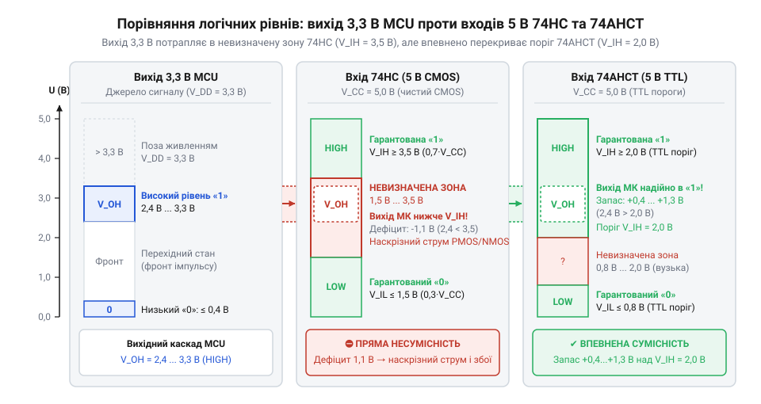
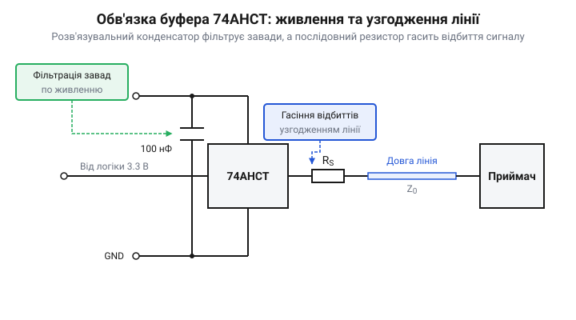

# Логіка серії 74AHCT у системній схемотехніці

<preknowlist>
- [Перетворювач логічних рівнів](root:cat-hw-parts/logic-level-converter) — загальні принципи та проблеми узгодження цифрових сигналів між різними напругами живлення
- [Буфер із трьома станами виходу 74LVC1G125](root:cat-hw-parts/logic-buffer-74lvc1g125) — принцип буферизації сигналів та керування виводом у високоімпедансному стані
</preknowlist>

## Електричний конфлікт логічних рівнів

Пряме підключення 3,3-вольтового мікроконтролера до 5-вольтової периферії спричиняє апаратний конфлікт. Подання такого сигналу на вхід класичної @@en|CMOS@@-логіки (від лат. *complementum* — доповнення) серії @@en|74HC@@ викликає збої та перегрів мікросхеми.

Причина — у розходженні порогів напруги. За живлення `V_CC = 5.0 В` логіка @@en|74HC@@ вимагає для одиниці щонайменше `V_IH = 0.7 · V_CC = 3.5 В`. Вихід мікроконтролера забезпечує лише `V_OH ≈ 3.3 В`, тому напруга потрапляє в невизначену зону між нулем `V_IL = 1.5 В` та одиницею.

Вхідний каскад вентиля утворює пара P- та N-канальних транзисторів. За штатної логіки один транзистор відімкнений, а інший замкнений. Напруга `3.3 В` тримає обидва транзистори частково відкритими водночас. Між лінією `5 В` і землею виникає низькоомний канал, яким тече наскрізний струм (англ. @@en|shoot-through current@@, від давньоангл. *scēotan* — стріляти). Він розігріває кристал, просаджує живлення та спотворює зчитування бітів.

## Вхідні TTL-пороги логіки 74AHCT

Апаратним вирішенням є логіка @@en|74AHCT@@ (англ. @@en|Advanced High-Speed CMOS with TTL-compatible inputs@@). Вона живиться від `5 В`, але адаптована під пороги транзисторно-транзисторної логіки (@@en|TTL@@, від англ. @@en|Transistor-Transistor Logic@@).

Вхідний каскад @@en|74AHCT@@ має асиметричну геометрію: ширину каналу N-транзистора збільшено відносно P-транзистора. Це зміщує точку перемикання вниз. Поріг логічної одиниці знижено до `V_IH = 2.0 В`, а нуля — до `V_IL = 0.8 В`. Сигнал `3.3 В` перевищує поріг `2.0 В` із запасом завадостійкості (англ. @@en|noise margin@@) у `1.3 В`, виключаючи потрапляння в невизначену зону.

*Знижений поріг V_IH мікросхем 74AHCT забезпечує запас завадостійкості у 1,3 В при зчитуванні 3,3-вольтових сигналів.*

Вихідний каскад мікросхеми виконано як потужний двотактний (англ. @@en|push-pull@@, від середньоангл. *poussen* — штовхати) драйвер @@en|CMOS@@. Він забезпечує повний 5-вольтовий розмах (`V_OH ≥ 4.5 В`), струм до `±8 мА` та круті фронти. Це робить серію @@en|74AHCT@@ активним [перетворювачем логічних рівнів](root:cat-hw-parts/logic-level-converter) 3,3 В → 5 В для шин і адресних світлодіодів.

## Схемотехнічне обв'язування та захист входів

Фронти перемикання виходів @@en|74AHCT@@ становлять лише `3–5 нс`. Швидке перезаряджання ємності навантаження за цей час викликає імпульсні кидки струму силою до сотень міліампер.

Паразитна індуктивність доріжок живлення `L` створює стрибок напруги `ΔV = L · (di / dt)`. Це явище земляного відскоку (англ. @@en|ground bounce@@, від середньоангл. *bounsen* — підстрибувати) — коливання потенціалу локальної землі, що спотворює сигнали сусідніх вузлів. Для компенсації кидків упритул до виводів живлення `V_CC` та `GND` встановлюють керамічний розв'язувальний конденсатор (англ. @@en|decoupling capacitor@@, від лат. *de-* — роз'єднання, та *copula* — зв'язок) номіналом `100 нФ`.

Інша загроза — залишені у повітрі входи. Затвори @@en|CMOS@@ мають опір понад `10¹² Ом` і сприймають завади як антени. Накопичений статичний заряд зміщує потенціал у проміжну зону напруг. Це відкриває обидва вхідні транзистори, спричиняючи постійний наскрізний струм @@en|shoot-through current@@ та перегрів. Усі невикористані входи слід жорстко підтягувати до `V_CC` або землі.

## Запобігання дзвінку та паразитному живленню

Швидкі фронти перемикання тривалістю менше `5 нс` перетворюють довгі доріжки плати на лінії передачі. Низький вихідний опір драйвера порівняно з хвильовим опором лінії створює хвильові відбиття.

Вони спричиняють високочастотний дзвін сигналів (англ. @@en|ringing@@, від давньоангл. *hringan* — лунати, дзвонити) із викидами напруги за межі живлення. Коливання повторно перетинають логічний поріг і породжують хибні перемикання, наприклад, у [зсувному регістрі 74HC595](root:cat-hw-parts/74hc595). Для гасіння коливань упритул до виходу встановлюють послідовний узгоджувальний резистор (англ. @@en|series termination resistor@@, від лат. *series* — ряд) номіналом `22–33 Ом`.

*Керамічний конденсатор біля виводів живлення пригнічує кидки напруги, а послідовний резистор на виході гасить хвильові відбиття та дзвін.*

Небезпеку становить і паразитне живлення (англ. @@en|phantom powering@@, від грец. *phantasma* — привид). Входи мікросхеми захищені діодами електростатичного розряду (@@en|ESD@@, від англ. @@en|Electrostatic Discharge@@). Якщо подати активний сигнал на вхід вимкненого чіпа, струм потече крізь верхній діод у знеструмлену лінію `V_CC`. Це призводить до хаотичного напівзапуску схеми, зависання шин та аварійного тиристорного защіпання кристала (англ. @@en|latch-up@@, від давньоангл. *læccan* — хапати) під час подальшої подачі живлення.