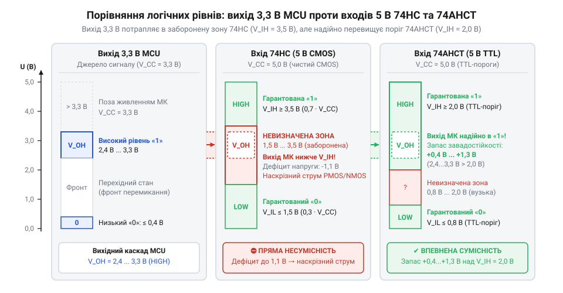
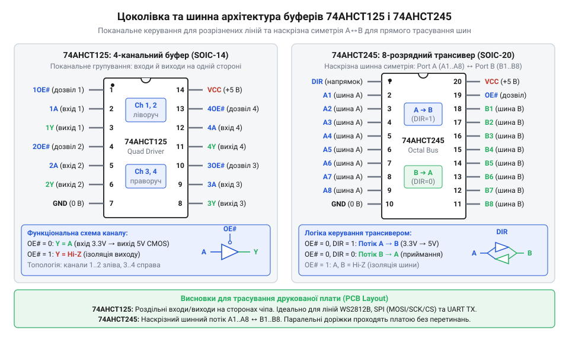

# Схемотехнічний довідник та залізний інтерфейс логічних мікросхем серії 74AHCT

<preknowlist>
- [Буфер із трьома станами виходу 74LVC1G125](root:cat-hw-parts/logic-buffer-74lvc1g125) — концепцію буферизації сигналів, функціонування третього високоімпедансного стану (Hi-Z) та керування виводом дозволу виходу
- [Перетворювач логічних рівнів](root:cat-hw-parts/logic-level-converter) — принципи узгодження сигналів між цифровими вузлами з різними рівнями напруги живлення та обмеження пасивних перетворювачів
</preknowlist>

## Збої 5-вольтової периферії від 3,3-вольтових сигналів

Пряме з'єднання мікроконтролера з напругою 3.3 В і периферійного пристрою на 5.0 В спричиняє збої через несумісність вхідних порогів стандартної п'ятивольтової логіки з низьковольтним сигналом.

Вхідні каскади класичних чипів побудовані за технологією @@en|CMOS@@, де поріг високого рівня `V_IH` становить сімдесят відсотків від напруги живлення `V_CC`:

`V_IH = 0.7 · V_CC`

За живлення 5.0 В мінімальна логічна одиниця дорівнює 3.5 В, тоді як мікроконтролер видає менше. Сигнал потрапляє в заборонену зону, викликаючи паразитні коливання. Пасивний [перетворювач логічних рівнів](root:cat-hw-parts/logic-level-converter) затягує фронти, тому для надійної роботи потрібен активний перетворювач зі зміщеними порогами — логічна родина @@en|74AHCT@@.

## Електричні параметри та вхідні пороги 74AHCT

Мікросхеми серії @@en|74AHCT@@ (Advanced High-Speed CMOS з сумісністю за входом із @@en|TTL@@ — транзисторно-транзисторна логіка) працюють із живленням `V_CC` від 4.5 до 5.5 В. Вхідні інвертори зміщені: поріг високого рівня `V_IH` становить не більше 2.0 В, а низького `V_IL` — не більше 0.8 В. Це дозволяє надійно приймати сигнал 3.3 В від мікроконтролерів.

Запас завадостійкості високого рівня `V_NH` обчислюють як різницю між вихідною напругою контролера та порогом мікросхеми:

```
V_NH
= V_OH_MC - V_IH         [різниця гарантованого виходу і порогу сприйняття]
= 3.0 В - 2.0 В          [підстановка значень для виходу 3.3 В та входу 74AHCT]
= 1.0 В                  [запас стійкості до перешкод]
```


*Рівні напруги виходу мікроконтролера 3.3 В гарантують надійний запас завадостійкості понад один вольт відносно порогу 2.0 В мікросхеми 74AHCT.*

Вихідний каскад працює за схемою @@en|push-pull@@ і видає вихідні струми до $\pm 8$ мА з розмахом майже від шини до шини. Статичний вхідний струм не перевищує 1 мкА, що дає великий @@en|коефіцієнт розгалуження@@ (@@en|fan-out@@) за постійним струмом.

## Апаратний інтерфейс та розпінування ключових чипів

Для побудови узгоджувальних каскадів використовують три базові мікросхеми серії: чотириканальний буфер @@en|74AHCT125@@, восьмиканальний лінійний драйвер @@en|74AHCT244@@ та восьмиканальний шинний трансивер @@en|74AHCT245@@. Усі вони випускаються в компактних корпусах для поверхневого монтажу @@en|SOIC@@ і @@en|TSSOP@@, а також у вивідних корпусах @@en|DIP@@ для лабораторного прототипування.

Мікросхема 74AHCT125 містить чотири незалежні буферні вентилі. На відміну від мініатюрного [одноканального буфера з трьома станами](root:cat-hw-parts/logic-buffer-74lvc1g125), тут у чотирнадцятививідному корпусі розміщено чотири окремі тракти з власними лініями керування дозволом виходу `OE`. Вивід дозволу виходу є інверсним: активним станом є логічний нуль.

Коли на вивід `OE` подано низький потенціал, буфер передає сигнал зі входу `A` на вихід `Y` без інверсії з посиленням за струмом. Якщо на `OE` з'являється логічна одиниця, вихідний каскад вимикає обидва транзистори й переходить у стан @@en|Hi-Z@@ (стан високого повного опору). У стані Hi-Z вихід має опір у десятки мегаомів і фактично від'єднується від лінії.

Восьмиканальний трансивер 74AHCT245 призначений для двонапрямного обміну даними між паралельними шинами. Його апаратний інтерфейс у двадцятививідному корпусі містить спільний інверсний вхід дозволу `OE` (вивід 19) та вхід вибору напрямку передачі `DIR` (вивід 1). Якщо на виводі `DIR` встановлено високий логічний рівень, дані передаються з порту `A` на порт `B`; коли заземлено — з `B` на `A`. Подання одиниці на `OE` негайно вимикає обидва порти у високоімпедансний стан.


*Чотириканальний буфер 74AHCT125 містить незалежні лінії дозволу виходу OE, тоді як восьмиканальний трансивер 74AHCT245 керує напрямком передачі даних через вивід DIR і загальне вимкнення шини.*

Топологічна @@it|цоколівка@@ спроєктована для наскрізного трасування шин. У корпусі SOIC-14 мікросхеми 74AHCT125 живлення `V_CC` підведено до виводу 14, а земля `GND` — до виводу 7. У корпусі SOIC-20 трансивера 74AHCT245 живлення підведено до виводу 20, а земля — до виводу 10. Порти `A` та `B` розміщені суворо один навпроти одного вздовж протилежних боків корпусу, що дає змогу прокладати багаторозрядні провідники прямими доріжками без перехрещень.

## Часові характеристики та динамічне навантаження ліній

Швидкодія родини `74AHCT` визначається затримкою поширення сигналу `t_pd` (від англ. @@en|propagation delay@@). За живлення 5.0 В і ємності `C_L = 50 пФ` затримка від входу до виходу становить від 5.5 до 8.5 нс, а час наростання та спаду фронтів не перевищує 3.0 нс. Кожні додаткові 10 пФ паразитної ємності додають 0.5–0.8 нс затримки й обмежують граничну частоту перемикання на рівні 40–50 МГц.


*Часові діаграми демонструють затримки поширення сигналу `t_pd`, фронти наростання та спаду, а також перекіс `t_sk(o)` між каналами.*

У шинних формувачах час переведення в третій стан `t_dis` та вимкнення виходів критичний для запобігання апаратним конфліктам шини (`bus contention`), коли зустрічні передавачі одночасно виставляють протилежні рівні живлення й викликають просідання напруги. У багаторозрядних шинах різниця затримок між каналами утворює перекіс `t_sk(o)` (`skew`), що може порушити часи встановлення даних.

Динамічний струм споживання `I_dyn` виникає через перезаряджання ємності навантаження `C_L` за частоти `f` і напруги `V_CC`:

```
I_dyn
= C_L · V_CC · f         [заряд ємності навантаження за кожен період тактового сигналу]
= 50 · 10⁻¹² Ф · 5.0 В · 10 · 10⁶ Гц [навантаження 50 пФ на тактовій частоті 10 МГц]
= 2.5 · 10⁻³ А           [2.5 мА динамічного споживання на один вихідний канал]
```

Зі збільшенням кількості активних каналів сумарний імпульсний струм на шинах живлення зростає, створюючи перешкоди для суміжних вузлів.

## Трасування плати, блокування завад і входи

Висока швидкодія серії @@en|74AHCT@@ висуває жорсткі вимоги до схемотехнічного обв'язування та топології друкованої плати. Першим критичним правилом є повна заборона залишати входи відкритими. Вхідний каскад @@en|CMOS@@ має власний опір понад сотні мегаомів, тому ні до чого не підключений вивід працює як антена. Електростатичні заряди й наведення швидко заряджають мізерну ємність затвора до проміжного потенціалу 1.5–2.5 В.

У зоні перемикання виникає @@en|наскрізний струм@@ через одночасно відкриті ключі комплементарної пари. Прямий шлях низького опору між шинами живлення та землі спричиняє струм у десятки міліамперів на канал, перегрів чипа та високочастотні шуми по живленню. Усі невикористані входи підтягують безпосередньо до `V_CC` або `GND`. Якщо вільними залишаються канали буфера @@en|74AHCT125@@, їхні входи `A` під'єднують до землі, а виводи `OE` підтягують до живлення.

Другим правилом є розв'язка живлення керамікою. Під час перемикання виходів за 3 нс швидкість наростання струму викликає локальне падіння напруги та підскакування потенціалу землі (@@en|ground bounce@@). Для компенсації застосовують @@en|блокувальний конденсатор@@ (@@en|bypass capacitor@@) номіналом 100 нФ з діелектриком X7R. Його монтують на відстані не більше ніж 2–3 мм від виводу `V_CC` з коротким підключенням до земляного полігону через отвори великого діаметра. Про [індуктивне підскакування землі та шум шин живлення](root:hw-digital/ground-bounce-and-supply-noise) розказано в окремому довіднику.

Третьою проблемою є хвильові відбиття на швидкісних лініях. Спектральні гармоніки з частотами понад 100 МГц перетворюють навіть коротку доріжку на лінію з розподіленими параметрами.

Критичну довжину провідника визначають за часом наростання фронту сигналу `t_r` та швидкістю поширення хвилі `v`:

```
L_crit
= (t_r · v) ÷ 6          [критерій узгодженої лінії передачі]
= (3.0 · 10⁻⁹ с · 1.5 · 10⁸ м/с) ÷ 6
= 0.075 м                [7.5 см граничної довжини без демпфування]
```

Якщо доріжка довша за сім з половиною сантиметрів, фронт відбивається від кінця лінії, формуючи @@en|дзвін@@ (@@en|ringing@@). Викиди напруги виходять за межі живлення та землі, викликаючи хибні перемикання або пробій захисних діодів. Подробиці про [хвильові відбиття та дзвін у швидкісних лініях зв'язку](root:hw-digital/transmission-line-ringing) допоможуть обрати демпфувальні резистори.

Для придушення відбиттів застосовують послідовний @@de|демпфувальний резистор@@ номіналом 22–33 Ом якомога ближче до виходу чипа. Оскільки вихідний опір 74AHCT становить 20–25 Ом, резистор доводить сумарний імпеданс джерела до 45–55 Ом, узгоджуючи його з хвильовим опором лінії та повністю поглинаючи відбиту хвилю.