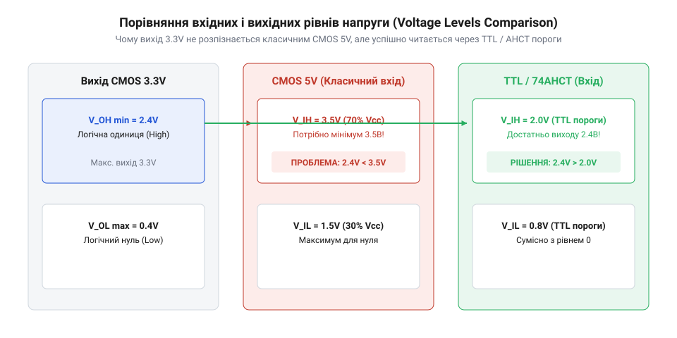
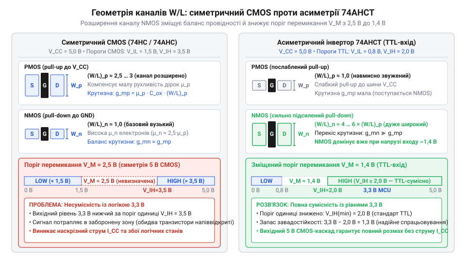

# Еволюція серії 74AHCT та походження TTL-сумісних входів

<preknowlist>
- [Перетворювач логічних рівнів](root:cat-hw-parts/logic-level-converter) — Читач має знати загальну концепцію узгодження логічних рівнів та навіщо воно потрібне при з'єднанні мікросхем з різною напругою живлення.
</preknowlist>

## Проблема несумісності логічних рівнів

На початку 1990-х мікроконтролери перейшли на живлення 3.3 В, тоді як периферія залишалася 5-вольтовою. Пряме з'єднання спричинило несумісність логічних рівнів.

Обчислимо поріг логічної одиниці `V_IH` для логіки @@en|CMOS@@ серії @@en|74HC@@ через частку напруги живлення `V_CC`:

```
V_IH = 0.7 · V_CC
     = 0.7 · 5.0 В       [порогове співвідношення для 74HC]
     = 3.5 В             [мінімальний рівень одиниці]
```

Поріг нуля становить `V_IL ≤ 1.5 В`. Під навантаженням вихід 3.3 В дає лише `V_OH = 2.4–3.0 В`, що потрапляє в зону невизначеності між `V_IL` та `V_IH`.


*Невідповідність між вихідною напругою 3.3V та порогом одиниці 5V CMOS, де сигнал потрапляє в зону невизначеності.*

Вхідний інвертор @@en|CMOS@@ містить транзистори @@en|PMOS@@ до шини 5.0 В і @@en|NMOS@@ до землі. Сигнал 3.0 В на затворі верхнього плеча спричиняє наскрізний струм (@@en|shoot-through current@@), перегріваючи кристал і викликаючи замикання (@@en|latch-up@@). Це зумовило потребу в узгодженні рівнів (@@en|level shifting@@) до 5.0 В.

## Обмеження попередніх логічних родин

Перед розробкою нових напівпровідникових рішень розробники спробували використати три наявні технологічні групи мікросхем: класичну біполярну логіку, чисті комплементарні схеми @@en|74HC@@ та перше покоління CMOS-схем із сумісними входами.

Традиційна біполярна логіка (@@en|TTL@@, від англ. *Transistor-Transistor Logic* — транзисторно-транзисторна логіка) в серіях 74LS і 74F мала відповідні вхідні пороги (`V_IH = 2.0 В`, `V_IL = 0.8 В`), проте породжувала нездоланні системні вади:
- Високе статичне споживання через керування базовим струмом біполярних транзисторів. - Значний вхідний струм витоку на низькому рівні, що підіймав вихідну напругу нуля контролера. - Неповний розмах вихідної напруги `V_OH`, який не гарантував надійне керування іншими 5-вольтовими CMOS-входами. - Комутаційні завади та підстрибування потенціалу сигнальної землі (@@en|ground bounce@@).

Чисті схеми @@en|74HC@@ усували проблему енергоспоживання, проте їхні симетричні вхідні пороги відкидали сигнали 3.3 В без проміжних вузлів.

Перша спроба об'єднати низьке споживання з вхідними порогами біполярних схем — серія @@en|74HCT@@ (від англ. *High-Speed CMOS with TTL thresholds* — високошвидкісна комплементарна логіка з порогами транзисторно-транзисторної логіки) 1982 року — на середину 1990-х років не задовольняла вимоги до швидкодії:
- Велика затримка поширення сигналу (@@en|propagation delay@@) у 9–25 наносекунд через топологічні норми 3–5 мікрометрів. - Обмеження смуги пропускання для тактових частот шин понад 25–40 МГц. - Слабкий вихідний каскад із допустимим струмом навантаження лише `±4 мА`.

Інженерам була потрібна нова кремнієва серія з порогами @@en|TTL@@, струмом спокою менше мікроампера, затримкою менше 5 наносекунд і потужним виходом.

## Зміщення порогів спрацьовування CMOS

У 1996 році @@en|Texas Instruments@@, @@en|Philips Semiconductors@@ та @@en|Toshiba@@ представили родину @@en|74AHC@@ (Advanced High-Speed CMOS) разом зі спеціалізованим варіантом @@en|74AHCT@@ (Advanced High-Speed CMOS with TTL thresholds). Субмікронний процес із нормами 0.6–0.8 мікрометра скоротив час затримки поширення @@en|propagation delay@@ до `3.0–5.5 нс`, а вихідний каскад оптимізували для струмів до `±8 мА`.

У стандартному інверторі перемикання відбувається на симетричному порозі `V_M = V_CC / 2` (2.5 В для 5-вольтового живлення), через що симетричні мікросхеми @@en|74AHC@@ не сприймають 3.0 В як упевнену одиницю. У серії @@en|74AHCT@@ геометрію транзисторів вхідного каскаду навмисно розбалансували: широкий нижній @@en|NMOS@@ відкривається раніше і притягує сигнал до землі вже при `1.3–1.4 В`, зміщуючи поріг `V_M` униз до допускового вікна логіки @@en|TTL@@ (0.8–2.0 В). Це забезпечує вхідні пороги `V_IL ≤ 0.8 В` та `V_IH ≥ 2.0 В`, дозволяючи мікроконтролеру з живленням 3.3 В впевнено перемикати вхід без наскрізного струму @@en|shoot-through current@@ та при мікроамперному струмі спокою @@en|quiescent current@@. Поглибити розуміння цього процесу допоможе [передатна характеристика CMOS-інвертора](root:cat-hw-parts/cmos-inverter-transfer-characteristics), яка детально розглядає залежність порогу перемикання від геометрії транзисторів та фізику виникнення крізного струму.


*На схемі наведено порівняння геометрії каналів NMOS та PMOS транзисторів у симетричному інверторі та спеціалізованому інверторі 74AHCT із розбалансованими пропорціями W/L.*

Серія @@en|74AHCT@@ стала універсальним інструментом узгодження рівнів @@en|level shifting@@: вона приймає 3.3-вольтові сигнали без обмежувачів, формує 5-вольтовий розмах виходу та працює на частотах понад 50 МГц.

## Становлення інструменту узгодження напруг

У середині 1990-х років розробники зіткнулися з несумісністю нових 3.3-вольтових мікроконтролерів та 5-вольтової периферії. Прості резистивні дільники та схеми з відкритим колектором затягували фронти імпульсів, обмежуючи швидкість зв'язку, тоді як спеціалізовані перетворювачі рівня були рідкісними та вимагали двох ліній живлення.

Практичним розв'язком стали логічні вентилі та буфери родини @@en|74AHCT@@ на спільній 5-вольтовій шині. Вхідний поріг `V_IH = 2.0 В` гарантував спрацьовування від 3.3-вольтового сигнального рівня (2.8–3.0 В), а вихідний каскад @@en|CMOS@@ формував повний 5-вольтовий розмах із затримкою поширення @@en|propagation delay@@ менше 5 нс, дозволяючи без погіршення часових діаграм сполучати виводи мікроконтролера з класичними мікросхемами, як-от [вихідний зсувний регістр](root:cat-hw-parts/74hc595) чи [периферійний дешифратор](root:cat-hw-parts/74hc138).

Вирішальною перевагою серії стала толерантність входів до напруги (@@en|input voltage tolerance@@) та захист від порушення послідовності вмикання живлення. У звичайній логіці @@en|HC@@ вхідні захисні діоди (@@en|clamping diode@@) з'єднують вхід із шиною `V_CC`, через що під час затримки запуску 5-вольтової шини струм від джерела витікає в неактивну лінію, перевантажуючи процесор і провокуючи замикання @@en|latch-up@@. У мікросхемах @@en|74AHCT@@ верхній діод вилучено, а захист побудовано на лавинному пробої до землі. Це дозволяє безпечно подавати на входи до 5.5 В навіть за нульової напруги живлення мікросхеми.

Поєднання швидкодії, низького струму спокою @@en|quiescent current@@ та стійкості перетворило мікросхеми серії на промисловий стандарт сполучення 3.3-вольтових процесорів із 5-вольтовою апаратурою. Чотириканальні буфери 74AHCT125 та восьмиканальні трансивери 74AHCT245 закріпилися у пристроях як найнадійніший міст для односпрямованих ліній.

## Спростування міфів про 74AHCT

Широке застосування мікросхем родини @@en|74AHCT@@ породило низку інженерних оман щодо їхнього походження та меж використання. 

Перший міф стверджує, що літера «Т» вказує на біполярні транзистори чи гібридну технологію @@en|BiCMOS@@. Насправді мікросхеми виготовляються за чистою технологією @@en|CMOS@@, а літера «Т» означає лише сумісність вхідних порогів зі стандартами @@en|TTL@@ завдяки геометрії вхідного інвертора.

Друга помилка — уявлення про створення серії спеціально для мікроконтролерів із живленням 3.3 В. Історично вхідні каскади «Т» виникли раніше в серії @@en|74HCT@@ для прямої заміни (@@en|drop-in replacement@@) мікросхем 74LS. Серія @@en|74AHCT@@ з'явилася пізніше для 5-вольтових пристроїв, але збіглася з переходом мікроконтролерів на 3.3 В, здобувши славу зручного перетворювача рівнів.

Третя омана — розгляд @@en|74AHCT@@ як двоспрямованого перетворювача. Вона працює лише в одному напрямку (від 3.3 В до 5.0 В), бо живиться від 5 В і формує повний розмах, здатний зруйнувати вхід 3.3-вольтового контролера. Для зворотного напрямку чи двоспрямованих шин на кшталт @@en|I2C@@ потрібні інші рішення, наприклад серія @@en|74LVC@@.

Четвертий міф вважає серію застарілою. Проте вона залишається затребуваною для керування виконавчими механізмами й світлодіодами, де потрібні напруги понад 3.5 В і наносекундні фронти.