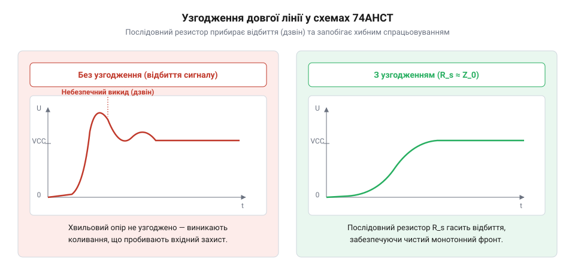

# Розрахунок динамічного енергоспоживання, затримок поширення та узгодження ліній 74AHCT

<preknowlist>
- [Буфер із трьома станами виходу 74LVC1G125](root:cat-hw-parts/logic-buffer-74lvc1g125) — розуміння будови вихідного каскаду та його здатності віддавати струм під час перемикання.
</preknowlist>

## Звідки береться @@en|dynamic power dissipation@@

У стані спокою логіка @@en|CMOS@@ споживає лічені наноампери, а на високій частоті струм сягає десятків міліампер через перезаряд паразитних ємностей і наскрізний струм перемикання. Виробники зводять їх до еквівалентної ємності розсіювання `C_pd`, яка для вентиля @@en|74AHCT@@ становить 14 пФ.

Сумарну динамічну потужність `P_dyn` знаходять із внутрішніх втрат `P_int` та зовнішніх `P_ext` на ємності навантаження `C_L` за напруги `V_CC` і частоти `f_sw`:

        P_dyn = P_int + P_ext
        = (C_pd · V_CC² · f_sw) + (C_L · V_CC² · f_sw)   [внутрішні та зовнішні втрати]
        = (C_pd + C_L) · V_CC² · f_sw                    [винесення спільного множника]

Потужність зростає квадратично від напруги й лінійно від частоти, а динамічний струм становить `I_dyn = (C_pd + C_L) · V_CC · f_sw`. Тепловий опір `R_thJA` перетворює втрати на нагрів кристала: `ΔT = P_dyn · R_thJA`.

**Розрахунок для чотирьох буферів 74AHCT у SOIC-14 (R_thJA = 120 °C/W, V_CC = 5.0 V, f_sw = 20 MHz, C_L = 25 pF, C_pd = 14 pF)**

        P_ch = (14 + 25) · 10⁻¹² · 5.0² · (20 · 10⁶) = 0.0195 W      [потужність каналу]
        P_dyn = 4 · 0.0195 W = 0.078 W                               [сумарна потужність]
        I_dyn = 0.078 W / 5.0 V = 15.6 mA                            [динамічний струм]
        ΔT = 0.078 W · 120 °C/W = 9.36 °C                            [перегрів кристала]

Чотири канали на 20 МГц споживають 15.6 мА та нагрівають кристал на 9.36 °C.

## Затримка поширення та ємність навантаження

У технічній документації на компоненти @@en|74AHCT@@ час затримки поширення сигналу `t_pd` (англ. @@en|propagation delay@@, від лат. *propagare* — поширювати вперед та лат. *dilatio* — відкладання) виглядає привабливо малим: типово близько 3.8 нс при напрузі живлення 5.0 В. Проте розробники цифрових пристроїв нерідко стикаються з тим, що реальна затримка в зібраній друкованій платі становить 8–10 нс, руйнуючи часовий бюджет швидкісної шини та спричиняючи збої в часі встановлення (англ. @@en|setup time@@) наступних каскадів. Ця розбіжність виникає тому, що паспортні таблиці вказують затримку для нормованого вимірювального навантаження `C_L0 = 15 pF` або `50 pF` за фіксованої температури +25 °C.

Реальна тривалість поширення сигналу крізь логічний елемент складається з двох послідовних фізичних фаз. Перша фаза — внутрішня затримка перемикання кристала `t_pd0`, зумовлена часом прольоту носіїв заряду крізь канали вхідних транзисторів і проміжних інверторів. Друга фаза — тривалість заряду або розряду зовнішньої ємності вихідного вузла. Вихідний каскад логічного елемента під час відкривання працює як неідеальний ключ із власним внутрішнім вихідним опором `R_out` (типово від 20 до 30 Ом). Цей опір разом із під'єднаною ємністю навантаження `C_L` утворює інтегрувальний ланцюг. Щоб напруга на виході перетнула поріг логічного перемикання наступного каскаду, струм вихідних транзисторів повинен зарядити або розрядити всю сумарну ємність лінії.

Через це залежність затримки поширення від під'єднаної ємності має лінійний характер у типовому робочому діапазоні. Позначимо через `t_pd1` відому паспортну затримку при еталонній ємності `C_L1 = 15 pF`, а через `k_C` — ємнісний коефіцієнт зростання затримки (приріст часу в наносекундах на кожен пікофарад доданої ємності). Тоді математична модель повної затримки набуває такого вигляду:

        t_pd(C_L) = t_pd1 + Δt_pd
        = t_pd1 + k_C · (C_L - C_L1)                     [лінійна екстраполяція затримки]

Коефіцієнт `k_C` надійно обчислюється з паспортних значень затримки для двох різних ємностей навантаження `C_L1 = 15 pF` та `C_L2 = 50 pF`:

        k_C = (t_pd2 - t_pd1) / (C_L2 - C_L1)

Сумарна ємність навантаження `C_L` на друкованій платі ніколи не обмежується лише входом мікросхеми-приймача. Вона складається з власної вхідної ємності під'єднаних приймачів `∑ C_in`, ємності мідного друкованого провідника `C_trace` та паразитної ємності монтажних переходів і контактних майданчиків `C_stray`:

        C_L = C_trace + ∑ C_in + C_stray

Вхідна ємність логічного входу мікросхем сімейств @@en|74AHCT@@ або @@en|74HC@@ становить `C_in ≈ 3.0..4.5 pF`. Провідник на стандартному двошаровому або чотиришаровому склотекстоліті має погонну ємність `c_trace ≈ 1.0..1.2 pF/cm`. Якщо лінія довжиною 12 см тактує чотири приймачі — наприклад, керуючі входи паралельного завантаження [зсувного регістра 74HC165](root:cat-hw-parts/74hc165) та [зсувного регістра 74HC595](root:cat-hw-parts/74hc595), — сумарна паразитна ємність лінії легко перевищує 30 пФ.

Додатковим дестабілізуючим чинником виступає температура. Під час нагрівання напівпровідника амплітуда теплових коливань кристалічної ґратки кремнію зростає, через що рухливість електронів та дірок знижується. Це викликає зростання опору відкритих каналів транзисторів приблизно на 0.35% на кожен градус Цельсія. У діапазоні від кімнатної температури +25 °C до верхньої промислової межі +85 °C затримка поширення зростає на 20–25%. Температурний коефіцієнт деградації затримки `K_T` описується виразом:

        K_T = 1 + α_T · (T - T_0)

де `α_T ≈ 0.0035 °C⁻¹`, `T_0 = 25 °C`, а `T` — робоча температура кристала.

**Розрахунок найгіршої затримки поширення 74AHCT з урахуванням ємності та температури**

        k_C = (5.5 - 3.8) / (50 - 15) = 1.7 / 35 ≈ 0.0486 ns/pF      [ємнісний коефіцієнт затримки]
        C_L = (12 · 1.1) + (4 · 3.5) + 2.8 = 13.2 + 14.0 + 2.8 = 30.0 pF [сумарна ємність вузла]
        t_pd_25 = 3.8 + 0.0486 · (30.0 - 15.0) = 3.8 + 0.73 = 4.53 ns [затримка за 25 °C]
        K_T = 1 + 0.0035 · (85 - 25) = 1 + 0.21 = 1.21               [температурний коефіцієнт для 85 °C]
        t_pd_worst = 4.53 · 1.21 ≈ 5.48 ns                           [типова затримка за 85 °C]
        t_pd_max_worst = (5.5 + 0.0714 · 15) · 1.21 = 6.57 · 1.21 ≈ 7.95 ns [найгірший паспортний випадок]

Сукупний вплив ємності розгалуженої доріжки та підвищеної температури збільшує затримку поширення від паспортних 3.8 нс до майже 8.0 нс. Без урахування цього запасу схема не виконає часові обмеження швидкісної синхронізації.

## Ефект лінії на швидких фронтах

Поширена омана інженерів полягає в тому, що ефекти довгої лінії передачі проявляються лише у високочастотних радіотрактах або на гігагерцових шинах обчислювальних процесорів. Працюючи з мікросхемами @@en|74AHCT@@ на відносно низькій тактовій частоті 1 МГц або 500 кГц, нерідко очікують побачити на друкованій доріжці звичайні прямокутні імпульси. Натомість осцилограф фіксує незрозумілі викиди напруги вище шини живлення, глибокі провали та паразитні імпульси. Причина криється в тому, що хвильову поведінку провідника визначає не період повторення імпульсів, а тривалість їхнього наростання.

Електричний потенціал не поширюється дротом миттєво: сигнал рухається у вигляді електромагнітної хвилі, що біжить діелектриком навколо провідника. Вихідні каскади родини @@en|74AHCT@@ оптимізовані для високої швидкодії: час наростання фронту `t_r` (англ. @@en|rise time@@) між рівнями 10% та 90% становить лише від 1.5 до 2.5 нс. Швидкість поширення електромагнітної хвилі `v` у товщі друкованої плати @@en|PCB@@ (англ. @@en|Printed Circuit Board@@) з популярного склотекстоліту @@en|FR-4@@ (англ. @@en|Flame Retardant 4@@) визначається швидкістю світла у вакуумі `c ≈ 30 cm/ns` та ефективною діелектричною проникністю матеріалу `ε_eff` (англ. @@en|dielectric permittivity@@, від лат. *permittere* — пропускати):

        v = c / √ε_eff

Для зовнішніх сигнальних доріжок (мікросмужкових ліній) частина електромагнітного поля проходить крізь текстоліт (`ε_r ≈ 4.2`), а частина крізь повітря (`ε = 1.0`), що дає `ε_eff ≈ 3.0..3.2`. Звідси швидкість поширення хвилі вздовж траси становить:

        v = 30 / √3.1 ≈ 30 / 1.76 ≈ 17.0 cm/ns

Погонна затримка поширення траси `t_prop` є оберненою величиною до швидкості: `t_prop = 1 / v ≈ 59 ps/cm` (близько 6 пікосекунд на міліметр).

Помноживши швидкість поширення хвилі на тривалість фронту, отримуємо просторову довжину фронту сигналу `l_edge` у матеріалі плати:

        l_edge = v · t_r

Якщо час наростання становить `t_r = 2.0 ns`, то просторова довжина фронту складає лише `17 cm/ns · 2.0 ns = 34 cm`. Поки довжина доріжки `l` значно менша за довжину фронту, різниця потенціалів на початку і в кінці провідника в кожен момент часу мізерна — провідник можна розглядати як коло із зосередженими параметрами. Але коли сигнал біжить до кінця лінії за час `t_line = l / v`, а відбита хвиля повертається до джерела за час подвійного пробігу `2 · t_line`, ситуація якісно змінюється.

Якщо подвійний час затримки лінії перевищує частину тривалості фронту, відбита хвиля накладається на вже сформований сигнал, створюючи сходинки, викиди або фазовий шум. У швидкісній цифровій схемотехніці друкований провідник вважають лінією передачі з розподіленими параметрами (англ. @@en|transmission line@@, від лат. *transmittere* — пересилати крізь), коли довжина траси перевищує критичну довжину `l_crit`. За загальноприйнятим інженерним правилом критичну довжину визначають із умови, що час затримки сигналу в один бік перевищує шосту частину тривалості фронту:

        t_line ≥ t_r / 6
        l_crit / v = t_r / 6                             [вираз через швидкість і довжину]
        l_crit = (v · t_r) / 6                           [домноження на швидкість хвилі]

**Розрахунок критичної довжини друкованої траси для мікросхеми 74AHCT**

        v = 30 / √3.1 = 30 / 1.761 ≈ 17.04 cm/ns         [швидкість сигналу в мікросмужці FR-4]
        l_edge = 17.04 · 2.0 = 34.08 cm                  [фізична довжина наростання фронту]
        l_crit = (17.04 · 2.0) / 6
        = 34.08 / 6                                      [ділення на інженерний коефіцієнт]
        ≈ 5.68 cm                                        [критична довжина провідника]

Для мікросхеми родини @@en|74AHCT@@ з фронтом наростання 2.0 нс будь-яка друкована доріжка, довша за приблизно 5.7 см, починає діяти як лінія передачі. На такій трасі закони Кірхгофа втрачають чинність, а сигнал зазнає хвильових відбиттів, якщо лінію не узгодити спеціальними схемотехнічними засобами.

## Узгодження лінії послідовним резистором

Коли високошвидкісний фронт добігає до кінця неузгодженої друкованої доріжки, виникає ефект відбиття. Вхідний каскад логічного елемента на основі транзисторів @@en|CMOS@@ має надзвичайно високий вхідний імпеданс: затвори ізольовані діелектриком, тож опір навантаження `Z_L` прямує до нескінченності (еквівалент розімкненого кола). Натомість сама друкована траса над земляним полігоном володіє фіксованим хвильовим опором `Z_0` (англ. @@en|characteristic impedance@@, від лат. *impedire* — перешкоджати), величина якого зазвичай становить 50–75 Ом.

Поведінку електромагнітної хвилі на межі середовищ кількісно описує коефіцієнт відбиття навантаження `Γ_L` (англ. @@en|reflection coefficient@@, від лат. *reflectere* — згинати назад):

        Γ_L = (Z_L - Z_0) / (Z_L + Z_0)

Оскільки для входу логіки `Z_L >> Z_0`, коефіцієнт відбиття прямує до одиниці:

        Γ_L = lim[Z_L → ∞] (Z_L - Z_0) / (Z_L + Z_0) = +1.0

Це означає, що хвиля напруги падаючого фронту `V_inc` відбивається від кінця лінії з тим самим знаком і тією самою амплітудою. Результуюча напруга на вході приймача дорівнює сумі падаючої та відбитої хвиль: `V_load = V_inc + Γ_L · V_inc = 2 · V_inc`.

Відбита хвиля повертається назад до мікросхеми-передавача. Внутрішній вихідний опір драйвера `R_out` (англ. @@en|output impedance@@) у відкритому стані становить лише близько 20–25 Ом, що помітно менше за хвильовий опір лінії `Z_0 = 50 Ω`. Коефіцієнт відбиття від джерела `Γ_S` набуває від'ємного значення:

        Γ_S = (R_out - Z_0) / (R_out + Z_0) = (25 - 50) / (25 + 50) = -25 / 75 ≈ -0.33

Хвиля відбивається від джерела з інверсією полярності й знову летить до приймача. У результаті вздовж провідника виникає затухаючий коливальний процес — дзвін (англ. @@en|ringing@@), що супроводжується небезпечними викидами напруги (англ. @@en|overshoot@@) вище шини живлення та провалами (англ. @@en|undershoot@@) нижче рівня землі. Ці паразитні коливання пробивають захисні діоди мікросхем, викликають тиристорне замикання або перетинають логічний поріг перемикання, провокуючи хибні тактові спрацьовування.

*Порівняння перехідних процесів на вході приймача: неузгоджена лінія генерує багаторазові відбиття та амплітудний дзвін за межі живлення, тоді як послідовний резистор біля драйвера повністю гасить зворотну хвилю й забезпечує монотонне наростання сигналу.*

Найбільш економічним і надійним способом усунення відбиттів у цифрових схемах із точковим з'єднанням є послідовне узгодження на боці джерела, або послідовне демпфування (англ. @@en|series termination@@, від лат. *terminare* — обмежувати, закінчувати). Безпосередньо біля вихідного виводу драйвера встановлюють резистор `R_s`. Мета цього рішення полягає в тому, щоб сумарний вихідний опір джерела точно дорівнював хвильовому опору друкованої траси:

        R_out + R_s = Z_0

Звідси необхідний номінал демпфувального резистора становить:

        R_s = Z_0 - R_out

Механізм роботи узгодженої лінії полягає в наступному. У момент перемикання ланцюг `(R_out + R_s)` разом із вхідним хвильовим опором траси `Z_0` утворює подільник напруги. Оскільки сумарний опір джерела дорівнює `Z_0`, амплітуда хвилі, що вирушає в лінію, становить рівно половину напруги живлення: `V_inc = V_CC / 2 = 2.5 V`. Ця сходинка біжить до приймача за час `t_line`.

На розімкненому кінці лінії (`Γ_L = +1.0`) хвиля відбивається в тій самій фазі: амплітуда подвоюється, утворюючи на вході приймача чистий повний логічний рівень `2.5 V + 2.5 V = 5.0 V` без жодного перерегулювання. Відбита хвиля амплітудою 2.5 В прямує назад до передавача. Добігши до джерела, вона зустрічає опір `(R_out + R_s) = Z_0`. Коефіцієнт відбиття на джерелі дорівнює нулю: `Γ_S = (Z_0 - Z_0) / (Z_0 + Z_0) = 0`. Відбита хвиля повністю поглинається резистором і каналом транзистора, не породжуючи жодних зворотних сплесків.

Щоб розрахувати точний номінал `R_s`, необхідно визначити внутрішній опір `R_out` вихідного каскаду @@en|74AHCT@@. Його знаходять із паспортних даних на падіння напруги при нормованому вихідному струмі. Для гарантованого високого рівня напруга становить `V_OH ≈ 4.4 V` при вихідному струмі `I_OH = -8 mA` і живленні `V_CC = 5.0 V`. Падіння напруги на відкритому транзисторі складає `ΔV = 5.0 - 4.4 = 0.6 V`, звідки внутрішній опір дорівнює `R_out = 0.6 V / 0.008 A = 75 Ω` у найгіршому паспортному випадку, але для типових умов за кімнатної температури `V_OH ≈ 4.8 V` при 8 мА, що відповідає `R_out ≈ 0.2 V / 0.008 A = 25 Ω`. Аналогічний типовий опір відкритого нижнього транзистора в нульовому стані становить близько 22 Ом.

**Розрахунок номіналу узгоджувального резистора для траси 50 Ом**

        R_out = (V_CC - V_OH) / |I_OH| = (5.0 - 4.8) / 0.008 = 25 Ω  [типовий вихідний опір драйвера]
        R_s = Z_0 - R_out
        = 50 - 25                                        [віднімання опору драйвера від хвильового]
        = 25 Ω                                           [розрахунковий номінал узгодження]

Для типової траси з хвильовим опором 50 Ом розрахунковий номінал узгоджувального резистора складає 25 Ом. Зі стандартного ряду номіналів E24 обирають найближчий резистор 24 Ом або 27 Ом. Резистор обов'язково розміщують на друкованій платі впритул до вихідної ніжки мікросхеми (на відстані не більше 3–5 мм), щоб паразитна ділянка між транзистором і резистором не перетворилася на мініатюрну неузгоджену лінію.