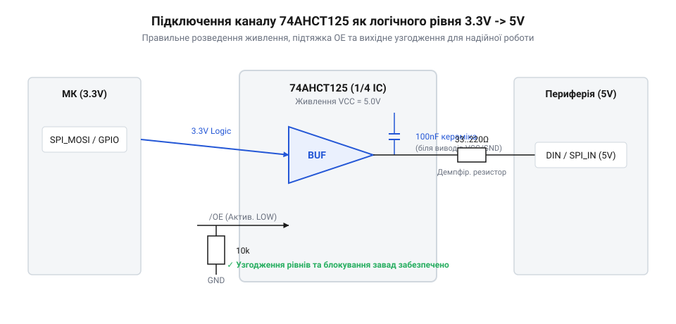
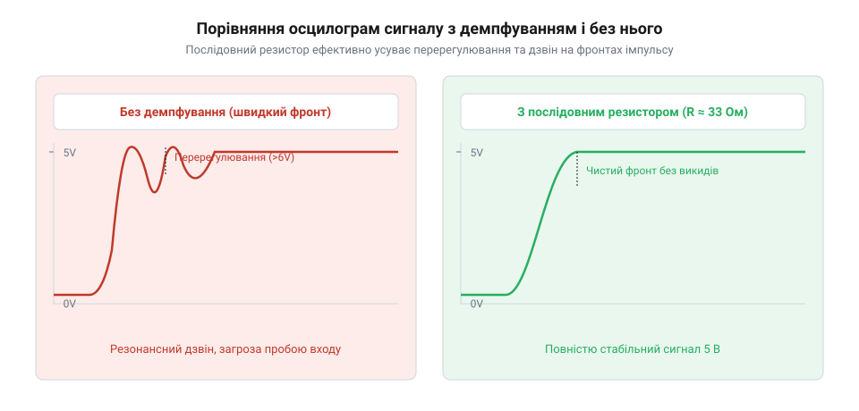

# Побудова високошвидкісного узгоджувача рівнів 3,3 В у 5 В на базі 74AHCT125

<preknowlist>
- [Перетворювач логічних рівнів](root:cat-hw-parts/logic-level-converter) — схемотехніка транзисторних перетворювачів із підтягувальними резисторами, їхні частотні обмеження та причини спотворення фронтів на швидкісних шинах
- [Буфер із трьома станами виходу 74LVC1G125](root:cat-hw-parts/logic-buffer-74lvc1g125) — принцип дії логічного буфера, функція інверсного виводу дозволу OE та переведення каналу у високоімпедансний стан
</preknowlist>

## Збої керування швидкісною 5-вольтовою периферією

Коли мікроконтролер із живленням 3,3 В намагається напряму керувати швидкісною 5-вольтовою периферією, наприклад адресними світлодіодними стрічками або пристроями на шині SPI, система починає працювати нестабільно. Дані втрачаються, кольори спотворюються, а іноді обмін взагалі зупиняється через хаотичні хибні спрацьовування. Причина криється у фізичній невідповідності логічних рівнів вихідного сигнала мікроконтролера та вхідних вимог приймача. Вихідний високий рівень від мікроконтролера 3,3 В видає напругу, яка є надто низькою для надійного розпізнавання її п'ятивольтовою схемою як логічна одиниця. Згідно з європейськими та американськими стандартами для TTL та CMOS мікросхем із живленням 5 В, поріг визначення високого рівня становить не менше 2,0 В для TTL або 3,5 В для КМОП-логіки, проте реальні кристали периферії часто вимагають суворіших 0,7 від живлення, тобто від 3,5 В і вище. У результаті сигнал на межі спрацьовування спричиняє перемикання вентилів від найменшого шуму.

Спроби розв'язати цю проблему за допомогою простих дискретних схем на біполярних або польових транзисторах із підтягувальними резисторами швидко виявляють свої обмеження на високих частотах. Через ємність монтажу та вхідну ємність саму по собі резистор перезаряджає лінію надто повільно, затягуючи фронти імпульсів і перетворюючи чіткі прямокутники на похилі трапеції. На мегагерцових частотах такі спотворені фронти призводять до того, що час перебування сигналу в забороненій лінійній зоні зростає, викликаючи нагрівання вихідних каскадів і додаткові збої. Простий резистивний подільник взагалі не підходить, оскільки він лише знижує напругу, але не підвищує її. Для швидкісних протоколів необхідний активний пушпульний буфер, здатний видавати потужний струм як на заряд, так і на розряд ємності навантаження, забезпечуючи круті фронти та сумісність із високими логічними порогами.

Коли транзисторний ключ закривається, підтягувальний резистор із опором `R` утворює з вхідною ємністю та ємністю монтажу `C` інтегрувальний RC-ланцюг, де час наростання напруги визначається стала часу `τ = R · C`. Якщо взяти типовий резистор на `4.7 кОм` та сумарну ємність лінії близько `50 пФ`, стала часу становить `250 нс`, через що фронт сигналу затягується і на частоті `800 кГц` сигнал просто не встигає досягти порогу спрацьовування. На відміну від пасивного резистора, активний вихідний каскад пушпульного буфера забезпечує низький вихідний опір `R_out` у десятки ом під час заряду та розряду, зменшуючи сталу часу `τ = R_out · C` до кількох наносекунд і гарантуючи круті фронти навіть на довгих лініях зв'язку.

## Узгодження логічних порогів мікросхемою 74AHCT125

Коли мікроконтролер із живленням 3,3 В передає сигнал у 5-вольтову мережу, стандартні КМОП-входи приймача з живленням 5 В часто виявляються сліпими до такого рівня, бо їхній мінімальний поріг високого рівня становить близько 3,5 В. Сигнал 3,3 В сприймається ними як невизначений стан, що призводить до збоїв, перегріву вихідних транзисторів та спотворення даних. Для розв'язання цієї проблеми застосовується спеціалізована мікросхема 74AHCT125, яка містить чотири незалежні буфери з трьома станами виходу.

Головна перевага серії AHCT полягає в поєднанні КМОП-живлення (англ. @@en|Complementary Metal-Oxide-Semiconductor@@) на рівні 5 В із входами, які мають TTL-сумісні пороги спрацьовування. Внутрішня структура вхідного каскаду мікросхеми побудована так, що поріг високого рівня становить близько 2,0 В замість звичних для 5-вольтової КМОП-логіки 3,5 В. Завдяки цьому сигнал 3,3 В від мікроконтролера надійно та беззастережно сприймається входом як впевнена логічна одиниця з великим запасом завадостійкості. Час затримки поширення сигналу крізь такий буфер становить менше 6 наносекунд, що дозволяє без втрат передавати потоки даних на мегагерцових швидкостях.


*Принципова схема підключення каналу 74AHCT125 із розв'язувальним керамічним конденсатором безпосередньо біля виводів живлення, підтяжкою входу дозволу OE та вихідним узгодженням.*

Внутрішньо кожен буфер мікросхеми реалізований на базі швидкісного пушпульного каскаду з можливістю переведення виходу у високоімпедансний стан Z за допомогою інверсного входу дозволу виходу OE (англ. @@en|Output Enable@@). Низький рівень на входові OE активує буфер, з'єднуючи його вихід із шиною через потужні польові транзистори, а високий — повністю відключає вихідний каскад, переводячи його у стан високого опору. Це дозволяє безпечно керувати спільними шинами та захищати периферію від випадкових імпульсів під час ініціалізації системи. Апаратне керування цими лініями вбудовується в логіку запуску за допомогою компактних програмних інтерфейсів.

:::code proj-3v3-to-5v-bus-driver/c/ahct_buffer.h 1-25

Для реалізації аналогічного захисту та управління в середовищах із підтримкою об'єктно-орієнтованого підходу використовується патерн RAII, який гарантує безпечне переведення виходів у захисний стан при знищенні об'єкта. Це виключає ризик зависання або появи неконтрольованих станів на шині.

:::code proj-3v3-to-5v-bus-driver/cpp/include/AhctBusDriver.hpp 19-65

## Розв'язка живлення та придушення завад

Навіть ідеально підібрана мікросхема буфера може спричиняти серйозні збої в роботі пристрою, якщо не приділити належної уваги розв'язці її живлення. Коли швидкісні виходи 74AHCT125 одночасно перемикають стан із нуля в одиницю, вони створюють короткочасні імпульсні кидки струму через шини живлення. Через наявність паразитної індуктивності провідників друкованої плати та дротів ці імпульси викликають різке просідання напруги живлення мікросхеми та підстрибування землі (англ. @@en|ground bounce@@). Такий високочастотний шум здатний не лише порушити роботу самого буфера, а й проникнути в лінії мікроконтролера, спричиняючи хибні спрацьовування сусідніх логічних вентилів і повне зависання системи.

Для боротьби з цим явищем застосовують блокувальні конденсатори, які встановлюються безпосередньо біля виводів живлення мікросхеми з мінімальною довжиною провідників для створення локального джерела заряду. Керамічний конденсатор ємністю 100 нФ здатний миттєво віддати необхідний струм під час перемикання фронтів, компенсуючи індуктивність довгих силових доріжок. Разом із цим для запобігання виникненню «дзвону» та коливальних процесів на довгих лініях зв'язку використовують послідовні демпфуючі резистори невеликого номіналу, узгоджуючи хвильовий опір провідника.


*Порівняльні осцилограми швидкісного імпульсу на навантаженні з послідовним демпфуючим резистором та без нього.*

Коливання на фронтах сигналів успішно згладжуються, забезпечуючи чисту передачу пакетів даних до світлодіодних стрічок через швидкісні інтерфейси. Повний цикл кодування буферизованих пакетів та управління шиною через сучасні об'єктні структури в середовищі C++ наведено в наступній реалізації драйвера.

:::code proj-3v3-to-5v-bus-driver/cpp/include/AhctBusDriver.hpp 80-113

## Демпфування сигналів і фіксація входів

Маючи стабільне живлення схеми, читач переходить до захисту ліній зв'язку від перехідних коливальних процесів («дзвону») та неконтрольованих станів тристабільних входів. Виводи дозволу виходу не можна залишати «висіти в повітрі», оскільки будь-яке випадкове наведення на них може перевести мікросхему у випадковий або потенційно небезпечний стан. Для запобігання цьому використовують надійне прив'язування виводів дозволу до землі або живлення через відповідні резистори, що гарантує блокування виходів під час перезавантаження мікроконтролера. 

Коли сигнал проходить довгими провідниками на високій швидкості, невідповідність хвильового опору траси та вихідного опору буфера призводить до виникнення відбиттів хвиль, що створюють коливання на фронтах. Для усунення цього паразитного «дзвону» застосовують послідовні демпфуючі резистори опором від 33 до 100 Ом, які гасять відбиті хвилі безпосередньо біля джерела сигналу. На виході розробник отримує повністю завершену схемотехнічну модель модуля, готову до монтажу та тестування під навантаженням.

Для реалізації апаратного керування станом буфера та ініціалізації використовується низькорівневий код керування GPIO:

:::code proj-3v3-to-5v-bus-driver/c/ahct_buffer.h 10-25

## Збирання вузла та осцилографічна перевірка

Спираючись на розраховану схему з фільтрацією та демпфуванням, інженер монтує фізичний макет узгоджувача рівнів на базі @@en|74AHCT125@@ і підключає його між мікроконтролером та стрічкою адресних світлодіодів. Для перевірки працездатності запускається тестовий код передачі швидких імпульсів, під час якого осцилограф контролює часові параметри сигналу: амплітуду 5 В, крутизну фронтів та відсутність паразитного дзвону. Це дозволяє переконатися у стабільній роботі 5-вольтової периферії без мерехтінь та збоїв адресного протоколу, фіксуючи переваги активного буфера над пасивними транзисторними конвертерами з лінійними підтяжками.

Управління станом шини та кодування даних для передачі на адресну світлодіодну стрічку реалізується як за допомогою процедурного підходу в C, так і за допомогою безпечного об'єктно-орієнтованого драйвера з використанням RAII в C++:

:::tabs
:::code proj-3v3-to-5v-bus-driver/c/main.c 3-24
```cpp|arduino
:::code proj-3v3-to-5v-bus-driver/cpp/src/main.cpp 6-31
```
:::

У результаті розробник отримує перевірений робочий інструмент для швидкісного узгодження рівнів і вміє адаптувати його для інших інтерфейсів, таких як високошвидкісні SPI-дисплеї та модулі зовнішньої пам'яті.