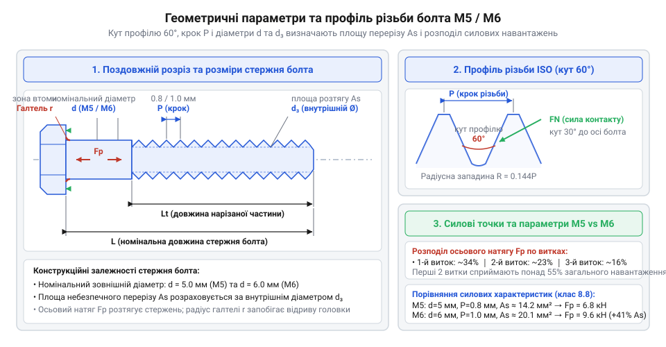
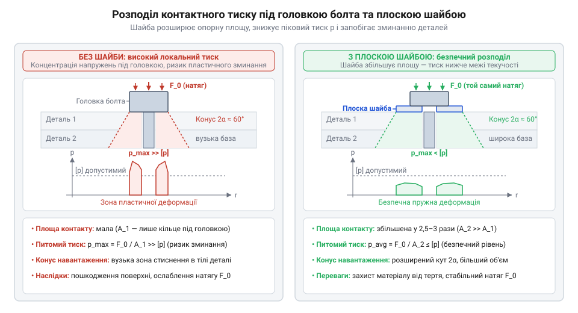
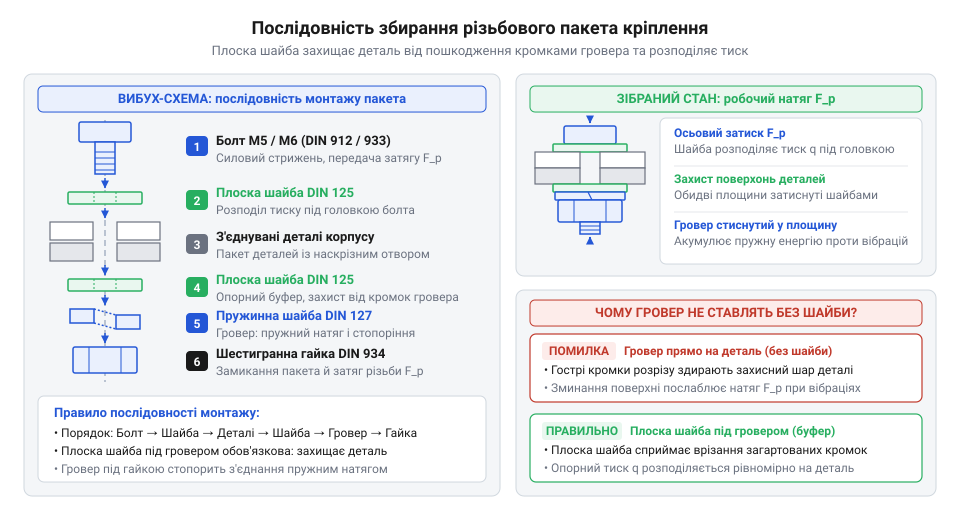
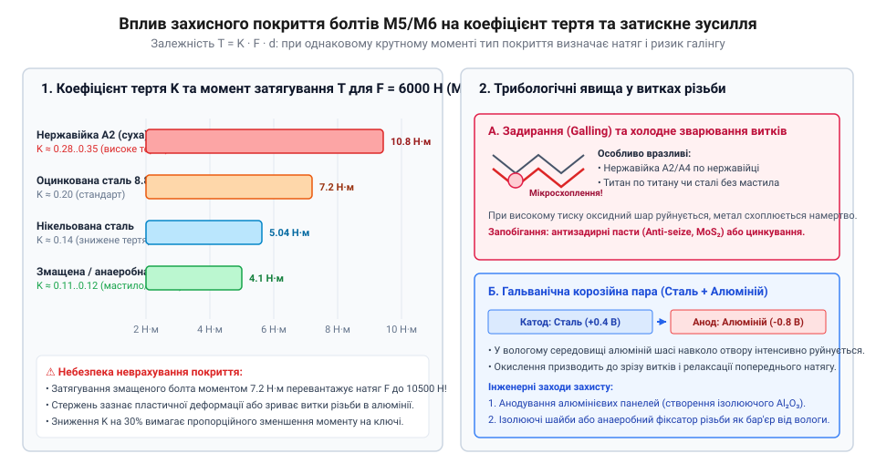
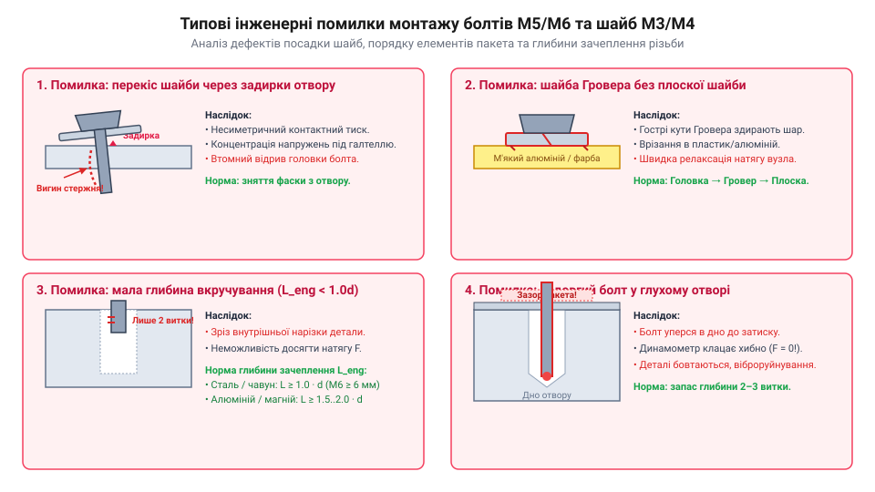

# Болти М5/М6 і шайби М3/М4

<preknowlist>
- [Набори гвинтів М3 (шестигранник, потайні DIN7991)](root:cat-hw-parts/m3-screw-kits) — конструкція дрібного метричного різьблення та принцип роботи нарізного кріплення у базових вузлах.
- [Стійки М2/М3 (латунь, нейлон)](root:cat-hw-parts/standoffs) — основи використання підкладних елементів та монтажу плат у корпусах.
</preknowlist>

## Руйнування різьбових вузлів під навантаженням

У будь-якому рухомому робототехнічному пристрої чи силовому корпусі механічні вузли постійно зазнають динамічних вібрацій, різких прискорень та змінних навантажень. Коли розробник закріплює важкий кроковий двигун, акумуляторний блок або несний кронштейн шасі безпосередньо до тонкої листової сталі, алюмінієвої пластини чи надрукованого на 3D-принтері пластикового корпусу, у місцях з'єднання виникає критична локальна напруга. Якщо кріпильні елементи підбрано без урахування механіки контактної взаємодії, вузол втрачає початкову жорсткість уже під час перших годин експлуатації: гвинти послаблюються, конструкційні отвори розбиваються, а нарізні витки зрізаються.

Головна причина таких відмов полягає в концентрованому передаванні зусилля через малу площу контакту. Головка стандартного кріпильного елемента має обмежений зовнішній діаметр. Під час затягування вся сила, яка стискає деталі, припадає на вузьке кільце матеріалу під головкою. У цьому місці виникає високий @@en|контактний тиск@@ (англ. *bearing pressure*), який дорівнює відношенню осьового зусилля до площі опорної поверхні. Якщо значення цього тиску перевищує межу плинності матеріалу корпусу, виникає @@en|пластична деформація@@ (англ. *plastic deformation*). М'який матеріал буквально «продавлюється» та витікає з-під головки. У результаті відстань між голівкою кріплення та гайкою зменшується на частки міліметра, що призводить до негайної втрати @@en|попереднього натягу@@ (англ. *preload*) різьбового з'єднання. Без попереднього натягу кріплення більше не створює потрібного @@en|затискного зусилля@@ (англ. *clamping force*, від *clamp* — затискати), і деталі починають зміщуватися одна відносно одної.

Другим деструктивним чинником у тонколистових конструкціях є @@en|зріз різьби@@ (англ. *thread stripping*). При прямому вгвинчуванні кріплення в тонку стінку корпуса завтовшки 1.0–1.5 мм кількість робочих витків різьби, що беруть участь у зачепленні, виявляється мінімальною. Під дією зовнішньої виривної сили або згинального моменту напруження зрізу на внутрішніх витках різьби перевищує допустиму міцність матеріалу стінки. Витки зминаються, і нарізне з'єднання повністю втрачає несучу здатність. При виборі [дрібних нарізних елементів](root:cat-hw-parts/m3-screw-kits) для збирання електронних модулів ця проблема постає особливо гостро, адже мала довжина зачеплення вимагає строгого дотримання нормативних зусиль затягування.

Третій механізм руйнування пов'язаний із динамічним впливом робота під час руху. Постійні циклічні вібрації викликають мікрозсуви між опорними поверхнями витків різьблення та голівкою болта. У моменти таких мікроколивань коефіцієнт тертя в різьбі короткочасно падає практично до нуля, через що виникає @@en|самовідгвинчування@@ (англ. *self-loosening*). Накопичена пружна енергія стержня болта розкручує різьбу, і з'єднання повністю розбирається самостійно.

Щоб відвернути руйнування вузлів, у проектуванні застосовують чіткий функціональний поділ. Силовий каркас і масивні агрегати вимагають високої несучої здатності стержня під час розтягування та зсуву, що забезпечується силовими метричними болтами М5 та М6. Водночас для захисту м'яких поверхонь від продавлювання та запобігання вібраційному розкручуванню у вузлах із кріпленням М3 та М4 необхідні підкладні та пружинні шайби, а при монтажі друкованих плат доцільно використовувати [латунні або нейлонові стійки](root:cat-hw-parts/standoffs) для правильного розподілу механічних навантажень.

## Силові метричні болти М5 і М6

Для сприйняття значних осьових і зсувних навантажень у каркасах та силових вузлах робототехнічних систем застосовують силові метричні болти діаметром 5 мм (`M5`) та 6 мм (`M6`). Конструктивно такий болт складається з циліндричного стержня з нарізаною зовнішньою різьбою та опорної головки різної конфігурації (шестигранної, з внутрішнім шестигранником або циліндричної). Геометрична характеристика різьбового стержня визначає його стійкість до розтягування та зрізу.


*Геометричні параметри силового метричного болта М5/М6: крок різьби, внутрішній діаметр та кут профілю визначають площу небезпечного перерізу та граничне затискне зусилля.*

Історично розробка уніфікованої метричної різьби ISO (International Organization for Standardization) та впровадження міжнародних стандартів DIN (Deutsches Institut für Normung) розв'язали критичну проблему сумісності деталей у машинобудуванні. Перехід від різноманітних дюймових та кустарних нарізок до єдиного метричного профілю з кутом вершини 60 градусів дозволив стандартизувати геометричні ряди діаметрів від дрібних М3 й М4 до силових М5 та М6. Стандартизований крок різьби та стандарти коефіцієнтів міцності забезпечили строгу взаємозамінність кріпильних елементів різних виробників, гарантуючи передбачувані механічні характеристики різьбового з'єднання в будь-якому конструкційному вузлі.

Основними геометричними параметрами кріплення є номінальний діаметр різьби `d` та її @@en|крок різьби@@ (англ. *thread pitch*) `P` — відстань між сусідніми вершинами профілю уздовж осі стержня. Для стандартного основного метричного різьблення крок становить `P = 0.8` мм для `M5` та `P = 1.0` мм для `M6`. При затягуванні болта внутрішні напруження розтягування зосереджуються у найвужчому місці — площі небезпечного перерізу `A_s`. Розрахункова площа небезпечного перерізу враховує середній та внутрішній діаметри різьби й визначається геометричною будовою трикутного профілю ISO. Для болта `M5` площа перерізу становить `A_s ≈ 14.2` мм², тоді як для `M6` вона досягає `A_s ≈ 20.1` мм². Перехід від `M5` до `M6` збільшує ефективну площу сприйняття навантаження на 41.5%, що надає суттєвий прирост несучої здатності при незначному збільшенні габаритів.

Механічні властивості металевого кріплення регламентує @@de|клас міцності@@ (нім. *Festigkeitsklasse*). Маркування класу міцності складається з двох чисел, розділених крапкою (наприклад, 4.8, 8.8, 10.9 або 12.9). Перше число, помножене на 100, вказує на тимчасовий опір розриву `R_m` у мегапаскалях (МПа). Друге число вказує на відношення межі плинності `R_e` до тимчасового опору розриву, виражене у десятках відсотків. Для найпоширенішого силового класу 8.8 тимчасовий опір розриву становить `R_m = 8 × 100 = 800` МПа, а межа плинності обчислюється як 80% від `R_m`, тобто `R_e = 0.8 × 800 = 640` МПа.

Граничне осьове @@en|попереднє затягування@@ (англ. *preload force*) `F_p`, яке може безпечно створювати болт без ризику незворотної пластичної деформації стержня, розраховують за площею небезпечного перерізу `A_s` та межою плинності `R_e` з урахуванням нормативного коефіцієнта запасу 0.75:

```
F_p = 0.75 × R_e × A_s
= 0.75 × 640 × 20.1          [значення для болта M6 класу 8.8]
= 9648 N                     [граничне осьове зусилля]
```

Це значення показує, що один силовий болт `M6` класу міцності 8.8 здатний забезпечити затискне зусилля понад 9.6 кілоньютонів (що еквівалентно утриманню маси майже 980 кг). Для аналогічного болта `M5` класу 8.8 граничне зусилля становить близько 6.8 кН. Для розрахунку крутного моменту затягування, який необхідно прикласти до головки болта для досягнення такого затискного зусилля, враховують коефіцієнти тертя у різьбі та на опорному торці головки; детальну математичну модель для [розрахунку затягування різьбового з'єднання](root:cat-hw-parts/bolts-and-washers/math-threaded-joint-mechanics.md) винесено в окрему статтю.

При виборі довжини силового болта необхідно гарантувати, щоб довжина зачеплення різьби `L_e` в глухому отворі або гайці перевищувала один номінальний діаметр болта (`L_e ≥ 1.0 × d`) для сталі, півтора діаметри (`L_e ≥ 1.5 × d`) для чавуну та не менше двох діаметрів (`L_e ≥ 2.0 × d`) для алюмінієвих сплавів. Для захисту від впливу зовнішнього середовища металеві болти піддають спеціальній обробці, про що детальніше розказано у статті про [гальванічні антикорозійні покриття](root:cat-hw-parts/cat-hw-corrosion-protection-coatings).

## Функції та геометрія шайб М3/М4

У той час як силові болти М5 та М6 відповідають за фіксацію масивних елементів каркаса, з'єднання малогабаритних вузлів, датчиків та плат керування найчастіше виконують кріпленням М3 та М4. Невелика площа опорної поверхні головок гвинтів і болтів М3/М4 створює високе локальне напруження, що загрожує пошкодженням крихких або м'яких матеріалів. Для розв'язання цієї проблеми в різьбовий пакет впроваджують підкладні (плоскі) та противібраційні (пружинні) шайби.

Основним завданням @@de|плоскої шайби@@ (нім. *Scheibe* — диск) є збільшення опорної площі контакту під головкою кріплення або гайкою та @@en|перерозподіл контактного тиску@@ (англ. *clamping force redistribution*). Стандартна плоска шайба М3 за стандартом DIN 125 має внутрішній діаметр 3.2 мм, зовнішній діаметр 7.0 мм і товщину 0.5 мм. Площа її опорної поверхні становить близько 30 мм², що удвічі перевищує площу контакту головки звичайного гвинта М3. Збільшена плоска шайба DIN 9021 (кузовна шайба) для М3 має зовнішній діаметр 9.0 мм, що розширює площу контакту до 55 мм² — майже у 3.7 раза порівняно зі стандартною головкою.


*Концептуальна схема розподілу контактного тиску під головкою кріплення: плоска шайба розширює конус напружень і знижує питомий тиск на поверхню з'єднуваної деталі.*

Фізичний ефект застосування плоскої шайби полягає в конусоподібному розсіюванні стискальних напружень під кутом приблизно 45 градусів крізь товщину шайби. Внаслідок цього середній питомий контактний тиск `q` на деталь знижується зворотньо пропорційно площі контакту `A_c`:

```
q = F_p / A_c
= F_p / (π × (r_outer² - r_inner²))          [формула площі кільцевого контакту]
```

Завдяки зниженню тиску `q` нижче межі плинності матеріалу деталі запобігається пластичне продавлювання акрилу, композитів, текстоліту та тонких алюмінієвих стінок.

Для захисту від самовідгвинчування в умовах вібрацій застосовують пружинну шайбу, або @@en|шайбу Гровера@@ (нім. *Grover-Scheibe*, названу на честь винахідника Джона Гровера, DIN 127). Вона являє собою розрізане кільце з пружинної сталі, кінці якого зміщені у протилежні боки вздовж осі. Пружинна шайба М3 або М4 працює за двома механізмами:

1. **Пружна компенсація релаксації:** під час затягування розрізане кільце стискається в площину, акумулюючи пружну енергію. Якщо внаслідок температурного розширення або зминання мікронеровностей початковий натяг різьби послаблюється, пружинна шайба розтискається, підтримуючи залишкове осьове затискне зусилля. 2. **Механічне зачеплення:** гострі загартовані кромки розрізу пружинної шайби під час спроби відгвинчування врізаються в матеріал опорного торця головки та поверхню деталі, створюючи механічний упор проти обертання проти годинникової стрілки.


*Правильна послідовність збирання різьбового пакета: плоска шайба захищає поверхню деталі від пошкодження гострими краями пружинної шайби Гровера.*

При компонуванні різьбового вузла критично дотримуватися правильної послідовності розміщення елементів. Гострі кромки пружинної шайби Гровера не повинні безпосередньо контактувати з м'яким матеріалом деталі або пластиком, оскільки при затягуванні вони зріжуть захисний шар і деформують деталь. Правильний порядок складання пакета такий: головка болта (або гвинта) -> плоска шайба -> з'єднувані деталі -> плоска шайба -> пружинна шайба Гровера -> [метрична гайка](root:cat-hw-parts/cat-hw-nuts-and-threaded-inserts). Плоска шайба підкладається під пружинну, сприймаючи врізання її кромок і рівномірно передаючи тиск далі на корпус.

У вузлах із підвищеними вібраціями або там, де застосування деформуючих шайб неприпустиме (наприклад, поблизу чутливих оптичних датчиків), альтернативою пружинним шайбам виступають [анаеробні фіксатори різьбових з'єднань](root:cat-hw-parts/thread-locking-methods). Покрокові інструкції та практичні методики щодо вибору інструменту й збирання конструкцій наведено у виданні про [монтаж силового каркаса](root:cat-hw-parts/bolts-and-washers/proj-chassis-fastener-assembly.md).

## Взаємодія різьбового вузла та покриття

Два однакові на вигляд болти М5 або М6 можуть поводитися по-різному під час затягування: один надійно фіксує деталь, а інший розгвинчується від мікровібрації або намертво заклинює ще до досягнення розрахункового натягу. Причина полягає у фізиці контактної взаємодії поверхонь, яку вивчає @@el|трибологія@@ (грецьк. *tribos* — тертя, *logos* — вчення). Під час обертання різьбового кріплення до 85–90% прикладеного крутного моменту витрачається на подолання тертя у витках та під головкою болта, і лише 10–15% перетворюється на корисне осьове затискне зусилля.

Характер тертя у з'єднанні визначається захисно-декоративним покриттям металу. Оцинкована сталь забезпечує стабільний коефіцієнт тертя в межах `μ = 0.14 ÷ 0.18` у сухому стані, що робить розрахунок затиску передбачуваним. Нікельоване кріплення має нижчий коефіцієнт тертя `μ = 0.11 ÷ 0.14` завдяки високій гладкості нікелевого шару. Це дає змогу отримати більше осьове зусилля при одинаковому моменті затягування, проте без використання контруючих шайб М3/М4 суттєво зростає ризик самовільного розгвинчування вузла під дією динамічних навантажень. Для кріплення з нержавіючої сталі (марки A2 та A4) характерний високий коефіцієнт тертя `μ = 0.25 ÷ 0.35` та схильність до поверхневого схоплювання витків під тиском — явища, яке називається @@en|галінг@@ (англ. *galling* — задір, заклинювання). Під час закручування нержавіючого болта М6 у нержавіючу різьбу тонкий оксидний шар руйнується, виникає мікрозварювання металу, і вузол повністю заклинює без можливості безрозбірного демонтажу.

Для розрахунку необхідного крутного моменту `T` (у ньютон-метрах) залежно від бажаного осьового зусилля затиску `F` (у ньютонах), номінального діаметра болта `d` (у метрах) та коефіцієнта тертя `K` застосовують математичний взаємозв'язок силових параметрів.

**Розрахунок моменту затягування для болта М6 при зміні стану поверхні**

```
T = F × d × K
= 6000 × 0.006 × 0.20    [обчислення моменту для сухої оцинкованої сталі при K = 0.20]
= 7.20                   [результат моменту затягування у ньютон-метрах]

T_nickel = 6000 × 0.006 × 0.14   [обчислення моменту для нікельованого кріплення зі змащенням при K = 0.14]
= 5.04                   [результат моменту затягування у ньютон-метрах]
```

З обчислення видно, що для досягнення одинакового затискного зусилля 6000 Н нікельований болт потребує на 30% меншого моменту затягування. Спроба затягнути нікельований або змащений болт із зусиллям, розрахованим для сухої сталі, призводить до пластичного витягування стержня або зрізу витків. Познайомитися з повною математичною моделлю розподілу тиску та тертя у витках можна за [розрахунком механічних параметрів](root:cat-hw-parts/bolts-and-washers/math-threaded-joint-mechanics.md) різьбового контакта.


*Порівняння сухого, цинкованого та масляного контактів різьби М5/М6 показує різку зміну затискного зусилля при однаковому моменту затягування.*

При монтажі болтів М5/М6 і шайб М3/М4 у металеві корпуси та шасі виникає проблема контакту різнорідних металів. Якщо сталевий або нікельований болт встановлюють безпосередньо в отвір алюмінієвої деталі за наявності вологи, виникає @@it|гальванічна корозія@@ (італ. *Galvani* — прізвище науковця Луїджі Гальвані, лат. *corrosio* — роз'їдання). Алюміній має більш негативний електрохімічний потенціал, тому виконує роль анода й прискорено руйнується навколо кріпильного отвору, перетворюючись на пухкий оксид. Щоб уникнути цього, застосовують кріплення з анодованого алюмінію, де поверхня захищена ізолювальним шаром оксиду шляхом електрохімічного процесу — @@el|анодування@@ (грецьк. *anodos* — рух вгору, анод). *anodos* — рух вгору). Також ефективним є використання захисних покриттів, описаних у матеріалі про [спеціалізовані антикорозійні покриття](root:cat-hw-parts/cat-hw-corrosion-protection-coatings) металевих елементів.

Експлуатація кріплення у вологому середовищі або при перепадах температур супроводжується ризиком конденсації вологи всередині герметичних об'ємів, що викликає точкове руйнування металу — @@en|пітинг@@ (англ. *pitting* — утворення виразок). Запобігти накопиченню конденсату в корпусі допомагають [захисними вентиляційними мембранами](root:cat-hw-parts/eptfe-protective-vents) з матеріалу ePTFE. Для одночасного герметичного ущільнення зазору різьби та запобігання корозії застосовують [анаеробні фіксатори з'єднань](root:cat-hw-parts/thread-locking-methods), які полімеризуються у міжвитковому просторі без доступу повітря.

## Компонування та помилки монтажу кріплення

Правильне компонування різьбового вузла з болтами М5/М6 та шайбами М3/М4 полягає у створенні стабільного пружного натягу, який утримує з'єднувані деталі корпусу без їх деформації протягом усього терміну служби. Надійність вузла визначається не лише якістю самих деталей, а й дотриманням технології монтажу та відсутністю типових конструктивних помилок.

Існує чотири головні помилки під час збирання рознімних з'єднань, які призводять до відмови кріплення:

1. **Надмірне затягування**. Перевищення допустимого моменту затягування виводить матеріал болта за межу пружної деформації у зону пластичності. Стержень болта М5 або М6 незворотно витягується, втрачаючи пружні властивості. У разі монтажу у м'які матеріали (м'які алюмінієві сплави, листовий пластик, деталі 3D-друку) надмірне зусилля викликає продавлювання поверхні під головкою або шайбою, що призводить до негайного падіння натягу. 2. **Перекіс шайб та елементів**. Встановлення шайби М3 або М4 на нерівну поверхню з заудирами створює несиметричну опору для головки болта. У результаті болт зазнає не лише осьового розтягу, а й згину. На галтелі (переході від головки до стержня) виникає питома концентрація напружень, яка під час вібрації швидко призводить до втомного відриву головки. 3. **Відсутність контруючих елементів**. Під дією змінних механічних навантажень та вібрацій коефіцієнт тертя у різьбі періодично падає до нуля. Якщо вузол не оснащений пружинною шайбою Гровера або рідким фіксатором, виникає самовільне викручування болта з повною втратою герметичності й міцності корпусу. 4. **Нехтування довжиною зчеплення різьби**. Мінімальна довжина вкручування стержня `L_eng` у внутрішню різьбу має відповідати міцності матеріалу деталі. Для сталевих гайок достатньо глибини `L_eng ≥ 1.0d` (5 мм для М5 та 6 мм для М6). При вкручуванні в алюміній або пластик довжина зчеплення повинна становити не менше `1.5d ÷ 2.0d` (8–10 мм для М5 та 9–12 мм для М6). Недотримання цієї глибини спричиняє зріз витків у м'якшій внутрішній різьбі під час затягування.

При монтажі кріплення у тонкостінні корпуси або пластикові панелі, де нарізання міцної різьби неможливе, використовують [різьбові втулки для монтажу](root:cat-hw-parts/cat-hw-nuts-and-threaded-inserts). Вони перерозподіляють зсувне навантаження на більшу зовнішню площу пластику чи алюмінію. Для розв'язання задач внутрішнього рознесення друкованих плат відносно металевого шасі застосовують [латунні та нейлонові стійки](root:cat-hw-parts/standoffs), які гарантують ізоляцію та жорстку дистанцію без деформації плати.

Технологічний процес збирання силового різьбового вузла виконують у такій послідовності. Спочатку очищають контактні поверхні від бруду та стружки. На деталь укладають плоску шайбу відповідного розміру (М3, М4, М5 або М6), яка збільшує площу опирання й захищає поверхню від подряпин. Поверх плоскої шайби встановлюють пружинну шайбу Гровера, після чого вставляють болт або накручують гайку. Попереднє закручування виконують вручну на 3–4 витки, щоб виключити перекошування різьби. Затягування до робочого стану здійснюють динамометричним інструментом — @@el|динамометр@@ (грецьк. *dynamis* — сила, *metron* — вимірювач). *dynamis* — сила, *metron* — міра) або динамометричний ключ гарантує точний контроль моменту. При збиранні багатоболтових фланців корпусу затягування проводять хрест-нанакриж у два або три проходи (50%, 75% та 100% зусилля). Докладно практичний порядок збирання силового каркаса висвітлено у [керівництві з монтажу](root:cat-hw-parts/bolts-and-washers/proj-chassis-fastener-assembly.md) робототехнічних конструкцій.


*Перекіс шайби та недотримання глибини вкручування призводять до вигинання болта й передчасного зрізу витків.*

Для зручності проведення монтажних робіт у майстерні дрібні деталі, плоскі й пружинні шайби, а також болти різних довжин варто впорядкувати, використовуючи [зручний детальний органайзер](root:cat-hw-parts/parts-organizer). У разі відсутності під рукою потрібних стандартних метизів для допоміжних вузлів підбирають [готові набори гвинтів](root:cat-hw-parts/m3-screw-kits) або додаткові [набори дрібних елементів](root:cat-hw-parts/m25-fastener-kit). Якщо необхідно тимчасово зафіксувати ненавантажений елемент оздоблення корпусу без використання різьби, фіксацію здійснюють [ціаноакрилатним клеєм](root:cat-hw-parts/cyanoacrylate-glue).