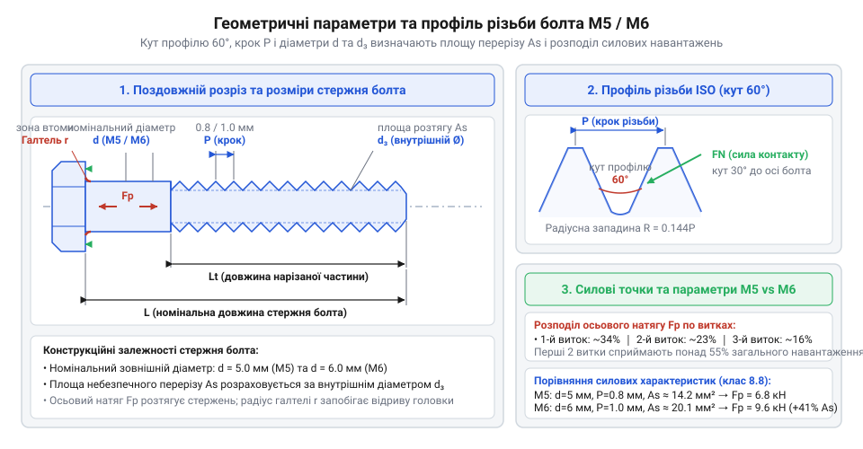
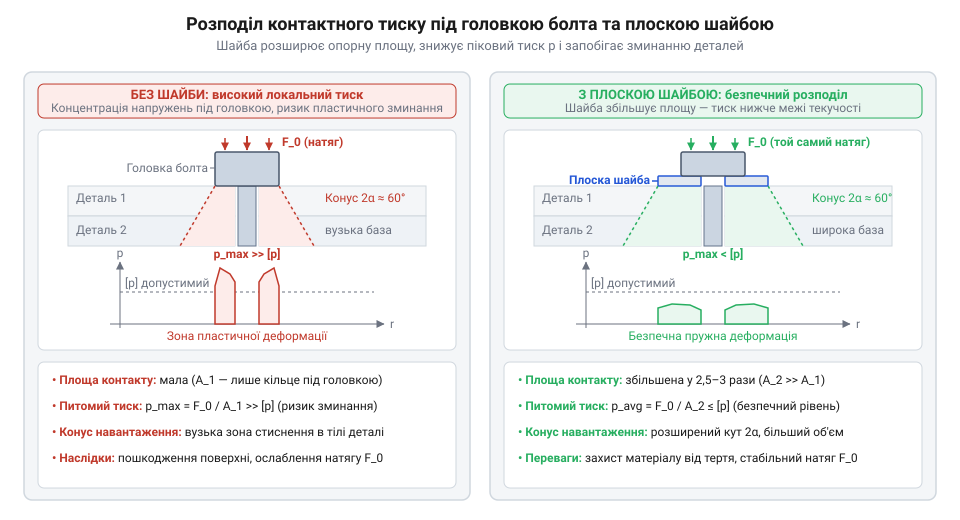
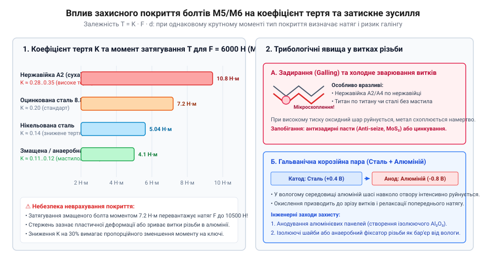
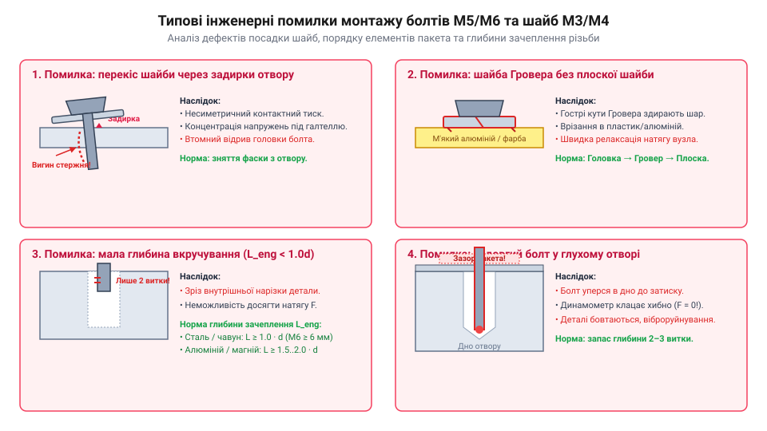
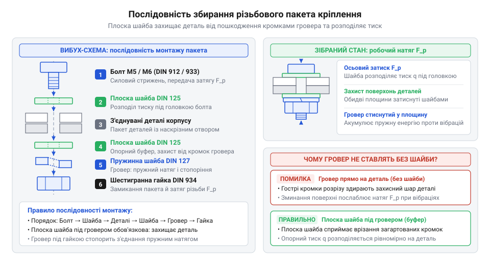

# Болти М5/М6 і шайби М3/М4

<preknowlist>
- [Набори гвинтів М3 (шестигранник, потайні DIN7991)](root:cat-hw-parts/m3-screw-kits) — геометрія метричної різьби та базовий принцип передачі навантаження в нарізному кріпленні
- [Стійки М2/М3 (латунь, нейлон)](root:cat-hw-parts/standoffs) — правила механічної фіксації плат та застосування підкладних опорних елементів у корпусах
</preknowlist>

## Руйнування різьбових вузлів під навантаженням

Коли нарізне з'єднання працює під навантаженням, головка болта передає тиск на опорну поверхню деталі. Якщо матеріал корпусу надто м'який, тиск перевищує його межу плинності, що викликає пластичне продавлювання й падіння попереднього натягу. У тонкостінних деталях коротка довжина зачеплення веде до зрізу витків різьби. Додатково виникає вібраційне самовідгвинчування через періодичне падіння сил тертя. Щоб уникнути цього, силові болти приймають навантаження, а шайби розподіляють тиск і блокують відгвинчування.

## Силові метричні болти М5 і М6

Для забезпечення надійного з'єднання каркасів і масивних агрегатів застосовують силові метричні болти з номінальним діаметром різьби 5 та 6 міліметрів. Геометрія таких болтів базується на стандартному трикутному профілі ISO з кутом при вершині 60 градусів, де вершини та западини зрізані для зниження концентрації напружень. Важливою характеристикою є крок різьби, тобто осьова відстань між сусідніми витками. Болти М6 мають більший крок та більшу площу небезпечного перерізу порівняно з М5, що забезпечує їм вищу несучу здатність під час розтягу й зсуву.

*Геометрія силових болтів М5 і М6 визначає їхню стійкість до розтягу й зсуву залежно від площі небезпечного перерізу.*

Міцність болта визначається маркуванням класу міцності, наприклад `8.8` чи `10.9`, де перше число помножене на сто дає номінальну межу міцності на розрив у мегапаскалях, а добуток першого і другого чисел, помножений на десять, вказує межу плинності. Знаючи межу плинності та площу перерізу, інженер обчислює граничне затискне зусилля попереднього натягу. Для запобігання вириванню витків у внутрішній різьбі деталі необхідно витримувати мінімальну нормативну довжину зачеплення, яка залежить від співвідношення міцностей матеріалу болта і корпусу.

## Функції та геометрія шайб М3/М4

У малогабаритних вузлах під час кріплення гвинтами М3 та М4 зусилля затягування створює високий контактний тиск, здатний пошкодити крихкий текстоліт чи м'який алюміній. Плоскі шайби розширюють конус напружень і знижують питомий тиск.

*Плоска шайба захищає деталі, а шайба Гровера блокує самовідгвинчування.*

Для захисту від вібрацій застосовують пружинні шайби Гровера. Розрізане кільце пружно підтискає головку, компенсуючи релаксацію натягу. Загартовані кромки врізаються в поверхні, створюючи механічний бар'єр проти самовідгвинчування.

## Взаємодія різьбового вузла та покриття

Під час затягування різьбового з'єднання більша частина крутного моменту витрачається на тертя у витках і під головкою болта, а не на корисний натяг. Захисні покриття (цинк завтовшки `5–15 µm`, нікель) змінюють коефіцієнт тертя, що вимагає коригування моменту затягування: надто мале тертя перевищує межу плинності, а надто велике заважає натягу. У нержавіючій сталі виникає адгезійне схоплювання (галінг@@en|galling@@), а в парі зі сталлю та алюмінієм — контактна гальванічна корозія, яку нейтралізують ізолюючими прокладками чи мастилами.

*На діаграмі зображено залежність між типом захисного покриття болта та коефіцієнтом тертя, з якої видно вплив мастил на ефективність попереднього натягу.*

## Компонування та помилки монтажу кріплення

Надійність рознімного вузла залежить від технології складання. Надмірне затягування виводить матеріал за межу плинності, а перекіс шайб створює згинальні напруження, що веде до втомного відриву головки болта.

*Перекіс шайб та неправильна послідовність пакету створюють згин стержня і концентрують напруження, що веде до руйнування.*

Для запобігання аваріям дотримуйтесь послідовності: знизу детальна поверхня, потім плоска шайба для захисту матеріалу, пружинна шайба Гровера, і зверху головка болта. Не ставте гострі кромки шайби на м'який алюміній. Використовуйте динамометричний ключ, а багатоболтові з'єднання затягуйте поетапно хрест-навхрест.

*На схемі показано правильний багатошаровий пакет з'єднання з послідовним розташуванням плоских та пружинних елементів, що гарантує рівномірний розподіл зусиль.*