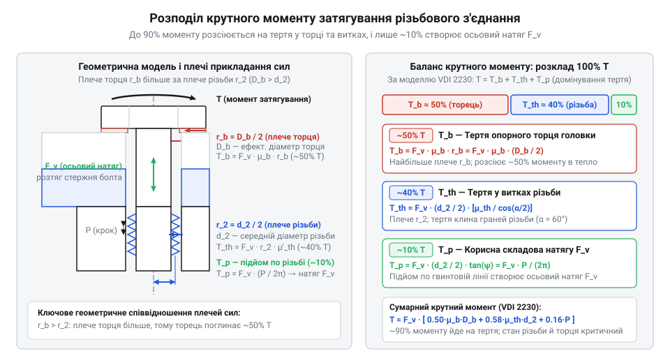
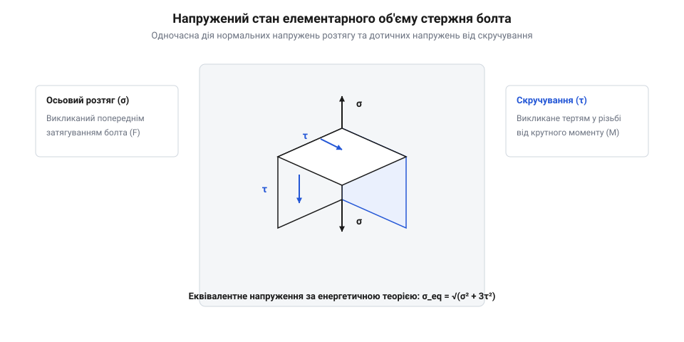
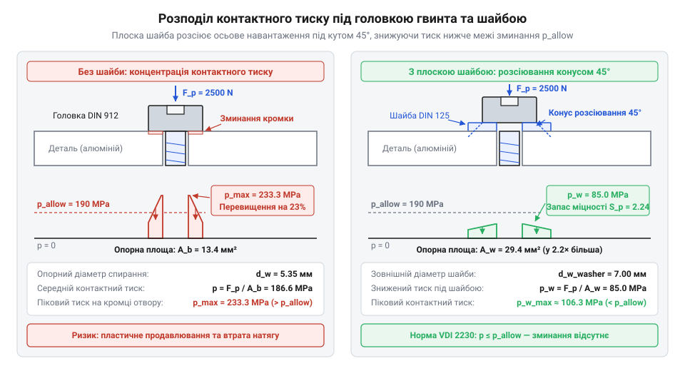

# Розрахунок затягування різьбового з'єднання та контактного тиску

<preknowlist>
- [Набори гвинтів М3 (шестигранник, потайні DIN7991)](root:cat-hw-parts/m3-screw-kits) — геометрія циліндричних та потайних головок, номінальні кроки метричної різьби та типи шліців для прикладання моменту
- [Стійки М2/М3 (латунь, нейлон)](root:cat-hw-parts/standoffs) — механічні характеристики латуні та нейлону, схильність різьбових отворів у м'яких матеріалах до пластичної деформації та зриву різьби
</preknowlist>

## Механічні відмови неконтрольованого затягування кріплення

Монтаж кріплення «за відчуттям руки» робить з'єднання непередбачуваним: зусилля стискання деталей відхиляється від розрахункового в кілька разів, веде до слабкого затиску або руйнівного перевантаження.

За слабкого затягування осьове зусилля попереднього затягування (англ. @@en|preload@@, від лат. *prae-* — попереду, та англ. *load* — навантаження) не фіксує стик. Вібрації спричиняють мікрозсуви деталей, тертя спокою падає, і кріплення відкручується згідно з механікою [вібраційного самовідгвинчування різьби](root:cat-hw-parts/threaded-fasteners-vibration-locking).

Надмірне зусилля спричиняє обрив стержня при монтажі. Під одночасною дією розтягу та скручування напруження перевищують межу плинності (англ. @@en|yield strength@@, від давньоангл. *gieldan* — поступатися): метал зазнає пластичної деформації (англ. @@en|plastic deformation@@, від грец. *plastikos* — придатний для ліплення, та лат. *deformare* — спотворювати), незворотно витягується або відривається по западині першого робочого витка.

Друга аварія — зрив нарізних витків (англ. @@en|thread shear@@, від давньоангл. *sceran* — зрізати). Коли сталевий гвинт закручують у м'який метал чи різьблення в [латунних чи нейлонових стійках](root:cat-hw-parts/standoffs), зусилля перевищує опір матеріалу зрізу: гребені нарізки зрізаються вздовж циліндричної поверхні, позбавляючи стик тримальної здатності.

Третя відмова проявляється зминанням деталі. Якщо крутний момент затягування (англ. @@en|tightening torque@@, від лат. *torquere* — скручувати) створює надмірний контактний тиск, опорний торець головки продавлює поверхню на десятки мікрометрів. Таке просідання спричиняє релаксацію затягу (англ. @@en|stress relaxation@@, від лат. *relaxare* — послаблювати): натяг стержня спадає, і стик послаблюється.

Табличні моменти без урахування тертя не рятують від аварій. Довідники припускають нормативний коефіцієнт тертя (англ. @@en|friction coefficient@@, від лат. *fricare* — терти) `μ ≈ 0.12..0.15`. На сухій поверхні тертя сягає `μ = 0.25..0.35`, створюючи недотяг, а випадкове змащення знижує його до `μ = 0.08`, подвоюючи натяг і обриваючи стержень. Запобігання поломкам вимагає точного розрахунку балансу моменту та напружень у стержні.

## Фізична модель розподілу крутного моменту

Крутний момент, прикладений до головки болта чи гайки, лише частково перетворюється на зусилля стискання деталей. Механізм різьби працює як похила площина: витки ковзають один по одному під навантаженням, а опорний торець тисне на поверхню.

Прикладений момент `T` ділиться на три складові:
- корисний момент `T_p` для підйому по гвинтовій лінії різьби;
- момент тертя у витках `T_th`;
- момент тертя на опорному торці головки `T_b`.


*Баланс моменту затягування: до 90% енергії розсіюється на тертя, і лише 10–15% створює корисний натяг.*

Метрична нарізка @@en|ISO@@ має номінальний діаметр `d`, крок `P` та середній діаметр `d_2`. Кут підйому гвинтової лінії `φ` визначається через крок і середній діаметр:

```
tan(φ) = P / (π · d_2)
```

Корисний момент `T_p`, що створює осьове зусилля @@en|preload@@ `F_p`, обчислюється через радіус `d_2 / 2` та тангенс кута підйому:

```
T_p = F_p · (d_2 / 2) · tan(φ)
    = F_p · P / (2 · π)
```

На бічних гранях витків із кутом профілю `α = 60°` нормальна сила зростає в `1 / cos(30°)` раза, а ефективний коефіцієнт тертя становить `μ_th' = μ_th / cos(30°)`. Момент тертя у витках `T_th` дорівнює:

```
T_th = F_p · (μ_th · d_2) / (2 · cos(30°))
```

Під опорною поверхнею головки зусилля передається через кільцевий контакт із зовнішнім діаметром `d_w` та внутрішнім `d_h`. Ефективний діаметр тертя торця `d_b` обчислюється як:

```
d_b = (2 / 3) · (d_w³ - d_h³) / (d_w² - d_h²)
```

Момент тертя на опорному торці `T_b` визначається через силу затягування, коефіцієнт тертя `μ_b` та радіус тертя:

```
T_b = F_p · μ_b · (d_b / 2)
```

Повний крутний момент затягування `T` є сумою всіх трьох складових:

```
T = T_p + T_th + T_b
  = F_p · [ P / (2 · π) + (μ_th · d_2) / (2 · cos(30°)) + (μ_b · d_b) / 2 ]
```

Для спрощення розрахунків використовують безрозмірний коефіцієнт моменту (@@en|nut factor@@ / @@en|torque coefficient@@, `K`):

```
T = K · F_p · d
```

Вираз для коефіцієнта моменту `K` має вигляд:

```
K = (1 / d) · [ P / (2 · π) + (μ_th · d_2) / (2 · cos(30°)) + (μ_b · d_b) / 2 ]
```

Для стандартних сталевих оцинкованих болтів без змащення `K ≈ 0.20`.

**Розрахунок моменту затягування для болта М6 під зусилля затиску `F_p = 9000 N` за коефіцієнтів тертя `μ_th = μ_b = 0.15`**

```
T_p = 9000 · 0.001 / (2 · π)
    = 1.432 N·m                              [корисний момент підйому]

T_th = 9000 · (0.15 · 0.00535) / (2 · 0.866)
     = 4.168 N·m                             [момент тертя у витках різьби]

T_b = 9000 · 0.15 · (0.008 / 2)
    = 5.400 N·m                              [момент тертя під опорним торцем]

T = 1.432 + 4.168 + 5.400
  = 11.000 N·m                               [сумарний крутний момент затягування]
```

Фактичний коефіцієнт моменту становить `K ≈ 0.204`. Опір торця `T_b` сприймається детаттю, тоді як момент у витках скручує стержень болта навколо осі, доповнюючи осьовий розтяг.

## Напружений стан стержня силового болта

Під час затягування силових типорозмірів @@en|M5@@ та @@en|M6@@ у навантажених механічних вузлах стержень кріплення зазнає комбінованого навантаження. Одночасно з осьовою силою розтягу `F_p` стержень сприймає скручувальний момент у різьбі `T_thread = T - T_b`. У поперечному перерізі металу виникає складний плоский напружений стан, де нормальні напруження розтягу поєднуються з дотичними напруженнями зсуву від кручення.


*Схема ілюструє складові напруженого стану в елементарному об'ємі стержня, демонструючи одночасну дію нормальних напружень розтягу та дотичних напружень від скручування.*

Осьова сила `F_p` створює поздовжні нормальні напруження. Нарізка послаблює стержень болта: канавки витків зменшують площу суцільного металу. Розрахунковий діаметр розтягу `d_s` обчислюється як середнє арифметичне між середнім діаметром `d_2` та внутрішнім діаметром по западинах зовнішньої різьби `d_3`:

```
d_s = (d_2 + d_3) / 2
```

Знайдемо розрахункову площу перерізу різьби на розтяг `A_s` як площу круга розрахункового діаметра `d_s`:

```
A_s = (π / 4) · d_s²
    = (π / 4) · [(d_2 + d_3) / 2]²
```

Для стандарту @@en|ISO 898-1@@ площа для болта М5 становить `A_s = 14.2 mm²`, а для болта М6 — `A_s = 20.1 mm²`. Нормальне напруження розтягу `σ` у перерізі болта обчислюється через осьову силу та площу розтягу:

```
σ = F_p / A_s
```

Скручувальний момент у різьбі створює на поверхні стержня дотичні напруження скручування `τ`. Полярний момент опору круглого перерізу визначається як:

```
W_p = (π · d_s³) / 16
```

Знайдемо максимальне дотичне напруження скручування `τ` від моменту тертя у витках:

```
τ = T_thread / W_p
  = (16 · T_thread) / (π · d_s³)
```

Для оцінки переходу металу в пластичний стан застосовують критерій плинності фон Мізеса. Еквівалентне напруження `σ_eq` для сумісної дії розтягу та скручування обчислюється так:

```
σ_eq = √(σ² + 3 · τ²)
```

Множник `3` відображає руйнівний внесок зсуву. Еквівалентне напруження порівнюють із механічною межею плинності металу. Властивості сталевих болтів нормуються класом міцності за стандартом ISO 898-1 (наприклад, 8.8 чи 10.9). За стандартом @@de|VDI 2230@@ допустиме еквівалентне напруження під час монтажу обмежується часткою від нормативної межі плинності:

```
σ_allow = 0.90 · R_p0.2
```

Знайдемо коефіцієнт запасу міцності за межею плинності `S_y`:

```
S_y = R_p0.2 / σ_eq
```

Умова `S_y ≥ 1.10` гарантує відсутність залишкових пластичних подовжень стержня кріплення після затягування. Для оцінки довговічності вузла під циклічними навантаженнями варто вивчити [втомну міцність різьбових з'єднань](root:cat-hw-parts/bolted-joint-fatigue-strength).

**Перевірка напруженого стану болта М6 класу міцності 8.8 при монтажному затягуванні**

Вихідні дані: `F_p = 9000 N`, `A_s = 20.1 mm² = 20.1 · 10⁻⁶ m²`, `d_s ≈ 5.059 · 10⁻³ m`, `T_thread = 5.6 N·m`, `R_p0.2 = 640 MPa`. Визначимо напруження в перерізі стержня:

```
σ = 9000 / (20.1 · 10⁻⁶)
  = 447.8 MPa                                [нормальне напруження розтягу]

W_p = (π · (5.059 · 10⁻³)³) / 16
    = 2.542 · 10⁻⁸ m³                        [полярний момент опору перерізу]

τ = 5.6 / (2.542 · 10⁻⁸)
  = 220.3 MPa                                [дотичне напруження скручування]

σ_eq = √((447.8)² + 3 · (220.3)²)
     = √(200525 + 3 · 48532)                 [піднесення компонентів до квадрата]
     = √(200525 + 145596)                    [урахування коефіцієнта зсуву 3]
     = √346121
     = 588.3 MPa                             [еквівалентне напруження фон Мізеса]

S_y = 640.0 / 588.3
    = 1.088                                  [коефіцієнт запасу за межею плинності]
```

Еквівалентне напруження досягає 91.9% межі плинності, залишаючись у зоні пружності. Оцінка за чистим розтягом дала б занижене значення і створила б оманливе уявлення про запас міцності.

## Розрахунок контактного тиску під шайбами

Коли стержень болта витримує навантаження без переходу в пластичний стан, навантаження переходить на опорну зону деталей. Осьове зусилля @@en|preload@@ `F_p` передається через кільцеву поверхню під головкою або гайкою. На м'яких матеріалах — алюмінії, латуні чи полімерах — виникає надмірний контактний тиск (англ. @@en|bearing pressure@@). Перевищення межі зминання спричиняє пластичне втискання головки, що зменшує товщину пакета. Оскільки пружне видовження коротких гвинтів М3 та М4 становить лише 10–25 мкм, зминання на 10 мкм знижує затискне зусилля на 40–100%, викликаючи руйнівну @@en|stress relaxation@@.

Опорна площа контакту під головкою гвинта `A_b` визначається як різниця площ зовнішнього опорного кола діаметра `d_w` та прохідного отвору `d_h`:

```
A_b = (π / 4) · (d_w² - d_h²)
```

Середній контактний тиск `p` під опорною головкою дорівнює:

```
p = F_p / A_b
```

Біля кромки отвору виникає концентрація напружень, де піковий тиск перевищує середнє значення на 20–30%.


*Схема показує розподіл контактного тиску під опорною головкою гвинта без шайби та з плоскою шайбою: конус розсіювання навантаження під кутом 45° збільшує опорну площу контакту та знижує напруження нижче за межу пластичного зминання матеріалу деталі.*

Для захисту м'яких матеріалів під головку підкладають плоску шайбу (англ. @@en|flat washer@@), яка збільшує зовнішній діаметр спирання до `d_w_washer`. Навантаження поширюється в товщі шайби під кутом у формі конуса розсіювання (англ. @@en|pressure cone@@) з кутом приблизно `45°`. Ознайомитися з альтернативними конструкціями для розподілу зусиль дозволяє [фланцеве кріплення та види підкладних шайб](root:cat-hw-parts/cat-hw-nuts-and-threaded-inserts).

Розрахункова площа контакту під плоскою шайбою `A_w` дорівнює:

```
A_w = (π / 4) · (d_w_washer² - d_h²)
```

Знижений контактний тиск під шайбою `p_w` становить:

```
p_w = F_p / A_w
```

За методикою @@de|VDI 2230@@ контактний тиск не повинен перевищувати допустимого значення матеріалу:

```
p ≤ p_allow
```

Допустимий тиск `p_allow` становить для сталі 600–800 МПа, алюмінію 200–260 МПа, латуні 250–350 МПа, текстоліту 100–140 МПа, нейлону 30–60 МПа. Без шайб [латунні монтажні стійки](root:cat-hw-parts/standoffs) та деталі з [дрібних кріпильних наборів](root:cat-hw-parts/m3-screw-kits) продавлюються миттєво.

**Перевірка контактного тиску під головкою гвинта М3 класу 8.8 та підбір шайби для алюмінієвої деталі**

Гвинт М3 за @@de|DIN 912@@ (`d_w = 5.35 mm`, `d_h = 3.4 mm`), `F_p = 2500 N`, алюміній з `p_allow = 190 MPa`. Розрахуємо площу та тиск під головкою:

```
A_b = (π / 4) · (5.35² - 3.4²)
    = 13.40 mm²                              [опорна площа головки DIN 912]

p = 2500 / 13.40
  = 186.6 MPa                                [середній контактний тиск під головкою]
```

З урахуванням концентрації `k = 1.25` піковий тиск сягає `233.3 MPa`, що перевищує `190 MPa`. Підберемо шайбу @@de|DIN 125@@ (`d_w_washer = 7.0 mm`, `s_w = 0.5 mm`):

```
A_w = (π / 4) · (7.0² - 3.4²)
    = 29.40 mm²                              [опорна площа шайби DIN 125]

p_w = 2500 / 29.40
    = 85.0 MPa                               [контактний тиск під плоскою шайбою]
```

Тиск знизився до `85.0 MPa` (запас `S_p ≈ 2.24`), захищаючи деталь від пластичної деформації. Повне зусилля `F_p` передається на різьбове зчеплення.

## Перевірка витків різьби на зріз

Осьове зусилля попереднього затягування намагається вирвати стержень болта з нарізного отвору або гайки. Якщо контактні витки не мають достатньої тримальної здатності на зсув, виникає раптове механічне руйнування — зріз витків різьби (англ. @@en|thread stripping@@, пластичне сколювання нарізних витків уздовж циліндричної поверхні). На відміну від обриву стержня, який помітно одразу під час монтажу, зріз витків часто починається як приховане зминання перших гребенів різьби й призводить до зриву вже під час експлуатації.

Осьова сила `F_p` зрізає витки вздовж циліндричної поверхні западин отвору номінального діаметра `d`. Опір зрізу визначається робочою довжиною згвинчування `L_e` (англ. @@en|length of engagement@@, глибина осьового контакту нарізки в отворі чи гайці) та кроком різьби `P`. Ширина зуба біля діаметра `d` становить частку `C_int ≈ 0.75..0.85` від кроку `P`. Детальніше про пообертове розподілення навантаження розповідає [моделювання напружень у різьбових з'єднаннях методом скінченних елементів](root:cat-hw-parts/bolted-joint-finite-element-analysis).

Знайдемо розрахункову площу зрізу внутрішніх витків деталі `A_s_int` (англ. @@en|thread shear area@@) як площу циліндричної оболонки номінального зовнішнього діаметра `d` з урахуванням довжини згвинчування `L_e` та коефіцієнта ширини зуба `C_int`:

```
A_s_int = π · d · L_e · C_int
```

Сталеві болти часто загвинчують у деталі з м'якших металів — в алюмінієві корпуси, у [латунні монтажні стійки](root:cat-hw-parts/standoffs) або елементи з [нікельованого набору кріплення](root:cat-hw-parts/m25-fastener-kit). У таких вузлах границя міцності матеріалу отвору значно нижча за міцність сталі, тому найслабшою ланкою стає саме внутрішня різьба. Осьова сила `F_p` розподіляється по довжині зчеплення нерівномірно через протилежний знак пружних деформацій: перший робочий виток сприймає до 38% зусилля, проте перед руйнуванням витки пластично деформуються, перерозподіляючи напруження. За нормами @@de|VDI 2230@@ перевірку виконують за повною площею зачеплення. Для відновлення пошкоджених нарізних отворів застосовуються [різьбові вставки та футорки](root:cat-hw-parts/thread-repair-inserts).

Знайдемо діюче дотичне напруження зрізу у витках внутрішньої різьби `τ_int` через осьову силу затягування `F_p` та площу зрізу отвору `A_s_int`:

```
τ_int = F_p / A_s_int
```

Це напруження порівнюють із допустимим напруженням матеріалу деталі на зсув `τ_allow = τ_y / S_th`, де за критерієм фон Мізеса межа плинності на чистий зсув становить `τ_y = R_p0.2 / √3 ≈ 0.577 · R_p0.2`, а `S_th ≥ 1.3` — нормативний коефіцієнт запасу. Конструкція повинна гарантувати, що при перевантаженні обірветься змінний болт, а не зруйнується різьба в делікатній деталі.

Знайдемо мінімальну робочу довжину згвинчування `L_e_min` з умови граничної міцності витків на зріз `τ_int = τ_allow`:

```
L_e_min = F_p / (π · d · C_int · τ_allow)
```

Нормативні співвідношення довжини зачеплення до діаметра `L_e / d`: сталевий болт у сталі — `(0.8..1.0) · d`, у чавуні — `(1.2..1.4) · d`, в алюмінієвих сплавах — `(1.5..2.0) · d`, у латуні — `(1.3..1.6) · d`, у пластмасах — `(2.5..3.5) · d`.

**Розрахунок мінімальної довжини зачеплення для гвинта М5 класу міцності 8.8 в алюмінієвому корпусі**

Вихідні параметри: сталевий гвинт М5 із номінальним діаметром `d = 5.0 mm`, осьове зусилля `F_p = 6500 N`, межа плинності алюмінієвого сплаву на зсув `τ_y = 135 MPa`, запас `S_th = 1.35`, коефіцієнт повноти `C_int = 0.80`.

```
τ_allow = 135 / 1.35
        = 100.0 MPa                          [допустиме напруження зрізу сплаву]

L_e_min = 6500 / (π · 5.0 · 0.80 · 100.0)
        = 6500 / (3.1416 · 4.0 · 100.0)      [добуток геометричних множників у знаменнику]
        = 6500 / 1256.6
        = 5.17 mm                            [мінімальна теоретична довжина згвинчування]
```

Теоретичний мінімум становить `5.17 mm`. З урахуванням заходу мітчика інженерне правило вимагає призначати робочу довжину різьби `L_e ≥ 1.6 · d = 8.0 mm`, що дає фактичний запас міцності `S_th ≈ 2.08`.

Єдина інженерна методика розрахунку об'єднує чотири критерії: визначення монтажного крутного моменту, перевірку стержня за критерієм фон Мізеса, обмеження контактного тиску під головкою та забезпечення необхідної довжини зачеплення витків на зріз. Дотримання цієї послідовності гарантує довговічність і надійність з'єднання за всіма критеріями міцності.