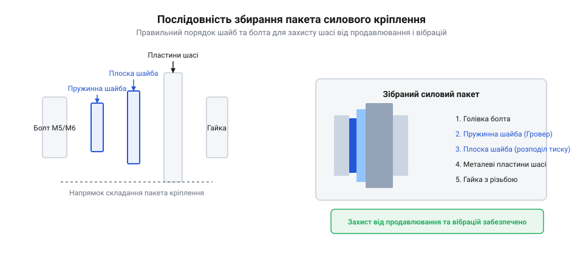

## Вібраційні відмови та розхитування каркаса

Коли силова рама робота чи будь-якого мобільного пристрою працює в реальних польових умовах, вона зазнає постійних циклічних поштовхів, ударів та високочастотних вібрацій від моторів і нерівностей поверхні. Під дією цих коливань звичайні нарізні з'єднання неминуче починають слабшати: болти поступово провертаються, втрачаючи початковий натяг, тонкі металеві стінки шасі продавлюються під головками кріплення, а каркас втрачає жорсткість і йде перекосом. Без спеціальних заходів захисту навантаження не розподіляється рівномірно, що призводить до зрізання витків різьби в алюмінієвих профілях та втомного руйнування металу в найменш захищених точках конструкції. Щоб уникнути цього, недостатньо просто затягнути болти з максимальною силою «на око»: необхідно розуміти фізику процесів, що відбуваються всередині з'єднання під навантаженням.

Головна причина руйнування криється у втраті сили попереднього натягу через поздовжні та поперечні мікрозсуви деталей відносно одна одної. Коли болт затягнутий, він працює як пружина, що притискає поверхні з величезною силою, а тертя між витками різьби та під головкою утримує його від обертання. Проте під час динамічних поштовхів виникають змінні сили, які на частку секунди зменшують силу притискання, дозволяючи виткам різьби прослизнути у зворотний бік. Поступово кут повороту накопичується, болт повністю відгвинчується, а вузол розпадається. Додатково ситуацію погіршує високий контактний тиск під головкою болта: якщо опорна площа занадто мала або метал шасі м'який, край головки врізається в матеріал, викликаючи його пластичну деформацію та миттєве падіння натягу в системі. Навіть ідеально виготовлена рама втратить геометрію, якщо в її вузлах не передбачено комплексний захист від розхитування.

Рішенням цієї проблеми є побудова інженерного вібростійкого вузла, який поєднує правильний підбір геометрії кріплення, розподіл тиску через плоскі шайби, пружну компенсацію релаксації та хімічне стопоріння. Для цього застосовуються силові болти класів міцності М5 та М6, здатні витримувати високі розтягувальні зусилля, у поєднанні зі спеціальними елементами живлення пакета та рідкими фіксаторами. Такий підхід гарантує, що рама залишатиметься монолітною навіть після сотень годин інтенсивної експлуатації в умовах постійної вібрації.

## Компонування пакета кріплення та шайб

Коли створюється силова рама, кожен елемент з'єднання має займати своє чітко визначене місце, інакше найміцніший болт не врятує конструкцію від руйнування. Під час вибору кріплення для силового каркаса використовують метричні болти М5 та М6, які забезпечують необхідну міцність на розрив для основних несучих балок, тоді як для кріплення легких електронних плат чи кронштейнів застосовують менше кріплення М3/М4. Головна вимога до такого пакета — забезпечити достатню глибину зачеплення різьби в матеріалі шасі: для сталевих деталей довжина загортання має становити не менше одного діаметра болта, а для м'якших алюмінієвих чи магнієвих сплавів цей показник збільшують у півтора чи два рази, щоб виключити виривання витків під навантаженням.



*Схема пакета силового кріплення у розрізі, що показує правильну послідовність елементів для рівномірного розподілу тиску та захисту від самовідгвинчування.*

Для запобігання продавлюванню тонкостінних деталей під головкою болта чи гайкою обов'язково встановлюють плоскі підкладні шайби великої площі, які знижують контактний тиск до безпечних для металу значень. Проте сама по собі плоска шайба не зупиняє вібраційне розхитування, тому в пакет обов'язково вводять пружинні шайби Гровера. Пружинна шайба працює як розрізне пружне кільце, яке постійно тисне на головку болта, створюючи додаткову силу тертя та компенсуючи мікроскопічне зминання чи втомну релаксацію металу в зоні контакту. При цьому вкрай важливо дотримуватися правильної послідовності збирання: гострі кромки пружинної шайби ніколи не повинні торкатися анодованих чи пофарбованих поверхонь шасі, оскільки вони здеруть захисний шар і спричинять корозію. Головка болта притискається до плоскої шайби, під якою стоїть пружинна, або ж пружинна шайба розташовується безпосередньо під гайкою, залежно від того, з якого боку прикладається момент затягування.

Розрахунок довжини стрижня болта виконується з урахуванням сумарної товщини всіх з'єднуваних пластин, товщини плоских і пружинних шайб, а також висоти гайки, додаючи до цього запас у два-три витки різьби, що мають виступати назовні після затягування. Якщо болт занадто короткий, різьба в гайці чи отворі працюватиме не на повну довжину; якщо занадто довгий — він упреться в дно глухого отвору раніше, ніж притисне пакет, створивши хибне відчуття затягнутого вузла. Укомплектувавши пакет згідно з цими правилами, вузол готують до нанесення спеціальних хімічних засобів фіксації.

## Анаеробні фіксатори та підготовка поверхонь

Навіть ідеально підібраний пакет кріплення з шайбами може поступово розхитатися під впливом резонансних коливань, якщо не заблокувати мікрозсуви між витками різьби на молекулярному рівні. Для цього використовують рідкі анаеробні фіксатори різьби — спеціальні полімерні склади, які залишаються рідкими на повітрі, але миттєво твердіють, перетворюючись на міцний пластик, щойно потрапляють у вузький зазор між металевими витками за повної відсутності кисню. Цей процес активується за участю іонів активного металу, тому заповнений простір між болтом і гайкою надійно блокується від будь-яких осьових чи радіальних зсувів.

За своєю міцністю фіксатори поділяються на склади середньої міцності та високої фіксації. Рознімні фіксатори середньої міцності дозволяють розібрати з'єднання за допомогою звичайного ручного інструмента без нагріву, що ідеально підходить для вузлів, які потребують періодичного обслуговування чи регулювання. Натомість нерознімні склади високої фіксації створюють настільки міцне з'єднання, що для розбирання болта доводиться прогрівати його будівельним феном чи паяльником до температури понад двісті градусів для руйнування полімерної структури.

Проте жоден анаеробний склад не спрацює на неподрібненій чи брудній поверхні: залишки машинного мастила, консерваційне покриття, пил або дрібна металева стружка повністю перешкоджають полімеризації смоли. Перед нанесенням фіксатора всі різьбові деталі ретельно знежирюють ізопропіловим спиртом за допомогою безворсової серветки та дають їм повністю висохнути. Добудований вузол вимагає дозованого нанесення: достатньо однієї чи двох крапель рідини на різьбу болта або всередину отвору, оскільки надлишок засобу під час загортання виштовхується назовні і може потрапити на пластикові елементи каркаса, викликаючи їхнє помутніння чи розтріскування, або на відкриті підшипники.


*Схема вузла з'єднання каркаса, що демонструє порядок затягування багатоболтових стиків хрест-навхрест для рівномірного розподілу зусиль та уникнення перекосів рами.*

Після нанесення фіксатора болти затягують за допомогою динамометричного інструмента, суворо дотримуючись схеми поетапного затягування багатоболтових стиків хрест-навхрест. На першому етапі всі болти підтягують приблизно до п'ятдесяти відсотків розрахункового моменту, на другому — до сімдесяти п'яти, і лише на фінальному етапі досягають ста відсотків, поступово вибираючи зазори і не допускаючи перекошування геометрії рами. Такий підхід гарантує, що силова конструкція збереже ідеальну прямолінійність і витримає найжорсткіші динамічні навантаження.

## Динамометричне затягування за схемою хрест-навхрест

Коли силова рама з'єднана болтами з нанесеним фіксатором різьби, затягування навмання за допомогою звичайної викрутки чи ключа може зіпсувати всю роботу. Надмірне зусилля неминуче зірве нарізну частину або деформує тонкі металеві пластини шасі, а недостатнє — залишить зазори, які швидко розіб'ються під час перших же циклічних ударних навантажень. Щоб перетворити хаотичне кручення на точний інженерний процес, використовують нормований попередній натяг за допомогою спеціалізованого інструмента. Основним інструментом тут виступає динамометричний ключ, який дозволяє контролювати момент сили із високою точністю.

Перед початком затягування граничний динамометричний ключ налаштовують на розраховані значення моменту затягування. Для метричних гвинтів та болтів стандартних класів міцності цей момент визначають виходячи з діаметра різьби та допустимих напружень на розтяг. Наявність рідкого анаеробного фіксатора дещо знижує коефіцієнт тертя у різьбі в момент закручування, тому інструкції виробників часто радять враховувати цей ефект, щоб не перевищити робоче натягнення. Розрахунок моменту затягування базується на формулі зв'язку крутного моменту з осьовим зусиллям затягування:

```
T = K · F · d
= 0.20 · 4500 · 0.006          [коефіцієнт тертя K, сила F, діаметр d]
= 5.4                          [результуючий крутний момент у ньютон-метрах]
```

Де `T` — крутний момент, `K` — затягувальний коефіцієнт тертя для змащеної чи фіксованої різьби, `F` — необхідне зусилля попереднього натягу, а `d` — номінальний діаметр болта. Цей розрахунок гарантує, що болт М6 отримає оптимальне зусилля, достатнє для опору вібраціям, але нижче межі плинності матеріалу.

Закручування окремого болта до упору не вирішує проблему рівномірності, оскільки під час затягування першого кріплення сусідні ділянки стику неминуче перекошуються. Якщо затягувати багатоболтовий вузол послідовно по колу, одна сторона пластини щільно притиснеться, а протилежна залишиться на мікроскопічному підвісі, що створить локальну концентрацію напружень. Тому для складних рамних конструкцій застосовують алгоритм поетапного затягування стиків хрест-навхрест. Процес починають із попереднього підтягування всіх болтів від руки до легкого контакту шайб із поверхнею. На першому етапі динамометричним ключем проходять усі точки приблизно на тридцять-п'ятдесят відсотків від фінішного моменту, рухаючись по діагоналі від центру до периферії або хрест-навхрест між протилежними кутами прямокутного фланця. На другому етапі задають повний розрахунковий момент, повторюючи ту саму хрестоподібну послідовність. На виході такий підхід забезпечує рівномірне силове затягування багатоболтових вузлів каркаса зі створенням розрахункового попереднього натягу без ризику зриву різьби чи пластичного зминання отворів.

## Контроль геометрії рами та віброперевірка

Маючи зібраний та затягнутий каркас, не можна просто встановити його на робот без ретельної перевірки геометричної точності та надійності з'єднань. Навіть за умови ідеального дотримання моментів затягування під час перехресного монтажу сукупна деформація тонких металевих пластин може призвести до загального перекосу рами. Похибка у кілька часток міліметра на базових елементах шасі здатна спричинити перекіс валів, заклинювання підшипників чи непаралельність осей рушіїв. Тому першочерговим кроком стає інструментальний контроль просторової геометрії зібраного каркаса.

Для виявлення кутових деформацій та перевірки прямокутності рами вимірюють її діагоналі за допомогою штангенциркуля або каліброваної металевої лінійки. Якщо різниця довжин діагоналей перевищує допустимий конструкторський допуск, це свідчить про нерівномірність затягування або миттєвий зсув деталей під час фіксації. Одночасно перевіряють правильність виходу різьбової частини кріплення з гайки чи глухого отвору: кінець болта або гвинта має виступати на нормовані один-два витки різьби, що гарантує повне зачеплення всіх робочих витків профілю. Після завершення геометричного контролю на стики болтів та гайок наносять спеціальну маркувальну пасту контролю ослаблення. Ця кольорова індикаторна суміш утворює крихку плівку, яка миттєво трісне при найменшому самовідгвинчуванні елемента під час експлуатації.

Завершальним етапом перевірки стає стендова діагностика каркаса під дією реальних робочих вібрацій та ударних навантажень. Зібране шасі закріплюють на вібростенді або піддають контрольованим механічним поштовхам, імітуючи рух робота по нерівній поверхні. Перевірка дозволяє виявити залишковий натяг у з'єднаннях та переконатися у відсутності мікрозсувів у стиках. На виході такий комплексний підхід гарантує проведення повної дефектовки змонтованого шасі, гарантуючи відповідність геометрії конструкторським допускам та довготривалу вібростійкість силового каркаса робота.
