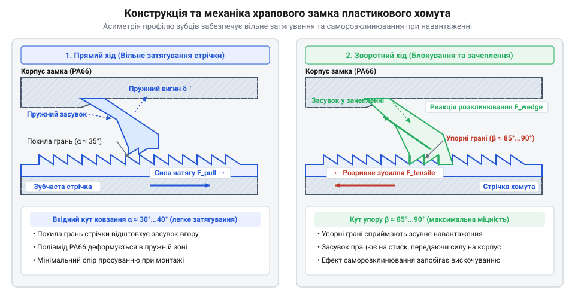
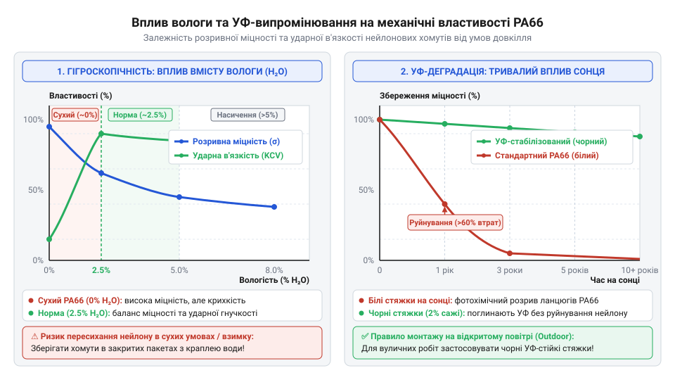
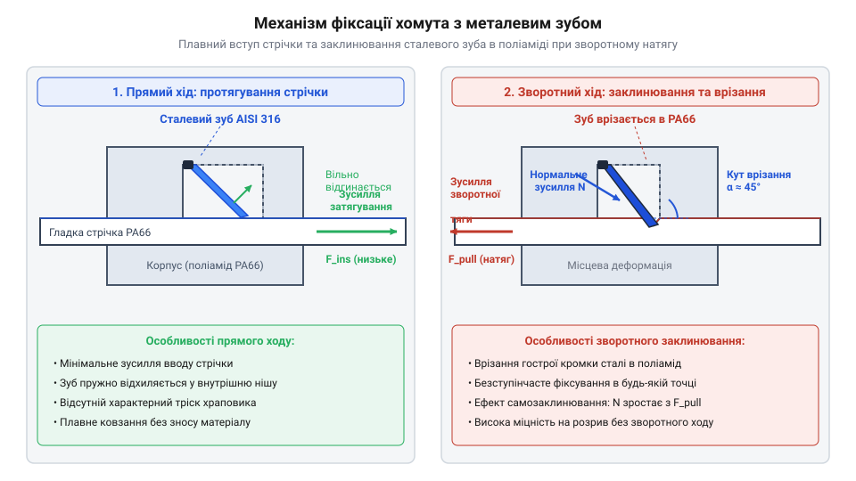
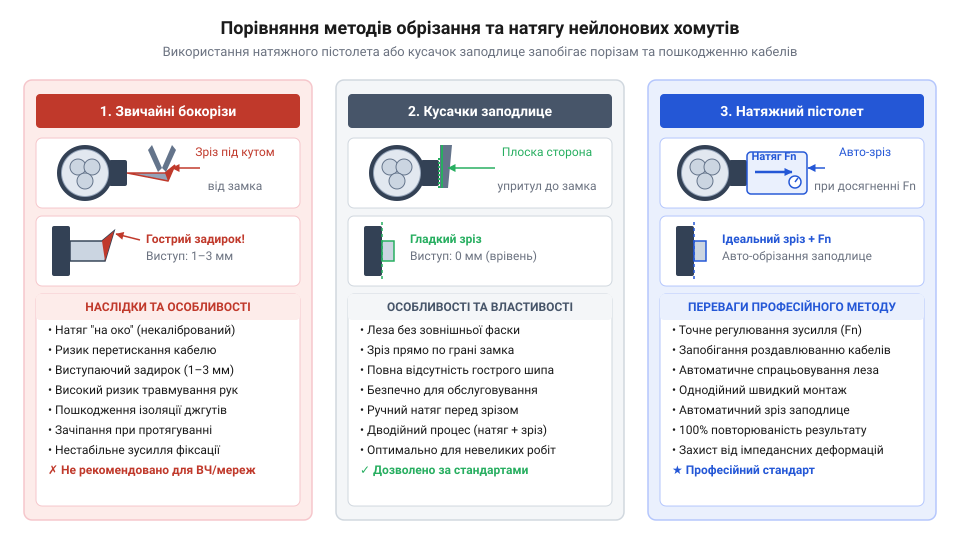
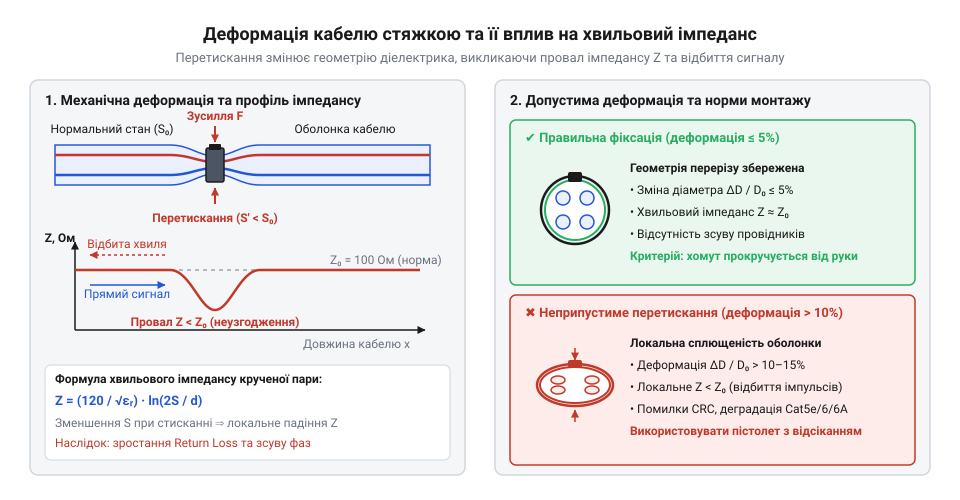

# Хомути пластикові

<preknowlist>
- [Ethernet-кабель RJ45](root:cat-hw-parts/ethernet-cable) — чутливість крученої пари до механічного тиску та збереження хвильового імпедансу при згинанні й стисканні
- [Органайзер кабелів (стрічка)](root:cat-hw-parts/cable-organizer) — принципи укладання та бандлування провідників у джгути
- [Монтажний провід 18 і 20 AWG](root:cat-hw-parts/hookup-wire) — конструкція ізоляції та механічні обмеження притиску гнучких провідників
</preknowlist>

## Некеровані джгути та вібраційний знос

У рухомих механічних системах, робототехнічних комплексах, транспортних засобах, авіації та промисловому обладнанні електричні провідники зазнають постійного впливу динамічних навантажень, вібрацій та ударних прискорень. Якщо провідники прокладені хаотично та позбавлені жорсткого зв'язку між собою у складі впорядкованого джгута, вібраційні коливання викликають їхнє постійне відносне зміщення. У результаті провідники інтенсивно перетираються один об одного та об гострі металеві крайки корпусних деталей чи елементів несучої рами. З часом це призводить до стирання зовнішнього ізоляційного шару, оголення мідних жил та неминучого виникнення коротких замикань на корпус обладнання чи між сусідніми лініями живлення.

Окрім прямого пошкодження ізоляції, некероване вишівання й розгойдування провідників створює значні знакоперемінні згинальні напруження в точках їхнього підключення до клемників, паяних з'єднань або контактних розеток. Внаслідок механічної втоми жила провідника переломлюється безпосередньо біля обтискного хвостовика контакту. Під дією постійної вібрації в електрошафах та силових щитах відбувається самовільне розмикання силових контакторів, випадання сигнальних роз'ємів та погіршення контактного опору, що спричиняє локальне перегрівання вузлів та хибні спрацьовування систем автоматики.

Спроби усунути хаотичне зміщення провідників за допомогою тимчасових або неспеціалізованих засобів кріплення швидко виявляють свою непридатність у реальних умовах експлуатації. Застосування стандартної клейкої ізоляційної стрічки демонструє крайню ненадійність при змінах температури навколишнього середовища та циклічному нагріві провідників робочим струмом. Клейовий склад на основі каучуку чи акрилату під дією тепла розм'якшується, втрачає @@lat|адгезія@@ (від лат. *adhaesio* — прилипання) і починає зсуватися під дією відцентрових або вібраційних сил. Тканинні та полівінілхлоридні стрічки з часом пересихають, витягуються, втрачають початковий натяг і розкручуються, залишаючи на провідниках липкі залишки клею, які приваблюють пил і бруд.

З іншого боку, фіксація провідників за допомогою жорстких металевих скоб, скруток із суцільного дроту або пластикових хомутів нееластичних типів створює точкові зони високої концентрації механічних напружень. Під дією вібраційного зсуву та теплового розширення провідника жорстка крайка металевої скоби починає діяти подібна до різця. Вона локально врізається в еластичну ізоляцію, якою вкритий [монтувальний провід](root:cat-hw-parts/hookup-wire), викликаючи її продавлювання до металевої жили. Це провокує прискорений @@en|вібраційний знос@@ (англ. *vibrational wear* — зношування від коливань) і деформацію провідників у точках притиснутості. Навіть якщо для захисту найбільш відповідальних вузлів обладнання застосовуються спеціальні [тросові віброізолятори](root:cat-hw-parts/wire-rope-isolators), самі електричні кабелі все одно потребують надійної локальної ув'язки для запобігання резонансному розгойдуванню.

Масштаб цієї проблеми критично виявився усередині XX століття під час стрімкого розвитку пасажирської та військової авіації. У важких літаках довжина електричних трас сягала десятки кілометрів, а ручне бандажування джгутів за допомогою вощеної нитки або лляного шнура вимагало сотень годин ручної праці, спричиняючи криваві мозолі у монтажників та залишаючи високий ризик людського фактора. Проблема хаотичного вкладання джгутів в авіації спонукала інженерів до створення спеціалізованих швидких кріплень: у 1958 році Маурус Логан розробив [перші кабельні стяжки](root:cat-hw-parts/cable-ties/hist-cable-tie-invention.md) для компанії @@en|Thomas & Betts@@ під торговельною маркою @@en|Ty-Rap@@, щоб спростити та прискорити монтаж електричних трас у пасажирських літаках @@en|Boeing 707@@. Це відкрило нову еру у виготовленні кабельних систем, замінивши важку ручну шнуровку стандартизованими пластиковими фіксаторами.

Системний аналіз причин руйнування кабельних трас показує, що надійне кріплення джгутів має відповідати низці жорстких конструктивних вимог. Елемент кріплення повинен забезпечувати постійне радіальне стискання пучка провідників без створення точкових перетискань, рівномірно розподіляючи зусилля по всій окружності бандлу. Він повинен охоплювати джгути довільного діаметра в широкому діапазоні розмірів, мати мінімальну власну масу, бути стійким до корозії та монтуватися за лічені секунди без використання додаткових гвинтів чи гайок.

Головна вимога до такого фіксатора — одноразовість та незворотність зачеплення (самоблокування). Після затягування механізм повинен надійно утримувати встановлений натяг і не послаблюватися під впливом вібраційних імпульсів, шокових ударів чи циклічних температурних розширень матеріалів. Порівнюючи цей підхід із тим, як укладається суцільний спіральний [органайзер кабелів](root:cat-hw-parts/cable-organizer) або як формуються важелезні [промислові кабельні шлейфи](root:cat-hw-parts/industrial-pendant-cable-harnessing-and-shielding), стає зрозуміло, що для точкової ув'язки потрібна компактна гнучка стрічка з інтегрованим замковим блоком. Всі ці вимоги сформували чіткі критерії до розробки храпового механізму фіксації.

## Механіка храпового замка та стрічки

Конструкція стандартного пластикового хомута являє собою монолітну або складену деталь, що складається з гнучкої стрічки прямокутного перерізу та замкової голівки, розташованої на її початку. Ключовим вузлом, який забезпечує незворотну фіксацію, є @@de|храповий замок@@ (нім. *Krapfen* — гак, зачіпка), всередині якого сформовано робочий канал та пружний зуб-засувку. Впродовж усієї робочої довжини стрічки вилито послідовний ряд похилих зубців, що мають пилоподібний геометричний профіль. Кожен зубець має один похилий східчастий фас та одну вертикальну стопорну грань, орієнтовану під кутом, близьким до 90 градусів відносно поздовжньої осі стрічки.

Під час введення вільного кінця стрічки у канал замкової голівки похила поверхня першого зубця ковзає по відповідному похилому фасу пружної засувки замка. Під дією прикладеного зусилля затягування засувка відхиляється убік, стискаючи матеріал замкового блоку та відкриваючи прохід для стрічки. Щойно вершина зубця стрічки долає вершину засувки, остання під дією власних пружних сил полімеру вхідної деталі впевнено повертається у вихідне положення, провалюючись у міжзубну западину. Цей процес супроводжується чітким тактильним та акустичним клацанням. Стрічка хомута може вільно просуватися в напрямку затягування на довільне число кроків зубчастого гребеня.

Зворотний хід стрічки в напрямку послаблення натягу унеможливлюється завдяки ефекту механічного заклинювання. Коли зусилля затягування припиняється і затиснутий джгут кабелів починає пружно розширюватися, прагнучи витовкти стрічку назад із замка, вертикальна стопорна грань зубця стрічки впирається у вертикальну грань пружної засувки. Кути контакту орієнтовані таким чином, що сила зворотного виштовхування стрічки не відгинає засувку, а навпаки — створює додатковий нормальний момент, який ще сильніше притискає засувку до основи стрічки. В результаті виникає @@en|клинове заклинювання@@ (англ. *wedge locking* — блокування клином), що перетворює розтягувальне зусилля стрічки на замкнений силовий контур зачеплення.


*Поперечний розріз храпового замка хомута: взаємодія пружної засувки з геометричним профілем зубців стрічки для забезпечення незворотного блокування.*

Основним механічним показником надійності хомута є @@en|колова розривна міцність@@ (англ. *loop tensile strength*, LTS — міцність на розрив у петлі). Вона характеризує максимальне розтягувальне зусилля в кільці, яке здатне витримати замкове з'єднання та стрічка до моменту катастрофічного руйнування — зрізу зубців замка або розриву полотна стрічки. Замковий блок під навантаженням перебуває в складному напруженому стані, де поєднуються поздовжній розтяг стрічки, вигин пружного зуба та зсув матеріалу в основі зачеплених зубців.

Для обчислення граничного навантаження, яке здатна витримати стрічка до зрізу зубців або розриву замка, використовують [математичний розрахунок розривного зусилля](root:cat-hw-parts/cable-ties/math-cable-tie-mechanics-and-clamping.md), де враховують геометричний профіль зачеплення та площу поперечного перерізу.

Розрахуємо теоретичну колову розривну міцність хомута. Нехай зусилля розтягу в кожній із двох гілок охоплювальної стрічки становить `F_t`, площа її поперечного перерізу дорівнює `A = b × h` (де `b` — ширина стрічки в міліметрах, `h` — товщина стрічки в міліметрах), а гранично допустиме напруження розтягу конструкційного полімеру дорівнює `σ_max`. Розрахунок граничного колового зусилля петлі `F_loop` здійснюється за покроковим розгортанням формули:

```
F_loop = 2 × F_t              [рівновага колових сил у замкненій петлі]
= 2 × (σ_max × A)             [вираження сили розтягу через напруження матеріалу]
= 2 × σ_max × b × h           [розгортання площі поперечного перерізу стрічки]
```

Отримане значення `F_loop` виражає абсолютну межу міцності полотна стрічки в замкненій петлі. Однак міцність хомута визначається найслабшою ланкою, якою найчастіше стає замковий вузол. Якщо площа основи одного зачепленого зубця дорівнює `A_s`, а припустиме напруження зрізу полімеру становить `τ_max`, то максимальне зусилля утримання замка з кількістю одночасно зачеплених зубців `n` обчислюється як:

```
F_lock = n × τ_max × A_s      [умова міцності замкового вузла на зріз зубців]
```

При проектуванні хомутів геометричні пропорції зубців добирають так, щоб виконувалася сувора умова `F_lock ≥ F_loop`. Це гарантує, що замок не зруйнується раніше, ніж буде вичерпано міцність самого пластикового паса. Надмірне затягування хомута може спричинити небажане стискання провідників, що критично, коли прокладається високочастотний [Ethernet-кабель RJ45](root:cat-hw-parts/ethernet-cable) або чутливий [JST-GH сигнальний кабель](root:cat-hw-parts/jst-gh-cable).

На практиці широке розповсюдження здобули дві основні конструктивні модифікації засувки храпового замка: суцільнолита пластикова та вплавлена металева. У повністю пластикових хомутах замковий блок відливається як єдине ціле з нейлоновою стрічкою під час інжекційного формування. Така конструкція є технологічною та дешевою у масовому виробництві, проте її розривне зусилля обмежене міцністю пластикового зуба, а під тривалим статичним навантаженням матеріалу властива поступова @@en|повзучість матеріалу@@ (англ. *material creep* — повільна пластична деформація), яка зменшує початковий натяг.

Друга модифікація використовує металевий фіксувальний зуб з аустенітної сталі, вплавлений під кутом у корпус пластикової голівки. Стрічка таких хомутів виготовляється абсолютно гладкою, без литих пластикових зубців. Під час затягування загострений край металевої засувки легко ковзає по гладкій поверхні нейлону у напрямку введення. У разі виникнення зворотного зусилля гострий клин із нержавіючої сталі врізається в поверхню пластикової стрічки на довільній відстанні, створюючи надійне зачеплення без фіксованого кроку зубців. Це дозволяє здійснювати безступінчасте регулювання натягу з високою точністю. Фіксатори такого типу мають значно вищу розривну міцність і термостійкість. Для виготовлення цих зубців застосовують високоефективні [нержавіючі сталі](root:cat-hw-parts/fastener-strength-classes-and-materials), стійкі до корозії та хімічно агресивних середовищ.

Аналіз геометричних параметрів та механіки храпового зачеплення підтверджує, що працездатність замкового вузла безпосередньо залежить від фізико-механічних властивостей матеріалу, з якого відлито стяжку. Твердість, модуль пружності та ударна в'язкість полімеру визначають як силу утримання зубця, так і гнучкість стрічки при низьких температурах. Це формує логічний перехід до детального розбору матеріалознавчих характеристик поліаміду PA66, його гігроскопічності та механізмів деградації під дією зовнішніх чинників.

## Фізико-хімічні властивості поліаміду PA66

Кабельний хомут, який у сухому теплому приміщенні легко витримує натяг у сотні ньютонів, на морозній вулиці чи після року під яскравим сонцем раптово тріскається від найменшого торкання або розсипається на порох. Аби збагнути причини такої крихкості, необхідно розібратися у матеріалознавчих характеристиках полімеру. Основним матеріалом для виробництва стандартних стяжок є @@en|поліамід PA66@@ (англ. *polyamide*, від грец. *poly-* — багато та *amide* — амідна група), який також називають @@en|нейлон 66@@ (англ. *nylon*). Цей термопластичний конструкційний матеріал володіє високою механічною міцністю та пружністю, однак його фізико-механічний стан залежить від внутрішньої хімічної структури та умов зовнішнього середовища.

Молекулярна структура PA66 утворена довгими полімерними ланцюгами з лінійним чергуванням гексаметилендіаміну та адипінової кислоти. Уздовж макромолекул розташовані полярні амідні групи `-CO-NH-`, які формують щільну сітку міжланцюгових водневих зв'язків. У кристалічних фазах полімеру ці зв'язки жорстко утримують ланцюги разом, забезпечуючи високий модуль пружності, високе @@lat|розривне зусилля@@ та протидію механічним навантаженням.

Проте полярні амідні групи виявляють сильну хімічну спорідненість до дипольних молекул води. Ця властивість відома як @@grc|гігроскопічність@@ (грец. *hygros* — вологий, *skopeo* — дивлюся). Молекули води вибірково проникають у аморфні зони полімерної матриці, вклинюючись у міжланцюговий простір поліаміду. - Свіжовідлиті стяжки безпосередньо з термопластавтомата є повністю сухими (вміст вологи менше `0.2%` за масою). У цьому стані полімер має максимальну жорсткість та модуль Юнга понад 3000 MPa, але виявляє підвищену крихкість під дією ударних навантажень. - За стандартних кліматичних умов (температура `23 °C` та відносна вологість повітря `50%`) @@en|поліамід PA66@@ вбирає @@lat|зв'язана вода@@ у кількості від `2.5%` до `3.0%` від своєї маси, досягаючи стійкого рівноважного стану. - При тривалому перебуванні у водному середовищі або при 100% відносній вологості вміст вологи у полімерній матриці зростає до `8.5%`.

Поглинута @@lat|зв'язана вода@@ виконує роль внутрішнього змащувального агента, діючи як @@lat|пластифікатор@@ (лат. *plasticus* — пластичний, формований). Диполі води розривають частину міжланцюгових водневих зв'язків `N-H...O=C`, розсувають макромолекули та збільшують їхню сегментарну рухливість. У результаті докорінно змінюються механічні параметри стяжки:
- Модуль пружності падає до ~1000 MPa, а @@lat|розривне зусилля@@ знижується на 15–20% порівняно із сухим станом. - Гнучкість, відносне подовження при розриві та @@lat|ударна в'язкість@@ зростають у 2–3 рази, роблячи хомут надзвичайно пластичним та стійким до динамічних вигинів. З цієї причини якісні стяжки поставляються у герметично заварних пакетах із додаванням дозованої вологи для кондиціонування. Якщо ж відкритий пакет тривалий час лежить у сухому приміщенні з працюючим опаленням, вода випаровується, стяжки пересихають (`w < 1%`) і під час монтажу їхні зубці миттєво сколюються.

Надійна експлуатація стандартного немодифікованого PA66 обмежена температурним діапазоном від `-40 °C` до `+85 °C`. - У зоні від'ємних температур (нижче `0 °C` і аж до `-40 °C`) @@lat|зв'язана вода@@ всередині аморфних зон замерзає, перетворюючись на мікрокристали льоду. Полімер переходить через свою @@lat|температура склування@@, яка для сухого нейлону становить близько `+50 °C`, а для зволоженого зміщується нижче `0 °C`. При сильному морозі аморфні ділянки склуються, міжланцюгова рухливість блокується і гнучкий нейлон перетворюється на крихке скло. Спроба затягнути переохолоджений хомут на морозі призводить до миттєвого зрізання зубців храпового замка. - При нагріванні понад `+85 °C` інтенсивний тепловий рух молекул послаблює міжланцюгову взаємодію. Починається @@lat|повзучість матеріалу@@ (пластичне витягування стрічки під постійним натягом), а при тривалій роботі при високій температурі відбувається термоокиснювальна деструкція полімерних ланцюгів.

Вулична експлуатація додає ще один руйнівний чинник — сонячне @@lat|ультрафіолетове випромінювання@@ (лат. *ultra* — понад, *violaceus* — фіолетовий), або @@lat|УФ-випромінювання@@. Кванти світла ультрафіолетового спектра з довжиною хвилі від 290 до 400 нанометрів несуть енергію від 300 до 415 kJ/mol, що перевищує міцність хімічних зв'язків `C-N` та `C-C` у молекулярному кістяку поліаміду. Поглинання УФ-фотонів викликає гомолітичний розрив хімічних зв'язків із утворенням первинних вільних радикалів. На повітрі ці радикали миттєво реагують із киснем, утворюючи пероксидні радикали `ROO•`, які відривають атоми водню від сусідніх ланцюгів і формують гідропероксиди `ROOH`. Внаслідок цього запускається автокаталітична @@grc|фотоокиснювальна деградація@@ (грец. *photos* — світло, лат. *oxydatio* — окиснення). Молекулярні ланцюги фрагментуються, полімер жовтіє, вкривається сіткою мікротріщин і кришиться. Звичайна біла або прозора нейлонова стяжка на відкритому сонці втрачає понад 80% номінальної міцності впродовж 6–12 місяців.

Залежність залишкової міцності `F_t` (у ньютонах) немодифікованого хомута від вмісту поглинутої вологи `w` (у відсотках) та часу сонячного опромінення `t` (у місяцях) можна описати розрахунковим співвідношенням:

F_t(w, t) = F_base × K_w(w) × K_uv(t)
K_w(w) = 1.0 - 0.08 × (w - 2.5)     [поправка на пластифікацію вологою]
K_uv(t) = exp(-0.15 × t)             [коефіцієнт фотоокиснювального деструктування]
F_t(2.5, 12) = 220 × 1.0 × exp(-1.8) [обчислення для нормальної вологості після 1 року на сонці]
F_t(2.5, 12) = 220 × 1.0 × 0.165     [обчислення експоненційного згасання]
F_t(2.5, 12) ≈ 36.4 N                [підсумкова залишкова міцність]

З наведеного розрахунку видно, що через один рік перебування під прямими сонячними променями залишкова міцність стяжки падає з початкових 220 N до небезпечних 36.4 N, що унеможливлює утримання вагових навантажень.


*Залежність механічної міцності на розрив та ударної в'язкості поліаміду PA66 від вмісту вологи в полімерній матриці та тривалості впливу сонячного ультрафіолетового випромінювання.*

Тому при проектуванні кабельних трас під [монтажних провідників 18 AWG](root:cat-hw-parts/hookup-wire) чи при укладанні провідників у [органайзер кабелів](root:cat-hw-parts/cable-organizer) матеріалознавчі особливості PA66 змушують суворо відокремлювати внутрішній монтаж від зовнішнього.

## Конструктивні модифікації для спеціальних умов

Розуміння фізико-хімічних обмежень базового поліаміду PA66 дозволяє свідомо підбирати спеціалізовані виконання хомутів під конкретні умови експлуатації. Коли стандартний нейлон виявляється безсилим перед палючим сонцем, агресивними хімікатами, високою температурою чи постійною вібрацією, інженерні модифікації долають ці перешкоди шляхом хімічного легування полімерної матриці або корінної зміни механіки фіксуючого замка.

Для зовнішнього вуличного монтажу розроблені @@en|УФ-стабілізовані нейлонові стяжки@@. Щоб захистити амідні зв'язки від руйнівних ультрафіолетових фотонів, у розплав поліаміду під час двошнекової екструзії вводиться високодисперсний @@en|технічний вуглець@@ (англ. *carbon black*), більше відомий як @@en|сажа@@, у концентрації від 2% до 3% від загальної маси. - Наночастинки вуглецю розміром 15–25 нанометрів із питомою поверхнею понад 100 м²/г рівномірно розподіляються у об'ємі полімеру. Вони виступають у ролі суцільного екранного світлофільтра та ефективного поглинача сонячної енергії. УФ-випромінювання поглинається сажею у тонкому поверхневому шарі товщиною в кілька мікронів і безшкодно розсіюється у вигляді тепла. - Крім того, технічний вуглець працює як пастка для вільних радикалів, гасячи ланцюгові реакції автоокиснення на початковій стадії. - На вигляд такі стяжки завжди мають глибокий вугільно-чорний колір. Завдяки введенню сажі термін служби хомутів на відкритому повітрі зростає з 1 року до 12–20 років навіть у високогірних та південних регіонах.

Для експлуатації в зоні підвищених температур (поблизу силових блоків живлення, автомобільних двигунів чи промислових нагрівачів) випускаються @@en|термостійкі стяжки@@. - Модифікація PA66-HS (Heat Stabilized) передбачає легування полімеру органічними та неорганічними термостабілізаторами на основі солей міді та галогенідів. Це сповільнює термоокиснювальне старіння й підвищує межу довготривалої робочої температури до `+105 °C` (і короткочасно до `+125 °C`). - Для ще більш екстремальних умов застосовують альтернативні конструкційні полімери:
  - @@en|поліамід PA46@@ (англ. *polyamide 46*): володіє високою температурою плавлення і працює тривало при температурах до `+150 °C`. - @@en|поліпропілен@@ (грец. *poly-* — багато, *propene* — пропілен), або @@en|PP@@: забезпечує високу хімічну стійкість до агресивних концентрованих кислот, лугів та розчинників, хоча має дещо нижчу механічну міцність. - @@en|фторполімери@@ (зокрема @@en|ETFE / Tefzel@@): розраховані на жорстке радіаційне опромінення, агресивне середовище та температури до `+170 °C`. - @@en|поліефірефіркетон@@ (англ. *polyether ether ketone*, @@en|PEEK@@): суперконструкційний пластмасовий матеріал із робочою температурою до `+250 °C`, що застосовується в аерокосмічній техніці.

У ситуаціях, коли кабельна траса потребує регулярного обслуговування, додавання нових провідників або тимчасової фіксації при налагодженні, звичайні одноразові хомути створюють масу пластикових відходів. У таких вузлах застосовують @@en|багаторазові стяжки@@ (англ. *reusable cable ties*). Головка такої стяжки містить пружний @@en|важіль розблокування@@ (англ. *release lever*). При натисканні на важіль пальцем або викруткою фіксуючий зубчик розклинюється й відходиться від зубчастої стрічки. Це дозволяє вільно витягти стрічку у зворотний бік без руйнування храповика й використати хомут повторно десятки разів. Вони незамінні при макетуванні трас, де з'єднані [40-контактним GPIO шлейфом](root:cat-hw-parts/gpio-ribbon-cable) модулі або підключені [силових роз'ємів XT60](root:cat-hw-parts/xt-connectors) джерела живлення.

Найбільш надійним рішенням для екстремальних механічних навантажень є посилені хомути, де литий пластиковий храповик замінено на @@en|металевий фіксуючий зуб@@ (англ. *stainless steel barb*). - Конструктивно така стяжка має повністю гладку стрічку без зовнішніх пластикових зубців. У головку хомута під кутом 45 градусів вплавлено тонку та гостру загартовану пластину з @@en|нержавіюча сталь AISI 316@@, що містить молібден для захисту від корозії. - Завдяки клиновому ефекту під час затягування гладка нейлонова стрічка безперешкодно ковзає вперед. Проте при спробі зворотного висування гострий край сталевого зуба врізається у поверхню нейлону, створюючи самозаклинюючий замок. - Ця конструкція забезпечує суцільне безступінчасте регулювання натягу (без фіксованого кроку зубців), не боїться сколювання пластику на морозі та гарантує максимальне @@en|колове розривне зусилля@@. Історично саме ця технологія започаткувала масове застосування стяжок: у 1958 році Маурус Логан винайшов перші хомути Ty-Rap для монтажу проводки в літаках Boeing 707. Більше деталей розкриває [винайдення стяжок Ty-Rap](root:cat-hw-parts/cable-ties/hist-cable-tie-invention.md).


*Схема детального розрізу замкової голівки хомута зі вплавленим сталевим зубом із нержавіючої сталі демонструє кут врізання загостреної пластини у гладку стрічку для забезпечення надійного безступінчастого заклинювання.*

Металевий зуб у поєднанні з PA66 чудово протистоїть вібраційному зрізу у вузлах, де працюють [тросові віброізолятори](root:cat-hw-parts/wire-rope-isolators). Оцінити [матеріали металевого кріплення](root:cat-hw-parts/fastener-strength-classes-and-materials) можна при порівнянні пластикових стяжок із повністю сталевими аналогами. Для точного підбору міцності використовується [розрахунок розривного зусилля](root:cat-hw-parts/cable-ties/math-cable-tie-mechanics-and-clamping.md), а практичне виконання робіт описує [формування кабельного джгута](root:cat-hw-parts/cable-ties/proj-cable-harness-bundling-and-installation.md).

## Технологія інструментального бандлування джгутів

Монтаж кабельних трас у складних електронних приладах та шафах автоматики вимагає впорядкування сотень окремих провідників. Коли монтажник затягує нейлонові хомути вручну або за допомогою звичайних плоскогубців, виникає неминучий людський фактор: зусилля затягування відрізняється від стяжки до стяжки. При недостатньому затягуванні кабельний джгут залишається пухким, провідники зміщуються від вібрації та перетираються об гострі металеві краї шафі. При надмірному зусиллі затягування зубчаста стрічка врізається в зовнішню ізоляцію, створюючи ризик міжжильного короткого замикання. Щоб сформувати стабільну та безпечну конструкцію, у професійній інженерній практиці застосовують нормоване @@en|бандлування@@ (англ. @@en|bundling@@, від @@en|bundle@@ — пучок, джгут) за допомогою спеціалізованого інструменту. Коли потрібно впорядкувати [гнучкий монтажний провід](root:cat-hw-parts/hookup-wire) у тісному корпусі або сформувати магістральний джгут, рівномірність обтискання стає вирішальним фактором довговічності всієї системи.

Рішенням проблеми нестабільного зусилля є @@en|натяжний пістолет@@ (англ. @@en|tensioning tool@@, від @@en|tension@@ — натягувати) — механічний ручний пристрій із вбудованою каліброваною пружиною та кулісним затискачем. Монтажник заводить @@en|хвостовик@@ (англ. @@en|tie tail@@) стяжки у робочий захват інструмента і стискає важіль. Інструмент захоплює гладку поверхню стрічки та протягує її крізь замкову голівку, нарощуючи осьовий натяг. Натяг триває доти, доки реактивна сила стрічки не зрівняється із заданим преднатягом внутрішньої пружини, регульованим шкалою на руків'ї (зазвичай від 40 до 120 Н залежно від ширини стрічки). В момент досягнення нормованого зусилля спрацьовує спусковий кулісний механізм, який автоматично звільняє підпружинений ніж. Завдяки цьому провідники отримують саме той контактний тиск, який утримує джгут монолітним, але не деформує внутрішні струмопровідні жили. Так створюється надійна фіксація, коли прокладають [потужні силові роз'єми](root:cat-hw-parts/xt-connectors) у робототехнічних комплексах або підключають [сигнальний кабель JST-GH](root:cat-hw-parts/jst-gh-cable) у польотних контролерах без ризику перетискання тендітної ізоляції.

Другою критичною технологічною пасткою є спосіб видалення лишків стрічки. Звичайні @@en|бокорізи@@ (англ. @@en|diagonal pliers@@) мають губки з двосторонньою фаскою, які при відрізанні пластику діють подібно до клина. Вони залишають на замковій голівці гострий кутовий виступ завдовжки від 1 до 3 мм із заусенцем. Цей пластиковий спис із твердого поліаміду перетворюється на справжнє лезо для рук монтажника під час обслуговування обладнання, а також здатний прорізати ізоляцію сусідніх джгутів при вібраціях. Для усунення цієї загрози використовують @@en|кусачки заподлице@@ (англ. @@en|flush cutters@@, від @@en|flush@@ — врівень, заподлице), ріжучі кромки яких абсолютно плоскі з лицьового боку. При притисканні кусачок впритул до корпусу замка ніж зрізає стрічку в одній площині з замковою голівкою. Проте найдосконаліший результат забезпечує саме @@en|натяжний пістолет@@: його ніж відрізає @@en|хвостовик@@ під натягом безпосередньо всередині вікна замка. Як тільки стрічка перерізається, еластична релаксація нейлону втягує обрізаний край на частки міліметра вглиб замкової порожнини, повністю усуваючи будь-який виступаючий гострий заусенець.


*Принцип дії натяжного інструмента з автоматичним обрізанням стрічки у порівнянні з ручним підрізанням кусачками заподлице та небезпечним загостреним виступом після бокорізів.*

Правильна методика формування джгута вимагає дотримання послідовності кроків. Спочатку провідники розправляють паралельно без перекручування, якщо первинно застосовано [спіральний органайзер кабелів](root:cat-hw-parts/cable-organizer) для групування ліній або укладається плоский [багатожильний GPIO шлейф](root:cat-hw-parts/gpio-ribbon-cable) уздовж металевої станини. Стяжки попередньо затягують вручну з кроком (пітчем) монтажу, що становить від 10 до 20 діаметрів джгута (орієнтовно кожні 100–150 мм), а біля точок розгалуження та з'єднувачів — на відстані не більше 25–30 мм від корпусу роз'єму. Після цього здійснюють остаточне нормоване затягування інструментом. Така технологія актуальна, коли формують [промислові кабельні шлейфи](root:cat-hw-parts/industrial-pendant-cable-harnessing-and-shielding) пультів керування або фіксують силові лінії під [ізольовані наконечники Faston](root:cat-hw-parts/faston-crimp-terminals) у шафах живлення. Детальний порядок збірки джгута можна опанувати, реалізуючи [покроковий практичний проект](root:cat-hw-parts/cable-ties/proj-cable-harness-bundling-and-installation.md) з побудови кабельних трас та тестування натяжних пістолетів. Згадуючи [історію перших стяжок](root:cat-hw-parts/cable-ties/hist-cable-tie-invention.md) Ty-Rap, створених для Boeing 707, стає зрозуміло, що саме інструментальне @@en|бандлування@@ дало змогу зменшити вагу літаків та запобігти сотням відмов через вібраційний знос провідників.

## Запобігання деформаціям та травмонебезпечним помилкам

Навіть правильно підібраний нейлоновий хомут може стати причиною важкодіагностованої аварії, якщо не враховано фізико-механічні обмеження пластиків та чутливість високочастотних сигнальних ліній. Застосування хомутів здається інтуїтивним, проте локальний стиск діелектрика, висихання матеріалу при зберіганні чи вібраційне стирання створюють ризики для обладнання й персоналу.

Високочастотні лінії передачі даних — такі як [чутливий Ethernet-кабель](root:cat-hw-parts/ethernet-cable) (Cat5e/Cat6/Cat6A), коаксіальні фідерні лінії чи екрановані диференціальні пари — критично залежать від постійності своєї геометрії. @@en|хвильовий імпеданс@@ (лат. @@la|impedio@@ — перешкоджати) лінії `Z_0` визначається геометрією провідників та діелектричною проникністю середовища між ними. Коли хомут затягують із надмірним зусиллям, затискна стрічка створює локальний радіальний тиск на зовнішню оболонку кабелю. М'який спінений або екструдований поліетилен діелектрика пластично деформується, зменшуючи відстань між центрами струмопровідних жил `D`. Оскільки хвильовий імпеданс пропорційний натуральному логарифму відношення відстані між жилами до їхнього діаметра, локальне зменшення `D` викликає різкий стрибок (падіння) імпедансу у точці стискання.

Перед обчисленням визначимо параметри лінії: `Z_0` — хвильовий імпеданс (Ом), `ε_r` — відносна діелектрична проникність ізоляції, `D` — міжосьова відстань між жилами (мм), `d` — діаметр провідника (мм).

**Обчислення на прикладі падіння імпедансу крученої пари при стисканні ізоляції на 20%:**
Початкові параметри: `D = 1.0` мм, `d = 0.5` мм, `ε_r = 1.5`, початковий імпеданс `Z_0`:
```
Z_0 = (120 / √1.5) × ln(2 × 1.0 / 0.5)
    = (120 / 1.2247) × ln(4.0)          [обчислення кореня діелектричної проникності]
    = 97.98 × 1.3863                    [обчислення натурального логарифма відношення відстаней]
    = 135.8 Ом                          [базовий хвильовий імпеданс незтисненої пари]

Z_deformed = (120 / √1.5) × ln(2 × 0.8 / 0.5)   [стискання діелектрика: D зменшується з 1.0 мм до 0.8 мм]
           = 97.98 × ln(3.2)                    [розрахунок нового геометричного співвідношення]
           = 97.98 × 1.16315                    [значення логарифма після деформації]
           = 114.0 Ом                           [новий імпеданс у точці локального стискання]
```
Висновок: Зниження імпедансу з 135.8 Ом до 114.0 Ом створює точкову імпедансну неоднорідність. У цій точці виникають високі @@en|зворотні втрати@@ (англ. @@en|return loss@@) — частина високочастотної енергії сигналу відбивається назад до передавача. Це спричиняє спотворення імпульсів, виникнення @@en|перехресних наводок@@ (англ. @@en|crosstalk@@) та сплеск цифрових помилок (BER), що змушує мережеві адаптери знижувати швидкість з'єднання з 1 Gbps до 100 Mbps або викликає повну втрату пакетів. Особливо небезпечним є явище повзучості м'яких ізоляторів (наприклад, силікону): під постійним тиском перетягнутої стяжки діелектрик повільно видавлюється місяцями, що з часом призводить до міжжильного замикання, коли прокладають [інтерфейсні кабелі USB](root:cat-hw-parts/usb-cables) чи з'єднують [міжплатні Dupont дроти](root:cat-hw-parts/dupont-wires).


*Механізм виникнення імпедансного неузгодження у високочастотному кабелі через локальне деформування ізоляції та зміну міжосьової відстані провідників при надмірному затягуванні хомута.*

Іншою критичною пасткою є крихкість висушеного поліаміду PA66. Нейлон 66 є гігроскопічним матеріалом: у нормальних умовах він містить від 2.5% до 3.0% зв'язаної води, яка виконує роль природного @@en|пластифікатора@@. Завдяки молекулам води полімерні ланцюги отримують рухливість, що забезпечує високу ударну в'язкість та гнучкість стрічки. Якщо упакування зі стяжками тривалий час зберігалося відкритим у сухому приміщенні (наприклад, узимку при працюючому опаленні з відносною вологістю повітря нижче 20%), волога з аморфних зон нейлону випаровується. Вміст вологи падає нижче 0.5%, а температура склування полімеру зростає. Стяжки стають надзвичайно крихкими: при спробі вигнути стрічку або затягнути замок храповий зуб або сама стрічка миттєво ламаються із кришталевим тріском. Для запобігання висиханню нейлонові хомути слід зберігати виключно у фабричних герметичних поліетиленових пакетах. Якщо стяжки все ж пересохли і втратили гнучкість, їхній стан можна повністю відновити методом кондиціонованого зволоження: у пакет зі стяжками додають 5–10 мл чистої дистильованої води, щільно герметизують zip-замок і залишають при кімнатній температурі на 24–48 годин. Волога рівномірно дифундує у товщу поліаміду, повертаючи нормативне розривне зусилля та пластичність.

У рухомих механізах, транспортних засобах та БПЛА кабелі зазнають постійних вібраційних навантажень. Якщо джгут притиснуто стяжкою безпосередньо до гострої кромки металевого кронштейна чи технологічного отвору шасі, виникає @@en|вібраційний зріз@@ (англ. @@en|vibrational fatigue shear@@). Відносне мікрозміщення джгута під дією циклічних прискорень призводить до того, що металеве ребро працює як пилка, зрізаючи або пластиковий хомут, або ізоляцію провідників. Щоб цього уникнути, під хомути укладають гумові чи силіконові демпферні прокладки, застосовують кромкові захисні профілі або монтують [еластомірні віброізолятори](root:cat-hw-parts/wire-rope-isolators) для розв'язки всієї монтажної панелі. При кріпленні хомутів до пластикових чи композитних корпусів 3D-друку гвинти монтажних майданчиків закручують у [латунні нарізні втулки](root:cat-hw-parts/threaded-inserts-and-heat-set), що запобігає вириванню різьби при вібраціях. При цьому важливо правильно розраховувати [сталеві класи міцності](root:cat-hw-parts/fastener-strength-classes-and-materials) металевого кріплення майданчиків.

Невід'ємною частиною професійної культури монтажу є захист персоналу від порізів. Необрізані або некоректно обрізані хвостовики хомутів у тісних серверних шафах чи розподільчих щитах є причиною г глубоких рваних ран передпліч та кистей сервісних інженерів. Пластикові заусенці після бокорізів мають настільки високу твердість, що легко розсікають шкіру при випадковому торканні. Регламент контролю якості вимагає проведення обов'язкового «пальцевого тесту»: перевіряючий проводити рукою вздовж замкових голівок джгута. Якщо палець відчуває найменший зачіп або гострий край, монтаж вважається некондиційним і підлягає переробці із застосуванням кусачок заподлице чи натяжного пістолета. Цей підхід є обов'язковим, коли захищають [пружні пружинні контакти](root:cat-hw-parts/pogo-pins) від механічного пошкодження, монтують [компактні роз'єми JST-SM](root:cat-hw-parts/jst-sm-connectors) у рухомих вузлах або підводять живильні лінії через [капсульне ковзне кільце](root:cat-hw-parts/capsule-slip-ring) обертових платформ. Спираючись на [математичний розрахунок розривного](root:cat-hw-parts/cable-ties/math-cable-tie-mechanics-and-clamping.md) зусилля та правильно вибираючи тип стяжки під умови довкілля, інженер гарантує повну безаварійність та довговічність кабельної інфраструктури.