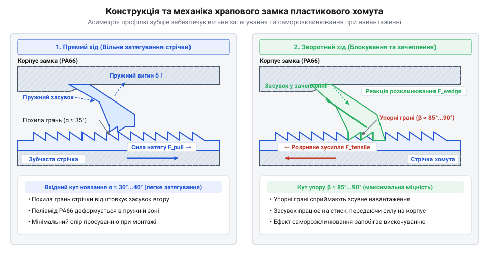
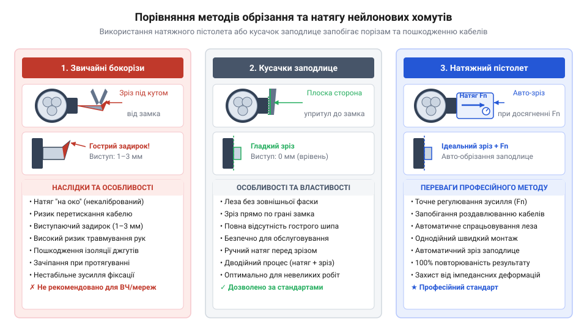

# Хомути пластикові

<preknowlist>
- [Ethernet-кабель RJ45](root:cat-hw-parts/ethernet-cable) — чутливість геометричного розташування провідників до радіального тиску та вплив деформації ізоляції на хвильовий імпеданс лінії
- [Органайзер кабелів (стрічка)](root:cat-hw-parts/cable-organizer) — принципи групування та бандлування провідників у джгути для запобігання відносного зміщення
- [Монтажний провід 18 і 20 AWG](root:cat-hw-parts/hookup-wire) — конструктивні особливості зовнішньої полімерної ізоляції та її поведінка під точковим притискним навантаженням
</preknowlist>

## Некеровані джгути та вібраційний знос

У рухомих механізмах вільно прокладені провідники, як-от [монтажний провід](root:cat-hw-parts/hookup-wire) чи [сигнальний кабель JST-GH](root:cat-hw-parts/jst-gh-cable), хаотично зміщуються відносно один одного та металевого каркаса. Сухе тертя оболонок стирає полімер, спричиняючи пробій на корпус або коротке замикання між жилами.

У точках кріплення до плати чи роз'єму незафіксований джгут зазнає знакоперемінних вигинів. Концентрація циклічних напружень біля паяння чи кримпування накопичує дислокації в кристалічній ґратці міді, викликаючи втомний перелом дротів усередині неушкодженої ізоляції. Для захисту від зносу та розподілу вібрацій провідники жорстко об'єднують у єдиний пучок.

## Механіка храпового замка та стрічки

Полімерний хомут складається з гнучкої стрічки з пилоподібним профілем та замкової голівки з пружним язичком. Разом вони утворюють (від німецького *Ratsche*): @@uk|храповий замок@@. Під час затягування похилі грані зубців віджимають язичок. При зворотному натягу прямовисний кут зубця впирається в засув, викликаючи клинове заклинювання фіксатора в міжзубній западині.

*Механіка заклинювання пружного язичка храпового замка в міжзубних западинах стрічки хомута під дією зворотного натягу.*

Граничне радіальне зусилля розширення пучка визначає колова розривна міцність замкового вузла, за якої відбувається розрив стрічки або зріз полімерного зубця фіксатора.

## Фізико-хімічні властивості поліаміду PA66

Стандартні хомути виготовляють із полімеру @@uk|поліамід PA66@@ (від грецького *polys* та французького *Амід*). У нормальних умовах він поглинає до 2.5% води, яка розриває міжланцюгові водневі зв'язки. Ця @@uk|зв'язана вода@@ працює як природний @@uk|пластифікатор@@ (від латинського *plasticus* — придатний для ліплення), надаючи стрічці гнучкості. На морозі чи в сухому повітрі волога випаровується — відновлена жорстка сітка зв'язків робить хомут крихким, і він тріскається при вигинанні.

Сонячне @@uk|УФ-випромінювання@@ (від латинського *ultra* — понад) розриває вуглецеві зв'язки полімерного ланцюга фотонами високої енергії. Ця @@uk|фотоокиснювальна деградація@@ (від грецького *photos* та *oxys*) викликає пожовтіння, мікротріщини й втрату міцності.

## Модифікації для складних умов експлуатації

Для протидії сонячному випромінюванню до поліаміду додають 2–3% сажі — @@uk|технічний вуглець@@. Його частки поглинають кванти світла й розсіюють їх як тепло, утворюючи @@en|УФ-стабілізовані нейлонові стяжки@@ для зовнішніх робіт. За температур понад +150 °C використовують високотемпературні полімери PA46, ETFE або PEEK.

Для тимчасового монтажу застосовують багаторазові хомути, чий @@en|важіль розблокування@@ відводить пружний язичок замка. Для важконавантажених джгутів використовують хомути, у замку яких @@en|металевий фіксуючий зуб@@ із нержавіючої сталі врізається в гладеньку стрічку, забезпечуючи безступінчастий натяг і підвищену міцність.

## Інструментальне бандлування та захист ліній

Для нормованого обтискання джгутів застосовують @@en|бандлування@@ за допомогою пристрою @@en|натяжний пістолет@@. Він затягує стрічку із заданим зусиллям і автоматично обрізає хвостовик урівень із голівкою. Використання звичайних бокорізів залишає гострі заусенці, тому для безпечного підрізання застосовують @@en|кусачки заподлице@@ з плоскими кромками.

*Використання натяжного пістолета для нормованого обтискання та підрізання стрічки хомута кусачками заподлице.*

Контроль зусилля затягування критичний для високочастотних ліній. Перетискання таких кабелів, як [Ethernet-кабель RJ45](root:cat-hw-parts/ethernet-cable), деформує діелектрик і змінює відстань між парами, що локально знижує @@en|хвильовий імпеданс@@, викликає @@en|зворотні втрати@@ сигналу та @@en|перехресні наводки@@. Пересохлі хомути рекондиціонують зволоженням — витримують у герметичному пакеті з 1–2% води за масою протягом 24–48 годин. Для захисту трас у вібронавантажених вузлах під стрічку підкладають [силіконові демпфери](root:cat-hw-parts/wire-rope-isolators), а хомут монтують через [нарізні втулки та футорки](root:cat-hw-parts/threaded-inserts-and-heat-set).