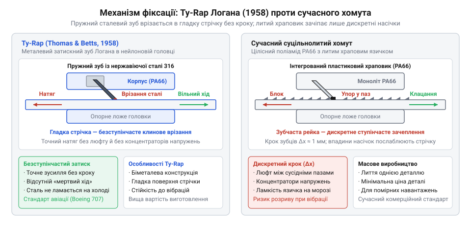
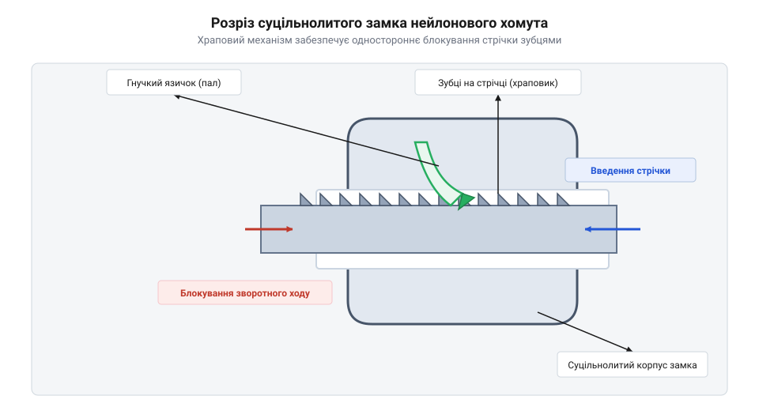

# Історія винайдення кабельних стяжок Ty-Rap та еволюція нейлонових хомутів

## Хаос дротів у Boeing 707

У середині двадцятого століття авіаційна промисловість стикнулася з проблемою складності електричних мереж у нових літаках. Наприклад, у пасажирському лайнері Boeing 707 довжина кабельних трас сягала десятків кілометрів, і всі ці дроти потрібно було надійно зібрати в джгути. Для цього робітники, переважно жінки, використовували вощену капронову нитку, вручну перев'язуючи кабелі вузлами через кожні кілька сантиметрів. Цей процес був украй повільним і вимагав неабиякої спритності та фізичних зусиль.

Постійне затягування тугих вузлів призводило до того, що нитка глибоко врізалася в шкіру. До кінця зміни руки робітників часто вкривалися порізами, а пальці збивалися до крові, навіть попри використання захисних пластирів. Крім того, такий метод бандлування робив ремонт вкрай незручним. Якщо потрібно було замінити один дріт у готовому джгуті, технікам доводилося розрізати весь ланцюг вузлів на довгій ділянці, а потім знову перев'язувати все вручну. Окрім ергономічних проблем, саме неперервне шнурування (cable lacing) на складальних плазах створювало серйозну загрозу в експлуатації: через постійну вібрацію в польоті пошкодження чи перетирання хоча б однієї вощеної нитки призводило до розпускання всього вузла, оголюючи дроти та спричинюючи їхнє замикання. Потреба в швидкому, безпечному та надійному способі фіксації проводки стала гострою.

## Металевий замок перших Ty-Rap

У 1958 році Маурус Логан (en|Maurus Logan@@), працівник компанії@@en|Thomas & Betts@@, який неодноразово бачив порізані руки працівниць на заводах Boeing під час зав'язування джгутів вощеною ниткою, запропонував кардинально нове рішення. Він винайшов першу кабельну стяжку, яка отримала назву @@en|Ty-Rap@@. Потреба в надійному і безпечному бандлуванні великої кількості дротів у сучасних авіаційних конструкціях вимагала відходу від ручних вузлів, що травмували пальці й вимагали надмірної праці.

Конструкція першої стяжки була двокомпонентною: стрічка виготовлялася з гнучкого пластику, а всередині головки розташовувався невеликий затискний металевий зуб (en|metal pawl@@), виготовлений з неіржавної сталі.

*Схема першої стяжки Логана в розрізі, де видно металевий затискний зуб всередині головки.*

Цей зуб діяв за принципом зворотного клапана завдяки продуманій геометрії та точному куту нахилу сталевого зуба. Коли вільний кінець стрічки протягували крізь головку, гладка поверхня стрічки вільно ковзала по металевій пластині без помітного опору. Проте, якщо спробувати потягнути стрічку в зворотному напрямку, виникав ефект самозаклинювання: гострий край металевого зуба під кутом врізався в тіло пластикової стрічки та надійно блокував будь-який рух назад. Така механіка забезпечувала міцну одноразову фіксацію хомута, дозволяючи миттєво затягнути джгут до потрібного діаметра та зафіксувати його без зав'язування вузлів. 

Хоча процес монтажу став значно швидшим і безпечнішим, виробництво таких стяжок із вбудованою металевою деталлю залишалося технологічно складним і дорогим через необхідність точного закладання сталевого зуба в пластикову головку під час лиття.

## Суцільнолитий нейлон та поліамід-66

Наступним кроком в еволюції кабельних стяжок стала відмова від металевого зуба на користь повністю пластикової конструкції. Цей перехід став можливим завдяки використанню поліаміду-66 — міцного, зносостійкого та водночас достатньо пружного синтетичного полімеру, відомого як нейлон. Властивості цього матеріалу дозволили відливати стяжку як єдину суцільну деталь, що значно спростило і здешевило масове виробництво.

*Розріз суцільнолитого замка сучасного нейлонового хомута.*

Замість металевої пластини в головці почали формувати гнучкий пластиковий язичок, а на самій стрічці — ряд поперечних зубців. Під час затягування храповий механізм дозволяв язичку перескакувати через зубці, видаючи характерний тріск. Під навантаженням у зворотному напрямку язичок впирався у вертикальну стінку зубця, міцно блокуючи стрічку. Поліамід-66 забезпечив замку необхідну жорсткість на розрив і гнучкість для легкого монтажу, перетворивши суцільнолитий нейлоновий хомут на універсальний стандарт для кріплення кабелів.

## Інструменти монтажу та УФ-стабілізація
З поширенням суцільнолитих нейлонових хомутів ручне затягування перестало задовольняти промисловість. Працівники витрачали багато часу на затягування кожної стяжки та обрізання залишку стрічки ножем або кусачками, що залишало гострі краї. Ці краї могли пошкодити ізоляцію сусідніх дротів або травмувати руки під час обслуговування. Щоб розв'язати цю проблему, інженери розробили спеціальні монтажні пістолети. Інструмент захоплював хвіст хомута, автоматично затягував його із заданим зусиллям і зрізав залишок урівень із головкою. Це забезпечило однакову силу затягування для всього джгута та безпеку готової кабельної траси, перетворивши стяжку на масовий стандарт монтажу.

Ще одним викликом стала вразливість нейлону до сонячного світла. Звичайний поліамід-66 під дією ультрафіолету швидко ставав крихким і руйнувався, що робило стяжки непридатними для використання просто неба. Хіміки знайшли рішення у додаванні сажі до полімерної маси під час відливання. Дрібнодисперсний вуглець поглинав ультрафіолетове випромінювання, захищаючи молекулярну структуру нейлону від деградації. Так з'явилися чорні УФ-стабілізовані кабельні стяжки, які витримували роки впливу сонця і дозволили прокладати кабельні траси на відкритому повітрі.

## Справжні автори та поширені міфи
В історії створення кабельних стяжок часто виникає плутанина щодо авторства винаходу. Найпоширеніший міф приписує винахід суцільнолитого пластикового хомута самому Маурусу Логану, автору оригінальної ідеї. Проте перший патент Логана, поданий у 1958 році, описував лише стяжку з металевим затискним зубом — Ty-Rap. Суцільнолитий нейлоновий хомут із пластиковим храповим механізмом, який став світовим стандартом, був запатентований пізніше іншими інженерами, зокрема компанією Dennison Manufacturing, яка у 1968 році запропонувала конструкцію без металевих деталей.

Інший поширений міф полягає в тому, що стяжки від початку розроблялися як універсальний кріпильний інструмент для будівництва чи побуту. Насправді єдиною метою перших розробок було впорядкування складної проводки в авіації, зокрема у літаках Boeing. Лише здешевлення виробництва завдяки переходу на повністю пластикове лиття зробило хомути доступними для інших галузей. Достовірна патентна історія показує, що еволюція кабельних стяжок була результатом колективної інженерної роботи багатьох компаній, кожна з яких вдосконалювала механізм замикання та матеріали, а не результатом одного раптового осяяння.