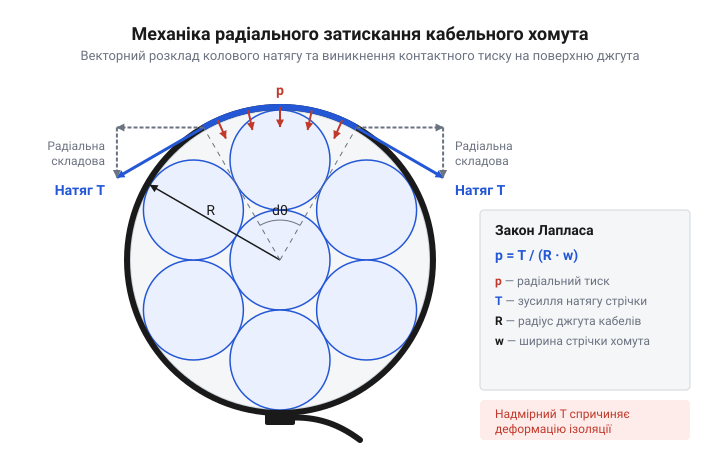
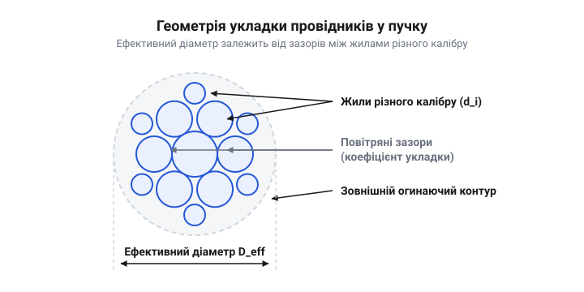

# Розрахунок розривного зусилля, контактного тиску та геометричних параметрів джгута

<preknowlist>
- [Монтажний провід 18 і 20 AWG](root:cat-hw-parts/hookup-wire) — геометричні калібри AWG, товщина полімерної ізоляції та геометрична площа перерізу струмопровідних жил
- [Ethernet-кабель RJ45](root:cat-hw-parts/ethernet-cable) — геометрія кручених пар, механічна чутливість діелектрика та вимоги до стабільності хвильового імпедансу 100 Ом
- [Органайзер кабелів (стрічка)](root:cat-hw-parts/cable-organizer) — базові способи групування провідників та відмінності між м'яким бандажуванням і жорсткою фіксацією хомутами
</preknowlist>

## Некероване стягування та пошкодження кабельних джгутів

Під час монтажу електронного обладнання, міжплатних з'єднань або кабельних мереж зазвичай виникає потреба об'єднати окремі провідники у впорядковані пучки. Застосування нейлонових кабельних хомутів здається найпростішим рішенням, однак затягування хомута вручну «на око» без попереднього розрахунку створює приховані ризики для надійності системи. Коли монтажник прикладає максимальне зусилля руки, затягуючи стрічку хомута до упору, у зоні фіксації виникає надмірний радіальний контактний тиск (від латинського *radialis* — променевий та *contactus* — доторк): @@en|radial contact pressure@@. Цей тиск не просто стискає зовнішні оболонки дротів, а викликає незворотну геометричну деформацію внутрішньої ізоляції провідників.

Найбільш чутливими до механічного стискання є високочастотні лінії передачі даних, такі як [Ethernet-кабель RJ45](root:cat-hw-parts/ethernet-cable) або диференційні [кабелі USB](root:cat-hw-parts/usb-cables). В основі передачі високочастотного сигналу лежить хвильовий імпеданс (від латинського *impedio* — перешкоджаю): @@en|characteristic impedance@@. Хвильовий імпеданс ліній визначається геометричними параметрами перерізу — відстанню між центрами струмопровідних жил `s`, їхнім зовнішнім діаметром `d` та відносною діелектричною проникністю `ε_r` ізоляційного матеріалу (наприклад, спіненого поліетилену чи фторопласту). Диференційний імпеданс описується виразом:

`Z_0 = (120 / √ε_r) × ln(2 × s / d)`

Коли хомут передавлює кабельний джгут, м'який діелектрик між парами провідників зминається, через що міжосьова відстань `s` локально зменшується. Зменшення відстані `s` призводить до локального падіння хвильового імпедансу `Z_0` у місці затискання.

Наслідки геометричного зсуву імпедансу виявляються у появі імпедансної неоднорідності (від українського *не-* та *однорідність*): @@en|impedance mismatch@@. Високочастотна хвиля, поширюючись уздовж лінії, частково відбивається від ділянки зі зниженим імпедансом назад до джерела сигналу. Це викликає зростання зворотних втрат (від англійського *return loss*): @@en|return loss@@, спотворення форми електричних імпульсів, міжсимвольну інтерференцію та різке зростання коефіцієнта бітових помилок у швидкісних інтерфейсах. Крім того, сплющення захисних екранів із фольги чи оплетки зменшує коефіцієнт екранування, що призводить до міжпровідникових наводок (від англійського *crosstalk*): @@en|crosstalk@@.

Друга критична проблема некерованого стягування пов'язана з довготривалою механічною деградацією ізоляції в силових та сигнальних колах, де використовуються [монтажний провід 18 AWG](root:cat-hw-parts/hookup-wire) або [сигнальний кабель JST-GH](root:cat-hw-parts/jst-gh-cable). Полімерні оболонки жил (полівінілхлорид, поліолефіни) під дією постійного контактного тиску демонструють явище пластичної текучості (від англійського *cold flow* — холодна текучість): @@en|cold flow@@ чи механічної релаксаційної повзучості (від англійського *creep*): @@en|creep@@. Під вузькою стрічкою хомута полімер повільно видавлюється з зони стискання з перебігом часу, особливо за підвищеної робочої температури чи вібрації. Товщина ізоляційної стінки неперервно зменшується, що зрештою призводить до електричного пробою на металевий корпус або короткого замикання між сусідніми жилами.

Фізичний механізм виникнення радіального тиску при затягуванні стрічки хомута описується за аналогією до тонкостінних циліндричних оболонок за формулою Лапласа. Зусилля натягу стрічки `F_t` перетворюється на нормальний радіальний тиск `P_r`, який діє на циліндричну поверхню джгута ефективного діаметра `D_eff` при ширині стрічки хомута `w`:

`P_r = (2 × F_t) / (D_eff × w)`


*Схема розподілу колового зусилля натягу стрічки хомута та виникнення радіального контактного тиску на циліндричну поверхню джгута.*

Розглянемо практичний приклад. При ручному затягуванні хомута за допомогою звичайних плоскогубців або пальців без контролю зусилля натяг стрічки легко досягає `F_t = 120 Н`. Якщо хомут стандартної ширини `w = 2.5 мм` охоплює компактний джгут діаметром `D_eff = 8 мм`, контактний тиск становить:

```
P_r = (2 × F_t) / (D_eff × w)
    = (2 × 120) / (0.008 × 0.0025)             [підстановка параметрів натягу та геометрії]
    = 240 / 0.000020                           [проміжне ділення]
    = 12 000 000 Па                            [обчислення тиску в паскалях]
    = 12 МПа                                   [підсумковий контактний тиск]
```

Значення `12 МПа` суттєво перевищує границю плинності для більшості монтажних ізоляційних матеріалів (`0.5 – 2.0 МПа`), що неминуче спричиняє роздавлювання ізоляції. Для запобігання деформації ліній застосовують м'яке бандажування, де регульоване групування забезпечує [органайзер кабелів](root:cat-hw-parts/cable-organizer), або ж проводять точний розрахунок гранично припустимого зусилля затягування хомута, виходячи з геометрії джгута та механічних характеристик фіксатора.

## Геометричний розрахунок перерізу та діаметра джгута

Щоб обчислити радіальний контактний тиск та підібрати хомут належної довжини й ширини, необхідно перш за все визначити точні геометричні розміри джгута. Реальний кабельне пакування у виробах містить провідники різних калібрів — силові жили великого перерізу, сигнальні дрібнокаліберні дроти та екрановані кабелі передачі даних.

Обчислення сумарного перерізу джгута починається з розрахунку зовнішньої площі кожного провідника з урахуванням товщини його ізоляційної оболонки. Якщо джгут складається з `N` провідників, де кожен `i`-й провідник має зовнішній діаметр `d_i`, то площа його зовнішнього колового перерізу дорівнює:

`A_i = π × d_i² / 4`

Сумарна площа перерізу всіх струмопровідних елементів та їхніх оболонок визначається як алгебраїчна сума:

`A_total = ∑ [i=1..N] (π × d_i² / 4)`

Однак у реальному джгуті круглі провідники не можуть заповнити весь об'єм без проміжків: між циліндричними поверхнями суміжних ізоляцій обов'язково залишаються повітряні порожнини. Для врахування щільності упаковки використовують коефіцієнт укладки (від латинського *coefficiens* — той, що сприяє): @@en|packing factor@@ / @@en|packing fraction@@ `K_p`. Цей коефіцієнт показує відношення корисної площі провідників до повної площі описаного кола джгута:

`K_p = A_total / A_bundle`

Величина коефіцієнта укладки `K_p` залежить від способу розміщення дротів у пучку:
- Квадратна укладка (квадратна сітка розташування центрів): `K_p = π / 4 ≈ 0.7854`. - Гексагональна щільна укладка (від грецького *hex* — шість та *gonia* — кут): @@en|hexagonal packing@@, де центри дротів утворюють трикутну сітку: `K_p = π / (2 × √3) ≈ 0.9069`. - Реальний багатокаліберний джгут із довільним вкладанням та гнучкими провідниками: `K_p ≈ 0.65 – 0.75`. На практиці для розрахунків приймають усереднене значення `K_p = 0.70`.

Знаючи сумарну площу жил `A_total` та коефіцієнт укладки `K_p`, можна визначити повну ефективну площу перерізу джгута `A_bundle`:

`A_bundle = A_total / K_p`

Виходячи з отриманої площі `A_bundle`, ефективний еквівалентний діаметр джгута `D_eff` обчислюється як діаметр описаного циліндричного кола:

`D_eff = √(4 × A_bundle / π) = √(4 × A_total / (π × K_p))`


*Геометрія укладки провідників у пучку та визначення ефективного еквівалентного діаметра джгута з урахуванням коефіцієнта щільності.*

Розглянемо практичний геометричний розрахунок для комбінованого міжплатного джгута.

**Умова розрахунку:**
Пучок містить 4 силові провідники [монтажний провід 18 AWG](root:cat-hw-parts/hookup-wire) із зовнішнім діаметром ізоляції `d_1 = 2.1 мм`, 6 сигнальних провідників [монтажний провід 20 AWG](root:cat-hw-parts/hookup-wire) із зовнішнім діаметром `d_2 = 1.8 мм` та 1 [Ethernet-кабель RJ45](root:cat-hw-parts/ethernet-cable) із зовнішнім діаметром `d_3 = 6.0 мм`. Приймаємо коефіцієнт укладки джгута `K_p = 0.70`.

Покрокове визначення еквівалентного діаметра виконується за таким розрахунковим алгоритмом:

```
A_1 = 4 × (π × 2.1² / 4)
    = 4 × 3.4636                               [площа 4 провідників 18 AWG]
    = 13.854 мм²                               [сумарна площа першої групи]

A_2 = 6 × (π × 1.8² / 4)
    = 6 × 2.5447                               [площа 6 провідників 20 AWG]
    = 15.268 мм²                               [сумарна площа другої групи]

A_3 = 1 × (π × 6.0² / 4)
    = 1 × 28.274                               [площа одного кабелю Ethernet]
    = 28.274 мм²                               [площа третьої групи]

A_total = A_1 + A_2 + A_3
        = 13.854 + 15.268 + 28.274             [сумування площ усіх складників]
        = 57.396 мм²                           [сумарна фізична площа провідників]

A_bundle = A_total / K_p
         = 57.396 / 0.70                       [урахування коефіцієнта укладки K_p]
         = 81.994 мм²                          [повна ефективна площа джгута]

D_eff = √(4 × A_bundle / π)
      = √(4 × 81.994 / 3.14159)                [обчислення еквівалентного діаметра]
      = √(104.398)                             [підкореневе значення]
      = 10.217 мм                              [підсумковий еквівалентний діаметр]
```

Отриманий еквівалентний діаметр `D_eff ≈ 10.22 мм` виступає базовим параметром для розрахунку механіки затискання, вибору довжини стрічки хомута та визначення граничного контактного тиску на провідники.

## Механіка розривного зусилля замкового фіксатора

Знаючи геометричні параметри джгута, розглянемо механічні обмеження самого затискного елемента. Полімерний кабельне хомут складається з гнучкої зубчастої стрічки та замкової голівки, усередині якої розміщено пружний зубчастий фіксатор (язичок замка). Для виготовлення більшості промислових хомутів застосовують поліамід PA66 (від грецького *полі-* — багато та німецького *Амід*): @@en|polyamide PA66@@.

Головним паспортним показником механічної міцності хомута є колове розривне зусилля (від англійського *loop tensile strength*): @@en|Loop Tensile Strength@@ (`F_loop`). Колові розривні зусилля визначають максимальну зовнішню радіальну силу розширення, яку здатний витримати закритий хомут, зафіксований навколо розсувного випробувального циліндра до моменту руйнування.

Розподіл сил у замковому вузлі має чітку геометричну залежність. Оскільки стрічка хомута утворює замкнену петлю навколо циліндричного джгута, розтягувальне зусилля натягу `F_t`, що діє всередині самій стрічки (@@en|strap tension@@), пов'язане з сумарним коловим зусиллям `F_loop` співвідношенням:

`F_loop = 2 × F_t`

Звідси зусилля розтягу стрічки та замка дорівнює:

`F_t = F_loop / 2`

Руйнування замкового з'єднання хомута під дією колового навантаження може відбуватися за двома механізмами:
1. Розрив стрічки по живому перерізу від розтягувального напруження (від латинського *tensio* — розтяг): @@en|tensile stress@@ `σ`. 2. Зріз полімерного зубця замка від напруження зрізу (від англійського *shear stress*): @@en|shear stress@@ `τ`.

Розтягувальне напруження `σ` у стрічці шириною `w` та товщиною `t` становить:

`σ = F_t / (w × t) = F_loop / (2 × w × t)`

Для поліаміду PA66 межа міцності на розтяг (від англійського *ultimate tensile strength*) становить `σ_ult ≈ 70 – 85 МПа`. Однак на практиці геометричний переріз стрічки розраховують із запасом, тому у 90% випадків хомут руйнується не через розрив стрічки, а через зріз замкового зубця фіксатора.

Зріз зубця фіксатора відбувається по площині основи його контакту із зубцями стрічки. Площа зрізу замка `A_shear` обчислюється як:

`A_shear = b × l_shear × n`

де `b` — ширина контактного зубця фіксатора, `l_shear` — довжина основи зубця вздовж лінії зрізу, `n` — кількість активних зубців фіксатора, що одночасно перебувають у зачепленні.

Напруження зрізу `τ`, що діє на язичок замка під дією натягу `F_t`, дорівнює:

`τ = F_t / A_shear = F_t / (b × l_shear × n)`

Для поліаміду PA66 допустиме напруження зрізу становить `τ_ult ≈ 45 – 55 МПа`. Коли напруження `τ` досягає граничного значення `τ_ult`, зубець фіксатора зрізається, і стрічка вільно проскочує крізь замкову голівку.

Поєднуючи розрахунок зусилля натягу `F_t` із формулою Лапласа з першого розділу, ми можемо встановити прямий зв'язок між паспортним коловим зусиллям `F_loop`, еквівалентним діаметром джгута `D_eff` та нормальним контактним тиском `P_r`:

`P_r = (2 × F_t) / (D_eff × w) = F_loop / (D_eff × w)`

Проведемо покроковий розрахунок механічної міцності замка та контактного тиску для хомута.

**Умова розрахунку:**
Використовується стандартний малогабаритний хомут із поліаміду PA66 із паспортним розривним зусиллям `F_loop_rated = 80 Н` (8 кг). Ширина стрічки `w = 2.5 мм`, товщина стрічки `t = 1.0 мм`. Замок має один фіксатор (`n = 1`) з шириною зубця `b = 2.2 мм` та довжиною основи зрізу `l_shear = 0.8 мм`. Хомут встановлено на джгут з еквівалентним діаметром `D_eff = 10.22 мм` (із розрахунку другого розділу).

Покроковий математичний розрахунок напружень та тиску виконується за таким алгоритмом:

```
F_t_max = F_loop_rated / 2
        = 80 / 2                               [зусилля розтягу стрічки при розриві замка]
        = 40 Н                                 [максимальне розтягувальне зусилля стрічки]

σ_strap = F_t_max / (w × t)
        = 40 / (0.0025 × 0.0010)               [напруження розтягу в перерізі стрічки]
        = 16 000 000 Па                        [обчислення в паскалях]
        = 16 МПа                               [напруження в стрічці значно нижче σ_ult = 75 МПа]

A_shear = b × l_shear × n
        = 2.2 × 0.8 × 1                        [площа зрізу основи замкового зубця]
        = 1.76 мм²                             [площа зрізу в квадратних міліметрах]

τ_pawl = F_t_max / (A_shear × 10⁻⁶)
       = 40 / (1.76 × 10⁻⁶)                    [напруження зрізу замкового зубця]
       = 22 727 273 Па                         [значення напруження в паскалях]
       = 22.73 МПа                             [робоче напруження зрізу фіксатора]

P_r_max = (2 × F_t_max) / (D_eff × w)
        = (2 × 40) / (0.01022 × 0.0025)        [максимальний тиск при руйнуванні хомута]
        = 80 / 0.00002555                      [проміжне ділення]
        = 3 131 115 Па                         [тиск Лапласа на поверхню джгута]
        = 3.13 МПа                             [граничний радіальний тиск при розриві]
```

**Інженерний висновок:**
Якщо монтажник затягує даний хомут динамометричним пістолетом із нормованим зусиллям `F_t = 20 Н` (що відповідає половині від розривного `F_t_max`), то контактний тиск на джгут становитиме `P_r = (2 × 20) / (0.01022 × 0.0025) = 1.57 МПа`.

Якщо для того самого джгута (`D_eff = 10.22 мм`) та при тому самому зусиллі натягу `F_t = 20 Н` обрати більш широкий хомут із `w = 4.8 мм`, контактний тиск зменшиться:

`P_r = (2 × 20) / (0.01022 × 0.0048) = 0.81 МПа`

Таким чином, збільшення ширини хомута вдвічі знижує радіальний контактний тиск майже у 2 рази при збереженні того самого зусилля фіксації. Це математично доводить, що для захисту чутливих проводів у вузлах, де встановлено [розʼєми JST-SM](root:cat-hw-parts/jst-sm-connectors) або [кабельні шлейфи](root:cat-hw-parts/industrial-pendant-cable-harnessing-and-shielding), слід обирати широкі хомути та застосовувати монтувальний інструмент із точним калібруванням зусилля натягу.

## Перетворення натягу стрічки в радіальний тиск

При бандажуванні провідників поздовжнє зусилля затягування стрічки хомута безпосередньо не тисне на кабель, а діє вздовж її периметра. Однак через кривину циліндричної поверхні джгута це колове напруження перетворюється на стискальне радіальне напруження, спрямоване до центру пучка. Механіка цього перетворення описується рівнянням Лапласа (@@en|Laplace equation@@) для тонкостінних циліндричних оболонок під зовнішнім тиском.

Розглянемо малий ділянку стрічки шириною `w`, що охоплює джгут радіуса `R` (або ефективного діаметра `D = 2 · R`) під кутом `dθ`. На кожен кінець цього нескінченно малого сегмента довжиною `dL = R · dθ` діє поздовжнє зусилля натягу `T`. Векторна сума обох сил `T`, спрямованих по дотичних до кола, дає радіальну результуючу силу `dFᵣ`, орієнтовану строго до центру джгута:

```
dFᵣ = 2 · T · sin(dθ / 2)
= 2 · T · (dθ / 2)             [для малих кутів sin(dθ / 2) ≈ dθ / 2]
= T · dθ                       [спрощення виразу для радіальної сили]
```

Ця результуюча сила діє на площу контакту `dA`, яка дорівнює добутку ширини стрічки `w` на довжину дуги `R · dθ`. Визначаючи радіальний контактний тиск `P` як відношення нормальної сили `dFᵣ` до площі контакту `dA`, отримуємо вивід формули:

```
P = dFᵣ / dA
= (T · dθ) / (w · R · dθ)      [підстановка dFᵣ та dA = w · R · dθ]
= T / (w · R)                  [скорочення dθ]
= 2 · T / (w · D)              [підстановка радіуса R = D / 2]
```

Отриманий вираз показує, що нормальний тиск `P` на зовнішню ізоляцію провідників пропорційний коловому натягу `T` і обернено пропорційний ширині стрічки `w` та діаметру джгута `D`.


*Розподіл поздовжнього зусилля натягу T по ширині стрічки w та виникнення радіального контактного тиску P на циліндричний джгут радіуса R.*

З рівняння Лапласа випливає критичний геометричний параметр, про який часто забувають при бандажуванні: радіус джгута `R`. Для одного й того ж затяжного зусилля `T = 100 Н` та ширини стрічки `w = 4.8 мм` тиск на тонкий джгут діаметром `D = 6 мм` буде утричі вищим, ніж на товстий джгут діаметром `D = 18 мм`. Тонкі пучки, в яких прокладено [сигнальні JST-GH кабелі](root:cat-hw-parts/jst-gh-cable) або поодинокі провідники, зазнають екстремальних локальних напружень навіть при незначному натягу стрічки. Використання ширшої стрічки `w` дозволяє пропорційно збільшити площу контакту й суттєво знизити контактний тиск без зменшення фіксувального зусилля.

**Розрахунок тиску для джгутів різного діаметра:**
Розглянемо джгут, в якому згруповано [стандартний монтажний провід](root:cat-hw-parts/hookup-wire) до діаметра `D₁ = 16 мм` (`R₁ = 8 мм = 0.008 м`), та одиночну гілку діаметром `D₂ = 5 мм` (`R₂ = 2.5 мм = 0.0025 м`). Обидва вузли затягуються хомутом шириною `w = 4.5 мм` (`0.0045 м`) із зусиллям натягу `T = 135 Н`.

Обчислимо радіальний тиск `P₁` для товстого джгута:

```
P₁ = 135 / (0.0045 · 0.008)
= 135 / 0.000036               [обчислення знаменника площі]
= 3 750 000 Па                 [результат у паскалях]
= 3.75 МПа                     [переведення в мегапаскалі]
```

Тепер обчислимо тиск `P₂` для тонкої гілки:

```
P₂ = 135 / (0.0045 · 0.0025)
= 135 / 0.00001125             [обчислення знаменника площі]
= 12 000 000 Па                [результат у паскалях]
= 12.0 МПа                     [переведення в мегапаскалі]
```

Розрахунок демонструє, що на тонкій гілці тиск сягає `12.0 МПа`, що перевищує межу плинності м'якого полівінілхлориду (`8–10 МПа`) і призводить до незворотної витискальної деформації ізоляції. Замість стягування вузькими пластиковими хомутами для тонких ліній доцільніше застосовувати [гнучкий органайзер кабелів](root:cat-hw-parts/cable-organizer), який рівномірно розподіляє навантаження вздовж всієї довжини.

## Розрахунок граничного стискання та збереження імпедансу

Під дією радіального тиску `P` м'які діелектрики кабелів деформуються, що змінює взаємне розташування струмопровідних жил. У високочастотних лініях, таких як [високочастотний Ethernet-кабель RJ45](root:cat-hw-parts/ethernet-cable) або [екран USB-кабелів](root:cat-hw-parts/usb-cables), хвильовий імпеданс `Z₀` (@@en|characteristic impedance@@) визначається геометричним відношенням між провідниками та діелектричною проникністю ізолятора `εᵣ` (@@en|dielectric permittivity@@). Для крученої пари з діаметром жили `d` та міжосьовою відстанню `s` хвильовий імпеданс описується формулою:

```
Z₀ = (120 / √εᵣ) · ln(2 · s / d)
```

Коли радіальний тиск перевищує пружну межу полімеру (поліетилену або фторопласту), відбувається овалізація (від франц. *ovale* — овальний; @@fr|ovalisation@@) перерізу. Відстань `s` між паралельними жилами зменшується до `s' = s · (1 - δ)`, де `δ = Δs / s` — відносна деформація стискання. Зменшення `s` безпосередньо знижує чисельник під знаком логарифма, через що місцевий імпеданс `Z₀` падає нижче номінальних `100 Ом` (наприклад, до `82–88 Ом`).

Такий локальний перепад імпедансу утворює геометричну та електричну імпедансну неоднорідність. Сигнал високої частоти, досягаючи стиснутої ділянки під хомутом, частково відбивається назад до джерела. Це спричиняє зростання зворотних втрат (@@en|return loss@@) та спотворення амплітудно-частотної характеристики за рахунок збільшення внесених втрат (@@en|Insertion Loss@@). У швидкісних інтерфейсах це проявляється як втрата пакетів, падіння швидкості передачі даних або повна втрата лінку.


*Зміна геометрії міжпровідникової відстані s та овалізація ізоляції під тиском P, що викликає імпедансний зсув Z₀.*

Щоб запобігти неприпустимому відхиленню імпедансу `ΔZ₀ / Z₀`, відносна деформація діелектрика не повинна перевищувати граничного значення `δ_max` (зазвичай `3–5 %` для стандартів Cat6/Cat6A). Зв'язок між радіальним тиском `P` та деформацією `δ` в області малих пружних деформацій визначається модулем Юнга `E` (@@en|Young's Modulus@@) матеріалу ізоляції:

```
P_max = E · δ_max
```

Підставляючи `P_max` у виведене рівняння Лапласа `P = 2 · T / (w · D)`, дістаємо формулу для розрахунку гранично допустимого зусилля натягу стрічки `T_max`:

```
T_max = P_max · w · (D / 2)
= E · δ_max · w · (D / 2)       [підстановка P_max = E · δ_max]
= 0.5 · E · δ_max · w · D       [зведення коефіцієнтів]
```

**Розрахунок безпечного режиму моменту затягування:**
Припустимо, у трасу об'єднано сигнальні лінії та кабелі живлення [силових ліній XT](root:cat-hw-parts/xt-connectors). Сформовано джгут ефективним діаметром `D = 12 мм` (`0.012 м`). Ізоляція сигнальних кручених пар виконана з спіненого поліетилену з модулем пружності при стисканні `E = 75 МПа` (`75 × 10⁶ Па`). Для збереження відхилення імпедансу `ΔZ₀ ≤ 2 %` допустима деформація становить `δ_max = 0.03` (`3 %`). Бандажування виконується хомутом шириною `w = 3.6 мм` (`0.0036 м`).

Обчислимо граничний тиск `P_max`:

```
P_max = 75 000 000 · 0.03
= 2 250 000 Па                 [результат у паскалях]
= 2.25 МПа                     [переведення в мегапаскалі]
```

Тепер розрахуємо гранично допустиме зусилля натягу `T_max`:

```
T_max = 0.5 · 75 000 000 · 0.03 · 0.0036 · 0.012
= 2 250 000 · 0.0036 · 0.006    [підстановка радіуса R = 0.006 м]
= 48.6 Н                       [граничне зусилля затягування]
```

Звичайне ручне затягування хомута без каліброваного інструменту створює зусилля від `80` до `150 Н`, що у 2–3 рази перевищує розраховану межу `48.6 Н`. При бандажуванні комбінованих джгутів необхідно застосовувати спеціалізований монтажний пістолет-натягувач (від англ. *zip tie gun*; @@en|Zip Tie Gun@@) з регульованим динамометричним відсікачем. Якщо ж поруч проходять жорсткі [промислові кабельні шлейфи](root:cat-hw-parts/industrial-pendant-cable-harnessing-and-shielding) або важкі силові проводи, високочастотні лінії слід прокладати в окремому захисному рукаві або бандажувати з мінімальним фіксувальним натягом.